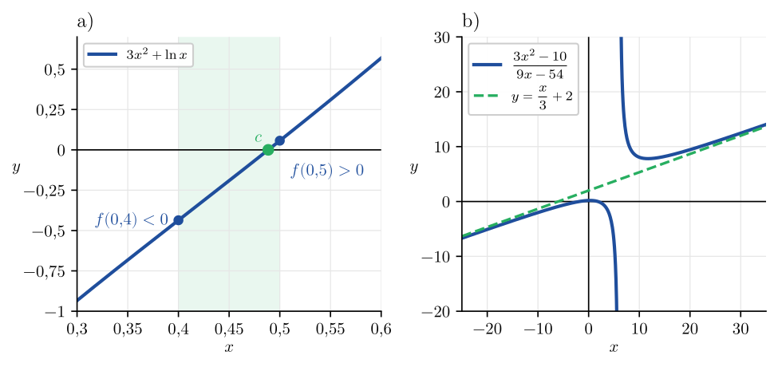
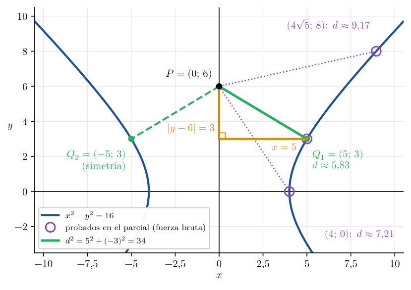
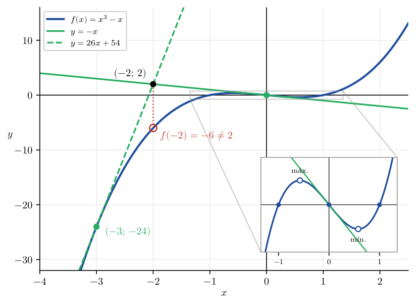
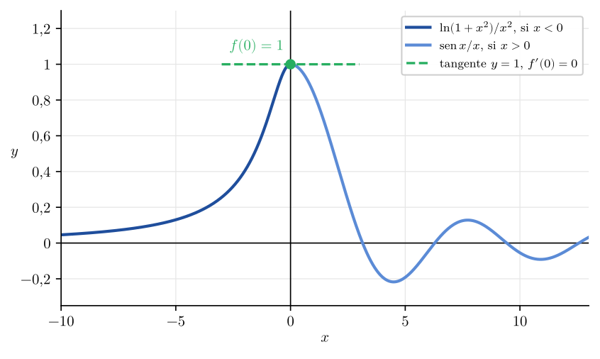
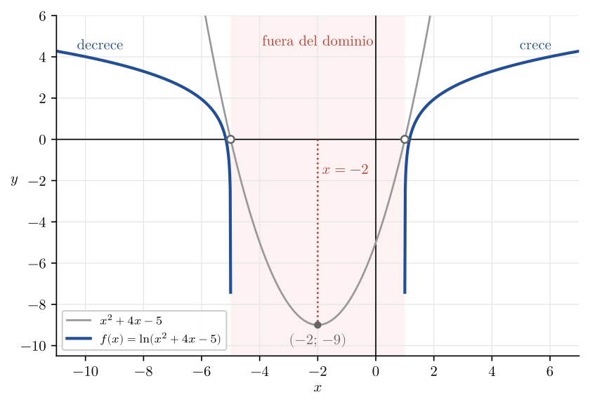

# Correcciones del 1er Parcial — Análisis Matemático I

Corrección de los errores del primer parcial rendido el **17 de octubre de 2026**. Los ejercicios 1, 3 y 5 coinciden con el modelo `1° parcial - Ejemplo 3.pdf`; el ejercicio 2 fue distinto (distancia mínima entre una curva y un punto) y el ejercicio 4 cambió la forma de escribir la rama $x > 0$ (en el parcial vino como $\frac{\operatorname{sen} x}{x}$).

---

## Ejercicio 1 — Verdadero o falso

### 1.1 Enunciado

> Indicar si las siguientes proposiciones son Verdaderas o Falsas, justificando la respuesta:
>
> a) $f(x) = 3x^2 + \ln x$ tiene al menos una raíz en su dominio.
>
> b) $\exists\, a, b \in \mathbb{R}$ tal que $y = \frac{x}{3} + 2$ es la ecuación de la asíntota oblicua al gráfico de $f(x) = \dfrac{3x^2 - 10}{ax + b}$.

### 1.2 Inciso a) — Teorema de Bolzano

El logaritmo exige $x > 0$: $D_f = (0;\,+\infty)$. En ese intervalo $f$ es continua, por ser suma de un polinomio y un logaritmo, ambos continuos.

Se evalúa en los extremos de $[0{,}4;\,0{,}5]$:

$$
\begin{aligned}
f(0{,}4) &= 3 \cdot 0{,}16 + \ln 0{,}4 \approx 0{,}48 - 0{,}92 = {\color{RoyalBlue} -0{,}44 < 0} \\
f(0{,}5) &= 3 \cdot 0{,}25 + \ln 0{,}5 \approx 0{,}75 - 0{,}69 = {\color{RoyalBlue} 0{,}06 > 0}
\end{aligned}
$$

$f$ es continua en $[0{,}4;\,0{,}5]$ y cambia de signo entre los extremos; por Bolzano existe

$$
{\color{ForestGreen}\boxed{c \in (0{,}4;\,0{,}5) \ / \ f(c) = 0}}
$$

> [!TIP]
> **Respuesta:** a) Verdadero: por Bolzano, $f$ tiene una raíz entre $0{,}4$ y $0{,}5$.

### 1.3 Inciso b) — Asíntota oblicua

La asíntota oblicua $y = mx + n$ se obtiene con dos límites. Pendiente, dividiendo $f$ por $x$:

$$
m = {\color{BrickRed} \lim_{x \to \infty} \frac{f(x)}{x}} = \lim_{x \to \infty} \frac{3x^2 - 10}{x\,(ax + b)} = \lim_{x \to \infty} \frac{3x^2 - 10}{ax^2 + bx} = {\color{RoyalBlue} \frac{3}{a}}
$$

Igualando a la pendiente de $y = \frac{x}{3} + 2$:

$$
\frac{3}{a} = \frac{1}{3} \implies {\color{ForestGreen}\boxed{a = 9}}
$$

Ordenada al origen, restando a $f$ el término $mx$:

$$
\begin{aligned}
n = {\color{BrickRed} \lim_{x \to \infty} \left[ f(x) - \frac{x}{3} \right]} &= \lim_{x \to \infty} \left[ \frac{3x^2 - 10}{9x + b} - \frac{x}{3} \right] \\
&= \lim_{x \to \infty} \frac{3\,(3x^2 - 10) - x\,(9x + b)}{3\,(9x + b)} \\
&= \lim_{x \to \infty} \frac{9x^2 - 30 - 9x^2 - bx}{27x + 3b} \\
&= \lim_{x \to \infty} \frac{-bx - 30}{27x + 3b} = {\color{RoyalBlue} -\frac{b}{27}}
\end{aligned}
$$

> [!CAUTION]
> **Mi error:** dejé el inciso sin responder: no sabía plantear los límites marcados en rojo.

Igualando a la ordenada al origen de $y = \frac{x}{3} + 2$:

$$
-\frac{b}{27} = 2 \implies {\color{ForestGreen}\boxed{b = -54}}
$$

> [!TIP]
> **Respuesta:** b) Verdadero: con $a = 9$ y $b = -54$, $f(x) = \dfrac{3x^2 - 10}{9x - 54}$ tiene asíntota oblicua $y = \frac{x}{3} + 2$.

<!-- salto-pagina -->

## Ejercicio 2 — Distancia mínima entre una curva y un punto

### 2.1 Enunciado

> Dada la curva $x^2 - y^2 = 16$ y el punto $P = (0;\,6)$, hallar el segmento de menor longitud que une el punto con la curva.

### 2.2 Qué curva es $x^2 - y^2 = 16$

$$
\frac{x^2}{16} - \frac{y^2}{16} = 1 \iff \left(\frac{x}{4}\right)^2 - \left(\frac{y}{4}\right)^2 = 1
$$

Hipérbola equilátera ($a = b = 4$) con centro en el origen, vértices en $(\pm 4;\,0)$ y focos en $(\pm 4\sqrt{2};\,0)$, ya que $c^2 = a^2 + b^2 = 4^2 + 4^2 = 32$.

La curva es simétrica respecto del eje $y$, sobre el cual está $P$: la respuesta viene de a pares, un segmento a cada rama.

### 2.3 Planteo

Entre $P = (0;\,6)$ y un punto $(x;\,y)$ de la curva se forma un triángulo rectángulo cuya hipotenusa es la distancia $d$:

- cateto horizontal: diferencia de abscisas, $x - 0 = x$;
- cateto vertical: diferencia de ordenadas, $y - 6$.

Por Pitágoras, y trabajando con la distancia al cuadrado, que tiene el mínimo en el mismo punto y evita la raíz:

$$
d^2 = (x - 0)^2 + (y - 6)^2 = {\color{RoyalBlue} x^2 + (y - 6)^2}
$$

<!-- salto-pagina -->

Despejando $x^2$ de la ecuación de la curva, $x^2 = 16 + y^2$, que entra directo en $d^2$ y deja una función de $y$ sola:

$$
\begin{aligned}
D(y) = d^2 &= 16 + y^2 + (y - 6)^2 \\
           &= 16 + y^2 + y^2 - 12y + 36 \\
           &= {\color{BrickRed} 2y^2 - 12y + 52}
\end{aligned}
$$

> [!CAUTION]
> **Mi error:** no arribé a la expresión marcada en rojo; no recuerdo exactamente a cuál llegué en el parcial, pero no era esta, y de ella depende todo lo que sigue.

<!-- solo-md -->

Derivando respecto de $y$ e igualando a cero:

$$
\frac{d}{dy}\,D(y) = 4y - 12 = 0 \implies 4y = 12 \implies {\color{ForestGreen}\boxed{y = 3}}
$$

<!-- /solo-md -->

<!-- solo-pdf
Derivando e igualando a cero:

$$
D'(y) = 4y - 12 = 0 \implies 4y = 12 \implies {\color{ForestGreen}\boxed{y = 3}}
$$
-->

Reemplazando $y = 3$ en $x^2 = 16 + y^2$:

$$
x^2 = 16 + 3^2 = 25 \implies {\color{ForestGreen}\boxed{x = 5}}
$$

y en la distancia:

$$
d^2 = D(3) = 2 \cdot 3^2 - 12 \cdot 3 + 52 = 18 - 36 + 52 = 34 \implies d = \sqrt{34} \approx 5{,}83
$$

> [!TIP]
> **Respuesta:** el primer punto de menor distancia a $P$ es $Q_1 = (5;\,3)$, sobre la rama derecha. Por la simetría respecto del eje $y$, el otro es $Q_2 = (-5;\,3)$, sobre la rama izquierda, a la misma distancia $d = \sqrt{34}$.

<!-- salto-pagina -->

## Ejercicio 3 — Rectas tangentes desde un punto exterior a la gráfica

### 3.1 Enunciado

> Hallar las ecuaciones de las rectas tangentes a la gráfica de $f(x) = x^3 - x$ que pasan por el punto $(-2;\,2)$.

### 3.2 Raíces y derivada

Sacando factor común $x$:

$$
f(x) = x^3 - x = x\,(x^2 - 1) = x\,(x - 1)(x + 1) \implies {\color{RoyalBlue} x = -1,\ x = 0,\ x = 1}
$$

$$
{\color{RoyalBlue} f'(x) = 3x^2 - 1}
$$

### 3.3 El punto $(-2;\,2)$ no pertenece a la gráfica

$$
f(-2) = (-2)^3 - (-2) = -8 + 2 = -6 \neq 2
$$

Por lo tanto $(-2;\,2)$ no puede ser el punto de tangencia: las rectas tocan la gráfica en otros puntos, que hay que encontrar.

> [!CAUTION]
> **Mi error:** reemplacé el punto $(-2;\,2)$ en la ecuación de la recta tangente como si fuera el punto de tangencia, pero no pertenece a la gráfica.

### 3.4 Tangente en un punto genérico

Se toma un punto de tangencia genérico $(a;\,f(a)) = (a;\,a^3 - a)$, con pendiente $f'(a) = 3a^2 - 1$:

$$
y - f(a) = f'(a)\,(x - a) \implies y - (a^3 - a) = (3a^2 - 1)(x - a)
$$

Se impone que la recta pase por $(-2;\,2)$:

$$
\begin{aligned}
2 - (a^3 - a) &= (3a^2 - 1)(-2 - a) \\
2 - a^3 + a &= -6a^2 - 3a^3 + 2 + a \\
2a^3 + 6a^2 &= 0 \\
2a^2\,(a + 3) &= 0 \implies {\color{RoyalBlue} a = 0} \quad \text{o} \quad {\color{RoyalBlue} a = -3}
\end{aligned}
$$

Con ${\color{RoyalBlue} a = 0}$: $f(0) = 0$ y ${\color{RoyalBlue} f'(0) = -1}$:

$$
y - 0 = -1\,(x - 0) \implies {\color{ForestGreen}\boxed{y = -x}}
$$

Con ${\color{RoyalBlue} a = -3}$: $f(-3) = -27 + 3 = -24$ y ${\color{RoyalBlue} f'(-3) = 27 - 1 = 26}$:

$$
y + 24 = 26\,(x + 3) \implies {\color{ForestGreen}\boxed{y = 26x + 54}}
$$

Verificación: ambas rectas pasan por $(-2;\,2)$.

$$
-(-2) = 2 \ \checkmark \qquad\qquad 26 \cdot (-2) + 54 = 2 \ \checkmark
$$

> [!TIP]
> **Respuesta:** $y = -x$, tangente en $(0;\,0)$, e $y = 26x + 54$, tangente en $(-3;\,-24)$. Ambas pasan por $(-2;\,2)$.

<!-- salto-pagina -->

## Ejercicio 4 — Continuidad y derivabilidad en $x = 0$

### 4.1 Enunciado

> Dada
> $$
> f(x) = \begin{cases} \dfrac{\ln(1 + x^2)}{x^2} & \text{si } x < 0 \\[2ex] \dfrac{\operatorname{sen} x}{x} & \text{si } x > 0 \end{cases}
> $$
>
> a) Analizar si es posible definir $f(0)$ tal que la función sea continua en ese punto.
>
> b) Considerando lo realizado en el ítem anterior, analizar si $f$ es derivable en $x = 0$.

Diferencia con el modelo: el modelo da la rama $x > 0$ como $-\frac{\cos\left(x + \frac{\pi}{2}\right)}{x}$. Como $\cos\left(x + \frac{\pi}{2}\right) = -\operatorname{sen} x$, es la misma función; en el parcial vino escrita directamente como $\frac{\operatorname{sen} x}{x}$, el límite notable trabajado en clase.

### 4.2 Inciso a) — Límites laterales

Por derecha, límite notable:

$$
\lim_{x \to 0^+} \frac{\operatorname{sen} x}{x} = {\color{RoyalBlue} 1}
$$

Por izquierda, $\ln(1 + 0) = 0$ y $0^2 = 0$: indeterminación $\frac{0}{0}$. Numerador y denominador son derivables para $x < 0$ y $(x^2)' = 2x \neq 0$ en ese intervalo, así que se aplica L'Hôpital.

<!-- solo-md -->

Derivadas, con regla de la cadena en el numerador, tomando $u = 1 + x^2$:

$$
\frac{d}{dx}\ln u = \frac{1}{u} \cdot \frac{du}{dx} = \frac{1}{1 + x^2} \cdot 2x = {\color{RoyalBlue} \frac{2x}{1 + x^2}} \qquad\qquad \frac{d}{dx}\,x^2 = {\color{RoyalBlue} 2x}
$$

<!-- /solo-md -->

<!-- solo-pdf
Derivadas, con regla de la cadena en el numerador:

$$
\left[\ln(1 + x^2)\right]' = \frac{1}{1 + x^2} \cdot 2x = {\color{RoyalBlue} \frac{2x}{1 + x^2}} \qquad\qquad (x^2)' = {\color{RoyalBlue} 2x}
$$
-->

$$
\begin{aligned}
\lim_{x \to 0^-} \frac{\ln(1 + x^2)}{x^2} &= \lim_{x \to 0^-} \frac{\frac{2x}{1 + x^2}}{2x} = \lim_{x \to 0^-} \frac{2x}{1 + x^2} \cdot \frac{1}{2x} \\
&= \lim_{x \to 0^-} {\color{BrickRed} \frac{1}{1 + x^2}} = \frac{1}{1 + 0} = {\color{RoyalBlue} 1}
\end{aligned}
$$

> [!CAUTION]
> **Mi error:** después de cancelar no llegué a la expresión marcada en rojo: me quedó $\frac{1}{0}$ e interpreté que el límite tendía a infinito. Lo que queda en el denominador es $1 + x^2$, que tiende a $1$, no a $0$.

Los dos límites laterales valen $1$ y $f(0)$ no está definido: la discontinuidad es evitable. Definiendo

$$
{\color{ForestGreen}\boxed{f(0) = 1}}
$$

la función resulta continua en $x = 0$.

### 4.3 Inciso b) — Derivada en $x = 0$ por definición

Con $f(0) = 1$, se calculan las derivadas laterales.

Por derecha (L'Hôpital dos veces, ambas con $\frac{0}{0}$):

$$
\begin{aligned}
f'_+(0) &= \lim_{h \to 0^+} \frac{\frac{\operatorname{sen} h}{h} - 1}{h} = \lim_{h \to 0^+} \frac{\operatorname{sen} h - h}{h^2} \\
&= \lim_{h \to 0^+} \frac{\cos h - 1}{2h} = \lim_{h \to 0^+} \frac{-\operatorname{sen} h}{2} = {\color{RoyalBlue} 0}
\end{aligned}
$$

Por izquierda (L'Hôpital una vez, con $\frac{0}{0}$):

$$
\begin{aligned}
f'_-(0) &= \lim_{h \to 0^-} \frac{\frac{\ln(1 + h^2)}{h^2} - 1}{h} = \lim_{h \to 0^-} \frac{\ln(1 + h^2) - h^2}{h^3} \\
&= \lim_{h \to 0^-} \frac{\frac{2h}{1 + h^2} - 2h}{3h^2} = \lim_{h \to 0^-} \frac{\frac{2h - 2h - 2h^3}{1 + h^2}}{3h^2} \\
&= \lim_{h \to 0^-} \frac{-2h^3}{3h^2\,(1 + h^2)} = \lim_{h \to 0^-} \frac{-2h}{3\,(1 + h^2)} = {\color{RoyalBlue} 0}
\end{aligned}
$$

Las derivadas laterales coinciden:

$$
{\color{ForestGreen}\boxed{f'(0) = 0}}
$$

> [!TIP]
> **Respuesta:** a) sí: la discontinuidad en $x = 0$ es evitable y definiendo $f(0) = 1$ la función es continua. b) Con esa definición $f$ es derivable en $x = 0$, con $f'(0) = 0$: la recta tangente en $(0;\,1)$ es horizontal, $y = 1$.

<!-- salto-pagina -->

## Ejercicio 5 — Dominio, crecimiento y concavidad

### 5.1 Enunciado

> Indicar el dominio, los intervalos de crecimiento y decrecimiento, y los intervalos de concavidad positiva y negativa de $f(x) = \ln(x^2 + 4x - 5)$.

### 5.2 Dominio

El logaritmo exige argumento estrictamente positivo: $x^2 + 4x - 5 > 0$.

Raíces de la cuadrática:

$$
x = \frac{-4 \pm \sqrt{4^2 - 4 \cdot 1 \cdot (-5)}}{2} = \frac{-4 \pm \sqrt{36}}{2} = \frac{-4 \pm 6}{2} \implies {\color{RoyalBlue} x = 1,\ x = -5}
$$

Vértice:

$$
x_v = \frac{-4}{2} = {\color{RoyalBlue} -2} \qquad\qquad y_v = (-2)^2 + 4 \cdot (-2) - 5 = 4 - 8 - 5 = {\color{RoyalBlue} -9}
$$

El coeficiente de $x^2$ es positivo: parábola con las ramas hacia arriba y vértice por debajo del eje $x$. Es positiva fuera de las raíces (sin incluirlas, porque ahí vale $0$):

$$
{\color{ForestGreen}\boxed{D_f = (-\infty;\,-5) \cup (1;\,+\infty)}}
$$

### 5.3 Crecimiento y decrecimiento

<!-- solo-md -->

Regla de la cadena, tomando $u = x^2 + 4x - 5$:

$$
f'(x) = \frac{d}{dx}\ln u = \frac{1}{u} \cdot \frac{du}{dx} = \frac{1}{x^2 + 4x - 5} \cdot (2x + 4) = {\color{RoyalBlue} \frac{2x + 4}{x^2 + 4x - 5}}
$$

<!-- /solo-md -->

<!-- solo-pdf
Regla de la cadena:

$$
f'(x) = \frac{1}{x^2 + 4x - 5} \cdot (2x + 4) = {\color{RoyalBlue} \frac{2x + 4}{x^2 + 4x - 5}}
$$
-->

El numerador se anula cuando

$$
2x + 4 = 0 \implies 2x = -4 \implies x = \frac{-4}{2} = {\color{RoyalBlue} -2}
$$

que no pertenece al dominio (es justamente $x_v$, donde la cuadrática vale $-9$): $f$ no tiene puntos críticos, pero $x = -2$ queda entre los dos tramos del dominio y los separa.

En todo el dominio el denominador es positivo (es la condición del dominio), así que el signo de $f'$ es el de $2x + 4$:

- en $(-\infty;\,-5)$: $2x + 4 < 0$, por ejemplo $f'(-6) = \frac{-8}{7} < 0$;
- en $(1;\,+\infty)$: $2x + 4 > 0$, por ejemplo $f'(2) = \frac{8}{7} > 0$.

$$
{\color{ForestGreen}\boxed{\text{decrece en } (-\infty;\,-5)}} \qquad\qquad {\color{ForestGreen}\boxed{\text{crece en } (1;\,+\infty)}}
$$

### 5.4 Concavidad

Regla del cociente sobre $f'$:

$$
\begin{aligned}
f''(x) &= \frac{2\,(x^2 + 4x - 5) - (2x + 4)(2x + 4)}{(x^2 + 4x - 5)^2} \\
       &= \frac{2x^2 + 8x - 10 - (4x^2 + 16x + 16)}{(x^2 + 4x - 5)^2} \\
       &= \frac{{\color{BrickRed} -2x^2 - 8x - 26}}{(x^2 + 4x - 5)^2} = {\color{RoyalBlue} \frac{-2\,(x^2 + 4x + 13)}{(x^2 + 4x - 5)^2}}
\end{aligned}
$$

> [!CAUTION]
> **Mi error:** desde el numerador marcado en rojo no llegué al azul. Obtuve las raíces $x = -4 \pm \sqrt{3}$ ($x \approx -5{,}73$ y $x \approx -2{,}27$); descarté $-2{,}27$ por estar fuera del dominio, pero tomé $-5{,}73$ como punto de inflexión y concluí concavidad positiva en $-4 - \sqrt{3} < x < -5$.

El denominador es un cuadrado, positivo en el dominio. La cuadrática $x^2 + 4x + 13$ tiene coeficiente de $x^2$ positivo y vértice

$$
x_v = \frac{-4}{2} = -2 \qquad\qquad y_v = (-2)^2 + 4 \cdot (-2) + 13 = 4 - 8 + 13 = 9 > 0
$$

por encima del eje $x$: no tiene raíces y es siempre positiva. Entonces $f''(x) < 0$ en todo el dominio, sin puntos de inflexión:

$$
{\color{ForestGreen}\boxed{\text{concavidad negativa en } (-\infty;\,-5) \cup (1;\,+\infty)}} \qquad\qquad {\color{ForestGreen}\boxed{\text{concavidad positiva: } \varnothing}}
$$

> [!TIP]
> **Respuesta:** $D_f = (-\infty;\,-5) \cup (1;\,+\infty)$. Decrece en $(-\infty;\,-5)$ y crece en $(1;\,+\infty)$. Concavidad negativa en todo el dominio; concavidad positiva en ningún intervalo.

<!-- solo-md -->

---

## Fuentes

- Enunciado del ejercicio 2: parcial rendido el 17/oct/2026.
- `1° parcial - Ejemplo 3.pdf` — modelo de parcial de la cátedra (ejercicios 1, 3, 4 y 5; en el 4, la rama $x > 0$ del parcial rendido fue $\frac{\operatorname{sen} x}{x}$, equivalente a la del modelo).

<!-- /solo-md -->
