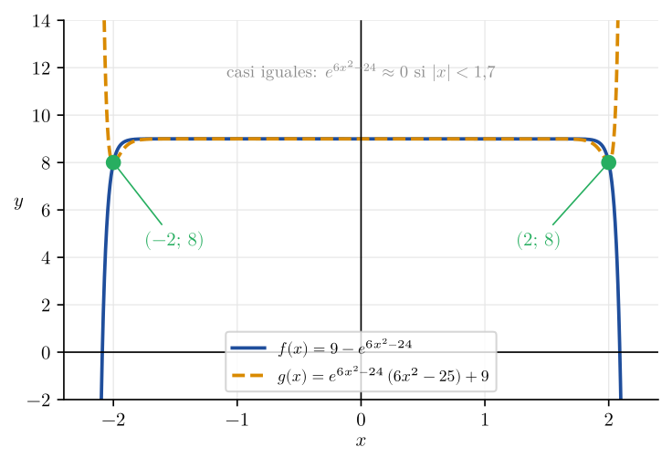
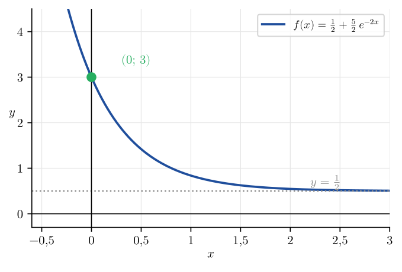
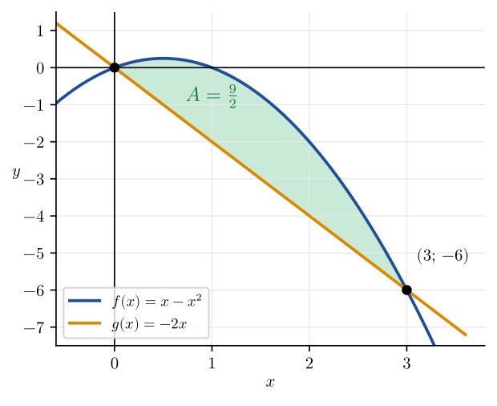
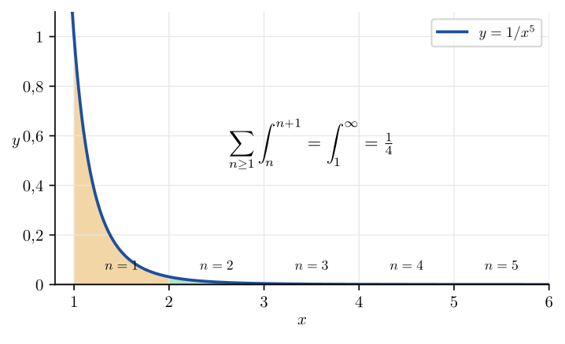
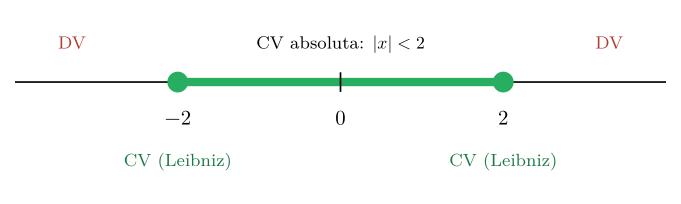

# Modelo de 2do parcial de Análisis Matemático I — resuelto y explicado

Los siete ejercicios del modelo de examen resueltos en la clase de repaso, explicados **desde cero**: cada uno empieza con la teoría mínima que hace falta para resolverlo, sigue con la resolución paso a paso y termina con lo que cambia si el parcial trae **los mismos ejercicios con otros números**.

| Ej. | Tema (unidad del cronograma) | Qué se pide | Respuesta |
|---|---|---|---|
| 1 | Fórmula de Taylor + regla de la cadena | V o F: $g''(4) = 8$ | Falso ($g''(4) = -4736$) |
| 2 | Taylor + Teorema Fundamental del Cálculo | $P_2$ de $f$ en $x = 1$ | $3 + \frac{13}{3}(x-1) + \frac{7}{2}(x-1)^2$ |
| 3 | Integración: sustitución y partes | Intersección de $f$ y $g$ | $(-2;\,8)$ y $(2;\,8)$ |
| 4 | Ecuaciones diferenciales + TFC | $f$ que cumple una ecuación integral | $f(x) = \frac{1}{2} + \frac{5}{2}e^{-2x}$ |
| 5 | Área entre curvas | $k$ para que el área sea $\frac{9}{2}$ | $k = -2$ |
| 6 | Series telescópicas + integral definida | V o F: la serie suma $\frac{1}{4}$ | Verdadero |
| 7 | Series de potencias | $k$ para que $R = 2$; intervalo | $k = 4$; $I = [-2;\,2]$ |

El orden sigue el del cronograma (Taylor → integrales → ecuaciones diferenciales → integral definida → series), no el de las hojas: así cada ejercicio usa solo herramientas ya explicadas. La **hoja de fórmulas** del final junta todo en una página.

Colores: ${\color{RoyalBlue}\text{azul}}$, resultado intermedio; ${\color{ForestGreen}\boxed{\text{verde en recuadro}}}$, resultado final.

<!-- salto-pagina -->

## Ejercicio 1 — Taylor y regla de la cadena (V o F)

> Si $P(x) = -37(x-2)^2 - 6(x-2)^3$ es el polinomio de Taylor de grado 3 asociado a $f$ en $x = 2$, y $g(x) = f(x^2 - 14)$, entonces $g''(4) = 8$. ¿Verdadero o falso?

### Lo que hay que saber

El **polinomio de Taylor** de grado $n$ de $f$ en $x = a$ es el polinomio que tiene, en $x = a$, el mismo valor y las mismas $n$ primeras derivadas que $f$:

$$
P_n(x) = f(a) + f'(a)(x-a) + \frac{f''(a)}{2!}(x-a)^2 + \frac{f'''(a)}{3!}(x-a)^3 + \dots + \frac{f^{(n)}(a)}{n!}(x-a)^n
$$

La clave de este ejercicio es **leerlo al revés**: si me dan el polinomio, cada coeficiente me da una derivada.

$$
\text{coeficiente de } (x-a)^k = \frac{f^{(k)}(a)}{k!} \quad\Longrightarrow\quad f^{(k)}(a) = k! \cdot \text{coeficiente}
$$

**Si un término no aparece, su coeficiente es 0**, y la derivada correspondiente también.

### Resolución

**Paso 1: leer las derivadas de $f$ en $x = 2$.** Escribo $P$ con todos sus términos:

$$
P(x) = \underbrace{0}_{f(2)} + \underbrace{0}_{f'(2)}\,(x-2) \underbrace{-\,37}_{f''(2)/2!}\,(x-2)^2 \underbrace{-\,6}_{f'''(2)/3!}\,(x-2)^3
$$

$$
{\color{RoyalBlue} f(2) = 0} \qquad {\color{RoyalBlue} f'(2) = 0} \qquad {\color{RoyalBlue} f''(2) = 2! \cdot (-37) = -74} \qquad f'''(2) = 3! \cdot (-6) = -36
$$

($f'''(2)$ no se va a usar: se pide una derivada segunda.)

**Paso 2: derivar $g(x) = f(x^2 - 14)$ dos veces.** Es una composición: regla de la cadena, «derivada de afuera evaluada en lo de adentro, por la derivada de adentro».

$$
g'(x) = f'(x^2 - 14) \cdot 2x
$$

Para $g''$, $g'$ es un **producto** de dos funciones de $x$: $f'(x^2-14)$ y $2x$. Regla del producto, y la cadena otra vez en el primer factor:

$$
\begin{aligned}
g''(x) &= \big[f''(x^2 - 14) \cdot 2x\big] \cdot 2x + f'(x^2 - 14) \cdot 2 \\
&= {\color{RoyalBlue} 4x^2 \, f''(x^2 - 14) + 2\, f'(x^2 - 14)}
\end{aligned}
$$

**Paso 3: evaluar en $x = 4$.** Lo de adentro vale $4^2 - 14 = 16 - 14 = 2$: justo el punto donde conozco las derivadas de $f$. (Por eso el enunciado eligió $x = 4$ y el $-14$.)

$$
g''(4) = 4 \cdot 16 \cdot f''(2) + 2 f'(2) = 64 \cdot (-74) + 2 \cdot 0 = {\color{ForestGreen}\boxed{-4736}}
$$

> [!TIP]
> **Respuesta:** **Falso**: $g''(4) = -4736 \neq 8$.

### Si cambian los datos

Con $f'(2) = 0$ (falta el término lineal) queda siempre $g''(4) = 64 \, f''(2) = 128 \cdot a_2$, donde $a_2$ es el coeficiente de $(x-2)^2$. Para que fuera verdadero haría falta $a_2 = \frac{8}{128} = \frac{1}{16}$. En el apunte de clase hay una anotación aparte con $-3(x-2)^2$: con ese coeficiente, $g''(4) = 128 \cdot (-3) = -384$, también falso.

Si el polinomio trajera término lineal $b\,(x-2)$, entonces $f'(2) = b$ y se suma $2b$.

> [!CAUTION]
> **Ojo:** el coeficiente **no es** la derivada: hay que multiplicar por $k!$ ($f''(2) = 2 \cdot (-37)$, no $-37$). Y en $g''$ no olvidar el segundo término de la regla del producto, $2 f'(x^2 - 14)$: acá vale 0, pero en una variante puede no valer 0.

<!-- salto-pagina -->

## Ejercicio 2 — Taylor de una función definida con una integral

> Sea $f(x) = 2x^3 - x\displaystyle\int_1^x g(t)\,dt + x^2$. Hallar el polinomio de Taylor de grado 2 de $f$ en $x = 1$, sabiendo que la recta $3y + x = 12$ es tangente al gráfico de $g$ en $x = 1$.

### Lo que hay que saber

**Teorema Fundamental del Cálculo (TFC).** Si $g$ es continua, la función $F(x) = \int_a^x g(t)\,dt$ es derivable y

$$
F'(x) = \frac{d}{dx}\int_a^x g(t)\,dt = g(x)
$$

Es decir: derivar una integral con **límite superior $x$** devuelve el integrando evaluado en $x$. Además, $\int_a^a g(t)\,dt = 0$ (intervalo de largo cero).

**Recta tangente.** La recta tangente a $g$ en $x = a$ es $y = g(a) + g'(a)(x - a)$: su **ordenada** en $x = a$ es $g(a)$ y su **pendiente** es $g'(a)$. Saber la recta tangente es saber esos dos números.

### Resolución

**Paso 1: qué hace falta.** $P_2(x) = f(1) + f'(1)(x-1) + \frac{f''(1)}{2}(x-1)^2$: hacen falta $f(1)$, $f'(1)$ y $f''(1)$.

**Paso 2: datos de $g$.** Despejo la recta: $3y = 12 - x \Rightarrow y = -\frac{1}{3}x + 4$.

$$
{\color{RoyalBlue} g'(1) = -\tfrac{1}{3}} \;\text{(pendiente)} \qquad {\color{RoyalBlue} g(1) = -\tfrac{1}{3}\cdot 1 + 4 = \tfrac{11}{3}} \;\text{(ordenada en } x = 1\text{)}
$$

**Paso 3: $f(1)$.** La integral de 1 a 1 vale 0:

$$
f(1) = 2 \cdot 1^3 - 1 \cdot \underbrace{\int_1^1 g(t)\,dt}_{0} + 1^2 = {\color{RoyalBlue} 3}
$$

**Paso 4: $f'(x)$.** El término $x \int_1^x g(t)\,dt$ es un **producto** de $x$ por la función integral: regla del producto, y el TFC para derivar la integral.

$$
\frac{d}{dx}\Big[x \int_1^x g(t)\,dt\Big] = 1 \cdot \int_1^x g(t)\,dt + x \cdot g(x)
$$

$$
f'(x) = 6x^2 - \Big[\int_1^x g(t)\,dt + x\,g(x)\Big] + 2x
$$

$$
f'(1) = 6 - \big[0 + 1 \cdot g(1)\big] + 2 = 8 - \tfrac{11}{3} = {\color{RoyalBlue} \tfrac{13}{3}}
$$

**Paso 5: $f''(x)$.** Derivo cada término de $f'$: la integral da $g(x)$ (TFC) y $x\,g(x)$ es otro producto, $g(x) + x\,g'(x)$.

$$
\begin{aligned}
f''(x) &= 12x - \big[g(x) + g(x) + x\,g'(x)\big] + 2 \\
&= 12x - 2g(x) - x\,g'(x) + 2
\end{aligned}
$$

$$
f''(1) = 12 - 2 \cdot \tfrac{11}{3} - \left(-\tfrac{1}{3}\right) + 2 = 14 - \tfrac{22}{3} + \tfrac{1}{3} = 14 - 7 = {\color{RoyalBlue} 7}
$$

**Paso 6: armar el polinomio.** Ojo con el $2!$ del término cuadrático: $\frac{f''(1)}{2} = \frac{7}{2}$.

$$
{\color{ForestGreen}\boxed{P_2(x) = 3 + \tfrac{13}{3}(x-1) + \tfrac{7}{2}(x-1)^2}}
$$

> [!TIP]
> **Respuesta:** $P_2(x) = 3 + \frac{13}{3}(x-1) + \frac{7}{2}(x-1)^2$.

### Si cambian los datos

El método no cambia: (1) de la recta tangente salen $g(a)$ y $g'(a)$; (2) en $x = a$ la integral $\int_a^a$ vale 0; (3) la integral se deriva con el TFC y el producto $x \cdot \int$ con la regla del producto. Si el límite inferior de la integral **no** coincide con el punto (por ejemplo $\int_0^x$ y $a = 1$), la integral ya no vale 0 en $x = 1$ y el enunciado tendría que dar su valor.

> [!CAUTION]
> **Ojo:** $\frac{d}{dx}\big[x \int_1^x g\big]$ **no** es $x\,g(x)$ solamente: es un producto y lleva los dos términos. Y la pendiente de $3y + x = 12$ es $-\frac{1}{3}$, no $1$ ni $3$: siempre despejar $y$ primero.

<!-- salto-pagina -->

## Ejercicio 3 — Primitiva por sustitución y partes; intersección de curvas

> Hallar los puntos de intersección entre $f(x) = 9 - e^{6x^2 - 24}$ y $g$, sabiendo que $g'(x) = \dfrac{12x\,(6x^2 - 24)}{e^{24 - 6x^2}}$ y $g(2) = 8$.

### Lo que hay que saber

**Integral indefinida.** Conocer $g'$ y querer $g$ es buscar una **primitiva**: $g(x) = \int g'(x)\,dx + C$. La constante $C$ se fija con un dato, $g(2) = 8$ (condición inicial).

**Sustitución.** Si en el integrando aparece una función $u(x)$ **y su derivada** $u'(x)\,dx$, se cambia de variable: $t = u(x)$, $dt = u'(x)\,dx$.

**Partes.** Para un producto «polinomio por exponencial»:

$$
\int u\,dv = u\,v - \int v\,du
$$

eligiendo $u$ = lo que se simplifica al derivar (el polinomio) y $dv$ = lo que se integra fácil (la exponencial).

### Resolución

**Paso 1: reescribir $g'$.** Dividir por $e^{24-6x^2}$ es multiplicar por $e^{-(24-6x^2)} = e^{6x^2-24}$:

$$
g'(x) = 12x\,(6x^2 - 24)\,e^{6x^2 - 24}
$$

**Paso 2: sustitución.** El exponente $6x^2 - 24$ se repite y su derivada, $12x$, está multiplicando: es la señal.

$$
t = 6x^2 - 24 \qquad dt = 12x\,dx
$$

$$
\int \underbrace{(6x^2 - 24)}_{t}\; e^{\overbrace{6x^2 - 24}^{t}}\; \underbrace{12x\,dx}_{dt} = {\color{RoyalBlue} \int t\,e^t\,dt}
$$

**Paso 3: partes.** $u = t$ ($du = dt$), $dv = e^t\,dt$ ($v = e^t$):

$$
\int t\,e^t\,dt = t\,e^t - \int e^t\,dt = t\,e^t - e^t + C = {\color{RoyalBlue} e^t\,(t - 1) + C}
$$

**Paso 4: volver a $x$.** Con $t = 6x^2 - 24$, $t - 1 = 6x^2 - 25$:

$$
g(x) = e^{6x^2 - 24}\,(6x^2 - 25) + C
$$

**Paso 5: la constante con $g(2) = 8$.** En $x = 2$: $6 \cdot 4 - 24 = 0$, así que $e^0 = 1$ y $6 \cdot 4 - 25 = -1$:

$$
1 \cdot (-1) + C = 8 \quad\Rightarrow\quad {\color{RoyalBlue} C = 9} \qquad\quad g(x) = e^{6x^2 - 24}\,(6x^2 - 25) + 9
$$

**Paso 6: intersección, $f(x) = g(x)$.**

$$
9 - e^{6x^2 - 24} = e^{6x^2 - 24}\,(6x^2 - 25) + 9
$$

El 9 se cancela. Divido por $-e^{6x^2-24}$, que **nunca es cero** (la exponencial es siempre positiva):

$$
\begin{aligned}
-e^{6x^2 - 24} &= e^{6x^2 - 24}\,(6x^2 - 25) \\
-1 &= 6x^2 - 25 \\
6x^2 &= 24 \\
x^2 &= 4 \quad\Rightarrow\quad {\color{RoyalBlue} x = 2 \ \text{ o } \ x = -2}
\end{aligned}
$$

**Paso 7: la ordenada.** $f(\pm 2) = 9 - e^{0} = 8$ (y $g(\pm 2) = 8$, coincide).

> [!TIP]
> **Respuesta:** los puntos de intersección son ${\color{ForestGreen}\boxed{(-2;\,8)}}$ y ${\color{ForestGreen}\boxed{(2;\,8)}}$.

### Si cambian los datos

Con $g'(x) = 2ax\,(ax^2 - b)\,e^{ax^2 - b}$ (exponente cualquiera), la misma sustitución $t = ax^2 - b$ lleva a $\int t\,e^t\,dt$. Lo importante es **reconocer el patrón**: exponente que se repite fuera de la exponencial y su derivada multiplicando.

> [!CAUTION]
> **Ojo:** no olvidar la $+C$ y calcularla con el dato antes de igualar (sin $C = 9$, el 9 de $f$ no se cancela). Y $\frac{1}{e^{a}} = e^{-a}$: el signo del exponente se da vuelta.

<!-- salto-pagina -->

## Ejercicio 4 — Ecuación diferencial escondida en una integral

> Hallar $f(x)$, cuyo gráfico pasa por $(0;\,3)$, tal que $\displaystyle\int_0^x 3t\,\big[f'(t) + 2f(t)\big]\,dt = \frac{3}{2}x^2$.

(El segundo miembro se reconstruyó del apunte: es el único que da $3x$ al derivar, como figura en la resolución de clase.)

### Lo que hay que saber

**El TFC saca la integral.** Si dos funciones son iguales para todo $x$, sus derivadas también. Derivando los dos miembros, el TFC convierte $\int_0^x h(t)\,dt$ en $h(x)$: la ecuación integral pasa a ser una **ecuación diferencial** (una ecuación donde la incógnita es una función y aparece su derivada).

**Ecuación diferencial de variables separables.** Si se puede escribir $\frac{dy}{dx} = p(x)\,q(y)$, se separa: todo lo de $y$ con $dy$, todo lo de $x$ con $dx$, y se integra cada lado.

$$
\frac{dy}{q(y)} = p(x)\,dx \quad\Longrightarrow\quad \int \frac{dy}{q(y)} = \int p(x)\,dx
$$

La solución general trae una constante; el dato «pasa por $(0;\,3)$» la fija (solución particular).

### Resolución

**Paso 1: derivar los dos miembros (TFC).**

$$
3x\,\big[f'(x) + 2f(x)\big] = 3x
$$

Para $x \neq 0$ divido por $3x$ (en $x = 0$ queda $0 = 0$, que se cumple siempre):

$$
{\color{RoyalBlue} f'(x) + 2f(x) = 1} \qquad\text{o sea}\qquad y' + 2y = 1
$$

**Paso 2: separar variables.** $y' = \frac{dy}{dx}$:

$$
\frac{dy}{dx} = 1 - 2y \quad\Longrightarrow\quad \frac{dy}{1 - 2y} = dx
$$

**Paso 3: integrar.** A la izquierda, sustitución $t = 1 - 2y$, $dt = -2\,dy$ (o sea $dy = -\frac{dt}{2}$):

$$
\int \frac{dy}{1 - 2y} = -\frac{1}{2}\int \frac{dt}{t} = -\frac{1}{2}\ln|t| = -\frac{1}{2}\ln|1 - 2y|
$$

$$
-\frac{1}{2}\ln|1 - 2y| = x + C
$$

**Paso 4: despejar $y$.** Multiplico por $-2$ y aplico exponencial:

$$
\begin{aligned}
\ln|1 - 2y| &= -2x - 2C \\
|1 - 2y| &= e^{-2x - 2C} = e^{-2C}\,e^{-2x}
\end{aligned}
$$

Ahora el paso delicado. $|1 - 2y| = e^{-2C}\,e^{-2x}$ significa $1 - 2y = \pm\, e^{-2C}\,e^{-2x}$. Llamo $K = \pm\, e^{-2C}$: $K$ puede ser **positivo o negativo** (el signo absorbe el valor absoluto).

$$
{\color{RoyalBlue} 1 - 2y = K\,e^{-2x}}, \qquad K \in \mathbb{R}
$$

**Paso 5: la condición $(0;\,3)$.** $x = 0$, $y = 3$:

$$
1 - 2 \cdot 3 = K\,e^{0} \quad\Rightarrow\quad {\color{RoyalBlue} K = -5}
$$

**Paso 6: despejar.** $1 - 2y = -5e^{-2x} \Rightarrow 2y = 1 + 5e^{-2x}$:

$$
{\color{ForestGreen}\boxed{f(x) = \tfrac{1}{2} + \tfrac{5}{2}\,e^{-2x}}}
$$

**Verificación** (rápida y vale la pena en el parcial): $f(0) = \frac{1}{2} + \frac{5}{2} = 3$ ✓. $f'(x) = -5e^{-2x}$, entonces $f' + 2f = -5e^{-2x} + 1 + 5e^{-2x} = 1$ ✓.

> [!TIP]
> **Respuesta:** $f(x) = \frac{1}{2} + \frac{5}{2}\,e^{-2x}$.

La curva baja hacia la recta $y = \frac{1}{2}$ (cuando $x \to \infty$, $e^{-2x} \to 0$): es el valor donde $y' = 1 - 2y$ se anula.

> [!CAUTION]
> **Ojo (está en el apunte de clase):** si se escribe $|1 - 2y| = K e^{-2x}$ con $K > 0$ y se reemplaza $(0;\,3)$ **sin** el valor absoluto, sale $K = -5 < 0$ y parece que «no hay solución». No es así: con el valor absoluto, $|1 - 6| = 5 = K$, y entonces $1 - 2y = -5e^{-2x}$ (el signo de $1 - 2y$ en el punto es negativo). Lo más seguro es lo del Paso 4: sacar el módulo y dejar $K \in \mathbb{R}$ con cualquier signo.

### Si cambian los datos

Con $\int_0^x c\,t\,[f' + a f]\,dt = \frac{c}{2}x^2$ siempre se llega a $y' + a y = 1$, y entonces $1 - a y = K e^{-a x}$, con $K = 1 - a\,y_0$ si pasa por $(0;\,y_0)$. Solución: $y = \frac{1}{a}\big(1 - K e^{-ax}\big)$.

<!-- salto-pagina -->

## Ejercicio 5 — Área entre curvas con un parámetro

> Hallar $k < 0$ tal que el área encerrada entre $f(x) = x - x^2$ y $g(x) = kx$ sea $\frac{9}{2}$.

### Lo que hay que saber

**Área entre dos curvas.** Si entre $x = a$ y $x = b$ la curva $f$ está **por encima** de $g$:

$$
A = \int_a^b \big[f(x) - g(x)\big]\,dx \qquad \text{(«techo menos piso»)}
$$

Los límites $a$ y $b$ son las **abscisas de los puntos de intersección** ($f = g$). La integral se calcula con la **regla de Barrow**: $\int_a^b h(x)\,dx = H(b) - H(a)$, con $H$ una primitiva de $h$.

### Resolución

**Paso 1: intersecciones.**

$$
x - x^2 = kx \;\Rightarrow\; x - x^2 - kx = 0 \;\Rightarrow\; x\,(1 - k - x) = 0 \;\Rightarrow\; {\color{RoyalBlue} x = 0 \ \text{ o } \ x = 1 - k}
$$

Como $k < 0$, $1 - k > 1 > 0$: el intervalo es $[0;\,1 - k]$.

**Paso 2: quién está arriba.** Pruebo un punto del medio, por ejemplo $x = 1$: $f(1) = 0$ y $g(1) = k < 0$. La parábola está arriba.

**Paso 3: el área.** Agrupo $f - g = x - x^2 - kx = (1-k)\,x - x^2$. Llamo $m = 1 - k$ para no arrastrar paréntesis:

$$
\begin{aligned}
A &= \int_0^m \big(m\,x - x^2\big)\,dx = \left[\frac{m\,x^2}{2} - \frac{x^3}{3}\right]_0^m \\
&= \frac{m \cdot m^2}{2} - \frac{m^3}{3} - 0 = m^3\left(\frac{1}{2} - \frac{1}{3}\right) = {\color{RoyalBlue} \frac{m^3}{6}}
\end{aligned}
$$

**Paso 4: igualar a $\frac{9}{2}$.**

$$
\frac{(1-k)^3}{6} = \frac{9}{2} \;\Rightarrow\; (1-k)^3 = 27 \;\Rightarrow\; 1 - k = \sqrt[3]{27} = 3 \;\Rightarrow\; {\color{ForestGreen}\boxed{k = -2}}
$$

Cumple $k < 0$ ✓. En el apunte se hizo sin la $m$ (sacando $(1-k)^2$ de factor común); llega a lo mismo, $\frac{(1-k)^3}{3} = 9$.

> [!TIP]
> **Respuesta:** $k = -2$. La recta es $g(x) = -2x$ y corta a la parábola en $(0;\,0)$ y $(3;\,-6)$.

### Si cambian los datos

Para cualquier área $A$: $(1-k)^3 = 6A$. Por ejemplo $A = \frac{4}{3}$ da $(1-k)^3 = 8$, $k = -1$. Con $k > 0$ (y $k < 1$) el intervalo es $[0;\,1-k]$ con el mismo resultado; si piden $k < 0$ es para que la recta quede por debajo y el intervalo sea más largo.

> [!CAUTION]
> **Ojo:** el área es siempre positiva; si al plantear «techo menos piso» se invierte el orden, la integral da negativa. Hacer un dibujo rápido (o probar un punto) antes de integrar.

<!-- salto-pagina -->

## Ejercicio 6 — Serie de integrales: telescópica (V o F)

> $\displaystyle\sum_{n=1}^{\infty} \int_n^{n+1} \frac{1}{x^5}\,dx$ converge y su suma es $\frac{1}{4}$. ¿Verdadero o falso?

### Lo que hay que saber

**Serie y suma parcial.** Una serie $\sum a_n$ **converge** si la sucesión de sumas parciales $S_N = a_1 + a_2 + \dots + a_N$ tiene límite finito; ese límite es la **suma** de la serie.

**Serie telescópica.** Si cada término es una resta de dos términos consecutivos de una misma sucesión, $a_n = b_n - b_{n+1}$, al sumar se cancelan todos los del medio:

$$
S_N = (b_1 - b_2) + (b_2 - b_3) + \dots + (b_N - b_{N+1}) = b_1 - b_{N+1}
$$

y la serie converge si $b_{N+1}$ tiene límite: $S = b_1 - \lim b_{N+1}$.

### Resolución

**Paso 1: calcular la integral de cada término (Barrow).** $\frac{1}{x^5} = x^{-5}$, primitiva $\frac{x^{-4}}{-4} = -\frac{1}{4x^4}$:

$$
\int_n^{n+1} x^{-5}\,dx = \left[-\frac{1}{4x^4}\right]_n^{n+1} = -\frac{1}{4(n+1)^4} + \frac{1}{4n^4} = {\color{RoyalBlue} \frac{1}{4}\left[\frac{1}{n^4} - \frac{1}{(n+1)^4}\right]}
$$

Es telescópica con $b_n = \frac{1}{n^4}$.

**Paso 2: suma parcial.** Saco el $\frac{1}{4}$ afuera y escribo los primeros términos:

$$
\begin{aligned}
S_N &= \frac{1}{4}\left[\left(\frac{1}{1^4} - \frac{1}{2^4}\right) + \left(\frac{1}{2^4} - \frac{1}{3^4}\right) + \dots + \left(\frac{1}{N^4} - \frac{1}{(N+1)^4}\right)\right] \\
&= {\color{RoyalBlue} \frac{1}{4}\left[1 - \frac{1}{(N+1)^4}\right]}
\end{aligned}
$$

**Paso 3: límite.** $\frac{1}{(N+1)^4} \to 0$:

$$
S = \lim_{N \to \infty} S_N = \frac{1}{4}\,(1 - 0) = {\color{ForestGreen}\boxed{\tfrac{1}{4}}}
$$

> [!TIP]
> **Respuesta:** **Verdadero**: converge y suma $\frac{1}{4}$.

**Otra forma (más corta).** Sumar las integrales sobre $[1;\,2]$, $[2;\,3]$, $[3;\,4]$… es integrar sobre $[1;\,\infty)$: la serie es la **integral impropia** $\int_1^\infty x^{-5}\,dx = \lim_{b\to\infty}\left[-\frac{1}{4x^4}\right]_1^b = 0 + \frac{1}{4} = \frac{1}{4}$.

### Si cambian los datos

Con $\frac{1}{x^p}$ ($p > 1$): $\sum_{n\ge1} \int_n^{n+1} x^{-p}\,dx = \int_1^\infty x^{-p}\,dx = \frac{1}{p-1}$. Con $p = 5$, $\frac{1}{4}$ ✓. Si la serie arranca en $n = 2$, la integral va de 2 a $\infty$: $\frac{1}{(p-1)\,2^{p-1}}$. Con $p \le 1$ la serie diverge.

> [!CAUTION]
> **Ojo:** el término general de la serie es la **integral** (un número que depende de $n$), no $\frac{1}{n^5}$. Y en el apunte, $\sum\left[\frac{1}{(n+1)^4} - \frac{1}{n^4}\right]$ suma $-1$: multiplicado por el $-\frac{1}{4}$ de afuera da $+\frac{1}{4}$. Cuidado con los signos al sacar factor común.

<!-- salto-pagina -->

## Ejercicio 7 — Serie de potencias: radio e intervalo de convergencia

> Hallar $k > 0$ tal que $\displaystyle\sum_{n=1}^{\infty} \frac{(-1)^n\,x^{2n}}{n\,k^n}$ tenga radio de convergencia $R = 2$. Para ese $k$, hallar el intervalo de convergencia.

### Lo que hay que saber

**Serie de potencias.** Es una serie cuyos términos dependen de $x$; para cada $x$ es una serie numérica que puede converger o no. Centrada en $x_0$, converge en un intervalo $|x - x_0| < R$ ($R$: **radio de convergencia**) y diverge fuera; en los **extremos** $x_0 \pm R$ hay que estudiar cada uno aparte.

**Criterio de D'Alembert (cociente).** Para $\sum a_n$:

$$
L = \lim_{n \to \infty}\left|\frac{a_{n+1}}{a_n}\right| \qquad
\begin{cases} L < 1 & \text{converge (absolutamente)} \\ L > 1 & \text{diverge} \\ L = 1 & \text{no decide} \end{cases}
$$

En una serie de potencias se aplica **con la $x$ adentro**: $L$ depende de $x$, y la condición $L < 1$ da el intervalo.

**Criterio de Leibniz (series alternadas).** $\sum (-1)^n b_n$ con $b_n > 0$ converge si $b_n$ es decreciente y $b_n \to 0$. Ejemplo clave: $\sum \frac{(-1)^n}{n}$ (armónica alternada) **converge**, aunque $\sum \frac{1}{n}$ (armónica) **diverge**.

### Resolución

**Paso 1: cociente con la $x$ adentro.** $a_n = \frac{(-1)^n x^{2n}}{n\,k^n}$, $a_{n+1} = \frac{(-1)^{n+1} x^{2n+2}}{(n+1)\,k^{n+1}}$. El valor absoluto elimina los $(-1)$:

$$
\begin{aligned}
\left|\frac{a_{n+1}}{a_n}\right| &= \frac{|x|^{2n+2}}{(n+1)\,k^{n+1}} \cdot \frac{n\,k^n}{|x|^{2n}}
= \frac{|x|^{2n}\cdot x^2}{(n+1)\,k^n \cdot k} \cdot \frac{n\,k^n}{|x|^{2n}} \\
&= \frac{x^2}{k}\cdot\frac{n}{n+1}
\end{aligned}
$$

$$
L = \lim_{n\to\infty} \frac{x^2}{k}\cdot\frac{n}{n+1} = \frac{x^2}{k} \cdot 1 = {\color{RoyalBlue} \frac{x^2}{k}}
$$

**Paso 2: condición de convergencia.**

$$
\frac{x^2}{k} < 1 \;\Rightarrow\; x^2 < k \;\Rightarrow\; |x| < \sqrt{k}
$$

Está centrada en $x_0 = 0$ y el radio es ${\color{RoyalBlue} R = \sqrt{k}}$.

**Paso 3: el $k$.** $\sqrt{k} = 2 \Rightarrow {\color{ForestGreen}\boxed{k = 4}}$ (cumple $k > 0$).

**Paso 4: extremos.** Con $k = 4$ converge en $(-2;\,2)$. Pruebo $x = 2$ y $x = -2$. Como la potencia es **par**, $x^{2n} = (x^2)^n = 4^n$ en los dos:

$$
x = \pm 2: \qquad \sum_{n=1}^\infty \frac{(-1)^n\,4^n}{n \cdot 4^n} = \sum_{n=1}^\infty \frac{(-1)^n}{n}
$$

Es la armónica alternada: $b_n = \frac{1}{n}$ es positiva, decreciente y tiende a 0. Por **Leibniz, converge** (condicionalmente: en valor absoluto sería la armónica, que diverge). Los dos extremos entran.

> [!TIP]
> **Respuesta:** $k = 4$; intervalo de convergencia ${\color{ForestGreen}\boxed{I = [-2;\,2]}}$ (absoluta en $(-2;\,2)$, condicional en $x = \pm 2$).

> [!CAUTION]
> **Ojo:** (1) La fórmula $R = \lim\left|\frac{c_n}{c_{n+1}}\right|$ sirve cuando la serie tiene **todas** las potencias $x^n$; acá solo hay potencias pares, $x^{2n}$: por eso conviene el cociente con la $x$ adentro (o pensar en $u = x^2$, que da $|u| < k$). (2) En el apunte, $k$ se despejó también con «$-\sqrt{k} - \sqrt{k} = 4$»: no hace falta; el radio es la mitad del largo del intervalo, $\sqrt{k} = 2$. (3) La suma empieza en $n = 1$ (con $n = 0$ habría una división por cero).

### Si cambian los datos

Con $\sum \frac{(-1)^n x^{2n}}{n\,k^n}$ y radio $R$ cualquiera: $k = R^2$, y los extremos dan siempre la armónica alternada (convergen). Sin el $(-1)^n$, en los extremos quedaría $\sum \frac{1}{n}$, que **diverge**: el intervalo sería $(-R;\,R)$, abierto. Con $x^n$ en vez de $x^{2n}$: $L = \frac{|x|}{k}$, $R = k$, y los extremos ya no dan la misma serie ($x = -R$ cambia los signos): hay que estudiar cada uno.

<!-- salto-pagina -->

## Hoja de fórmulas

| Tema | Fórmula | Se usa en |
|---|---|---|
| Taylor en $x = a$ | $P_n(x) = \sum_{k=0}^n \frac{f^{(k)}(a)}{k!}(x-a)^k$; coeficiente $\cdot\,k! = f^{(k)}(a)$ | Ej. 1, 2 |
| Regla de la cadena | $\big[f(u(x))\big]' = f'(u(x))\,u'(x)$ | Ej. 1 |
| Regla del producto | $(u\,v)' = u'\,v + u\,v'$ | Ej. 1, 2 |
| TFC | $\frac{d}{dx}\int_a^x g(t)\,dt = g(x)$; $\int_a^a g = 0$ | Ej. 2, 4 |
| Recta tangente | $y = g(a) + g'(a)(x-a)$ | Ej. 2 |
| Sustitución | $t = u(x)$, $dt = u'(x)\,dx$ | Ej. 3, 4 |
| Partes | $\int u\,dv = uv - \int v\,du$; $\int t\,e^t\,dt = e^t(t-1) + C$ | Ej. 3 |
| Logaritmo | $\int \frac{dt}{t} = \ln\lvert t\rvert + C$ | Ej. 4 |
| Variables separables | $\frac{dy}{q(y)} = p(x)\,dx$, integrar; el módulo se absorbe en $K \in \mathbb{R}$ | Ej. 4 |
| Barrow | $\int_a^b h = H(b) - H(a)$ | Ej. 5, 6 |
| Área entre curvas | $A = \int_a^b (\text{techo} - \text{piso})\,dx$; $a, b$: intersecciones | Ej. 5 |
| Telescópica | $\sum (b_n - b_{n+1}) = b_1 - \lim b_{n+1}$ | Ej. 6 |
| Integral impropia | $\int_1^\infty x^{-p}\,dx = \frac{1}{p-1}$ si $p > 1$; diverge si $p \le 1$ | Ej. 6 |
| D'Alembert | $\lim \lvert a_{n+1}/a_n\rvert < 1$: converge | Ej. 7 |
| Leibniz | $\sum(-1)^n b_n$, $b_n \downarrow 0$: converge | Ej. 7 |
| Armónica | $\sum\frac{1}{n}$ diverge; $\sum\frac{(-1)^n}{n}$ converge; $\sum\frac{1}{n^p}$ converge si $p > 1$ | Ej. 7 |

**Antes de entregar:** verificar cada resultado reemplazando (Ej. 3: $f(\pm2) = g(\pm2)$; Ej. 4: $f(0) = 3$ y $f' + 2f = 1$; Ej. 5: $k < 0$). Son treinta segundos y detectan casi todos los errores de signo.

<!-- solo-md -->

---

**Fuentes:** apunte de la clase de repaso con el modelo de examen (`../fuentes/`, 10 fotos del apunte, renombradas por ejercicio); `../../material_catedra/cronograma_2026.pdf` (unidades del 2do parcial); resumen de M. F. Martin y Herrera (`../fuentes/resumen_2do_parcial_martin_y_herrera.pdf`) (índice de temas y vocabulario).

<!-- /solo-md -->
