# Parciales modelo del 1er parcial de Álgebra y Geometría Analítica

Los siete parciales que la cátedra dejó como modelo en el campus virtual (2019–2022), resueltos y agrupados **por parcial**, en orden cronológico. Dos son recuperatorios: se tratan igual que los demás, porque toman los mismos temas con el mismo formato.

> [!NOTE]
> **El 1er parcial rendido el 08/08/2026 repitió un modelo: el examen P1, del 13/05/2019** (`fuentes/2019-05-13_TM_parcial.pdf`). La foto de los enunciados (`fuentes/2026-08-08_parcial_rendido_foto.jpg`) coincide palabra por palabra con su **Tema 2**, con la misma fecha y el mismo encabezado; no se sabe con certeza qué tema tocó. La cátedra reutiliza sus modelos: vale la pena hacerlos todos.

| Código | Fecha | Instancia | Temas | Archivo (en `fuentes/`) |
|--------|------------|---------------|--------|------------------------------------|
| P1 | 13/05/2019 | 1er parcial | 1 y 2 | `2019-05-13_TM_parcial.pdf` |
| P2 | 12/08/2019 | 1er parcial | 1 | `2019-08-12_TT_parcial.pdf` |
| P3 | 13/08/2019 | 1er parcial | 1 y 2 | `2019-08-13_TM_parcial.pdf` |
| P4 | 14/08/2019 | 1er parcial | 1 y 2 | `2019-08-14_TM_parcial.pdf` |
| P5 | 03/12/2019 | recuperatorio | 1 y 2 | `2019-12-03_TM_recuperatorio.pdf` |
| P6 | 09/12/2019 | recuperatorio | 1 | `2019-12-09_TT_recuperatorio.pdf` |
| P7 | 11/07/2022 | 1er parcial | 1 | `2022-07-11_TT_parcial.pdf` |

Algunos PDFs traen dos temas: el mismo examen con otros números o con las variables permutadas. El **Tema 1** se resuelve completo; el **Tema 2**, con el mismo método y todas las cuentas que cambian: el grueso se aprende con el Tema 1 y el Tema 2 sirve para reafirmar.

**Cómo es el parcial.** Cinco ejercicios: el 1 y el 2 de **geometría** (rectas, planos, haz, distancias), el 3 de **determinantes**, el 4 de **espacios vectoriales** (casi siempre verdadero o falso) y el 5 de **subespacios** (intersección, suma, complemento ortogonal). Se aprueba con tres bien resueltos y se promociona con cuatro. Se rinde **sin calculadora**: por eso todas las cuentas están hechas a mano, con los productos vectoriales y los determinantes desarrollados término a término.

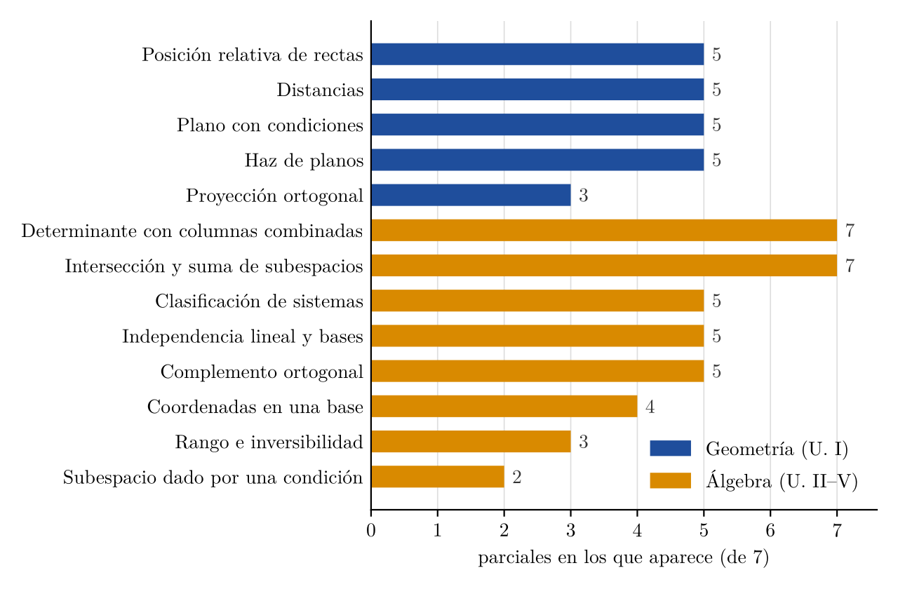

Dos temas salen en **los siete** parciales: el determinante de una matriz armada con columnas de otra y la intersección/suma de subespacios. Las fórmulas que se repiten están en el apéndice A, y las respuestas para autocorregirse, en el apéndice B.

Colores: azul, resultado intermedio; verde en recuadro, resultado final. En las figuras, verde es lo que se pide y rojo una distancia.

<!-- salto-pagina -->

## P1 — 1er parcial del 13/05/2019 (T.M.)

*Origen:* `fuentes/2019-05-13_TM_parcial.pdf` (en el campus: `Primer Parcial lu-ju.pdf`), Temas 1 y 2. **El parcial rendido el 08/08/2026 repitió este examen** (la foto que se tiene es del Tema 2). Condición de aprobación de 2019: dos ejercicios de Geometría y uno de Álgebra, o uno de Geometría y dos de Álgebra.

### Ejercicio 1 — Plano que contiene a una recta y rectas que se cortan

<!-- temas: PLANO REC -->

> Sean $r_1: \begin{cases} x + y - z = 0 \\ 3x + 4z - k = 0 \end{cases}$ y $r_2: \dfrac{x-1}{2} = \dfrac{y+7}{3} = -z$.
>
> a) Hallar la ecuación implícita del plano que contiene a $r_2$ y es paralelo al eje de abscisas.
> b) Hallar $k \in \mathbb{R}$ para que $d(r_1, r_2) = 0$.

**Leer $r_2$.** En la forma simétrica $\frac{x - x_0}{u_1} = \frac{y - y_0}{u_2} = \frac{z - z_0}{u_3}$ se leen un punto y la dirección. El $-z$ es $\frac{z - 0}{-1}$: punto $A_2 = (1,\,-7,\,0)$, dirección $\vec u_2 = (2,\,3,\,-1)$.

**a) Idea.** Un plano queda determinado por un punto y su normal. Si el plano contiene a $r_2$, contiene a la dirección $\vec u_2$; si es paralelo al eje $x$, contiene a la dirección $\vec\imath = (1,\,0,\,0)$. La normal es perpendicular a las dos: es su producto vectorial.

$$
\begin{aligned}
\vec n = \vec u_2 \times \vec\imath = \begin{vmatrix} \vec\imath & \vec\jmath & \vec k \\ 2 & 3 & -1 \\ 1 & 0 & 0 \end{vmatrix} &= \big(3 \cdot 0 - (-1) \cdot 0,\ \ -\left[2 \cdot 0 - (-1) \cdot 1\right],\ \ 2 \cdot 0 - 3 \cdot 1\big) \\ &= (0,\ -1,\ -3)
\end{aligned}
$$

Se usa $\vec n = (0,\,1,\,3)$ (cambiar el signo no cambia el plano): $y + 3z + D = 0$. El plano pasa por $A_2$: $-7 + 0 + D = 0$, $D = 7$.

> [!TIP]
> **Respuesta:** a) $y + 3z + 7 = 0$. No tiene $x$: es paralelo al eje $x$, como se pedía.

**b) Idea.** Dos rectas están a distancia cero si se cortan (o si coinciden). Hay que encontrar el punto de $r_2$ que cumple las ecuaciones de $r_1$.

Primero, que no sean paralelas. La dirección de $r_1$ es el producto vectorial de las normales de sus dos planos:

$$
\begin{aligned}
\vec u_1 = \begin{vmatrix} \vec\imath & \vec\jmath & \vec k \\ 1 & 1 & -1 \\ 3 & 0 & 4 \end{vmatrix} &= \big(1 \cdot 4 - (-1) \cdot 0,\ \ -\left[1 \cdot 4 - (-1) \cdot 3\right],\ \ 1 \cdot 0 - 1 \cdot 3\big) \\ &= (4,\ -7,\ -3)
\end{aligned}
$$

que no es múltiplo de $(2,\,3,\,-1)$. Se escribe $r_2$ en paramétricas, $(x,\,y,\,z) = (1 + 2t,\ -7 + 3t,\ -t)$, y se reemplaza en la ecuación de $r_1$ que no tiene $k$:

$$
(1 + 2t) + (-7 + 3t) - (-t) = 0 \implies 6t - 6 = 0 \implies t = 1 \implies {\color{RoyalBlue}(3,\,-4,\,-1)}
$$

Ese punto tiene que cumplir también la otra ecuación de $r_1$:

$$
3 \cdot 3 + 4 \cdot (-1) - k = 0 \implies 9 - 4 - k = 0 \implies {\color{ForestGreen}\boxed{k = 5}}
$$

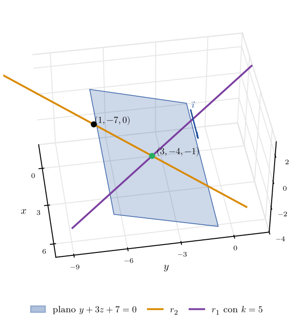

> [!TIP]
> **Respuesta:** b) $k = 5$; las rectas se cortan en $(3,\,-4,\,-1)$.

### Ejercicio 2 — Haz de planos y proyección de un punto

<!-- temas: HAZ PROY -->

> Sean $\pi: (x, y, z) = t(1, 0, 1) + s(3, 2, 1) + (1, -1, 1)$ con $t, s \in \mathbb{R}$ y $P = (1, 2, -1)$.
>
> a) Hallar, si existe, un plano en el haz $\alpha(3x + y + z + 3) + \beta(x - 2y + z + 1) = 0$ que contenga a $P$.
> b) Hallar las ecuaciones paramétricas de la recta ortogonal a $\pi$ que pasa por $\mathrm{proy}_\pi(P)$.

**a) Idea.** El haz son todos los planos que contienen a la recta en que se cortan $3x + y + z + 3 = 0$ y $x - 2y + z + 1 = 0$. Pedir que pase por $P$ es una ecuación en $\alpha$ y $\beta$, que fija la proporción entre ellos.

Se reemplaza $P = (1,\,2,\,-1)$ en cada paréntesis:

$$
3 \cdot 1 + 2 + (-1) + 3 = 7, \qquad 1 - 2 \cdot 2 + (-1) + 1 = -3 \qquad\implies\qquad 7\alpha - 3\beta = 0
$$

Cualquier par proporcional sirve; con $\alpha = 3$, $\beta = 7$:

$$
3(3x + y + z + 3) + 7(x - 2y + z + 1) = 9x + 3y + 3z + 9 + 7x - 14y + 7z + 7 = 16x - 11y + 10z + 16
$$

Verificación con $P$: $16 - 22 - 10 + 16 = 0$.

> [!TIP]
> **Respuesta:** a) $16x - 11y + 10z + 16 = 0$.

**b) Idea.** La recta ortogonal a $\pi$ tiene la dirección de la normal de $\pi$. Además, la recta ortogonal a $\pi$ que pasa por $P$ cae sobre $\pi$ justo en $\mathrm{proy}_\pi(P)$: es **la misma recta**. Igual conviene calcular la proyección, que es el punto que nombra el enunciado.

Normal de $\pi$, con sus dos vectores directores:

$$
\begin{aligned}
\vec n = \begin{vmatrix} \vec\imath & \vec\jmath & \vec k \\ 1 & 0 & 1 \\ 3 & 2 & 1 \end{vmatrix} &= \big(0 \cdot 1 - 1 \cdot 2,\ \ -\left[1 \cdot 1 - 1 \cdot 3\right],\ \ 1 \cdot 2 - 0 \cdot 3\big) \\ &= (-2,\ 2,\ 2)
\end{aligned}
$$

Se usa $\vec n = (1,\,-1,\,-1)$. Con el punto $(1,\,-1,\,1)$: $\pi: x - y - z + D = 0$, $1 + 1 - 1 + D = 0$, $D = -1$; o sea, $\pi: x - y - z - 1 = 0$.

Recta por $P$ con dirección $\vec n$: $(1 + \lambda,\ 2 - \lambda,\ -1 - \lambda)$. Se corta con $\pi$:

$$
(1 + \lambda) - (2 - \lambda) - (-1 - \lambda) - 1 = 0 \implies 3\lambda - 1 = 0 \implies \lambda = \tfrac13
$$

$$
\mathrm{proy}_\pi(P) = \left(1 + \tfrac13,\ 2 - \tfrac13,\ -1 - \tfrac13\right) = {\color{RoyalBlue}\left(\tfrac43,\ \tfrac53,\ -\tfrac43\right)}
$$

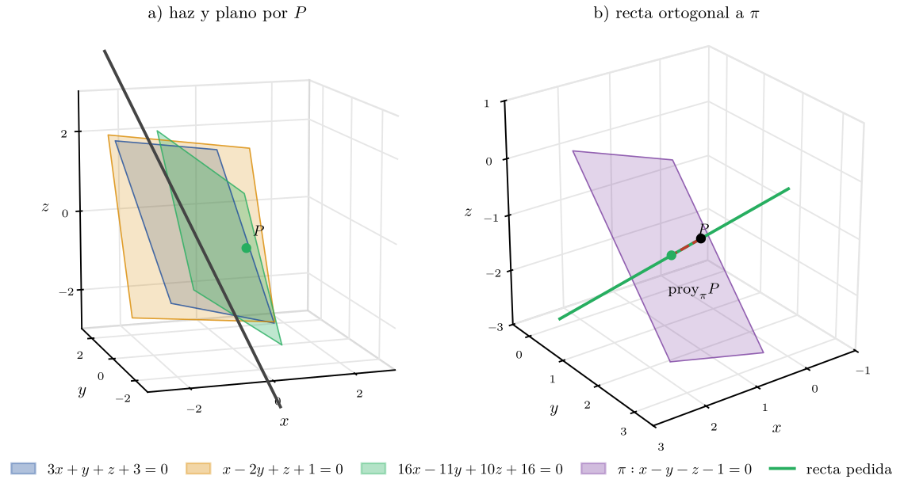

> [!TIP]
> **Respuesta:** b) $x = \tfrac43 + \lambda$, $y = \tfrac53 - \lambda$, $z = -\tfrac43 - \lambda$, con $\lambda \in \mathbb{R}$.

### Ejercicio 3 — Determinante por columnas y sistema homogéneo

<!-- temas: DET SIST -->

> Sea $A \in \mathbb{R}^{3\times3}$ inversible y sea $B = (4A_1 - A_2 \mid hA_2 \mid A_2 - A_3)$, donde $A_j$ es la columna $j$-ésima de $A$.
>
> a) Hallar $h \in \mathbb{R}$ para que $\det(BA^{-1}) = 4$.
> b) Sea $C = \lambda I \in \mathbb{R}^{3\times3}$. Clasificar el sistema lineal homogéneo $(AC + A)X = 0$ para todo $\lambda \in \mathbb{R}$.

**a) Idea.** No se conoce $A$, pero no hace falta: con las propiedades del determinante por columnas (apéndice A) se escribe $\det B$ como un número por $\det A$. Después, $\det(BA^{-1}) = \det B / \det A$.

Paso a paso:

1. La columna 2 es $h A_2$: sale el factor $h$.
2. Con $A_2$ sola en la columna 2, se le puede sumar o restar a cualquier otra columna un múltiplo de ella sin cambiar el determinante: en la columna 1 se suma $A_2$ (queda $4A_1$) y en la 3 se resta $A_2$ (queda $-A_3$).
3. Salen el 4 de la columna 1 y el $-1$ de la columna 3.

$$
\begin{aligned}
\det B &= h \det(4A_1 - A_2 \mid A_2 \mid A_2 - A_3) = h \det(4A_1 \mid A_2 \mid -A_3) \\
&= h \cdot 4 \cdot (-1) \det(A_1 \mid A_2 \mid A_3) = {\color{RoyalBlue} -4h \det A}
\end{aligned}
$$

$$
\det(BA^{-1}) = \det B \cdot \frac{1}{\det A} = -4h = 4 \implies {\color{ForestGreen}\boxed{h = -1}}
$$

**b) Idea.** Un sistema homogéneo siempre tiene la solución $X = 0$. Es compatible determinado si la matriz es inversible (determinante no nulo); si no, es compatible indeterminado.

Como $C = \lambda I$, $AC = \lambda A$ y la matriz del sistema es $\lambda A + A = (\lambda + 1)A$. El escalar multiplica las 3 columnas:

$$
\det\big((\lambda + 1)A\big) = (\lambda + 1)^3 \det A, \qquad \det A \neq 0
$$

> [!TIP]
> **Respuesta:** b) si $\lambda \neq -1$, compatible determinado (solo $X = 0$). Si $\lambda = -1$, la matriz es nula, $0X = 0$ y el sistema es compatible indeterminado: todo $\mathbb{R}^3$ es solución.

### Ejercicio 4 — Coordenadas en una base y subespacio de matrices

<!-- temas: COORD SUBESP -->

> a) Sea $B = \{2x + 3,\ 3x^2 - 12,\ p(x)\}$ una base de $P_2$. Hallar $p(x)$ para que $[x]_B = (2, -1, 3)^t$.
> b) Sea $S = \{A \in \mathbb{R}^{2\times2} / AB = A^t\}$ siendo $B = \begin{pmatrix} 1 & -1 \\ 0 & 2 \end{pmatrix}$. Hallar base y dimensión de $S$.

**a) Idea.** $[x]_B = (2,\,-1,\,3)$ significa que $x$ se escribe como $2$ veces el primer vector de $B$, $-1$ vez el segundo y $3$ veces el tercero. La única incógnita es el tercero.

$$
x = 2(2x + 3) - (3x^2 - 12) + 3\,p(x) = 4x + 6 - 3x^2 + 12 + 3\,p(x)
$$

$$
3\,p(x) = x - 4x - 18 + 3x^2 = 3x^2 - 3x - 18 \implies {\color{ForestGreen}\boxed{p(x) = x^2 - x - 6}}
$$

Falta comprobar que con ese $p$ el conjunto es base. Tres polinomios de $P_2$ son base si son LI; con sus coeficientes en el orden $(1,\,x,\,x^2)$ como filas:

$$
\begin{aligned}
\begin{vmatrix} 3 & 2 & 0 \\ -12 & 0 & 3 \\ -6 & -1 & 1 \end{vmatrix} &=  3\left[0 \cdot 1 - 3 \cdot (-1)\right] - 2\left[(-12) \cdot 1 - 3 \cdot (-6)\right] + 0\left[(-12) \cdot (-1) - 0 \cdot (-6)\right] \\ &= -3 \neq 0
\end{aligned}
$$

**b) Idea.** $S$ está definido por una ecuación matricial. Se escribe una matriz genérica, se hace la cuenta y se igualan las entradas: salen ecuaciones lineales en $a, b, c, d$.

$$
AB = \begin{pmatrix} a & b \\ c & d \end{pmatrix}\begin{pmatrix} 1 & -1 \\ 0 & 2 \end{pmatrix} = \begin{pmatrix} a & -a + 2b \\ c & -c + 2d \end{pmatrix}, \qquad A^t = \begin{pmatrix} a & c \\ b & d \end{pmatrix}
$$

Igualando entrada por entrada: $a = a$ (no aporta), $-a + 2b = c$, $c = b$, $-c + 2d = d$. De la tercera, $c = b$; en la segunda, $-a + 2b = b$, o sea $a = b$; en la cuarta, $d = c = b$. Todas las entradas son iguales a $b$:

$$
A = \begin{pmatrix} b & b \\ b & b \end{pmatrix} = b\begin{pmatrix} 1 & 1 \\ 1 & 1 \end{pmatrix}
$$

> [!TIP]
> **Respuesta:** b) $S = \mathrm{gen}\left\{\begin{pmatrix} 1 & 1 \\ 1 & 1 \end{pmatrix}\right\}$, $\dim S = 1$.

### Ejercicio 5 — Intersección, suma y complemento ortogonal en $\mathbb{R}^4$

<!-- temas: INTSUM ORTC -->

> Sean $S = \{(x, y, z, w) \in \mathbb{R}^4 / x + z - w = 0,\ y = 0\}$ y $T = \{(x, y, z, w) \in \mathbb{R}^4 / z + w = 0\}$.
>
> a) Hallar $S \cap T$ y la dimensión de $S + T$. Analizar si la suma es directa.
> b) Hallar $k \in \mathbb{R}$ para que $(2, 3, k, -2) \in S^\perp$.

**a) Idea.** Con los dos subespacios dados por ecuaciones, la intersección son los vectores que cumplen **todas** las ecuaciones. Para la suma no hace falta calcularla: alcanza con la fórmula de Grassmann.

$S \cap T$: $y = 0$, $w = x + z$ y $z = -w$. Reemplazando la tercera en la segunda: $w = x - w$, o sea $x = 2w$; y $z = -w$. Con $w$ libre:

$$
(x,\,y,\,z,\,w) = (2w,\ 0,\ -w,\ w) = w\,(2,\,0,\,-1,\,1) \implies S \cap T = \mathrm{gen}\{(2,\,0,\,-1,\,1)\}
$$

y $\dim(S \cap T) = 1$.

Dimensiones: en $\mathbb{R}^4$, cada ecuación independiente baja la dimensión en 1. $\dim S = 4 - 2 = 2$, $\dim T = 4 - 1 = 3$:

$$
\dim(S + T) = \dim S + \dim T - \dim(S \cap T) = 2 + 3 - 1 = 4
$$

> [!TIP]
> **Respuesta:** a) $S \cap T = \mathrm{gen}\{(2, 0, -1, 1)\}$; $\dim(S + T) = 4$, o sea $S + T = \mathbb{R}^4$. La suma **no** es directa: $S \cap T \neq \{0\}$.

**b) Idea.** Si $S$ está dado por ecuaciones, los vectores de coeficientes de esas ecuaciones generan $S^\perp$: cada ecuación dice «el vector es perpendicular a este».

$x + z - w = 0$ es $(1,\,0,\,1,\,-1) \cdot (x,\,y,\,z,\,w) = 0$, e $y = 0$ es $(0,\,1,\,0,\,0) \cdot (x,\,y,\,z,\,w) = 0$. Entonces $S^\perp = \mathrm{gen}\{(1,\,0,\,1,\,-1),\ (0,\,1,\,0,\,0)\}$, y se busca:

$$
(2,\,3,\,k,\,-2) = \alpha(1,\,0,\,1,\,-1) + \beta(0,\,1,\,0,\,0) = (\alpha,\ \beta,\ \alpha,\ -\alpha)
$$

De la primera, $\alpha = 2$; de la segunda, $\beta = 3$; la cuarta cierra ($-2 = -2$) y la tercera da $k = \alpha$.

> [!TIP]
> **Respuesta:** b) $k = 2$.

### Tema 2

> [!NOTE]
> La foto del parcial rendido el 08/08/2026 (`fuentes/2026-08-08_parcial_rendido_foto.jpg`) es de este tema.

#### Ej. 1

> $r_1: \begin{cases} 3x + 4y - a = 0 \\ x - y + z = 0 \end{cases}$, $r_2: \dfrac{x-1}{2} = -y = \dfrac{z+7}{3}$. a) Plano que contiene a $r_2$ y es paralelo al eje de cotas. b) $a$ para que $d(r_1, r_2) = 0$.

$r_2$: punto $(1,\,0,\,-7)$, dirección $(2,\,-1,\,3)$ (el $-y$ es $\frac{y - 0}{-1}$). a) El eje de cotas es el eje $z$: $\vec n = (2,\,-1,\,3) \times (0,\,0,\,1) = (-1,\,-2,\,0) \parallel (1,\,2,\,0)$; por $(1,\,0,\,-7)$, $D = -1$. b) $\vec u_1 = (3,\,4,\,0) \times (1,\,-1,\,1) = (4,\,-3,\,-7)$, no paralela a $r_2$. $r_2 = (1 + 2t,\ -t,\ -7 + 3t)$ en $x - y + z = 0$: $6t - 6 = 0$, $t = 1$, punto $(3,\,-1,\,-4)$; en la otra ecuación, $9 - 4 - a = 0$.

> [!TIP]
> **Respuesta:** a) $x + 2y - 1 = 0$; b) $a = 5$.

#### Ej. 2

> $\pi: (x, y, z) = \alpha(1, 1, 0) + \beta(3, 1, 2) + (1, 1, -1)$, $P = (1, -1, 2)$. a) Plano del haz $t(x + y - 2z + 1) + s(3x + y + z + 3) = 0$ que contenga a $P$. b) Paramétricas de la recta ortogonal a $\pi$ que pasa por $\mathrm{proy}_\pi(P)$.

a) En $P$: $1 - 1 - 4 + 1 = -3$ y $3 - 1 + 2 + 3 = 7$, así que $-3t + 7s = 0$; con $t = 7$, $s = 3$. b) $\vec n = (1,\,1,\,0) \times (3,\,1,\,2) = (2,\,-2,\,-2) \parallel (1,\,-1,\,-1)$ y $\pi: x - y - z - 1 = 0$. Recta por $P$: $(1 + \lambda,\ -1 - \lambda,\ 2 - \lambda)$; en $\pi$, $3\lambda - 1 = 0$, y $\mathrm{proy}_\pi(P) = \left(\tfrac43,\,-\tfrac43,\,\tfrac53\right)$.

> [!TIP]
> **Respuesta:** a) $16x + 10y - 11z + 16 = 0$; b) $x = \tfrac43 + \lambda$, $y = -\tfrac43 - \lambda$, $z = \tfrac53 - \lambda$.

#### Ej. 3

> $B = (5A_1 + A_2 \mid bA_2 \mid A_1 - A_3)$. a) $b$ para que $\det(A^{-1}B) = 5$. b) Clasificar $(A + CA)X = 0$, con $C = \mu I$.

a) $\det B = b \det(5A_1 \mid A_2 \mid A_1 - A_3) = 5b \det(A_1 \mid A_2 \mid -A_3) = -5b \det A$, y $-5b = 5$. b) $A + \mu A = (1 + \mu)A$.

> [!TIP]
> **Respuesta:** a) $b = -1$; b) $\mu \neq -1$: compatible determinado; $\mu = -1$: compatible indeterminado (todo $\mathbb{R}^3$).

#### Ej. 4

> a) $B = \{q(x),\ 2x + 3,\ 3x^2 - 12\}$ base de $P_2$; $q$ para que $[x]_B = (3, 2, -1)^t$. b) $W = \{A \in \mathbb{R}^{2\times2} / BA^t = A\}$, $B = \begin{pmatrix} 1 & 0 \\ -1 & 2 \end{pmatrix}$: base y dimensión.

a) $x = 3q + 2(2x + 3) - (3x^2 - 12)$, de donde $3q = 3x^2 - 3x - 18$: el mismo polinomio del Tema 1. b) Primero se traspone: $BA^t = \begin{pmatrix} a & c \\ -a + 2b & -c + 2d \end{pmatrix} = \begin{pmatrix} a & b \\ c & d \end{pmatrix}$, o sea $c = b$, $-a + 2b = c$, $-c + 2d = d$; otra vez $a = b = c = d$.

> [!TIP]
> **Respuesta:** a) $q(x) = x^2 - x - 6$; b) $W = \mathrm{gen}\left\{\begin{pmatrix} 1 & 1 \\ 1 & 1 \end{pmatrix}\right\}$, $\dim W = 1$.

#### Ej. 5

> $S = \{y + w = 0\}$, $T = \{x + y - w = 0,\ z = 0\}$ en $\mathbb{R}^4$. a) $S \cap T$, $\dim(S + T)$, ¿directa? b) $h$ para que $(2, h, 3, -2) \in T^\perp$.

a) $z = 0$, $w = -y$ y $x + y + y = 0$: $x = -2y$. $\dim(S + T) = 3 + 2 - 1 = 4$. b) $T^\perp = \mathrm{gen}\{(1,\,1,\,0,\,-1),\ (0,\,0,\,1,\,0)\}$ y $(2,\,h,\,3,\,-2) = 2(1,\,1,\,0,\,-1) + 3(0,\,0,\,1,\,0)$.

> [!TIP]
> **Respuesta:** a) $S \cap T = \mathrm{gen}\{(-2, 1, 0, -1)\}$, $\dim(S + T) = 4$, no es directa; b) $h = 2$.

<!-- salto-pagina -->

## P2 — 1er parcial del 12/08/2019 (T.T.)

*Origen:* `fuentes/2019-08-12_TT_parcial.pdf` (en el campus: `Primer Parcial Lu.pdf`), Tema 1 (el único que está en el campus).

### Ejercicio 1 — Plano del haz sobre el que una recta se proyecta en un punto

<!-- temas: HAZ PROY -->

> Hallar la ecuación implícita del plano en el haz $\alpha(x + y - z + 2) + \beta(x + y) = 0$, con $\alpha, \beta \in \mathbb{R}$, tal que la proyección ortogonal de la recta $L: \begin{cases} x - y = 0 \\ x + 2y + z + 3 = 0 \end{cases}$ sea el punto $P$.

> [!NOTE]
> El enunciado no define $P$: se entiende «sea **un** punto». Al final se calcula cuál es.

**Idea.** Al proyectar ortogonalmente una recta sobre un plano, en general se obtiene otra recta. Se obtiene un solo punto únicamente si la recta es **perpendicular** al plano: todos sus puntos caen en el mismo pie. Entonces la dirección de $L$ tiene que ser paralela a la normal del plano.

Dirección de $L$:

$$
\begin{aligned}
\vec u_L = \begin{vmatrix} \vec\imath & \vec\jmath & \vec k \\ 1 & -1 & 0 \\ 1 & 2 & 1 \end{vmatrix} &= \big((-1) \cdot 1 - 0 \cdot 2,\ \ -\left[1 \cdot 1 - 0 \cdot 1\right],\ \ 1 \cdot 2 - (-1) \cdot 1\big) \\ &= (-1,\ -1,\ 3)
\end{aligned}
$$

o sea, $(1,\,1,\,-3)$. La normal de un plano del haz se lee agrupando: $\alpha(x + y - z + 2) + \beta(x + y) = (\alpha + \beta)x + (\alpha + \beta)y - \alpha z + 2\alpha$, normal $(\alpha + \beta,\ \alpha + \beta,\ -\alpha)$. Para que sea múltiplo de $(1,\,1,\,-3)$, la tercera componente tiene que ser $-3$ veces la primera:

$$
-\alpha = -3(\alpha + \beta) \implies 2\alpha = -3\beta \implies \alpha = 3,\ \beta = -2
$$

$$
3(x + y - z + 2) - 2(x + y) = x + y - 3z + 6 = 0
$$

**El punto.** Se resuelve $L$ con el plano: de $x - y = 0$, $y = x$; de la segunda ecuación de $L$, $z = -3 - 3x$. En el plano:

$$
x + x - 3(-3 - 3x) + 6 = 0 \implies 11x + 15 = 0 \implies x = -\tfrac{15}{11}, \quad y = -\tfrac{15}{11}, \quad z = -3 + \tfrac{45}{11} = \tfrac{12}{11}
$$

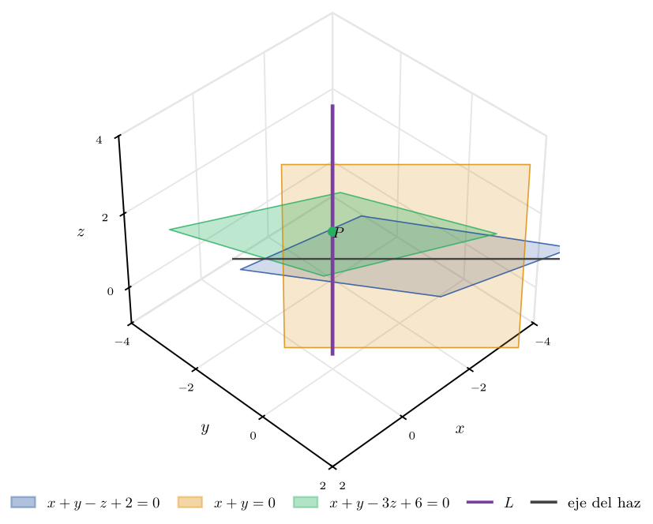

> [!TIP]
> **Respuesta:** $x + y - 3z + 6 = 0$; $L$ se proyecta en $P = \left(-\tfrac{15}{11},\ -\tfrac{15}{11},\ \tfrac{12}{11}\right)$.

### Ejercicio 2 — Rectas alabeadas y distancia recta–plano

<!-- temas: REC DIST -->

> Dadas $L: (x, y, z) = \lambda(3a + 1, -3, 1) + (1, 0, 0)$ y $r: x - 2 = y + 2 = -z$.
>
> a) Hallar $a \in \mathbb{R}$ para que las rectas sean alabeadas.
> b) Calcular la distancia entre la recta $r$ y el plano $\pi: x + z - 4 = 0$.

$r$: punto $(2,\,-2,\,0)$, dirección $(1,\,1,\,-1)$. $L$: punto $(1,\,0,\,0)$, dirección $(3a + 1,\,-3,\,1)$.

**a) Idea.** Dos rectas en el espacio pueden ser paralelas, cortarse o cruzarse sin tocarse (alabeadas). Las alabeadas son las **no coplanares**: el producto mixto de las dos direcciones y del vector que une un punto de cada una no es cero.

Paralelas no pueden ser nunca: $(3a + 1,\,-3,\,1) = k(1,\,1,\,-1)$ pediría $k = -3$ (segunda componente) y $k = -1$ (tercera). Vector entre los puntos: $(2,\,-2,\,0) - (1,\,0,\,0) = (1,\,-2,\,0)$.

$$
\begin{aligned}
[\vec u_L,\ \vec u_r,\ \overrightarrow{P_LP_r}] = \begin{vmatrix} 3 a + 1 & -3 & 1 \\ 1 & 1 & -1 \\ 1 & -2 & 0 \end{vmatrix} &=  (3 a + 1)\left[1 \cdot 0 - (-1) \cdot (-2)\right] \\ &\quad - (-3)\left[1 \cdot 0 - (-1) \cdot 1\right] + 1\left[1 \cdot (-2) - 1 \cdot 1\right] \\ &= - 6 a - 2
\end{aligned}
$$

Se anula solo en $a = -\tfrac13$: ahí son coplanares y, como no son paralelas, se cortan (en $(1,\,-3,\,1)$).

> [!TIP]
> **Respuesta:** a) alabeadas para todo $a \neq -\tfrac13$.

**b) Idea.** Si la recta corta al plano, la distancia es 0. Si es paralela, todos sus puntos están a la misma distancia: alcanza con uno.

$\vec u_r \cdot \vec n_\pi = (1,\,1,\,-1) \cdot (1,\,0,\,1) = 1 + 0 - 1 = 0$: la dirección de $r$ es perpendicular a la normal, así que $r$ es paralela a $\pi$. Desde $(2,\,-2,\,0)$:

$$
d(r, \pi) = \frac{|1 \cdot 2 + 0 \cdot (-2) + 1 \cdot 0 - 4|}{\sqrt{1^2 + 0^2 + 1^2}} = \frac{2}{\sqrt2} = \frac{2\sqrt2}{2} \implies {\color{ForestGreen}\boxed{d = \sqrt2}}
$$

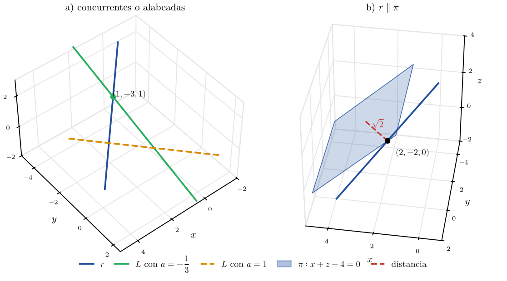

### Ejercicio 3 — Determinante con una matriz ortogonal

<!-- temas: DET -->

> Sean $A, B, C \in \mathbb{R}^{3\times3}$ tales que $A = 3I$ y $B = (C_3 - C_1 \mid 2C_2 \mid C_1)$.
>
> a) Si $C$ es ortogonal, calcular los posibles valores de $\det(B)$.
> b) Si $\det(C) = 2$, calcular $\det(3ABC^{-1})$.

**Idea.** Primero se escribe $\det B$ en función de $\det C$; después se usa lo que dice cada inciso sobre $C$.

$C_1$ está sola en la columna 3: se suma a la columna 1 y desaparece el $-C_1$. Sale el 2 de la columna 2. Queda $(C_3 \mid C_2 \mid C_1)$, que es $C$ con las columnas 1 y 3 intercambiadas: un intercambio cambia el signo.

$$
\det B = \det(C_3 - C_1 \mid 2C_2 \mid C_1) = 2\det(C_3 \mid C_2 \mid C_1) = {\color{RoyalBlue} -2\det C}
$$

**a)** $C$ ortogonal quiere decir $C^tC = I$. Tomando determinante: $\det(C^t)\det(C) = 1$, y como $\det C^t = \det C$, $(\det C)^2 = 1$, $\det C = \pm 1$.

> [!TIP]
> **Respuesta:** a) $\det B = 2$ o $\det B = -2$.

**b)** Cuidado con el 3: multiplica una matriz de $3 \times 3$, así que sale $3^3$. Además $\det A = \det(3I) = 3^3 = 27$ y $\det B = -2 \cdot 2 = -4$:

$$
\det(3ABC^{-1}) = 3^3 \cdot \det A \cdot \det B \cdot \frac{1}{\det C} = 27 \cdot 27 \cdot (-4) \cdot \frac12 = 729 \cdot (-2) \implies {\color{ForestGreen}\boxed{-1458}}
$$

### Ejercicio 4 — Verdadero o falso: sistema homogéneo y dimensión de un generado

<!-- temas: SIST LI VF -->

> a) Sean $A \in \mathbb{R}^{2\times2}$ inversible y $B \in \mathbb{R}^{2\times2}$ de rango 2. Entonces el sistema $(A + B)X = 0$ es compatible determinado.
> b) Si $S = \mathrm{gen}\{x^2,\ x + 3,\ 1 - ax - x^2\}$, entonces $\dim(S) = 3$ para todo $a \in \mathbb{R}$.

**a) Idea.** Un «para todo» se cae con un solo contraejemplo. Rango 2 en $2 \times 2$ quiere decir inversible, pero la suma de inversibles no tiene por qué serlo.

Con $A = I$ y $B = -I$ (las dos inversibles): $A + B = 0$, y $0X = 0$ tiene infinitas soluciones.

> [!TIP]
> **Respuesta:** a) **Falso**.

**b) Idea.** $\dim S = 3$ si y solo si los tres polinomios son LI, es decir, si el determinante de sus coeficientes no se anula. Si se anula para algún $a$, es falso.

Coeficientes en el orden $(1,\,x,\,x^2)$: $x^2 \to (0,\,0,\,1)$; $x + 3 \to (3,\,1,\,0)$; $1 - ax - x^2 \to (1,\,-a,\,-1)$.

$$
\begin{aligned}
\begin{vmatrix} 0 & 0 & 1 \\ 3 & 1 & 0 \\ 1 & - a & -1 \end{vmatrix} &=  0\left[1 \cdot (-1) - 0 \cdot (- a)\right] - 0\left[3 \cdot (-1) - 0 \cdot 1\right] + 1\left[3 \cdot (- a) - 1 \cdot 1\right] \\ &= - 3 a - 1
\end{aligned}
$$

Se anula en $a = -\tfrac13$.

> [!TIP]
> **Respuesta:** b) **Falso**: con $a = -\tfrac13$, $\dim S = 2$.

### Ejercicio 5 — Intersección y complemento ortogonal en $\mathbb{R}^4$

<!-- temas: INTSUM ORTC -->

> Sean $S = \{(x, y, z, w) \in \mathbb{R}^4 / y - z = 0,\ x + w = 0\}$ y\
> $T = \mathrm{gen}\{(0, 1, 1, 1), (1, 3, 3, 0), (1, 1, 1, -2)\}$.
>
> a) Hallar base y dimensión de $S \cap T$.
> b) Hallar base y dimensión del complemento ortogonal de $S$.

**a) Idea.** $S$ viene con ecuaciones y $T$ con generadores. Lo más directo es pasar $T$ a ecuaciones y juntar todas. Antes hay que ver si los generadores de $T$ son LI.

$(1,\,3,\,3,\,0) - (1,\,1,\,1,\,-2) = (0,\,2,\,2,\,2) = 2(0,\,1,\,1,\,1)$: el segundo generador es combinación de los otros dos. $T = \mathrm{gen}\{(0,\,1,\,1,\,1),\ (1,\,1,\,1,\,-2)\}$, $\dim T = 2$.

Ecuaciones de $T$: un vector genérico es

$$
\alpha(0,\,1,\,1,\,1) + \beta(1,\,1,\,1,\,-2) = (\beta,\ \alpha + \beta,\ \alpha + \beta,\ \alpha - 2\beta)
$$

Se eliminan $\alpha$ y $\beta$: $y = z$ (las dos valen $\alpha + \beta$); $\beta = x$, $\alpha = y - x$ y entonces $w = (y - x) - 2x = y - 3x$. $T = \{y - z = 0,\ 3x - y + w = 0\}$.

$S \cap T$: $y = z$, $w = -x$ y $3x - y + w = 0$. Reemplazando $w$: $3x - y - x = 0$, $y = 2x$:

$$
(x,\,y,\,z,\,w) = (x,\ 2x,\ 2x,\ -x) = x\,(1,\,2,\,2,\,-1)
$$

Verificación: $(1,\,2,\,2,\,-1) = 1 \cdot (0,\,1,\,1,\,1) + 1 \cdot (1,\,1,\,1,\,-2)$, está en $T$.

> [!TIP]
> **Respuesta:** a) $S \cap T = \mathrm{gen}\{(1, 2, 2, -1)\}$, $\dim(S \cap T) = 1$.

**b)** Los coeficientes de las ecuaciones de $S$, $y - z = 0$ y $x + w = 0$, generan $S^\perp$, y $\dim S^\perp = 4 - \dim S = 4 - 2 = 2$.

> [!TIP]
> **Respuesta:** b) $S^\perp = \mathrm{gen}\{(0, 1, -1, 0),\ (1, 0, 0, 1)\}$, dimensión 2.

<!-- salto-pagina -->

## P3 — 1er parcial del 13/08/2019 (T.M.)

*Origen:* `fuentes/2019-08-13_TM_parcial.pdf` (en el campus: `Primer Parcial Ma.pdf`), Temas 1 y 2.

### Ejercicio 1 — Plano ortogonal a una recta que contiene a otra

<!-- temas: PLANO -->

> Hallar la ecuación implícita del plano ortogonal a la recta $L: \begin{cases} x + ay - z = 1 \\ y + 3z = 0 \end{cases}$ y que contenga a la recta $r: x - 2 = y + 1 = -z$.

**Idea.** El parámetro $a$ no es dato: hay que encontrarlo. Hay dos condiciones:

- plano **ortogonal** a $L$: su normal es la dirección de $L$;
- plano que **contiene** a $r$: la normal es perpendicular a la dirección de $r$, y el plano pasa por un punto de $r$.

La primera da la normal en función de $a$; la segunda fija $a$.

$$
\begin{aligned}
\vec n = \vec u_L = \begin{vmatrix} \vec\imath & \vec\jmath & \vec k \\ 1 & a & -1 \\ 0 & 1 & 3 \end{vmatrix} &= \big(a \cdot 3 - (-1) \cdot 1,\ \ -\left[1 \cdot 3 - (-1) \cdot 0\right],\ \ 1 \cdot 1 - a \cdot 0\big) \\ &= (3 a + 1,\ -3,\ 1)
\end{aligned}
$$

$r$: punto $(2,\,-1,\,0)$, dirección $(1,\,1,\,-1)$. Condición de perpendicularidad:

$$
\vec n \cdot \vec u_r = (3a + 1) \cdot 1 + (-3) \cdot 1 + 1 \cdot (-1) = 3a - 3 = 0 \implies a = 1 \implies \vec n = {\color{RoyalBlue}(4,\,-3,\,1)}
$$

Plano $4x - 3y + z + D = 0$ por $(2,\,-1,\,0)$: $8 + 3 + 0 + D = 0$, $D = -11$.

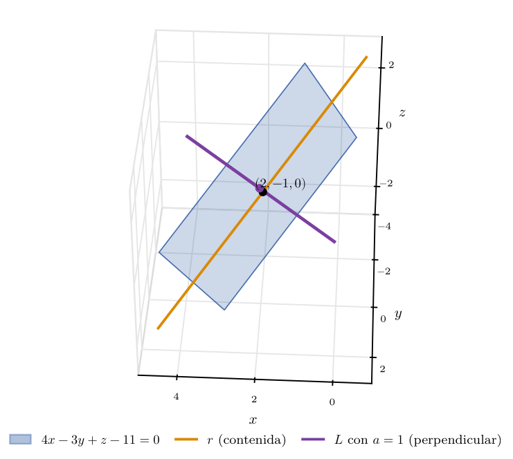

> [!TIP]
> **Respuesta:** $4x - 3y + z - 11 = 0$ (existe solo con $a = 1$).

### Ejercicio 2 — Punto a distancia 1 de una recta

<!-- temas: DIST -->

> Sea $P = (1, b, b)$ y $L: (x, y, z) = \lambda(1, 0, 1)$ con $\lambda \in \mathbb{R}$. Hallar $b \in \mathbb{R}$ para que $d(P, L) = 1$.

**Idea.** La distancia de un punto a una recta es el área del paralelogramo que forman $\overrightarrow{AP}$ y $\vec u$ ($A$ un punto de la recta) dividida por la base $|\vec u|$:

$$
d(P, L) = \frac{\left|\overrightarrow{AP} \times \vec u\right|}{|\vec u|}
$$

$L$ pasa por el origen, así que $\overrightarrow{AP} = (1,\,b,\,b)$.

$$
\begin{aligned}
\overrightarrow{AP} \times \vec u = \begin{vmatrix} \vec\imath & \vec\jmath & \vec k \\ 1 & b & b \\ 1 & 0 & 1 \end{vmatrix} &= \big(b \cdot 1 - b \cdot 0,\ \ -\left[1 \cdot 1 - b \cdot 1\right],\ \ 1 \cdot 0 - b \cdot 1\big) \\ &= (b,\ b - 1,\ - b)
\end{aligned}
$$

Para evitar raíces se trabaja con $d^2 = 1$:

$$
d^2 = \frac{b^2 + (b - 1)^2 + b^2}{1^2 + 0^2 + 1^2} = \frac{3b^2 - 2b + 1}{2} = 1 \implies 3b^2 - 2b - 1 = 0
$$

$$
b = \frac{2 \pm \sqrt{4 + 12}}{6} = \frac{2 \pm 4}{6} \implies b = 1 \ \text{o}\ b = -\tfrac13
$$

Los puntos a distancia 1 de $L$ forman un cilindro de radio 1 alrededor de $L$. Los puntos $(1,\,b,\,b)$ recorren una recta que corta a ese cilindro en dos puntos: por eso hay dos respuestas.

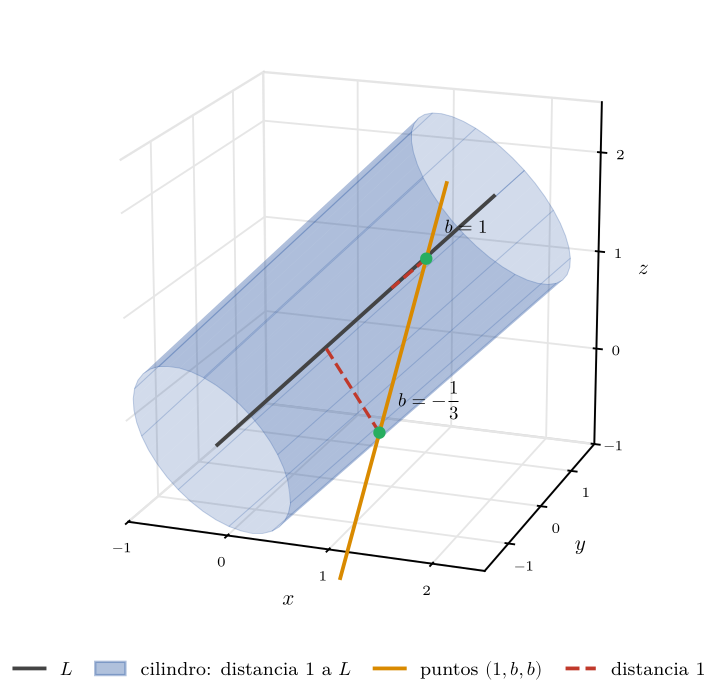

> [!TIP]
> **Respuesta:** $b = 1$ o $b = -\tfrac13$.

### Ejercicio 3 — Determinante de una matriz de $4 \times 4$ armada por columnas

<!-- temas: DET RANGO -->

> Sea $A \in \mathbb{R}^{4\times4}$ y $B = (3A_3 \mid A_3 - A_2 \mid 4A_1 \mid A_4)$.
>
> a) Si $A = \mathrm{diag}(k,\ 1,\ k - 1,\ 1)$, hallar $k \in \mathbb{R}$ para que $B$ sea singular.
> b) Si $A = \lambda I$, hallar $\lambda \in \mathbb{R}$ para que $\det(2B^t) = 12$.

**Idea.** La misma relación $\det B = (\text{número}) \cdot \det A$ resuelve los dos incisos.

1. Salen el 3 (columna 1) y el 4 (columna 3).
2. $A_3$ está sola en la columna 1: se suma a la columna 2 y queda $-A_2$; sale el $-1$.
3. Queda $(A_3 \mid A_2 \mid A_1 \mid A_4)$: intercambiando las columnas 1 y 3 se vuelve a $A$, con un cambio de signo.

$$
\begin{aligned}
\det B &= 3 \cdot 4 \det(A_3 \mid A_3 - A_2 \mid A_1 \mid A_4) = 12 \cdot (-1) \det(A_3 \mid A_2 \mid A_1 \mid A_4) \\
&= -12 \cdot (-\det A) = {\color{RoyalBlue} 12 \det A}
\end{aligned}
$$

**a)** $B$ es singular si $\det B = 0$, o sea, si $\det A = 0$. $A$ es diagonal: su determinante es el producto de la diagonal, $k \cdot 1 \cdot (k - 1) \cdot 1$.

> [!TIP]
> **Respuesta:** a) $k = 0$ o $k = 1$.

**b)** $\det A = \det(\lambda I) = \lambda^4$. El 2 multiplica una matriz de $4 \times 4$ y la traspuesta no cambia el determinante:

$$
\det(2B^t) = 2^4 \det B = 16 \cdot 12\,\lambda^4 = 12 \implies \lambda^4 = \frac{1}{16} \implies \lambda = \pm\frac12
$$

> [!TIP]
> **Respuesta:** b) $\lambda = \tfrac12$ o $\lambda = -\tfrac12$.

### Ejercicio 4 — Verdadero o falso: base de $\mathbb{R}^3$ y subespacios de $P_2$

<!-- temas: LI INTSUM VF -->

> a) El conjunto $B = \{(1, 0, 0), (0, 1, 3), (1, a, -1)\}$ es una base de $\mathbb{R}^3$ para todo $a \in \mathbb{R}$.
> b) Sean $S = \{p \in P_2 / 0 \text{ es raíz de } p\}$ y $T = \mathrm{gen}\{x\}$. Entonces $\dim(S \cap T) = 1$.

**a)** Tres vectores de $\mathbb{R}^3$ son base si el determinante que forman no es cero:

$$
\begin{aligned}
\begin{vmatrix} 1 & 0 & 0 \\ 0 & 1 & 3 \\ 1 & a & -1 \end{vmatrix} &=  1\left[1 \cdot (-1) - 3 \cdot a\right] - 0\left[0 \cdot (-1) - 3 \cdot 1\right] + 0\left[0 \cdot a - 1 \cdot 1\right] \\ &= - 3 a - 1
\end{aligned}
$$

> [!TIP]
> **Respuesta:** a) **Falso**: con $a = -\tfrac13$ el determinante es 0 y no es base.

**b) Idea.** Traducir la condición: $0$ es raíz de $p$ si $p(0) = 0$. Con $p = c_0 + c_1x + c_2x^2$, $p(0) = c_0$: los polinomios sin término independiente.

$S = \{c_1x + c_2x^2\} = \mathrm{gen}\{x,\ x^2\}$. Como $x \in S$, $T = \mathrm{gen}\{x\} \subset S$ y la intersección es todo $T$.

> [!TIP]
> **Respuesta:** b) **Verdadero**: $S \cap T = \mathrm{gen}\{x\}$, de dimensión 1.

### Ejercicio 5 — Matrices simétricas: suma de subespacios y coordenadas

<!-- temas: SUBESP INTSUM COORD -->

> Sean $S = \{A \in \mathbb{R}^{2\times2} / A \text{ es simétrica y de traza nula}\}$ y $B = \left\{\begin{pmatrix} 0 & 1 \\ 1 & 1 \end{pmatrix}, \begin{pmatrix} 1 & 3 \\ 3 & 0 \end{pmatrix}\right\}$ una base del subespacio $T$.
>
> a) Hallar base y dimensión de $S + T$.
> b) Hallar las coordenadas de $\begin{pmatrix} -1 & 0 \\ 0 & 3 \end{pmatrix}$ en la base $B$.

**a) Idea.** $S + T$ lo generan todos los generadores de $S$ y de $T$ juntos; después se descartan los que sobran.

Simétrica: $a_{12} = a_{21}$; traza nula: $a_{11} + a_{22} = 0$. Entonces

$$
S = \left\{\begin{pmatrix} a & b \\ b & -a \end{pmatrix}\right\} = \mathrm{gen}\left\{\begin{pmatrix} 1 & 0 \\ 0 & -1 \end{pmatrix}, \begin{pmatrix} 0 & 1 \\ 1 & 0 \end{pmatrix}\right\}
$$

Las cuatro matrices son simétricas, así que $S + T$ está dentro de las simétricas de $2 \times 2$, que tienen dimensión 3 (se eligen libremente $a_{11}$, $a_{12}$ y $a_{22}$). Basta encontrar tres de ellas que sean LI. Con las entradas $(a_{11},\,a_{12},\,a_{22})$ como filas:

$$
\begin{aligned}
\begin{vmatrix} 1 & 0 & -1 \\ 0 & 1 & 0 \\ 0 & 1 & 1 \end{vmatrix} &=  1\left[1 \cdot 1 - 0 \cdot 1\right] - 0\left[0 \cdot 1 - 0 \cdot 0\right] + (-1)\left[0 \cdot 1 - 1 \cdot 0\right] \\ &= 1 \neq 0
\end{aligned}
$$

> [!TIP]
> **Respuesta:** a) $S + T$ son todas las matrices simétricas de $2 \times 2$; base $\left\{\begin{pmatrix} 1 & 0 \\ 0 & -1 \end{pmatrix}, \begin{pmatrix} 0 & 1 \\ 1 & 0 \end{pmatrix}, \begin{pmatrix} 0 & 1 \\ 1 & 1 \end{pmatrix}\right\}$, $\dim(S + T) = 3$.

**b)** Las coordenadas son los coeficientes de la combinación:

$$
\alpha\begin{pmatrix} 0 & 1 \\ 1 & 1 \end{pmatrix} + \beta\begin{pmatrix} 1 & 3 \\ 3 & 0 \end{pmatrix} = \begin{pmatrix} \beta & \alpha + 3\beta \\ \alpha + 3\beta & \alpha \end{pmatrix} = \begin{pmatrix} -1 & 0 \\ 0 & 3 \end{pmatrix}
$$

Entrada $(1,1)$: $\beta = -1$. Entrada $(2,2)$: $\alpha = 3$. Las de afuera de la diagonal tienen que cerrar: $3 + 3(-1) = 0$.

> [!TIP]
> **Respuesta:** b) coordenadas $(3,\,-1)$.

### Tema 2

#### Ej. 1

> Plano ortogonal a $L: \begin{cases} z + ay - x = 1 \\ y + 3x = 0 \end{cases}$ que contenga a $r: -x = y + 1 = z - 2$.

Es el Tema 1 con $x \leftrightarrow z$. $r$: punto $(0,\,-1,\,2)$, dirección $(-1,\,1,\,1)$.

$$
\begin{aligned}
\vec u_L = \begin{vmatrix} \vec\imath & \vec\jmath & \vec k \\ -1 & a & 1 \\ 3 & 1 & 0 \end{vmatrix} &= \big(a \cdot 0 - 1 \cdot 1,\ \ -\left[(-1) \cdot 0 - 1 \cdot 3\right],\ \ (-1) \cdot 1 - a \cdot 3\big) \\ &= (-1,\ 3,\ - 3 a - 1)
\end{aligned}
$$

$\vec u_L \cdot \vec u_r = 1 + 3 - 1 - 3a = 3 - 3a = 0$, $a = 1$, $\vec n = (-1,\,3,\,-4) \parallel (1,\,-3,\,4)$. Por $(0,\,-1,\,2)$: $0 + 3 + 8 + D = 0$, $D = -11$.

> [!TIP]
> **Respuesta:** $x - 3y + 4z - 11 = 0$ (con $a = 1$).

#### Ej. 2

> $Q = (c, c, 1)$, $r: (x, y, z) = \lambda(1, 0, 1)$. Hallar $c$ para que $d(Q, r) = 1$.

$$
\begin{aligned}
\overrightarrow{OQ} \times \vec u = \begin{vmatrix} \vec\imath & \vec\jmath & \vec k \\ c & c & 1 \\ 1 & 0 & 1 \end{vmatrix} &= \big(c \cdot 1 - 1 \cdot 0,\ \ -\left[c \cdot 1 - 1 \cdot 1\right],\ \ c \cdot 0 - c \cdot 1\big) \\ &= (c,\ 1 - c,\ - c)
\end{aligned}
$$

$d^2 = \frac{c^2 + (1 - c)^2 + c^2}{2} = \frac{3c^2 - 2c + 1}{2} = 1$: la misma ecuación del Tema 1.

> [!TIP]
> **Respuesta:** $c = 1$ o $c = -\tfrac13$.

#### Ej. 3

> $A = (3B_3 \mid B_3 - B_2 \mid 4B_1 \mid B_4)$. a) Si $B = \mu I$, $\mu$ para que $\det(2A^t) = 12$. b) Si $B = \mathrm{diag}(1, k, 1, k - 1)$, $k$ para que $A$ sea singular.

Los papeles de $A$ y $B$ se invierten: $\det A = 12 \det B$. a) $2^4 \cdot 12\,\mu^4 = 12$, $\mu^4 = \tfrac1{16}$. b) $\det B = 1 \cdot k \cdot 1 \cdot (k - 1)$.

> [!TIP]
> **Respuesta:** a) $\mu = \pm\tfrac12$; b) $k = 0$ o $k = 1$.

#### Ej. 4

> a) $S = \{p \in P_2 / 0 \text{ es raíz de } p\}$, $T = \mathrm{gen}\{x^2\}$: $\dim(S \cap T) = 1$. b) $\{(0, 0, 1), (3, 1, 0), (-1, a, 1)\}$ es base de $\mathbb{R}^3$ para todo $a$.

a) $x^2$ no tiene término independiente: $x^2 \in S$, $T \subset S$ y $S \cap T = T$. b)

$$
\begin{aligned}
\begin{vmatrix} 0 & 0 & 1 \\ 3 & 1 & 0 \\ -1 & a & 1 \end{vmatrix} &=  0\left[1 \cdot 1 - 0 \cdot a\right] - 0\left[3 \cdot 1 - 0 \cdot (-1)\right] + 1\left[3 \cdot a - 1 \cdot (-1)\right] \\ &= 3 a + 1
\end{aligned}
$$

> [!TIP]
> **Respuesta:** a) **Verdadero**; b) **Falso** (con $a = -\tfrac13$ no es base).

#### Ej. 5

> $T$ = simétricas de traza nula, $B = \left\{\begin{pmatrix} 1 & 3 \\ 3 & 0 \end{pmatrix}, \begin{pmatrix} 0 & 1 \\ 1 & 1 \end{pmatrix}\right\}$ base de $S$. a) Base y dimensión de $S + T$. b) Coordenadas de $\begin{pmatrix} 1 & 0 \\ 0 & -3 \end{pmatrix}$ en $B$.

a) Igual que el Tema 1, con los nombres $S$ y $T$ cambiados. b) $\alpha\begin{pmatrix} 1 & 3 \\ 3 & 0 \end{pmatrix} + \beta\begin{pmatrix} 0 & 1 \\ 1 & 1 \end{pmatrix} = \begin{pmatrix} \alpha & 3\alpha + \beta \\ 3\alpha + \beta & \beta \end{pmatrix}$: $\alpha = 1$, $\beta = -3$, y $3 - 3 = 0$ cierra.

> [!TIP]
> **Respuesta:** a) las simétricas de $2 \times 2$, $\dim(S + T) = 3$; b) coordenadas $(1,\,-3)$.

<!-- salto-pagina -->

## P4 — 1er parcial del 14/08/2019 (T.M.)

*Origen:* `fuentes/2019-08-14_TM_parcial.pdf` (en el campus: `Primer Parcial Mi.pdf`), Temas 1 y 2.

### Ejercicio 1 — Planos a una distancia dada de otro plano

<!-- temas: PLANO DIST -->

> Hallar la ecuación implícita de los planos que estén a distancia $\sqrt{11}/11$ del plano $\pi: (x, y, z) = \alpha(1, 2, 1) + \beta(0, 1, -1) + (1, 2, 3)$ con $\alpha, \beta \in \mathbb{R}$.

**Idea.** Un plano que no es paralelo a $\pi$ lo corta, y entonces su distancia a $\pi$ es 0. Los planos buscados son **paralelos** a $\pi$: tienen la misma normal y solo cambia el término independiente. Hay dos, uno de cada lado.

$$
\begin{aligned}
\vec n = \begin{vmatrix} \vec\imath & \vec\jmath & \vec k \\ 1 & 2 & 1 \\ 0 & 1 & -1 \end{vmatrix} &= \big(2 \cdot (-1) - 1 \cdot 1,\ \ -\left[1 \cdot (-1) - 1 \cdot 0\right],\ \ 1 \cdot 1 - 2 \cdot 0\big) \\ &= (-3,\ 1,\ 1)
\end{aligned}
$$

$|\vec n| = \sqrt{9 + 1 + 1} = \sqrt{11}$. Con el punto $(1,\,2,\,3)$: $-3 + 2 + 3 + D = 0$, $D = -2$; $\pi: -3x + y + z - 2 = 0$.

Para dos planos paralelos con la misma normal, $\vec n \cdot X + D_1 = 0$ y $\vec n \cdot X + D_2 = 0$, la distancia es $\frac{|D_1 - D_2|}{|\vec n|}$. Además, $\frac{\sqrt{11}}{11} = \frac{1}{\sqrt{11}}$:

$$
\frac{|D - (-2)|}{\sqrt{11}} = \frac{1}{\sqrt{11}} \implies |D + 2| = 1 \implies D + 2 = 1 \ \text{o}\ D + 2 = -1 \implies D = -1 \ \text{o}\ D = -3
$$

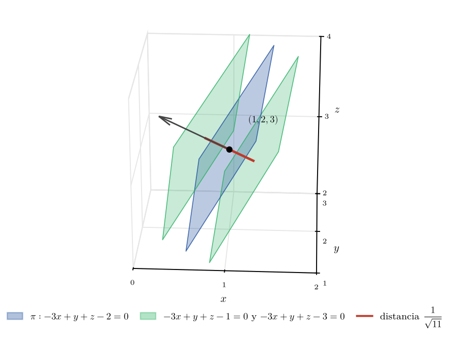

> [!TIP]
> **Respuesta:** $-3x + y + z - 1 = 0$ y $-3x + y + z - 3 = 0$.

### Ejercicio 2 — Rectas concurrentes y distancia de una recta al origen

<!-- temas: REC DIST -->

> Dadas las rectas $r: x - 2 = y + 2 = -z$ y $L: \begin{cases} x + ay - z = 1 \\ y + 3z = 0 \end{cases}$.
>
> a) Hallar $a \in \mathbb{R}$ para que las rectas sean concurrentes.
> b) Calcular la distancia entre la recta $r$ y el origen.

**a) Idea.** Concurrentes es que se cortan en un punto. El punto de corte está en $r$ y cumple las dos ecuaciones de $L$. Una de ellas no tiene $a$: esa da el punto, y la otra da $a$.

$r$ en paramétricas: $(2 + t,\ -2 + t,\ -t)$. En $y + 3z = 0$:

$$
(-2 + t) + 3(-t) = 0 \implies -2 - 2t = 0 \implies t = -1 \implies {\color{RoyalBlue}(1,\,-3,\,1)}
$$

En la otra ecuación: $1 + a(-3) - 1 = 1$, o sea $-3a = 1$, $a = -\tfrac13$. Falta ver que no sean paralelas (si lo fueran, compartir un punto las haría coincidentes): $\vec u_L = (3a + 1,\,-3,\,1)$ (el mismo producto vectorial que en P3 ej. 1) vale $(0,\,-3,\,1)$, que no es múltiplo de $(1,\,1,\,-1)$.

> [!TIP]
> **Respuesta:** a) $a = -\tfrac13$; se cortan en $(1,\,-3,\,1)$.

**b)** Con $A = (2,\,-2,\,0)$ en $r$, $\overrightarrow{AO} = (-2,\,2,\,0)$:

$$
\begin{aligned}
\overrightarrow{AO} \times \vec u = \begin{vmatrix} \vec\imath & \vec\jmath & \vec k \\ -2 & 2 & 0 \\ 1 & 1 & -1 \end{vmatrix} &= \big(2 \cdot (-1) - 0 \cdot 1,\ \ -\left[(-2) \cdot (-1) - 0 \cdot 1\right],\ \ (-2) \cdot 1 - 2 \cdot 1\big) \\ &= (-2,\ -2,\ -4)
\end{aligned}
$$

$$
d = \frac{\sqrt{4 + 4 + 16}}{\sqrt{1 + 1 + 1}} = \frac{\sqrt{24}}{\sqrt3} = \sqrt8 \implies {\color{ForestGreen}\boxed{d = 2\sqrt2}}
$$

Dato que sale de la figura: el pie de la perpendicular es el mismo $A = (2,\,-2,\,0)$, porque $\overrightarrow{AO} \cdot \vec u = -2 + 2 + 0 = 0$. Entonces $d = |\overrightarrow{OA}| = \sqrt{8}$, la misma cuenta.

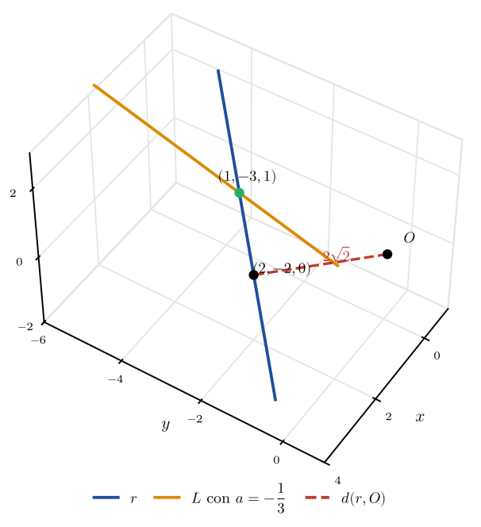

### Ejercicio 3 — Determinante de un producto y sistema homogéneo

<!-- temas: DET SIST -->

> Sean $A = \begin{pmatrix} 1 & 2 & 0 & 1 \\ 0 & -1 & 1 & 3 \\ 1 & 0 & 0 & 1 \\ 1 & 1 & 1 & 1 \end{pmatrix}$, $B \in \mathbb{R}^{4\times4}$ tal que $\det(B) = 2$ y $C = (B_1 \mid B_2 - B_3 \mid 3B_4 \mid 3B_3)$.
>
> a) Calcular $\det(A^{-1}B^tC)$.
> b) Clasificar el sistema $CX = 0$.

**Idea.** Hacen falta tres determinantes: $\det A$ (se calcula), $\det B$ (dato) y $\det C$ (por columnas, a partir de $\det B$).

**$\det A$, sin calculadora.** Para tener ceros en la primera columna se resta la fila 1 a las filas 3 y 4 (no cambia el determinante):

$$
\det A = \begin{vmatrix} 1 & 2 & 0 & 1 \\ 0 & -1 & 1 & 3 \\ 0 & -2 & 0 & 0 \\ 0 & -1 & 1 & 0 \end{vmatrix} = 1 \cdot \begin{vmatrix} -1 & 1 & 3 \\ -2 & 0 & 0 \\ -1 & 1 & 0 \end{vmatrix}
$$

El de $3 \times 3$ se desarrolla por la fila 2, que tiene dos ceros. El $-2$ está en la posición $(2,1)$, de signo $(-1)^{2+1} = -1$:

$$
\begin{vmatrix} -1 & 1 & 3 \\ -2 & 0 & 0 \\ -1 & 1 & 0 \end{vmatrix} = (-2) \cdot (-1) \cdot \begin{vmatrix} 1 & 3 \\ 1 & 0 \end{vmatrix} = 2 \cdot (0 - 3) = {\color{RoyalBlue} -6}
$$

**$\det C$.** Salen los dos 3. $B_3$ está sola en la columna 4: se suma a la columna 2 y queda $B_2$. Queda $(B_1 \mid B_2 \mid B_4 \mid B_3)$, con las columnas 3 y 4 intercambiadas:

$$
\det C = 3 \cdot 3 \det(B_1 \mid B_2 - B_3 \mid B_4 \mid B_3) = 9 \det(B_1 \mid B_2 \mid B_4 \mid B_3) = -9 \det B = {\color{RoyalBlue} -18}
$$

**a)**

$$
\det(A^{-1}B^tC) = \frac{1}{\det A} \cdot \det B \cdot \det C = \frac{2 \cdot (-18)}{-6} = \frac{-36}{-6} \implies {\color{ForestGreen}\boxed{6}}
$$

**b)** $\det C = -18 \neq 0$: $C$ es inversible.

> [!TIP]
> **Respuesta:** b) compatible determinado: solo la solución trivial $X = 0$.

### Ejercicio 4 — Verdadero o falso: coordenadas e independencia lineal

<!-- temas: COORD LI VF -->

> a) Si $[3x^2 + x - 1]_B = (1, 8, 3)^t$ y $B = \{x,\ 1,\ x^2 - b\}$, entonces $b = 3$.
> b) Si $\{u, v, w\}$ es linealmente independiente en un espacio vectorial $V$, entonces $\{u,\ 2v + w,\ w - v\}$ es linealmente dependiente.

**a)** Se reconstruye el polinomio con las coordenadas y se compara:

$$
1 \cdot x + 8 \cdot 1 + 3(x^2 - b) = 3x^2 + x + (8 - 3b) = 3x^2 + x - 1 \implies 8 - 3b = -1 \implies b = 3
$$

> [!TIP]
> **Respuesta:** a) **Verdadero**.

**b) Idea.** Se plantea una combinación lineal nula de los tres vectores nuevos y se reagrupa por $u$, $v$, $w$. Como $\{u, v, w\}$ es LI, cada coeficiente tiene que ser 0. Si eso obliga a que los coeficientes originales sean 0, el conjunto nuevo es LI.

$$
\alpha u + \beta(2v + w) + \gamma(w - v) = \alpha\,u + (2\beta - \gamma)\,v + (\beta + \gamma)\,w = 0
$$

$$
\begin{cases} \alpha = 0 \\ 2\beta - \gamma = 0 \\ \beta + \gamma = 0 \end{cases} \implies \gamma = 2\beta \ \text{y}\ \beta + 2\beta = 0 \implies \beta = 0,\ \gamma = 0
$$

Solo la combinación trivial: el conjunto es LI.

> [!TIP]
> **Respuesta:** b) **Falso**: el conjunto es linealmente independiente.

### Ejercicio 5 — Intersección de dimensión 1 y complemento ortogonal en $\mathbb{R}^3$

<!-- temas: INTSUM ORTC -->

> Sean $S = \mathrm{gen}\{(1, a, 2), (0, 1, a)\}$ y $T = \{(x, y, z) \in \mathbb{R}^3 / x - y + z = 0,\ x = 0\}$.
>
> a) Hallar $a \in \mathbb{R}$ para que $\dim(S \cap T) = 1$.
> b) Si $a = 1$, hallar base y dimensión del complemento ortogonal de $S$.

**a) Idea.** En $\mathbb{R}^3$ se puede pensar geométricamente. $T$ es una recta por el origen y $S$, un plano por el origen. La intersección de una recta con un plano tiene dimensión 1 solo si la recta está **dentro** del plano.

$T$: $x = 0$ y $z = y$, o sea $T = \mathrm{gen}\{(0,\,1,\,1)\}$. $S$ es siempre un plano: sus generadores nunca son paralelos (el primero tiene $x = 1$ y el segundo, $x = 0$). Su normal:

$$
\begin{aligned}
\vec n_S = \begin{vmatrix} \vec\imath & \vec\jmath & \vec k \\ 1 & a & 2 \\ 0 & 1 & a \end{vmatrix} &= \big(a \cdot a - 2 \cdot 1,\ \ -\left[1 \cdot a - 2 \cdot 0\right],\ \ 1 \cdot 1 - a \cdot 0\big) \\ &= (a^{2} - 2,\ - a,\ 1)
\end{aligned}
$$

$(0,\,1,\,1) \in S$ si es perpendicular a la normal: $0 + (-a) + 1 = 0$.

> [!TIP]
> **Respuesta:** a) $a = 1$.

**b)** Con $a = 1$, $\vec n_S = (1 - 2,\ -1,\ 1) = (-1,\,-1,\,1)$. El complemento ortogonal de un plano por el origen en $\mathbb{R}^3$ es su recta normal.

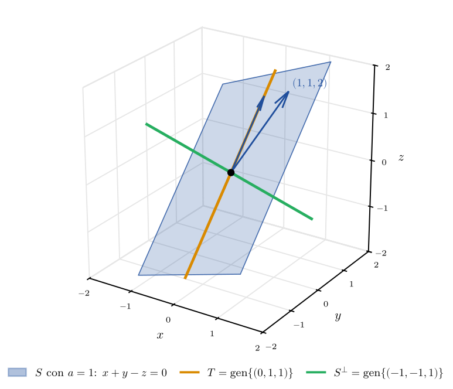

> [!TIP]
> **Respuesta:** b) $S^\perp = \mathrm{gen}\{(-1, -1, 1)\}$, $\dim S^\perp = 1$.

### Tema 2

#### Ej. 1

> Planos a distancia $\sqrt{11}/11$ de $\pi: (x, y, z) = \alpha(-1, 1, 0) + \beta(1, 2, 1) + (3, 2, 1)$.

$$
\begin{aligned}
\vec n = \begin{vmatrix} \vec\imath & \vec\jmath & \vec k \\ -1 & 1 & 0 \\ 1 & 2 & 1 \end{vmatrix} &= \big(1 \cdot 1 - 0 \cdot 2,\ \ -\left[(-1) \cdot 1 - 0 \cdot 1\right],\ \ (-1) \cdot 2 - 1 \cdot 1\big) \\ &= (1,\ 1,\ -3)
\end{aligned}
$$

Por $(3,\,2,\,1)$: $3 + 2 - 3 + D = 0$, $D = -2$; $\pi: x + y - 3z - 2 = 0$, y otra vez $|D + 2| = 1$.

> [!TIP]
> **Respuesta:** $x + y - 3z - 1 = 0$ y $x + y - 3z - 3 = 0$.

#### Ej. 2

> $r: -x = y + 2 = z - 2$, $L: \begin{cases} z + ay - x = 1 \\ y + 3x = 0 \end{cases}$. a) $a$ para que sean concurrentes. b) $d(r, O)$.

a) $r$: punto $(0,\,-2,\,2)$, dirección $(-1,\,1,\,1)$; $r = (-t,\ -2 + t,\ 2 + t)$. En $y + 3x = 0$: $-2 + t - 3t = 0$, $t = -1$, punto $(1,\,-3,\,1)$. En la otra: $1 - 3a - 1 = 1$, $a = -\tfrac13$. La dirección de $L$ (P3, Tema 2, ej. 1) es $(-1,\,3,\,-1 - 3a) = (-1,\,3,\,0)$: no es paralela a $r$.

b)

$$
\begin{aligned}
\overrightarrow{AO} \times \vec u = \begin{vmatrix} \vec\imath & \vec\jmath & \vec k \\ 0 & 2 & -2 \\ -1 & 1 & 1 \end{vmatrix} &= \big(2 \cdot 1 - (-2) \cdot 1,\ \ -\left[0 \cdot 1 - (-2) \cdot (-1)\right],\ \ 0 \cdot 1 - 2 \cdot (-1)\big) \\ &= (4,\ 2,\ 2)
\end{aligned}
$$

$d = \frac{\sqrt{16 + 4 + 4}}{\sqrt3} = \sqrt8$.

> [!TIP]
> **Respuesta:** a) $a = -\tfrac13$; b) $d = 2\sqrt2$.

#### Ej. 3

> $\det A = 2$, $B = (A_1 \mid A_2 - A_3 \mid 3A_4 \mid 3A_3)$, $C = \begin{pmatrix} 1 & 1 & 1 & 1 \\ 0 & -1 & 1 & 3 \\ 1 & 0 & 0 & 1 \\ 1 & 2 & 0 & 1 \end{pmatrix}$. a) $\det(C^{-1}A^tB)$. b) Clasificar $BX = 0$.

$\det B = -9 \det A = -18$ (la misma cuenta del Tema 1). $C$ es la matriz $A$ del Tema 1 con las filas 1 y 4 intercambiadas: $\det C = -(-6) = 6$. a) $\frac{2 \cdot (-18)}{6} = -6$. b) $\det B \neq 0$.

> [!TIP]
> **Respuesta:** a) $-6$; b) compatible determinado (solo la trivial).

#### Ej. 4

> a) $\{u, v, w\}$ LI $\Rightarrow$ $\{v,\ 2u + w,\ w - u\}$ es LD. b) Si $[3x^2 + x - 1]_B = (3, 8, 1)^t$ y $B = \{x^2 - t,\ 1,\ x\}$, entonces $t = 3$.

a) $\alpha v + \beta(2u + w) + \gamma(w - u) = (2\beta - \gamma)\,u + \alpha\,v + (\beta + \gamma)\,w$: el mismo sistema del Tema 1, solo la trivial. b) $3(x^2 - t) + 8 + x = 3x^2 + x + 8 - 3t$, y $8 - 3t = -1$.

> [!TIP]
> **Respuesta:** a) **Falso** (es LI); b) **Verdadero**.

#### Ej. 5

> $S = \{x - y + z = 0,\ z = 0\}$, $T = \mathrm{gen}\{(2, b, 1), (b, 1, 0)\}$. a) $b$ para que $\dim(S \cap T) = 1$. b) Si $b = 1$, base y dimensión de $T^\perp$.

Ahora la recta es $S$: $z = 0$ y $y = x$, $S = \mathrm{gen}\{(1,\,1,\,0)\}$.

$$
\begin{aligned}
\vec n_T = \begin{vmatrix} \vec\imath & \vec\jmath & \vec k \\ 2 & b & 1 \\ b & 1 & 0 \end{vmatrix} &= \big(b \cdot 0 - 1 \cdot 1,\ \ -\left[2 \cdot 0 - 1 \cdot b\right],\ \ 2 \cdot 1 - b \cdot b\big) \\ &= (-1,\ b,\ 2 - b^{2})
\end{aligned}
$$

$(1,\,1,\,0) \cdot \vec n_T = -1 + b = 0$. Con $b = 1$: $\vec n_T = (-1,\,1,\,1)$.

> [!TIP]
> **Respuesta:** a) $b = 1$; b) $T^\perp = \mathrm{gen}\{(-1, 1, 1)\}$, $\dim T^\perp = 1$.

<!-- salto-pagina -->

## P5 — 1er recuperatorio del 03/12/2019 (T.M.)

*Origen:* `fuentes/2019-12-03_TM_recuperatorio.pdf` (en el campus: `Recu 1 Primer Parcial Ma.pdf`), Temas 1 y 2.

### Ejercicio 1 — Distancia entre rectas paralelas y plano del haz por el origen

<!-- temas: DIST HAZ -->

> Consideremos la recta $r: \begin{cases} x + y - z = 1 \\ x - y = 2 \end{cases}$.
>
> a) Calcular la distancia entre las rectas $r$ y $L: (x, y, z) = (1, 1, 1) + \lambda(1, 1, 2)$ con $\lambda \in \mathbb{R}$.
> b) Hallar un plano en el haz generado por $r$ que pase por el origen de coordenadas.

**a) Idea.** Antes de usar una fórmula de distancia entre rectas hay que ver su posición. Si son paralelas, la fórmula con el producto mixto no sirve (el denominador $|\vec u_1 \times \vec u_2|$ es 0); se usa la distancia de un punto de una recta a la otra.

$$
\begin{aligned}
\vec u_r = \begin{vmatrix} \vec\imath & \vec\jmath & \vec k \\ 1 & 1 & -1 \\ 1 & -1 & 0 \end{vmatrix} &= \big(1 \cdot 0 - (-1) \cdot (-1),\ \ -\left[1 \cdot 0 - (-1) \cdot 1\right],\ \ 1 \cdot (-1) - 1 \cdot 1\big) \\ &= (-1,\ -1,\ -2)
\end{aligned}
$$

$(-1,\,-1,\,-2) = -(1,\,1,\,2)$: **la misma dirección que $L$**. Son paralelas.

Un punto de $r$: con $x = 0$, de $x - y = 2$ sale $y = -2$, y de la primera ecuación, $z = x + y - 1 = -3$; $A = (0,\,-2,\,-3)$. Desde $A$ hasta el punto $(1,\,1,\,1)$ de $L$: $(1,\,3,\,4)$.

$$
\begin{aligned}
(1,\,3,\,4) \times (1,\,1,\,2) = \begin{vmatrix} \vec\imath & \vec\jmath & \vec k \\ 1 & 3 & 4 \\ 1 & 1 & 2 \end{vmatrix} &= \big(3 \cdot 2 - 4 \cdot 1,\ \ -\left[1 \cdot 2 - 4 \cdot 1\right],\ \ 1 \cdot 1 - 3 \cdot 1\big) \\ &= (2,\ 2,\ -2)
\end{aligned}
$$

$$
d = \frac{\sqrt{4 + 4 + 4}}{\sqrt{1 + 1 + 4}} = \frac{\sqrt{12}}{\sqrt6} = \sqrt2 \implies {\color{ForestGreen}\boxed{d = \sqrt2}}
$$

**b) Idea.** El haz de $r$ son los planos $\alpha(x + y - z - 1) + \beta(x - y - 2) = 0$. Pasar por el origen es reemplazar $(0,\,0,\,0)$.

$\alpha(-1) + \beta(-2) = 0$, o sea $\alpha = -2\beta$; con $\beta = -1$, $\alpha = 2$:

$$
2(x + y - z - 1) - (x - y - 2) = 2x + 2y - 2z - 2 - x + y + 2 = x + 3y - 2z = 0
$$

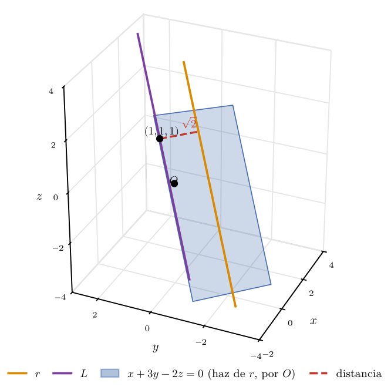

> [!TIP]
> **Respuesta:** b) $x + 3y - 2z = 0$.

### Ejercicio 2 — Plano ortogonal a otro, paralelo a un eje y a distancia dada de un punto

<!-- temas: PLANO DIST -->

> Hallar la ecuación de un plano ortogonal al plano $\pi: (x, y, z) = \alpha(1, 2, 3) + \beta(0, 1, 1) + (1, 2, -1)$, $\alpha, \beta \in \mathbb{R}$, paralelo al eje $z$ y tal que la distancia al punto $P = (1, 1, 3)$ sea $\sqrt2$. ¿Es único?

**Idea.** Cada condición se traduce en algo sobre la normal $\vec n$ del plano buscado:

- **ortogonal a $\pi$** (planos perpendiculares): las normales son perpendiculares, $\vec n \cdot \vec n_\pi = 0$;
- **paralelo al eje $z$**: el plano contiene la dirección $(0,\,0,\,1)$, o sea $\vec n \cdot (0,\,0,\,1) = 0$.

Eso da la normal; la distancia a $P$ da el término independiente.

$$
\begin{aligned}
\vec n_\pi = \begin{vmatrix} \vec\imath & \vec\jmath & \vec k \\ 1 & 2 & 3 \\ 0 & 1 & 1 \end{vmatrix} &= \big(2 \cdot 1 - 3 \cdot 1,\ \ -\left[1 \cdot 1 - 3 \cdot 0\right],\ \ 1 \cdot 1 - 2 \cdot 0\big) \\ &= (-1,\ -1,\ 1)
\end{aligned}
$$

Con $\vec n = (p,\,q,\,s)$: paralelo al eje $z$ da $s = 0$; ortogonal a $\pi$ da $-p - q + 0 = 0$, $q = -p$. Con $p = 1$: $\vec n = (1,\,-1,\,0)$ y el plano es $x - y + D = 0$.

$$
d(P, \text{plano}) = \frac{|1 - 1 + D|}{\sqrt{1 + 1}} = \frac{|D|}{\sqrt2} = \sqrt2 \implies |D| = 2 \implies D = 2 \ \text{o}\ D = -2
$$

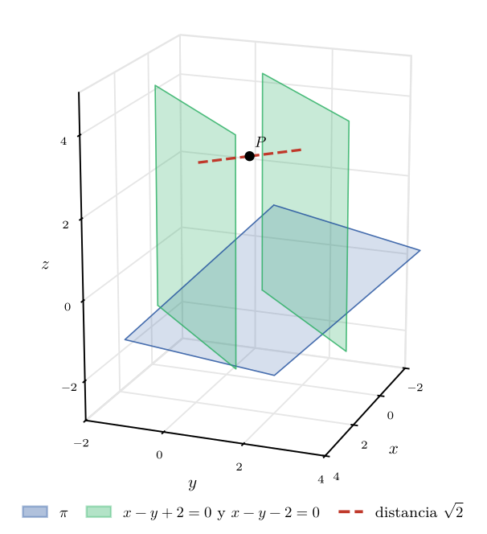

> [!TIP]
> **Respuesta:** $x - y + 2 = 0$ o $x - y - 2 = 0$. **No es único**: hay dos, uno a cada lado de $P$.

### Ejercicio 3 — Verdadero o falso: sistema $AX = B^tX$ y matriz ortogonal

<!-- temas: SIST DET VF -->

> a) Sean $A, B \in \mathbb{R}^{n\times n}$ inversibles; entonces el sistema lineal $AX = B^tX$ es compatible determinado.
> b) Si $A \in \mathbb{R}^{3\times3}$ es ortogonal, entonces $|\det(A)| = 1$.

**a) Idea.** Se pasa todo de un lado: $AX - B^tX = 0$, o sea $(A - B^t)X = 0$, un sistema homogéneo. Es compatible determinado solo si $A - B^t$ es inversible, y que $A$ y $B$ lo sean no lo garantiza.

Contraejemplo: $A = B = I$. Entonces $A - B^t = 0$ y todo $X$ es solución.

> [!TIP]
> **Respuesta:** a) **Falso**.

**b)** $A^tA = I$; tomando determinante, $\det(A^t)\det(A) = 1$, y como $\det A^t = \det A$, $(\det A)^2 = 1$.

> [!TIP]
> **Respuesta:** b) **Verdadero**.

### Ejercicio 4 — Base de $P_2$ con parámetro y pertenencia al generado

<!-- temas: LI -->

> Sea $M = \{x - 2,\ x^2 + x - 4,\ x^2 + ax - 3a\}$.
>
> a) Hallar $a \in \mathbb{R}$ para que $M$ sea una base de $P_2$.
> b) Si $a = 2$, analizar si $p(x) = x^2 + 1$ pertenece al espacio generado por $M$.

**a)** $\dim P_2 = 3$: tres polinomios son base si son LI. Coeficientes en el orden $(1,\,x,\,x^2)$:

$$
\begin{aligned}
\begin{vmatrix} -2 & 1 & 0 \\ -4 & 1 & 1 \\ - 3 a & a & 1 \end{vmatrix} &=  (-2)\left[1 \cdot 1 - 1 \cdot a\right] - 1\left[(-4) \cdot 1 - 1 \cdot (- 3 a)\right] + 0\left[(-4) \cdot a - 1 \cdot (- 3 a)\right] \\ &= 2 - a
\end{aligned}
$$

> [!TIP]
> **Respuesta:** a) $M$ es base para todo $a \neq 2$.

**b) Idea.** Con $a = 2$ el conjunto es LD; hay que ver cuál sobra, describir el generado y ver si $x^2 + 1$ está.

$x^2 + 2x - 6 = (x^2 + x - 4) + (x - 2)$: el tercero es la suma de los otros dos. $\mathrm{gen}(M) = \mathrm{gen}\{x - 2,\ x^2 + x - 4\}$. Se busca

$$
x^2 + 1 = \alpha(x^2 + x - 4) + \beta(x - 2) = \alpha x^2 + (\alpha + \beta)x + (-4\alpha - 2\beta)
$$

Igualando coeficientes:

$$
\begin{cases} x^2: & \alpha = 1 \\ x: & \alpha + \beta = 0 \implies \beta = -1 \\ 1: & -4\alpha - 2\beta = -4 + 2 = -2 \neq 1 \end{cases}
$$

La última ecuación no se cumple: el sistema es incompatible.

> [!TIP]
> **Respuesta:** b) $x^2 + 1 \notin \mathrm{gen}(M)$.

### Ejercicio 5 — Coordenadas y subespacio de matrices de traza nula

<!-- temas: COORD INTSUM -->

> Sean $S = \{A \in \mathbb{R}^{2\times2} / \mathrm{tr}(A) = 0\}$ y $B = \left\{\begin{pmatrix} 1 & 1 \\ 0 & k \end{pmatrix}, \begin{pmatrix} k & 0 \\ 0 & 1 \end{pmatrix}\right\}$.
>
> a) Hallar $k \in \mathbb{R}$ para que $\left[\begin{pmatrix} 5 & 1 \\ 0 & 4 \end{pmatrix}\right]_B = (1, 2)$.
> b) Para $k = -1$, hallar base y dimensión de $S \cap \mathrm{gen}(B)$.

**a)** Las coordenadas $(1,\,2)$ dicen: 1 vez la primera matriz más 2 veces la segunda.

$$
1\begin{pmatrix} 1 & 1 \\ 0 & k \end{pmatrix} + 2\begin{pmatrix} k & 0 \\ 0 & 1 \end{pmatrix} = \begin{pmatrix} 1 + 2k & 1 \\ 0 & k + 2 \end{pmatrix} = \begin{pmatrix} 5 & 1 \\ 0 & 4 \end{pmatrix}
$$

$1 + 2k = 5$ y $k + 2 = 4$: las dos dan $k = 2$ (si dieran valores distintos, no existiría).

> [!TIP]
> **Respuesta:** a) $k = 2$.

**b) Idea.** Se escribe un elemento genérico de $\mathrm{gen}(B)$ y se le impone la condición de $S$ (traza 0).

$$
\alpha\begin{pmatrix} 1 & 1 \\ 0 & -1 \end{pmatrix} + \beta\begin{pmatrix} -1 & 0 \\ 0 & 1 \end{pmatrix} = \begin{pmatrix} \alpha - \beta & \alpha \\ 0 & -\alpha + \beta \end{pmatrix}, \qquad \mathrm{tr} = (\alpha - \beta) + (-\alpha + \beta) = 0
$$

La traza da 0 **para todo** $\alpha, \beta$: las dos matrices de $B$ ya tienen traza 0, así que $\mathrm{gen}(B) \subset S$. Además son LI (no son proporcionales).

> [!TIP]
> **Respuesta:** b) $S \cap \mathrm{gen}(B) = \mathrm{gen}(B)$; base $\left\{\begin{pmatrix} 1 & 1 \\ 0 & -1 \end{pmatrix}, \begin{pmatrix} -1 & 0 \\ 0 & 1 \end{pmatrix}\right\}$, dimensión 2.

### Tema 2

#### Ej. 1

> $r: \begin{cases} z + y - x = 1 \\ z - y = 2 \end{cases}$. a) $d(r, L)$ con $L: (1, 1, 1) + \lambda(2, 1, 1)$. b) Plano del haz de $r$ que pase por el origen.

a)

$$
\begin{aligned}
\vec u_r = \begin{vmatrix} \vec\imath & \vec\jmath & \vec k \\ -1 & 1 & 1 \\ 0 & -1 & 1 \end{vmatrix} &= \big(1 \cdot 1 - 1 \cdot (-1),\ \ -\left[(-1) \cdot 1 - 1 \cdot 0\right],\ \ (-1) \cdot (-1) - 1 \cdot 0\big) \\ &= (2,\ 1,\ 1)
\end{aligned}
$$

Paralelas otra vez. Punto de $r$ con $y = 0$: $z = 2$, $x = z + y - 1 = 1$; $A = (1,\,0,\,2)$, y hasta $(1,\,1,\,1)$: $(0,\,1,\,-1)$.

$$
\begin{aligned}
(0,\,1,\,-1) \times (2,\,1,\,1) = \begin{vmatrix} \vec\imath & \vec\jmath & \vec k \\ 0 & 1 & -1 \\ 2 & 1 & 1 \end{vmatrix} &= \big(1 \cdot 1 - (-1) \cdot 1,\ \ -\left[0 \cdot 1 - (-1) \cdot 2\right],\ \ 0 \cdot 1 - 1 \cdot 2\big) \\ &= (2,\ -2,\ -2)
\end{aligned}
$$

$d = \sqrt{12}/\sqrt6 = \sqrt2$. b) $\alpha(z + y - x - 1) + \beta(z - y - 2)$ en el origen: $-\alpha - 2\beta = 0$; $\alpha = 2$, $\beta = -1$: $2z + 2y - 2x - 2 - z + y + 2$.

> [!TIP]
> **Respuesta:** a) $d = \sqrt2$; b) $-2x + 3y + z = 0$.

#### Ej. 2

> Plano ortogonal a $\pi: (x, y, z) = \alpha(3, 2, 1) + \beta(1, 1, 0) + (-1, 2, 1)$, paralelo al eje $x$ y a distancia $\sqrt2$ de $P = (3, 1, 1)$. ¿Es único?

$$
\begin{aligned}
\vec n_\pi = \begin{vmatrix} \vec\imath & \vec\jmath & \vec k \\ 3 & 2 & 1 \\ 1 & 1 & 0 \end{vmatrix} &= \big(2 \cdot 0 - 1 \cdot 1,\ \ -\left[3 \cdot 0 - 1 \cdot 1\right],\ \ 3 \cdot 1 - 2 \cdot 1\big) \\ &= (-1,\ 1,\ 1)
\end{aligned}
$$

Paralelo al eje $x$: $\vec n = (0,\,q,\,s)$; ortogonal a $\pi$: $q + s = 0$. Plano $y - z + D = 0$; $\frac{|1 - 1 + D|}{\sqrt2} = \sqrt2$, $|D| = 2$.

> [!TIP]
> **Respuesta:** $y - z + 2 = 0$ o $y - z - 2 = 0$; no es único.

#### Ej. 3

> a) $A \in \mathbb{R}^{n\times n}$ ortogonal $\Rightarrow |\det A| = 1$. b) $A, B \in \mathbb{R}^{3\times3}$ inversibles $\Rightarrow$ $AX = B^tX$ es compatible determinado.

Los mismos incisos del Tema 1, en otro orden. La prueba de a) vale para cualquier $n$.

> [!TIP]
> **Respuesta:** a) **Verdadero**; b) **Falso** ($A = B = I$).

#### Ej. 4

> $M = \{x^2 + ax - 3a,\ x^2 + 2x - 4,\ x - 5\}$. a) $a$ para que sea base de $P_2$. b) Si $a = 3$, ¿$x^2 + 2 \in \mathrm{gen}(M)$?

a)

$$
\begin{aligned}
\begin{vmatrix} - 3 a & a & 1 \\ -4 & 2 & 1 \\ -5 & 1 & 0 \end{vmatrix} &=  (- 3 a)\left[2 \cdot 0 - 1 \cdot 1\right] - a\left[(-4) \cdot 0 - 1 \cdot (-5)\right] + 1\left[(-4) \cdot 1 - 2 \cdot (-5)\right] \\ &= 6 - 2 a
\end{aligned}
$$

b) Con $a = 3$: $x^2 + 3x - 9 = (x^2 + 2x - 4) + (x - 5)$. $x^2 + 2 = \alpha(x^2 + 2x - 4) + \beta(x - 5)$: $\alpha = 1$; $2 + \beta = 0$, $\beta = -2$; término independiente $-4 + 10 = 6 \neq 2$.

> [!TIP]
> **Respuesta:** a) $a \neq 3$; b) no pertenece.

#### Ej. 5

> $S = \{\mathrm{tr}(A) = 0\}$, $B = \left\{\begin{pmatrix} k & 0 \\ 0 & 1 \end{pmatrix}, \begin{pmatrix} 1 & 0 \\ 1 & k \end{pmatrix}\right\}$. a) Con $k = -1$, base y dimensión de $S \cap \mathrm{gen}(B)$. b) $k$ para que $\left[\begin{pmatrix} 5 & 0 \\ 1 & 4 \end{pmatrix}\right]_B = (2, 1)$.

a) Con $k = -1$ las dos matrices tienen traza 0: $\mathrm{gen}(B) \subset S$. b) $2\begin{pmatrix} k & 0 \\ 0 & 1 \end{pmatrix} + \begin{pmatrix} 1 & 0 \\ 1 & k \end{pmatrix} = \begin{pmatrix} 2k + 1 & 0 \\ 1 & 2 + k \end{pmatrix}$: $2k + 1 = 5$ y $2 + k = 4$.

> [!TIP]
> **Respuesta:** a) $S \cap \mathrm{gen}(B) = \mathrm{gen}(B)$, dimensión 2; b) $k = 2$.

<!-- salto-pagina -->

## P6 — 1er recuperatorio del 09/12/2019 (T.T.)

*Origen:* `fuentes/2019-12-09_TT_recuperatorio.pdf` (en el campus: `Recu 1 Primer Parcial Lu.pdf`), Tema 1 (el único que está en el campus).

### Ejercicio 1 — Rectas coplanares y su intersección

<!-- temas: REC -->

> Consideremos las rectas $r_1: x - 1 = 2y = z + 1$ y $r_2: (x, y, z) = \lambda(k, 0, 1) + (2, 1, 0)$, con $\lambda \in \mathbb{R}$.
>
> a) Hallar todos los valores de $k \in \mathbb{R}$ para que $r_1$ y $r_2$ sean coplanares.
> b) Si $k = 1$, calcular $r_1 \cap r_2$.

**Leer $r_1$.** En la forma simétrica, el coeficiente de la variable va al **denominador**: $2y = \dfrac{y}{1/2}$. Punto $(1,\,0,\,-1)$, dirección $(1,\,\tfrac12,\,1)$; multiplicando por 2, $\vec u_1 = (2,\,1,\,2)$.

> [!NOTE]
> Trampa habitual: leer la dirección de $2y$ como 2.

**a) Idea.** Dos rectas son coplanares si el producto mixto de sus direcciones y del vector que une sus puntos es 0. Vector entre los puntos: $(2,\,1,\,0) - (1,\,0,\,-1) = (1,\,1,\,1)$.

$$
\begin{aligned}
[\vec u_1,\ \vec u_2,\ \overrightarrow{P_1P_2}] = \begin{vmatrix} 2 & 1 & 2 \\ k & 0 & 1 \\ 1 & 1 & 1 \end{vmatrix} &=  2\left[0 \cdot 1 - 1 \cdot 1\right] - 1\left[k \cdot 1 - 1 \cdot 1\right] + 2\left[k \cdot 1 - 0 \cdot 1\right] \\ &= k - 1
\end{aligned}
$$

> [!TIP]
> **Respuesta:** a) $k = 1$.

**b)** Con $k = 1$ se igualan las paramétricas, $r_1 = (1 + 2t,\ t,\ -1 + 2t)$ y $r_2 = (2 + \lambda,\ 1,\ \lambda)$:

$$
\begin{cases} 1 + 2t = 2 + \lambda \\ t = 1 \\ -1 + 2t = \lambda \end{cases} \implies t = 1,\ \lambda = 1 \ \ (\text{la tercera cierra: } -1 + 2 = 1)
$$

Las dos rectas están en el plano $x - z - 2 = 0$ (normal $\vec u_1 \times \vec u_2 = (1,\,0,\,-1)$).

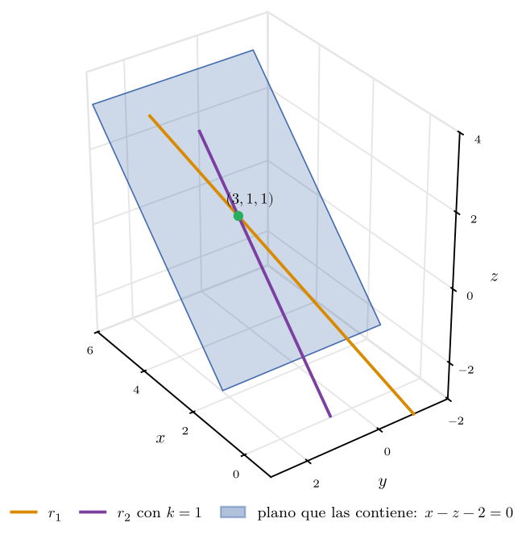

> [!TIP]
> **Respuesta:** b) $r_1 \cap r_2 = \{(3, 1, 1)\}$.

### Ejercicio 2 — Haz de planos y plano paralelo por el origen

<!-- temas: HAZ PLANO -->

> Sea el haz de planos $\alpha(2x - y) + \beta(x - y - z + 1) = 0$ con $\alpha, \beta \in \mathbb{R}$.
>
> a) Hallar un plano en el haz que pase por el punto $(1, 3, 0)$.
> b) Hallar la ecuación de un plano (no necesariamente en el haz) que contenga al origen y sea paralelo al plano del haz con $\alpha = 0$ y $\beta = 1$.

**a)** Se reemplaza $(1,\,3,\,0)$: $2 \cdot 1 - 3 = -1$ y $1 - 3 - 0 + 1 = -1$. Entonces $-\alpha - \beta = 0$; con $\alpha = 1$, $\beta = -1$:

$$
(2x - y) - (x - y - z + 1) = 2x - y - x + y + z - 1 = x + z - 1 = 0
$$

Verificación: $1 + 0 - 1 = 0$.

> [!TIP]
> **Respuesta:** a) $x + z - 1 = 0$.

**b) Idea.** Planos paralelos tienen la misma normal; solo cambia el término independiente, que se ajusta para pasar por el origen.

Con $\alpha = 0$, $\beta = 1$: $x - y - z + 1 = 0$, normal $(1,\,-1,\,-1)$. Por el origen: $x - y - z + D = 0$ con $D = 0$.

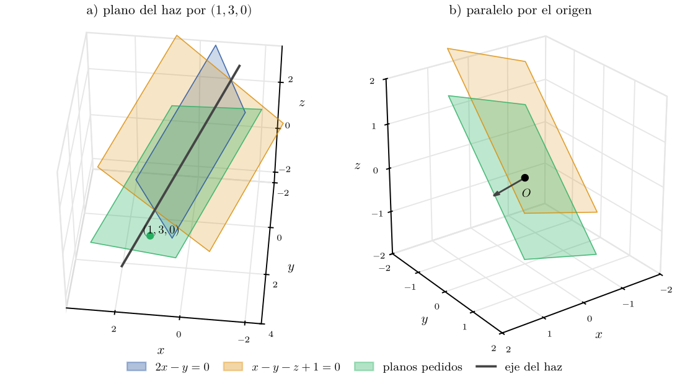

> [!TIP]
> **Respuesta:** b) $x - y - z = 0$.

### Ejercicio 3 — Rango con parámetro y determinante de un producto

<!-- temas: RANGO DET -->

> Sea $A = \begin{pmatrix} 1 & 2 & 1 & 1 \\ 0 & 1 & k & k \\ 1 & -1 & 0 & k \\ 0 & 3 & 1 & 1 - k \end{pmatrix} \in \mathbb{R}^{4\times4}$.
>
> a) Hallar $k \in \mathbb{R}$ para que $\mathrm{rg}(A) = 3$.
> b) Sean $B, C \in \mathbb{R}^{4\times4}$ tales que $\det(B) = -1$ y $\det(C) = 4$. Si $k = 1$, calcular $\det(2AB^tC^{-1})$.

**a) Idea.** Rango es la cantidad de filas LI. Se escalona con operaciones de fila, que no cambian el rango.

$F_3 - F_1 = (1 - 1,\ -1 - 2,\ 0 - 1,\ k - 1) = (0,\,-3,\,-1,\,k - 1)$. Las filas 2 a 4 quedan:

$$
F_2 = (0,\,1,\,k,\,k), \qquad F_3' = (0,\,-3,\,-1,\,k - 1), \qquad F_4 = (0,\,3,\,1,\,1 - k)
$$

Al comparar $F_4$ con $F_3'$: $F_4 = -F_3'$ **para todo $k$**. Entonces $F_4 + F_3' = 0$: siempre hay una fila nula, $\det A = 0$ y $\mathrm{rg}(A) \leq 3$.

Falta ver si $F_1$, $F_2$ y $F_3'$ son LI. $F_1$ es la única con primera componente no nula, así que alcanza con ver que $F_2$ y $F_3'$ no son paralelas. $(0,\,-3,\,-1,\,k - 1) = m\,(0,\,1,\,k,\,k)$ pediría $m = -3$ (segunda componente), $-1 = -3k$ (tercera, $k = \tfrac13$) y $k - 1 = -3k$ (cuarta, $k = \tfrac14$). No hay un $k$ que cumpla las dos.

> [!TIP]
> **Respuesta:** a) $\mathrm{rg}(A) = 3$ para **todo** $k \in \mathbb{R}$.

**b)** Como $\det A = 0$ para todo $k$, en particular para $k = 1$:

$$
\det(2AB^tC^{-1}) = 2^4 \cdot \underbrace{\det A}_{0} \cdot \det B \cdot \frac{1}{\det C} \implies {\color{ForestGreen}\boxed{0}}
$$

> [!NOTE]
> El inciso b) es una trampa para quien no hizo bien el a): los datos de $B$ y $C$ no hacen falta.

### Ejercicio 4 — Sistema con parámetro

<!-- temas: SIST -->

> Sean $A = \begin{pmatrix} 1 & k & 2 \\ k & 1 & 2 \\ 2 & 2 & 4 \end{pmatrix}$ y $b = \begin{pmatrix} 1 \\ 1 \\ 2 \end{pmatrix}$.
>
> a) Hallar $k \in \mathbb{R}$ para que el sistema $AX = b$ sea compatible determinado.
> b) Si $k = 1$, hallar el conjunto solución del sistema $AX = 0$.

**a)** Un sistema cuadrado es compatible determinado si y solo si $\det A \neq 0$.

$$
\begin{aligned}
\det A = \begin{vmatrix} 1 & k & 2 \\ k & 1 & 2 \\ 2 & 2 & 4 \end{vmatrix} &=  1\left[1 \cdot 4 - 2 \cdot 2\right] - k\left[k \cdot 4 - 2 \cdot 2\right] + 2\left[k \cdot 2 - 1 \cdot 2\right] \\ &= - 4 \left(k - 1\right)^{2}
\end{aligned}
$$

> [!TIP]
> **Respuesta:** a) compatible determinado para todo $k \neq 1$.

**b)** Con $k = 1$ las tres filas son $(1,\,1,\,2)$, $(1,\,1,\,2)$ y $(2,\,2,\,4) = 2(1,\,1,\,2)$: queda una sola ecuación, $x + y + 2z = 0$, con dos variables libres. Despejando $x = -y - 2z$:

$$
(x,\,y,\,z) = (-y - 2z,\ y,\ z) = y\,(-1,\,1,\,0) + z\,(-2,\,0,\,1)
$$

> [!TIP]
> **Respuesta:** b) $\{(x, y, z) : x + y + 2z = 0\} = \mathrm{gen}\{(-1, 1, 0),\ (-2, 0, 1)\}$.

### Ejercicio 5 — Complemento ortogonal y suma no directa

<!-- temas: ORTC INTSUM -->

> Sean $S = \{(x, y, z) \in \mathbb{R}^3 / x = y = -z\}$ y $T = \mathrm{gen}\{(1, 1, 1), (1, 1, -1), (1, 1, 0)\}$.
>
> a) Hallar base y dimensión de $S^\perp$.
> b) Hallar base y dimensión de $S + T$. ¿Es una suma directa?

**a)** $x = y = -z$: con $x = 1$, $(1,\,1,\,-1)$. $S = \mathrm{gen}\{(1,\,1,\,-1)\}$ es una recta; su complemento es el plano que tiene a $(1,\,1,\,-1)$ como normal: $x + y - z = 0$. Base: con $y = 1, z = 0$ sale $(-1,\,1,\,0)$; con $y = 0, z = 1$, $(1,\,0,\,1)$.

> [!TIP]
> **Respuesta:** a) $S^\perp = \{x + y - z = 0\}$, base $\{(-1, 1, 0),\ (1, 0, 1)\}$, dimensión 2.

**b)** $(1,\,1,\,0) = \tfrac12\big[(1,\,1,\,1) + (1,\,1,\,-1)\big]$: sobra. $T = \mathrm{gen}\{(1,\,1,\,1),\ (1,\,1,\,-1)\}$, el plano $x = y$. El generador de $S$, $(1,\,1,\,-1)$, ya es uno de los de $T$: $S \subset T$ y $S + T = T$.

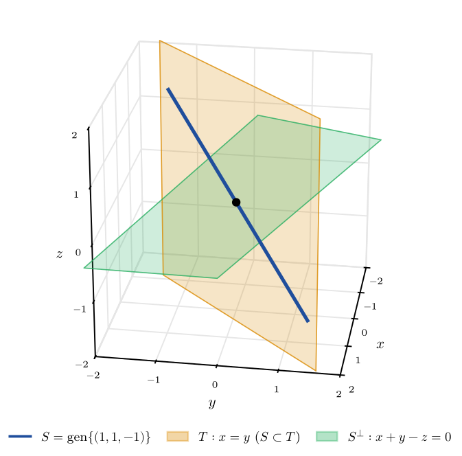

> [!TIP]
> **Respuesta:** b) $S + T = T$, base $\{(1, 1, 1),\ (1, 1, -1)\}$, dimensión 2; **no** es directa ($S \cap T = S \neq \{0\}$).

<!-- salto-pagina -->

## P7 — 1er parcial del 11/07/2022 (T.T.)

*Origen:* `fuentes/2022-07-11_TT_parcial.pdf` (en el campus: `Primer Parcial Lu2.pdf`), Tema 1 (el único que está en el campus). Es el más reciente de los modelos.

### Ejercicio 1 — Rectas coplanares y distancia de un punto a un plano

<!-- temas: REC DIST -->

> Sean $\pi: x - y + z + 3 = 0$, $L_1: \begin{cases} x = t \\ y = 2t + 1 \\ z = 1 - t \end{cases}$ y $L_2: (x, y, z) = \lambda(k, 1, 1) + (1, 3, 0)$, $\lambda \in \mathbb{R}$.
>
> a) Hallar, si existen, todos los valores de $k \in \mathbb{R}$ para que $L_1$ y $L_2$ sean coplanares.
> b) Para $k = 2$, calcular la distancia entre $\pi$ y $L_1 \cap L_2$.

$L_1$: punto $(0,\,1,\,1)$ (con $t = 0$), dirección $(1,\,2,\,-1)$.

**a) Idea.** Antes de hacer el producto mixto conviene mirar los datos. Si las dos rectas comparten un punto, son coplanares para cualquier dirección.

El punto $(1,\,3,\,0)$ de $L_2$, ¿está en $L_1$? Con $t = 1$: $(1,\ 2 + 1,\ 1 - 1) = (1,\,3,\,0)$. Sí: las rectas **siempre** se tocan ahí. El producto mixto lo confirma: el vector entre los puntos, $(1,\,2,\,-1)$, es igual a $\vec u_1$:

$$
\begin{aligned}
\begin{vmatrix} 1 & 2 & -1 \\ k & 1 & 1 \\ 1 & 2 & -1 \end{vmatrix} &=  1\left[1 \cdot (-1) - 1 \cdot 2\right] - 2\left[k \cdot (-1) - 1 \cdot 1\right] + (-1)\left[k \cdot 2 - 1 \cdot 1\right] \\ &= 0
\end{aligned}
$$

(dos filas iguales).

> [!TIP]
> **Respuesta:** a) coplanares para **todo** $k \in \mathbb{R}$.

**b)** Con $k = 2$, $(2,\,1,\,1)$ no es múltiplo de $(1,\,2,\,-1)$: las rectas se cortan en un solo punto, el $(1,\,3,\,0)$.

$$
d\big((1,\,3,\,0),\ \pi\big) = \frac{|1 - 3 + 0 + 3|}{\sqrt{1 + 1 + 1}} = \frac{1}{\sqrt3} = \frac{\sqrt3}{3} \implies {\color{ForestGreen}\boxed{d = \tfrac{\sqrt3}{3}}}
$$

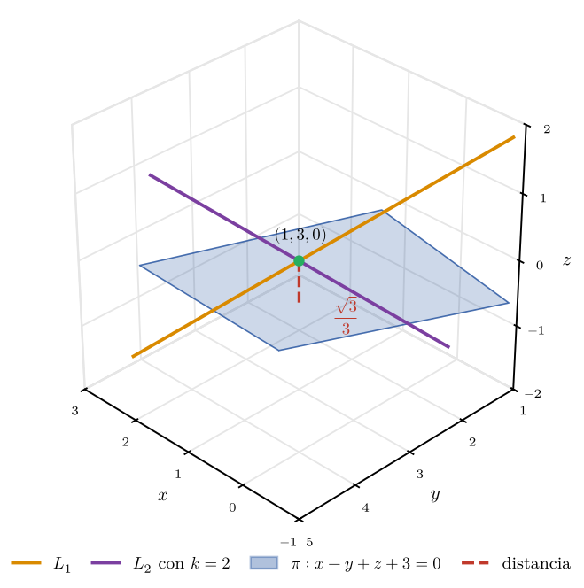

### Ejercicio 2 — Plano del haz con ordenada al origen dada y recta ortogonal

<!-- temas: HAZ PROY -->

> Consideremos el haz de planos $\alpha(x + y + z + 3) + \beta(x - 2y + z + 1) = 0$.
>
> a) Hallar, si existe, la ecuación del plano en el haz que tenga ordenada al origen igual a 2.
> b) Sea $\pi$ el plano en el haz con $\alpha = 0$ y $\beta = 1$. Hallar, si existe, la ecuación de una recta ortogonal a $\pi$ que pase por el punto $(3, 1, 2)$.

**a) Idea.** «Ordenada» es la coordenada $y$ (abscisa $x$, ordenada $y$, cota $z$). Ordenada al origen 2 quiere decir que el plano corta al eje $y$ en $y = 2$, es decir, que pasa por $(0,\,2,\,0)$.

Se reemplaza $(0,\,2,\,0)$: $0 + 2 + 0 + 3 = 5$ y $0 - 4 + 0 + 1 = -3$; $5\alpha - 3\beta = 0$. Con $\alpha = 3$, $\beta = 5$:

$$
3(x + y + z + 3) + 5(x - 2y + z + 1) = 3x + 3y + 3z + 9 + 5x - 10y + 5z + 5 = 8x - 7y + 8z + 14 = 0
$$

Verificación: con $x = z = 0$, $-7y + 14 = 0$, $y = 2$.

> [!TIP]
> **Respuesta:** a) $8x - 7y + 8z + 14 = 0$.

**b)** $\pi: x - 2y + z + 1 = 0$. La recta ortogonal tiene la dirección de la normal, $(1,\,-2,\,1)$, y siempre existe.

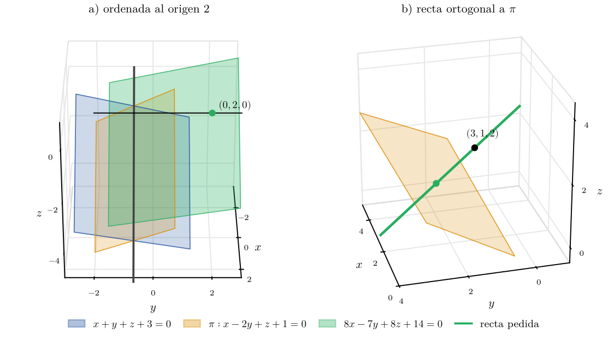

> [!TIP]
> **Respuesta:** b) $(x, y, z) = (3, 1, 2) + \lambda(1, -2, 1)$, $\lambda \in \mathbb{R}$.

### Ejercicio 3 — Verdadero o falso: inversibilidad y determinante por columnas

<!-- temas: RANGO DET VF -->

> Sean $A, B, C \in \mathbb{R}^{3\times3}$ tales que $A = \begin{pmatrix} 2 & 0 & 0 \\ 1 & k & 0 \\ 0 & 1 & 1 \end{pmatrix}$, $\det(B) = 4$ y $C = (B_1 - B_3 \mid 2B_2 \mid 3B_1)$.
>
> a) $A$ es inversible para todo valor de $k \in \mathbb{R}$.
> b) $\det(B^tC^{-1}) = 1/6$.

**a)** $A$ es triangular inferior (todo cero arriba de la diagonal): su determinante es el producto de la diagonal, $2 \cdot k \cdot 1 = 2k$, que se anula en $k = 0$.

> [!TIP]
> **Respuesta:** a) **Falso**: con $k = 0$ no es inversible.

**b)** Por columnas:

1. Salen el 2 (columna 2) y el 3 (columna 3): factor 6.
2. $B_1$ está sola en la columna 3: se resta de la columna 1 y queda $-B_3$; sale el $-1$.
3. $(B_3 \mid B_2 \mid B_1)$ es $B$ con las columnas 1 y 3 intercambiadas: otro $-1$.

$$
\begin{aligned}
\det C &= 6\det(B_1 - B_3 \mid B_2 \mid B_1) = 6\det(-B_3 \mid B_2 \mid B_1) \\
&= -6\det(B_3 \mid B_2 \mid B_1) = -6 \cdot (-\det B) = {\color{RoyalBlue} 24}
\end{aligned}
$$

$$
\det(B^tC^{-1}) = \det B \cdot \frac{1}{\det C} = \frac{4}{24} = \frac16
$$

> [!TIP]
> **Respuesta:** b) **Verdadero**.

### Ejercicio 4 — Dimensión de un generado de matrices y pertenencia

<!-- temas: LI -->

> Sea $S = \mathrm{gen}\left\{\begin{pmatrix} 1 & 2 \\ 0 & 3 \end{pmatrix}, \begin{pmatrix} 0 & 1 \\ -1 & 1 \end{pmatrix}, \begin{pmatrix} k & 0 \\ -2 & k \end{pmatrix}\right\}$.
>
> a) Hallar, si existen, todos los valores de $k \in \mathbb{R}$ para los cuales $\dim(S) = 2$.
> b) Si $k = 5$, analizar si $\begin{pmatrix} 5 & 1 \\ -3 & 6 \end{pmatrix} \in S$.

**a) Idea.** Las dos primeras no son proporcionales (una tiene un 0 donde la otra tiene un 1), así que $\dim S \geq 2$. Es exactamente 2 si la tercera es combinación lineal de las dos primeras.

$$
\alpha\begin{pmatrix} 1 & 2 \\ 0 & 3 \end{pmatrix} + \beta\begin{pmatrix} 0 & 1 \\ -1 & 1 \end{pmatrix} = \begin{pmatrix} \alpha & 2\alpha + \beta \\ -\beta & 3\alpha + \beta \end{pmatrix} = \begin{pmatrix} k & 0 \\ -2 & k \end{pmatrix}
$$

Entrada $(2,1)$: $\beta = 2$. Entrada $(1,1)$: $\alpha = k$. Entrada $(1,2)$: $2k + 2 = 0$, $k = -1$. Entrada $(2,2)$: $3k + 2 = k$, $k = -1$. Las dos condiciones coinciden.

> [!TIP]
> **Respuesta:** a) $k = -1$.

**b)** Con $k = 5$, $\dim S = 3$. Se busca $a M_1 + b M_2 + c M_3 = \begin{pmatrix} 5 & 1 \\ -3 & 6 \end{pmatrix}$, entrada por entrada:

$$
\begin{cases} (1,1): & a + 5c = 5 \\ (1,2): & 2a + b = 1 \\ (2,1): & -b - 2c = -3 \\ (2,2): & 3a + b + 5c = 6 \end{cases}
$$

De la primera, $a = 5 - 5c$; en la segunda, $b = 1 - 2a = 10c - 9$; en la tercera, $-(10c - 9) - 2c = -3$, $12c = 12$, $c = 1$. Entonces $a = 0$, $b = 1$, y la cuarta cierra: $0 + 1 + 5 = 6$.

> [!TIP]
> **Respuesta:** b) sí pertenece: $\begin{pmatrix} 5 & 1 \\ -3 & 6 \end{pmatrix} = \begin{pmatrix} 0 & 1 \\ -1 & 1 \end{pmatrix} + \begin{pmatrix} 5 & 0 \\ -2 & 5 \end{pmatrix}$.

### Ejercicio 5 — Intersección con parámetro y complemento de una suma

<!-- temas: INTSUM ORTC -->

> Sean $S = \{(x, y, z, w) \in \mathbb{R}^4 : x - 3y = 0,\ x + z - w = 0\}$ y $T = \mathrm{gen}\{(1, 0, 0, 0), (0, -1, k, 0)\}$.
>
> a) Hallar, si existen, todos los valores de $k \in \mathbb{R}$ para que $\dim(S \cap T) = 1$.
> b) Para $k = 3$, hallar base y dimensión de $(S + T)^\perp$.

**a) Idea.** $T$ viene con generadores y $S$ con ecuaciones: se toma un vector genérico de $T$ y se le imponen las ecuaciones de $S$.

$$
a(1,\,0,\,0,\,0) + b(0,\,-1,\,k,\,0) = (a,\ -b,\ bk,\ 0)
$$

$$
\begin{cases} x - 3y = 0: & a - 3(-b) = a + 3b = 0 \\ x + z - w = 0: & a + bk - 0 = 0 \end{cases}
\implies (a + 3b) - (a + bk) = b(3 - k) = 0
$$

Si $k \neq 3$: $b = 0$ y entonces $a = 0$; la intersección es $\{0\}$. Si $k = 3$: $b$ queda libre y $a = -3b$; con $b = -1$, $S \cap T = \mathrm{gen}\{(3,\,1,\,-3,\,0)\}$.

> [!TIP]
> **Respuesta:** a) $k = 3$.

**b)** Generadores de $S$: $x = 3y$ y $w = x + z = 3y + z$, con $y$ y $z$ libres; $S$ lo generan $(3,\,1,\,0,\,3)$ y $(0,\,0,\,1,\,1)$. Por Grassmann, $\dim(S + T) = 2 + 2 - 1 = 3$, y entonces $\dim(S + T)^\perp = 4 - 3 = 1$.

$(S + T)^\perp$ son los $(p,\,q,\,r,\,s)$ perpendiculares a todos los generadores de $S$ y de $T$:

$$
\begin{aligned}
(1,\,0,\,0,\,0)&: \quad p = 0 \\
(0,\,0,\,1,\,1)&: \quad r + s = 0 \\
(3,\,1,\,0,\,3)&: \quad 3p + q + 3s = 0 \implies q = -3s
\end{aligned}
$$

Con $s = -1$: $(0,\,3,\,1,\,-1)$. El cuarto generador cierra: $(0,\,-1,\,3,\,0) \cdot (0,\,3,\,1,\,-1) = -3 + 3 = 0$.

> [!TIP]
> **Respuesta:** b) $(S + T)^\perp = \mathrm{gen}\{(0, 3, 1, -1)\}$, dimensión 1.

<!-- salto-pagina -->

## Apéndice A — Herramientas que se repiten

**Determinante por columnas (propiedades).** No es la regla de Sarrus: Sarrus es una forma de *calcular* un determinante de $3 \times 3$ con números. Las propiedades sirven cuando la matriz no tiene números, como en el ej. 3 de casi todos los parciales ($B = (4A_1 - A_2 \mid \dots)$). El determinante es lineal en cada columna:

- una columna multiplicada por $\lambda$ saca un factor $\lambda$;
- sumarle a una columna un múltiplo de *otra columna presente* no lo cambia;
- una columna repetida (o nula) lo anula;
- intercambiar dos columnas le cambia el signo.

Con eso se pasa de $\det B$ a $\det A$ cuando $B$ se arma con columnas de $A$. Además, $\det(AB) = \det A \cdot \det B$, $\det(A^t) = \det A$, $\det(A^{-1}) = 1/\det A$ y, para $A \in \mathbb{R}^{n \times n}$, $\det(\lambda A) = \lambda^n \det A$: el escalar sale **elevado al tamaño**.

**Regla de Sarrus (solo $3 \times 3$).** Se repiten las dos primeras columnas a la derecha. Se **suman** los productos de las tres diagonales que bajan hacia la derecha (azul) y se **restan** los de las tres que bajan hacia la izquierda (naranja):

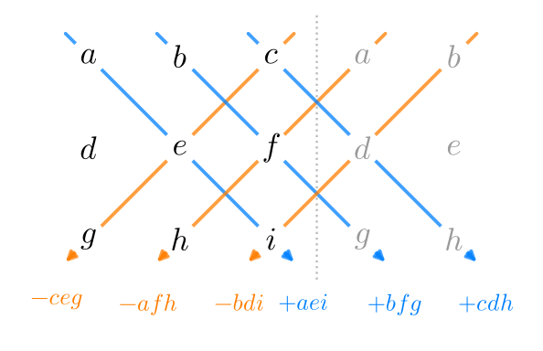

$$
\begin{vmatrix} a & b & c \\ d & e & f \\ g & h & i \end{vmatrix}
= {\color{RoyalBlue}(aei + bfg + cdh)} - {\color{BurntOrange}(ceg + afh + bdi)}
$$

Ejemplo, con la matriz de P1 ej. 4 a):

$$
\begin{aligned}
\begin{vmatrix} 3 & 2 & 0 \\ -12 & 0 & 3 \\ -6 & -1 & 1 \end{vmatrix}
&= {\color{RoyalBlue}\big(3 \cdot 0 \cdot 1 + 2 \cdot 3 \cdot (-6) + 0 \cdot (-12) \cdot (-1)\big)} \\
&\quad - {\color{BurntOrange}\big(0 \cdot 0 \cdot (-6) + 3 \cdot 3 \cdot (-1) + 2 \cdot (-12) \cdot 1\big)} \\
&= {\color{RoyalBlue}(-36)} - {\color{BurntOrange}(-33)} = -3
\end{aligned}
$$

En el documento, los determinantes de $3 \times 3$ están desarrollados por la primera fila (cofactores); Sarrus da lo mismo y suele ser más rápido. Para $4 \times 4$ Sarrus **no vale**: primero se hacen ceros con operaciones de fila (restar filas no cambia el determinante) y después se desarrolla por la fila o columna con más ceros.

**Producto vectorial.** Es el «determinante» con $\vec\imath,\ \vec\jmath,\ \vec k$ en la primera fila, ${\color{RoyalBlue}\vec u}$ en la segunda y ${\color{BurntOrange}\vec v}$ en la tercera. Cada componente es el determinante de $2 \times 2$ que queda al tapar su columna, y la del medio lleva el signo cambiado:

$$
\vec u \times \vec v = \begin{vmatrix} \vec\imath & \vec\jmath & \vec k \\ {\color{RoyalBlue}u_1} & {\color{RoyalBlue}u_2} & {\color{RoyalBlue}u_3} \\ {\color{BurntOrange}v_1} & {\color{BurntOrange}v_2} & {\color{BurntOrange}v_3} \end{vmatrix} = \big({\color{RoyalBlue}u_2}{\color{BurntOrange}v_3} - {\color{RoyalBlue}u_3}{\color{BurntOrange}v_2},\ \ -({\color{RoyalBlue}u_1}{\color{BurntOrange}v_3} - {\color{RoyalBlue}u_3}{\color{BurntOrange}v_1}),\ \ {\color{RoyalBlue}u_1}{\color{BurntOrange}v_2} - {\color{RoyalBlue}u_2}{\color{BurntOrange}v_1}\big)
$$

Verificación rápida: el resultado tiene que dar producto escalar 0 con $\vec u$ y con $\vec v$.

**Producto mixto.** Dos rectas con puntos $P_1, P_2$ y direcciones $\vec u_1, \vec u_2$ son coplanares si y solo si $[\vec u_1,\ \vec u_2,\ \overrightarrow{P_1P_2}] = 0$. Si además no son paralelas, se cortan (concurrentes); si el producto mixto no es cero, son alabeadas.

**Distancias.**

$$
d(P, \pi) = \frac{|a x_0 + b y_0 + c z_0 + d|}{\sqrt{a^2 + b^2 + c^2}}
\qquad
d(P, r) = \frac{\left|\overrightarrow{AP} \times \vec u\right|}{|\vec u|}
\qquad
d(r_1, r_2) = \frac{\left|[\vec u_1,\ \vec u_2,\ \overrightarrow{P_1P_2}]\right|}{|\vec u_1 \times \vec u_2|}
$$

con $A$ un punto de $r$. La tercera es solo para rectas **no paralelas**. Entre rectas paralelas, o entre una recta y un plano paralelos, se usa la distancia de un punto de una al otro objeto. Entre planos paralelos con la misma normal, $\frac{|D_1 - D_2|}{|\vec n|}$.

**Haz de planos.** $\alpha\,\pi_1 + \beta\,\pi_2 = 0$ son todos los planos que contienen a la recta $\pi_1 \cap \pi_2$. Una condición más (pasar por un punto, tener una normal dada) fija la razón $\alpha : \beta$.

**Recta como intersección de planos.** Su dirección es el producto vectorial de las dos normales.

**Condiciones sobre la normal de un plano.** Contiene a una recta: $\vec n \perp \vec u$. Paralelo a un eje: $\vec n \perp$ la dirección del eje. Perpendicular a otro plano: $\vec n \perp \vec n'$. Perpendicular a una recta: $\vec n \parallel \vec u$.

**Complemento ortogonal.** Si $S = \{x : M x = 0\}$, las filas de $M$ generan $S^\perp$. Si $S = \mathrm{gen}\{v_1, \dots\}$, $S^\perp$ son las soluciones de $v_i \cdot x = 0$. Siempre vale $\dim S + \dim S^\perp = n$.

**Fórmula de Grassmann.** $\dim(S + T) = \dim S + \dim T - \dim(S \cap T)$. La suma es directa si y solo si $S \cap T = \{0\}$.

## Apéndice B — Resultados

Para autocorregirse. «—» indica que ese parcial no tiene Tema 2 en el campus. La foto del parcial rendido el 08/08/2026 es del Tema 2 de P1.

| Parcial | Ej. | Tema 1 | Tema 2 |
|--------|:---:|--------------------------------------|--------------------------------------|
| P1 | 1 | a) $y + 3z + 7 = 0$; b) $k = 5$ | a) $x + 2y - 1 = 0$; b) $a = 5$ |
| P1 | 2 | a) $16x - 11y + 10z + 16 = 0$; b) $(\tfrac43, \tfrac53, -\tfrac43) + \lambda(1, -1, -1)$ | a) $16x + 10y - 11z + 16 = 0$; b) $(\tfrac43, -\tfrac43, \tfrac53) + \lambda(1, -1, -1)$ |
| P1 | 3 | a) $h = -1$; b) $\lambda \neq -1$ SCD, $\lambda = -1$ SCI | a) $b = -1$; b) $\mu \neq -1$ SCD, $\mu = -1$ SCI |
| P1 | 4 | a) $x^2 - x - 6$; b) $\mathrm{gen}\{\left(\begin{smallmatrix}1&1\\1&1\end{smallmatrix}\right)\}$, dim 1 | igual |
| P1 | 5 | a) $\mathrm{gen}\{(2,0,-1,1)\}$, dim 4, no directa; b) $k = 2$ | a) $\mathrm{gen}\{(-2,1,0,-1)\}$, dim 4, no directa; b) $h = 2$ |
| P2 | 1 | $x + y - 3z + 6 = 0$ | — |
| P2 | 2 | a) $a \neq -\tfrac13$; b) $\sqrt2$ | — |
| P2 | 3 | a) $\pm 2$; b) $-1458$ | — |
| P2 | 4 | a) F; b) F ($a = -\tfrac13$) | — |
| P2 | 5 | a) $\mathrm{gen}\{(1,2,2,-1)\}$; b) $\{(0,1,-1,0), (1,0,0,1)\}$, dim 2 | — |
| P3 | 1 | $4x - 3y + z - 11 = 0$ ($a = 1$) | $x - 3y + 4z - 11 = 0$ ($a = 1$) |
| P3 | 2 | $b = 1$ o $-\tfrac13$ | $c = 1$ o $-\tfrac13$ |
| P3 | 3 | a) $k = 0, 1$; b) $\lambda = \pm\tfrac12$ | a) $\mu = \pm\tfrac12$; b) $k = 0, 1$ |
| P3 | 4 | a) F; b) V | a) V; b) F |
| P3 | 5 | a) simétricas, dim 3; b) $(3, -1)$ | a) simétricas, dim 3; b) $(1, -3)$ |
| P4 | 1 | $-3x + y + z - 1 = 0$ y $-3x + y + z - 3 = 0$ | $x + y - 3z - 1 = 0$ y $x + y - 3z - 3 = 0$ |
| P4 | 2 | a) $a = -\tfrac13$; b) $2\sqrt2$ | a) $a = -\tfrac13$; b) $2\sqrt2$ |
| P4 | 3 | a) $6$; b) SCD | a) $-6$; b) SCD |
| P4 | 4 | a) V; b) F | a) F; b) V |
| P4 | 5 | a) $a = 1$; b) $\mathrm{gen}\{(-1,-1,1)\}$ | a) $b = 1$; b) $\mathrm{gen}\{(-1,1,1)\}$ |
| P5 | 1 | a) $\sqrt2$; b) $x + 3y - 2z = 0$ | a) $\sqrt2$; b) $-2x + 3y + z = 0$ |
| P5 | 2 | $x - y \pm 2 = 0$, no es único | $y - z \pm 2 = 0$, no es único |
| P5 | 3 | a) F; b) V | a) V; b) F |
| P5 | 4 | a) $a \neq 2$; b) no pertenece | a) $a \neq 3$; b) no pertenece |
| P5 | 5 | a) $k = 2$; b) $\mathrm{gen}(B)$, dim 2 | a) $\mathrm{gen}(B)$, dim 2; b) $k = 2$ |
| P6 | 1 | a) $k = 1$; b) $(3, 1, 1)$ | — |
| P6 | 2 | a) $x + z - 1 = 0$; b) $x - y - z = 0$ | — |
| P6 | 3 | a) todo $k$; b) $0$ | — |
| P6 | 4 | a) $k \neq 1$; b) $\mathrm{gen}\{(-1,1,0), (-2,0,1)\}$ | — |
| P6 | 5 | a) $\{(-1,1,0), (1,0,1)\}$, dim 2; b) $S + T = T$, dim 2, no directa | — |
| P7 | 1 | a) todo $k$; b) $\tfrac{\sqrt3}{3}$ | — |
| P7 | 2 | a) $8x - 7y + 8z + 14 = 0$; b) $(3,1,2) + \lambda(1,-2,1)$ | — |
| P7 | 3 | a) F; b) V | — |
| P7 | 4 | a) $k = -1$; b) sí pertenece | — |
| P7 | 5 | a) $k = 3$; b) $\mathrm{gen}\{(0,3,1,-1)\}$, dim 1 | — |

*Fuentes:* enunciados en `ayga/1er_parcial/fuentes/`: los siete PDFs del campus (2019–2022), renombrados por fecha (el nombre original figura en cada parcial), y la foto del parcial rendido el 08/08/2026; programa de la materia en `ayga/material_catedra/` (Unidades I–V, Parte A). Enunciados cotejados con la imagen de cada página; resultados y figuras comprobados con sympy y numpy.
