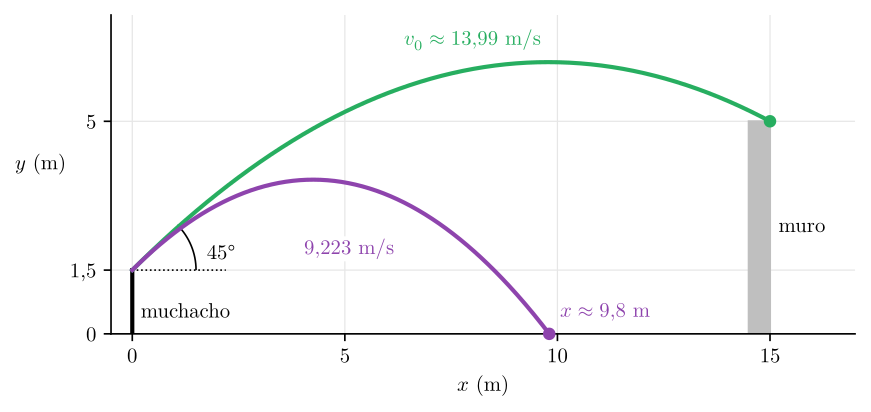
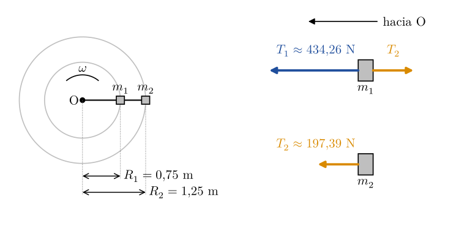
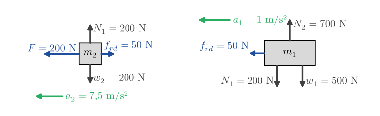
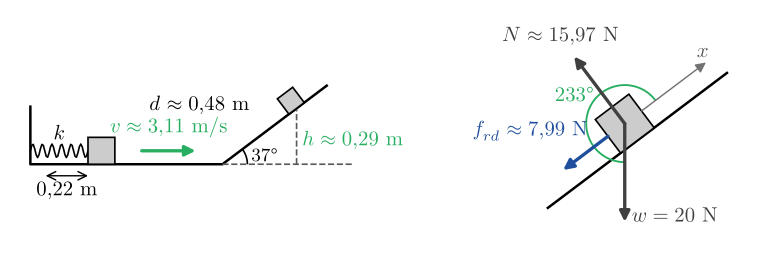
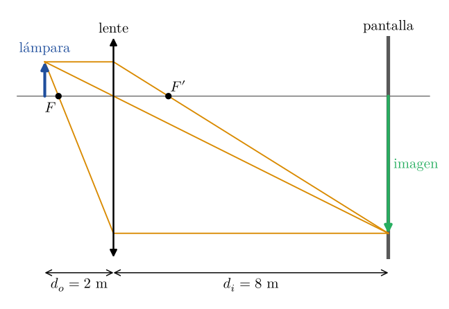

# Correcciones del 1er Parcial — Física I

Corrección de los errores del primer parcial rendido el **2 de septiembre de 2026** (curso A1193).

Indicaciones del examen: resolver con unidades, sistemas de referencia y DCL con esquemas prolijos; usar, donde sea necesario, $g = 10\ \text{m/s}^2$.

---

## Ejercicio 1 — Lanzamiento sobre un muro

### 1.1 Enunciado

> Un muchacho de 1,5 m de altura y que está parado a 15 m de distancia de un muro de 5 m de altura, lanza una piedra bajo un ángulo de 45° con respecto a la horizontal.
>
> ¿Con qué velocidad mínima debe lanzar la piedra para que ésta pase por encima del muro?

### 1.2 Planteo

Origen en el suelo, a los pies del muchacho; $x$ horizontal hacia el muro, $y$ hacia arriba:

$$
x_0 = 0 \qquad y_0 = 1{,}5\ \text{m} \qquad \theta = 45^\circ \qquad a_x = 0 \qquad a_y = -g = -10\ \text{m/s}^2
$$

La velocidad mínima es la que lleva la piedra justo al borde superior del muro, $(15\ \text{m};\,5\ \text{m})$: con una velocidad mayor pasa más alto.

Con $v_{0x} = v_0\cos\theta$ y $v_{0y} = v_0\operatorname{sen}\theta$, las ecuaciones de posición quedan:

$$
\begin{aligned}
x &= {\color{BrickRed}\cancel{{\color{black}x_0}}} + v_{0x}\,t + {\color{BrickRed}\cancel{{\color{black}\tfrac{1}{2}\,a_x\,t^2}}} = (v_0\cos\theta)\,t \\
y &= y_0 + v_{0y}\,t + \tfrac{1}{2}\,a_y\,t^2 = y_0 + (v_0\operatorname{sen}\theta)\,t - \tfrac{1}{2}\,g\,t^2
\end{aligned}
$$

### 1.3 Tiempo hasta el muro

De la ecuación en $x$, con $x = 15\ \text{m}$:

$$
{\color{RoyalBlue} t = \frac{15\ \text{m}}{v_0\cos 45^\circ}}
$$

### 1.4 Altura en el muro

Se reemplaza $t$ en la ecuación en $y$, con $y = 5\ \text{m}$:

$$
\begin{aligned}
5\ \text{m} &= 1{,}5\ \text{m} + {\color{BrickRed}\cancel{{\color{black}v_0}}}\operatorname{sen} 45^\circ \cdot \frac{15\ \text{m}}{{\color{BrickRed}\cancel{{\color{black}v_0}}}\cos 45^\circ} - \frac{1}{2}\cdot 10\ \frac{\text{m}}{\text{s}^2} \cdot {\color{BrickRed} \left({\color{black}\frac{15\ \text{m}}{v_0\cos 45^\circ}}\right)^{2}} \\[4pt]
5\ \text{m} - 1{,}5\ \text{m} &= {\color{RoyalBlue} \operatorname{tg} 45^\circ} \cdot 15\ \text{m} - 5\ \frac{\text{m}}{\text{s}^2} \cdot {\color{BrickRed} \frac{225\ \text{m}^2}{v_0^2\cos^2 45^\circ}}
\end{aligned}
$$

> [!CAUTION]
> **Mi error:** al reemplazar $t$ no lo elevé al cuadrado, aunque el $t^2$ estaba bien escrito en la ecuación de partida. Me quedó $5\ \text{m/s}^2 \cdot \frac{15\ \text{m}}{v_0\cos 45^\circ}$ y desde ahí arrastré el error en todo lo marcado en rojo.

Como ${\color{RoyalBlue}\operatorname{sen} 45^\circ = \cos 45^\circ = \tfrac{\sqrt{2}}{2}}$, resulta ${\color{RoyalBlue}\operatorname{tg} 45^\circ = 1}$:

$$
\begin{aligned}
3{,}5\ \text{m} &= 15\ \text{m} - 5\ \frac{\text{m}}{\text{s}^2} \cdot {\color{BrickRed} \frac{225\ \text{m}^2}{v_0^2\cos^2 45^\circ}} \\[4pt]
5\ \frac{\text{m}}{\text{s}^2} \cdot {\color{BrickRed} \frac{225\ \text{m}^2}{v_0^2\cos^2 45^\circ}} &= {\color{BrickRed} \frac{1125\ \text{m}^3/\text{s}^2}{v_0^2\cos^2 45^\circ}} = 15\ \text{m} - 3{,}5\ \text{m} = {\color{RoyalBlue} 11{,}5\ \text{m}}
\end{aligned}
$$

### 1.5 Velocidad mínima

Con ${\color{BrickRed}\cos^2 45^\circ = \left(\tfrac{\sqrt{2}}{2}\right)^{2} = \tfrac{2}{4} = \tfrac{1}{2}}$:

$$
\begin{aligned}
{\color{BrickRed} v_0^2} &= {\color{BrickRed} \frac{1125\ \text{m}^3/\text{s}^2}{{\color{RoyalBlue}11{,}5\ \text{m}} \cdot \cos^2 45^\circ}} = {\color{BrickRed} \frac{1125\ \text{m}^3/\text{s}^2}{{\color{RoyalBlue}11{,}5\ \text{m}} \cdot \frac{1}{2}}} = {\color{BrickRed} 195{,}65\ \frac{\text{m}^2}{\text{s}^2}} \\[4pt]
v_0 &= \sqrt{195{,}65\ \frac{\text{m}^2}{\text{s}^2}} \implies {\color{ForestGreen}\boxed{v_0 \approx 13{,}99\ \text{m/s}}}
\end{aligned}
$$

> [!TIP]
> **Respuesta:** $v_0 \approx 13{,}99$ m/s (en el parcial llegué a $9{,}223$ m/s).

<!-- salto-pagina -->

### 1.6 Comprobaciones

**Unidades.** El término de la gravedad debe dar metros, como el otro lado de la igualdad:

$$
\text{correcto:}\ \ \frac{\text{m}}{\text{s}^2} \cdot \frac{\text{m}^2}{\text{m}^2/\text{s}^2} = \text{m} \qquad\qquad {\color{BrickRed}\text{parcial:}}\ \ \frac{\text{m}}{\text{s}^2} \cdot {\color{BrickRed}\frac{\text{m}}{\text{m/s}}} = {\color{BrickRed}\frac{\text{m}}{\text{s}}}
$$

Sin el cuadrado, ese término queda en m/s y no se puede restar de metros. En el parcial dejé de escribir las unidades al pasar a $75$: por eso no quedó a la vista.

**Altura en el muro.** Con cada velocidad, $t = \frac{15\ \text{m}}{v_0\cos 45^\circ}$ e $y = 1{,}5\ \text{m} + 15\ \text{m} - 5\ \text{m/s}^2 \cdot t^2$:

| $v_0$ | $t$ | $y$ en $x = 15$ m | |
|---|---|---|---|
| $13{,}99$ m/s | $1{,}52$ s | $5{,}00$ m | llega justo al borde del muro |
| $9{,}223$ m/s | $2{,}30$ s | $-9{,}95$ m | bajo el suelo: la piedra cae antes, a unos $9{,}8$ m |

<!-- solo-pdf
\begingroup\centering
-->

<!-- solo-pdf
\par\endgroup
-->

<!-- salto-pagina -->

## Ejercicio 2 — Bloques en movimiento circular

### 2.1 Enunciado

> Dos bloques de masas 2 kg y 1 kg están unidos entre sí y a un punto fijo O por cuerdas inextensibles y sin masa, como muestra la figura. Los cuerpos describen un movimiento circular con velocidad angular constante de $4\pi$ rad/s, en un plano horizontal sin rozamiento.
>
> Calcular la tensión de cada una de las cuerdas.
>
> *Figura:* sobre un mismo radio, desde O: cuerda de 75 cm hasta el bloque de 2 kg y cuerda de 50 cm hasta el bloque de 1 kg. Velocidad angular $\omega$.

### 2.2 Datos

El bloque 1 es el interior y el bloque 2, el exterior. Su radio suma las dos cuerdas:

$$
m_1 = 2\ \text{kg} \qquad m_2 = 1\ \text{kg} \qquad \omega = 4\pi\ \frac{\text{rad}}{\text{s}} \qquad R_1 = 0{,}75\ \text{m} \qquad R_2 = 0{,}75\ \text{m} + 0{,}50\ \text{m} = 1{,}25\ \text{m}
$$

### 2.3 Aceleraciones radiales

Los dos bloques giran con la misma $\omega$ y radios distintos. Cada uno tiene una aceleración radial (centrípeta), dirigida hacia O, $a_{\text{rad}} = \gamma = \omega^2 R$:

$$
\begin{aligned}
{\color{RoyalBlue}\gamma_1} &= \omega^2 R_1 = \left(4\pi\ \frac{\text{rad}}{\text{s}}\right)^{2} \cdot 0{,}75\ \text{m} \approx {\color{RoyalBlue} 118{,}44\ \frac{\text{m}}{\text{s}^2}} \\[4pt]
{\color{RoyalBlue}\gamma_2} &= \omega^2 R_2 = \left(4\pi\ \frac{\text{rad}}{\text{s}}\right)^{2} \cdot 1{,}25\ \text{m} \approx {\color{RoyalBlue} 197{,}39\ \frac{\text{m}}{\text{s}^2}}
\end{aligned}
$$

El radián es adimensional, por eso $\frac{\text{rad}^2}{\text{s}^2} \cdot \text{m}$ da $\frac{\text{m}}{\text{s}^2}$. En el parcial llegué a estos valores, pero sin aclarar qué aceleración eran ($\gamma$).

### 2.4 Fuerzas sobre cada bloque

Eje radial positivo hacia O. En la vertical, $n = w$ en cada bloque, y no hay rozamiento: en la dirección radial actúan solo las tensiones. La cuerda entre bloques no tiene masa, así que $T_2$ es igual en sus dos extremos: tira del bloque 2 hacia O y del bloque 1 hacia afuera.

**Bloque 2.** Solo lo sostiene $T_2$:

$$
T_2 = m_2\,\gamma_2 = 1\ \text{kg} \cdot 197{,}39\ \frac{\text{m}}{\text{s}^2} \implies {\color{ForestGreen}\boxed{T_2 \approx 197{,}39\ \text{N}}}
$$

> [!CAUTION]
> **Mi error:** no hice el DCL ni planteé la segunda ley. Dibujé los bloques y las cuerdas sin fuerzas y solo multipliqué masa por aceleración, así que los 197,4 N eran el valor correcto de $T_2$, pero no lo dije.

<!-- salto-pagina -->

**Bloque 1.** $T_1$ tira hacia O y $T_2$, hacia afuera:

$$
\begin{aligned}
{\color{BrickRed} T_1 - T_2} &= m_1\,\gamma_1 = 2\ \text{kg} \cdot 118{,}44\ \frac{\text{m}}{\text{s}^2} = {\color{RoyalBlue} 236{,}87\ \text{N}} \\[4pt]
T_1 &= {\color{BrickRed} T_2} + m_1\,\gamma_1 = {\color{BrickRed} 197{,}39\ \text{N}} + {\color{RoyalBlue} 236{,}87\ \text{N}} \implies {\color{ForestGreen}\boxed{T_1 \approx 434{,}26\ \text{N}}}
\end{aligned}
$$

> [!CAUTION]
> **Mi error:** terminé en $m_1\gamma_1 = 236{,}87$ N. Esa es la fuerza neta sobre el bloque 1, no una tensión: faltó sumarle $T_2$, porque $T_1$ también tiene que compensar el tirón hacia afuera de la otra cuerda.

> [!TIP]
> **Respuesta:** $T_1 \approx 434{,}26$ N (entre O y el bloque 1) y $T_2 \approx 197{,}39$ N (entre los bloques).

### 2.5 Comprobaciones

**Unidades.** $\text{kg} \cdot \frac{\text{m}}{\text{s}^2} = \text{N}$ en las dos tensiones.

**Sistema completo.** Si se toman los dos bloques juntos, $T_2$ es una fuerza interna y se anula. La única fuerza radial externa es $T_1$, y se llega al mismo valor:

$$
T_1 = m_1\,\gamma_1 + m_2\,\gamma_2 = 236{,}87\ \text{N} + 197{,}39\ \text{N} = 434{,}26\ \text{N}
$$

<!-- solo-pdf
\begingroup\centering
-->

<!-- solo-pdf
\par\endgroup
-->

<!-- salto-pagina -->

## Ejercicio 3 — Bloques apilados con rozamiento

### 3.1 Enunciado

> El bloque de masa $m_1 = 50$ kg descansa sobre una superficie horizontal y un bloque 2 de masa $m_2 = 20$ kg descansa sobre el bloque 1. No hay rozamiento entre el bloque 1 y la superficie horizontal, pero sí entre ambos bloques. Los bloques se encuentran inicialmente en reposo cuando una fuerza $F$ de 200 N comienza a tirar del bloque 2.
>
> a) Realice el diagrama del cuerpo libre para cada bloque.
>
> b) Indique si los bloques se mueven juntos o si hay movimiento relativo entre ellos. Justifique.
>
> c) Determine la aceleración que adquiere cada bloque.
>
> *Figura:* $m_2$ apoyado sobre $m_1$; $\vec{F}$ horizontal, aplicada sobre $m_2$ y hacia la izquierda. $\mu_e = 0{,}5$; $\mu_d = 0{,}25$.

### 3.2 Inciso a) — Diagramas de cuerpo libre

Eje $x$ positivo en el sentido de $\vec F$ (hacia la izquierda) y eje $y$ hacia arriba. $N_1$ es la normal entre los bloques y $N_2$, la del piso sobre el bloque 1.

- **Bloque 2:** $\vec F$, $\vec w_2$, $\vec N_1$ hacia arriba y el rozamiento $\vec f_{rd}$, opuesto a $\vec F$.
- **Bloque 1:** $\vec w_1$, $\vec N_2$, $\vec N_1$ hacia abajo y la reacción de $\vec f_{rd}$, en el sentido de $\vec F$. Es la **única** fuerza horizontal sobre este bloque.

> [!CAUTION]
> **Mi error:** pensé que el rozamiento no podía quedar solo sobre el bloque 1 y le agregué una fuerza estática opuesta, con su reacción en el piso. El enunciado dice que no hay rozamiento con el piso: nada frena al bloque 1, y esa fuerza sola es la que lo acelera.

<!-- solo-pdf
\begingroup\centering
-->

<!-- solo-pdf
\par\endgroup
-->

### 3.3 Inciso b) — ¿Se mueven juntos?

En $y$ hay equilibrio (primera ley). El rozamiento depende de la normal entre los bloques, que sostiene solo a los 20 kg:

$$
\vec w_2 = m_2\,\vec g = \begin{pmatrix} 0 \\ -200\ \text{N} \end{pmatrix} \implies \vec N_1 = \begin{pmatrix} 0 \\ +200\ \text{N} \end{pmatrix}
$$

$$
{\color{RoyalBlue} f_{re,\text{máx}}} = \mu_e\,N_1 = 0{,}5 \cdot 200\ \text{N} = {\color{RoyalBlue} 100\ \text{N}} \qquad\qquad {\color{RoyalBlue} f_{rd}} = \mu_d\,N_1 = 0{,}25 \cdot 200\ \text{N} = {\color{RoyalBlue} 50\ \text{N}}
$$

<!-- salto-pagina -->

Si se movieran juntos, el rozamiento estático tendría que acelerar por sí solo al bloque 1:

$$
\begin{aligned}
{\color{BrickRed} a} &= {\color{BrickRed} \frac{F}{m_1 + m_2} = \frac{200\ \text{N}}{50\ \text{kg} + 20\ \text{kg}} \approx 2{,}86\ \frac{\text{m}}{\text{s}^2}} \\[4pt]
{\color{BrickRed} f_{\text{necesaria}}} &= {\color{BrickRed} m_1\,a = 50\ \text{kg} \cdot 2{,}86\ \frac{\text{m}}{\text{s}^2} \approx 142{,}86\ \text{N} > {\color{RoyalBlue} 100\ \text{N}}}
\end{aligned}
$$

El rozamiento estático no alcanza: los bloques deslizan entre sí.

> [!CAUTION]
> **Mi error:** comparé $F = 200$ N con los 100 N. La conclusión salió bien, pero ese criterio solo vale con el bloque 1 quieto. Como acompaña el movimiento, el límite es $F = 140$ N: con 120 N, por ejemplo, se mueven juntos aunque superen los 100 N.

> [!CAUTION]
> **Mi error:** respondí que el bloque 1 estaba en equilibrio, por arrastre de la fuerza estática que le había agregado en el inciso a).

> [!TIP]
> **Respuesta:** b) Hay movimiento relativo. Los dos bloques se mueven en el sentido de $\vec F$, pero el bloque 2 acelera más y desliza sobre el bloque 1.

### 3.4 Inciso c) — Aceleraciones

En $x$ se aplica la segunda ley con el rozamiento dinámico, porque hay deslizamiento.

**Bloque 2:**

$$
\begin{aligned}
\vec R_2 &= \vec F + \vec f_{rd} = \begin{pmatrix} 200\ \text{N} \\ 0 \end{pmatrix} + \begin{pmatrix} -50\ \text{N} \\ 0 \end{pmatrix} = \begin{pmatrix} 150\ \text{N} \\ 0 \end{pmatrix} \\[4pt]
a_2 &= \frac{150\ \text{N}}{20\ \text{kg}} \implies {\color{ForestGreen}\boxed{a_2 = 7{,}5\ \text{m/s}^2}}
\end{aligned}
$$

**Bloque 1:** la reacción de $\vec f_{rd}$ es su única fuerza horizontal.

$$
{\color{BrickRed} \vec R_1 = \begin{pmatrix} +50\ \text{N} \\ 0 \end{pmatrix} \qquad a_1 = \frac{50\ \text{N}}{50\ \text{kg}}} \implies {\color{ForestGreen}\boxed{a_1 = 1\ \text{m/s}^2}}
$$

> [!CAUTION]
> **Mi error:** calculé solo la aceleración del bloque 2. Al tener al bloque 1 en equilibrio, no calculé la suya.

> [!TIP]
> **Respuesta:** c) $a_2 = 7{,}5$ m/s² y $a_1 = 1$ m/s², las dos en el sentido de $\vec F$.

<!-- salto-pagina -->

### 3.5 Comprobaciones

**Unidades.** $\frac{\text{N}}{\text{kg}} = \frac{\text{kg}\cdot\text{m/s}^2}{\text{kg}} = \frac{\text{m}}{\text{s}^2}$.

**Sistema completo.** Tomando los dos bloques juntos, el rozamiento es una fuerza interna y se anula. La única fuerza horizontal externa es $F$:

$$
m_1\,a_1 + m_2\,a_2 = 50\ \text{kg} \cdot 1\ \frac{\text{m}}{\text{s}^2} + 20\ \text{kg} \cdot 7{,}5\ \frac{\text{m}}{\text{s}^2} = 50\ \text{N} + 150\ \text{N} = 200\ \text{N} = F
$$

> [!NOTE]
> **Nota sobre la corrección de la docente.** En mi hoja, para el bloque 1, escribió:
>
> $$
> a_1 = \frac{f_{rd}}{m_1} = \frac{0{,}25\,(500 + 200)\ \text{N}}{50\ \text{kg}} = 3{,}5\ \frac{\text{m}}{\text{s}^2}
> $$
>
> Acá se adopta $a_1 = 1\ \text{m/s}^2$, porque ese cálculo no cierra por tres lados:
>
> - **La normal.** El rozamiento entre bloques depende de la normal en esa superficie, $N_1 = 200$ N, que soporta solo los 20 kg de arriba. Los 700 N son $N_2$, la normal con el piso, donde no hay rozamiento.
> - **Acción y reacción.** Si el bloque 1 recibiera 175 N de rozamiento, el bloque 2 recibiría otros 175 N en sentido contrario. Entonces $a_2 = (200\ \text{N} - 175\ \text{N}) / 20\ \text{kg} = 1{,}25\ \text{m/s}^2$, y no los $7{,}5\ \text{m/s}^2$ que dio por correctos.
> - **El sistema completo.** Con $a_1 = 3{,}5$ y $a_2 = 7{,}5\ \text{m/s}^2$ resulta $m_1 a_1 + m_2 a_2 = 175\ \text{N} + 150\ \text{N} = 325\ \text{N}$, pero la única fuerza horizontal externa es de 200 N.
>
> Queda para consultar con la docente.

> [!NOTE]
> **Nota sobre el criterio del inciso b).** Los 100 N no se comparan con $F$, sino con el rozamiento que necesita el bloque 1 para acompañar al bloque 2, $m_1 F / (m_1 + m_2)$. Con $F = 200$ N necesita $142{,}86$ N, más de 100 N: deslizan. Con $F = 120$ N necesita $85{,}71$ N, menos de 100 N: se mueven juntos, aunque $F$ supere los 100 N. El límite está en $F = 140$ N. Comparar $F$ con 100 N directamente solo serviría con el bloque 1 fijo.

<!-- salto-pagina -->

## Ejercicio 4 — Resorte y plano inclinado

### 4.1 Enunciado

> Un bloque de 2 kg se empuja contra un resorte de masa despreciable y $k = 400$ N/m, comprimiéndolo 0,220 m. Al soltarse el bloque, este se mueve por una superficie horizontal (sin rozamiento) y luego sube por un plano inclinado 37° (con rozamiento).
>
> a) Determine la velocidad del bloque al deslizarse sobre la superficie horizontal después de separarse del resorte.
>
> b) ¿Qué altura máxima alcanza el bloque al subir el plano inclinado?
>
> c) Una vez alcanzada la altura máxima, indique si descenderá o no por el plano inclinado. Justifique.
>
> *Figura:* resorte horizontal fijo a una pared, comprimido 0,220 m por el bloque; a continuación, la superficie horizontal y el plano a 37,0°. $\mu_e = 0{,}8$; $\mu_d = 0{,}5$.

### 4.2 Inciso a) — Velocidad al separarse del resorte

La superficie horizontal no tiene rozamiento: el trabajo del resorte queda entero como energía cinética. La fuerza del resorte varía con la compresión ($F = k\,x$), por eso no se usa $F \cdot d$, sino la energía potencial elástica:

$$
W = \frac{1}{2}\,k\,x^2 = \frac{1}{2} \cdot 400\ \frac{\text{N}}{\text{m}} \cdot (0{,}22\ \text{m})^2 = {\color{RoyalBlue} 9{,}68\ \text{J}} \qquad\qquad \frac{\text{N}}{\text{m}} \cdot \text{m}^2 = \text{N} \cdot \text{m} = \text{J}
$$

El bloque parte del reposo, así que no tiene energía cinética inicial:

$$
\begin{aligned}
W &= K_2 - {\color{BrickRed}\cancel{{\color{black}K_1}}} = \frac{1}{2}\,m\,v^2 \\[4pt]
9{,}68\ \text{J} &= \frac{1}{2} \cdot 2\ \text{kg} \cdot v^2 \implies v^2 = 9{,}68\ \frac{\text{m}^2}{\text{s}^2} \implies {\color{ForestGreen}\boxed{v \approx 3{,}11\ \text{m/s}}}
\end{aligned}
$$

Al separarse del resorte no queda ninguna fuerza horizontal: la aceleración es nula y la velocidad, constante.

> [!TIP]
> **Respuesta:** a) $v \approx 3{,}11$ m/s.

<!-- salto-pagina -->

### 4.3 Inciso b) — Altura máxima

Sobre el plano, eje $x$ paralelo al plano y hacia arriba, eje $y$ perpendicular. Desde $+x$, el peso forma un ángulo de $180^\circ + 53^\circ = 233^\circ$, porque $180^\circ = 90^\circ + 37^\circ + 53^\circ$:

$$
\vec w = m\,g \begin{pmatrix} \cos 233^\circ \\ \operatorname{sen} 233^\circ \end{pmatrix} = \begin{pmatrix} -12{,}04\ \text{N} \\ -15{,}97\ \text{N} \end{pmatrix} \implies \vec N = \begin{pmatrix} 0 \\ +15{,}97\ \text{N} \end{pmatrix}
$$

$$
f_{rd} = \mu_d\,N = 0{,}5 \cdot 15{,}97\ \text{N} = {\color{RoyalBlue} 7{,}99\ \text{N}} \qquad\qquad f_{re,\text{máx}} = \mu_e\,N = 0{,}8 \cdot 15{,}97\ \text{N} = {\color{RoyalBlue} 12{,}78\ \text{N}}
$$

> [!CAUTION]
> **Mi error:** escribí "la fuerza que llevaba el bloque" y "la fuerza que imprime el resorte". Después de separarse, el bloque no lleva ninguna fuerza: lleva **energía cinética**, y los 9,68 J son energía, no fuerza. El peso y el rozamiento no se le oponen a una fuerza, sino que le quitan esa energía.

La única fuerza no conservativa es el rozamiento. Su trabajo es igual a la variación de la energía mecánica entre el pie del plano y el punto más alto, donde $v = 0$:

$$
{\color{BrickRed} W_{f_{rd}} = \Delta E_m \implies -f_{rd}\,d = m\,g\,h - \frac{1}{2}\,m\,v^2}
$$

Recorrido y altura se relacionan por ${\color{BrickRed} d = \dfrac{h}{\operatorname{sen} 37^\circ}}$:

$$
\begin{aligned}
{\color{BrickRed} -7{,}99\ \text{N} \cdot \frac{h}{\operatorname{sen} 37^\circ} - 20\ \text{N} \cdot h} &= {\color{BrickRed} -{\color{RoyalBlue}9{,}68\ \text{J}}} \\[4pt]
{\color{BrickRed} (13{,}27\ \text{N} + 20\ \text{N}) \cdot h} &= {\color{BrickRed} {\color{RoyalBlue}9{,}68\ \text{J}}} \\[4pt]
h &= \frac{9{,}68\ \text{J}}{33{,}27\ \text{N}} \implies {\color{ForestGreen}\boxed{h \approx 0{,}29\ \text{m}}}
\end{aligned}
$$

> [!CAUTION]
> **Mi error:** calculé bien el peso, la normal y el rozamiento, pero no planteé el balance de energía marcado en rojo: me quedé en la frase "cuánto le permite ascender antes de ser cancelada", sin llegar a $h$.

> [!TIP]
> **Respuesta:** b) $h \approx 0{,}29$ m, con un recorrido sobre el plano de $d \approx 0{,}48$ m.

<!-- salto-pagina -->

### 4.4 Inciso c) — ¿Desciende?

En el punto más alto el bloque está quieto, así que corresponde comparar con el rozamiento estático máximo:

$$
|w_x| = 12{,}04\ \text{N} < f_{re,\text{máx}} = 12{,}78\ \text{N}
$$

El peso no alcanza a romper el rozamiento estático. Mientras esté en reposo, el rozamiento vale justo lo necesario, $12{,}04$ N; los $12{,}78$ N son el tope.

> [!TIP]
> **Respuesta:** c) No desciende: la componente del peso sobre el plano no supera el rozamiento estático máximo.

### 4.5 Comprobaciones

**Unidades.** $\text{J} / \text{N} = \text{N}\cdot\text{m} / \text{N} = \text{m}$ en el resultado de $h$.

**Altura, con la segunda ley.** Con los vectores de 4.3 y la ecuación de $v^2$ con aceleración constante:

$$
\begin{aligned}
a_x &= \frac{-12{,}04\ \text{N} - 7{,}99\ \text{N}}{2\ \text{kg}} \approx -10{,}01\ \frac{\text{m}}{\text{s}^2} \\[4pt]
0 &= v^2 + 2\,a_x\,d \implies d = \frac{9{,}68\ \text{m}^2/\text{s}^2}{2 \cdot 10{,}01\ \text{m/s}^2} \approx 0{,}48\ \text{m} \implies h = d\,\operatorname{sen} 37^\circ \approx 0{,}29\ \text{m}
\end{aligned}
$$

**Descenso, sin la masa.** La condición $m\,g\operatorname{sen} 37^\circ \le \mu_e\,m\,g\cos 37^\circ$ se reduce a $\operatorname{tg} 37^\circ \le \mu_e$. Como $0{,}75 < 0{,}8$, no desciende, cualquiera sea la masa.

<!-- solo-pdf
\begingroup\centering
-->

<!-- solo-pdf
\par\endgroup
-->

<!-- salto-pagina -->

## Ejercicio 5 — Lente convergente

### 5.1 Enunciado

> Calcule la posición y distancia focal de la lente convergente que proyectará sobre una pantalla la imagen de una lámpara con una amplificación de 4 veces. La lámpara y la pantalla se encuentran separadas 10 m.

> [!CAUTION]
> **Mi error:** no llegué a empezarlo. El tiempo me alcanzó justo hasta el ejercicio 4, y además no había estudiado lentes.

### 5.2 Qué dice el enunciado

- **Se proyecta sobre una pantalla:** la imagen es **real**, porque la luz llega de verdad hasta ese punto. Con una lente, la imagen real se forma del otro lado: la lente está **entre** la lámpara y la pantalla.
- **Amplificación de 4 veces:** una imagen real de una lente convergente sale invertida, así que el aumento lateral es negativo, ${\color{RoyalBlue} m = -4}$.

Con $d_o$ la distancia de la lámpara a la lente, $d_i$ la de la lente a la pantalla y $f$ la distancia focal:

$$
\frac{1}{f} = \frac{1}{d_o} + \frac{1}{d_i} \qquad\qquad m = -\frac{d_i}{d_o}
$$

### 5.3 De dónde salen esas dos fórmulas

Se usan dos de los rayos de la figura, en una lámpara de altura $y$ y su imagen de altura $y'$ en módulo:

- El rayo que pasa por el centro de la lente no se desvía. Por triángulos semejantes, $\dfrac{y'}{y} = \dfrac{d_i}{d_o}$, que es el módulo de $m$.
- El rayo que llega paralelo al eje sale pasando por el foco. Por triángulos semejantes del lado de la imagen, $\dfrac{y'}{y} = \dfrac{d_i - f}{f}$.

Igualando las dos relaciones y dividiendo por $d_i$:

$$
\frac{d_i}{d_o} = \frac{d_i}{f} - 1 \implies \frac{1}{d_o} = \frac{1}{f} - \frac{1}{d_i} \implies \frac{1}{f} = \frac{1}{d_o} + \frac{1}{d_i}
$$

<!-- salto-pagina -->

### 5.4 Posición de la lente

Hay dos incógnitas y dos datos: la separación de 10 m y el aumento.

$$
\begin{aligned}
d_o + d_i &= 10\ \text{m} \\[4pt]
m = -\frac{d_i}{d_o} = -4 &\implies {\color{RoyalBlue} d_i = 4\,d_o}
\end{aligned}
$$

Reemplazando:

$$
d_o + 4\,d_o = 10\ \text{m} \implies {\color{ForestGreen}\boxed{d_o = 2\ \text{m}}} \implies {\color{ForestGreen}\boxed{d_i = 8\ \text{m}}}
$$

### 5.5 Distancia focal

$$
\frac{1}{f} = \frac{1}{2\ \text{m}} + \frac{1}{8\ \text{m}} = \frac{4 + 1}{8\ \text{m}} = \frac{5}{8\ \text{m}} \implies {\color{ForestGreen}\boxed{f = 1{,}6\ \text{m}}}
$$

> [!TIP]
> **Respuesta:** la lente va a 2 m de la lámpara y a 8 m de la pantalla, y su distancia focal es $f = 1{,}6$ m.

### 5.6 Comprobaciones

**Unidades.** $\frac{1}{f}$ da $\frac{1}{\text{m}}$, así que $f$ está en metros.

**Ubicación de la lámpara.** Una lente convergente da una imagen real, invertida y mayor que el objeto cuando este está entre $f$ y $2f$. Acá, $1{,}6\ \text{m} < 2\ \text{m} < 3{,}2\ \text{m}$.

**Otra posición de la misma lente.** Con $f = 1{,}6$ m y 10 m de separación, $\frac{1}{d_o} + \frac{1}{10\ \text{m} - d_o} = \frac{1}{f}$ lleva a $d_o^2 - 10\ \text{m} \cdot d_o + 16\ \text{m}^2 = 0$, con dos raíces: $d_o = 2$ m y $d_o = 8$ m. La segunda también forma imagen nítida, pero reducida, con $|m| = \frac{2}{8} = \frac{1}{4}$. Solo $d_o = 2$ m da los 4 aumentos pedidos.

**Marcha de rayos.** Los tres rayos principales, dibujados a escala, se cruzan en la pantalla, con una imagen 4 veces mayor e invertida:

<!-- solo-pdf
\begingroup\centering
-->

<!-- solo-pdf
\par\endgroup
-->

<!-- solo-md -->

---

## Fuentes

- `../20261007_190338.jpg` — foto del parcial rendido el 2/sep/2026 (enunciados y figuras). En el ejercicio 2 dice "$4\pi$ rad"; se transcribe como $4\pi$ rad/s, confirmado por el autor.
- `../20261007_190344.jpg` y `../20261007_190407.jpg` — fotos de la resolución del ejercicio 1 con la corrección de la docente.
- `../20261007_190449.jpg` — foto de la resolución del ejercicio 2 con la corrección de la docente, que escribe $a_c$ donde acá va $a_{\text{rad}} = \gamma$.
- `../20261007_190455.jpg` y `../20261007_190502.jpg` — fotos de la resolución del ejercicio 3 con la corrección de la docente.
- `../20261007_190506.jpg`, `../20261007_190512.jpg` y `../20261007_190516.jpg` — fotos de la resolución del ejercicio 4 con la corrección de la docente, que llega a $h \approx 0{,}29$ m por el mismo balance.
- `../01_optica.md` y `../Programa- Bibliografia.pdf` — notación de lentes delgadas, fórmula de Gauss y aumento lateral.
- `../hoja_formulas/hoja_formulas.md` — ecuaciones de posición con aceleración constante, proyectiles, movimiento circular uniforme, rozamiento y trabajo y energía.

<!-- /solo-md -->
