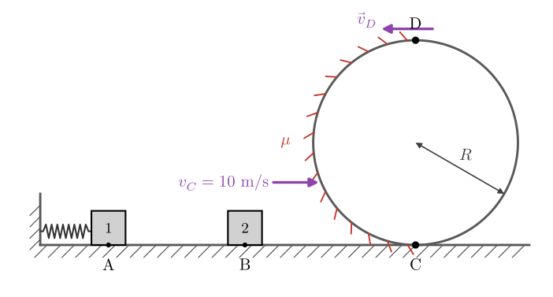
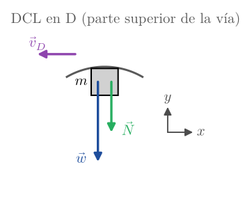
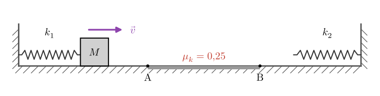
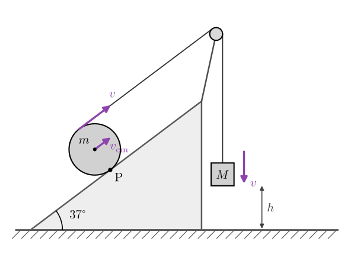
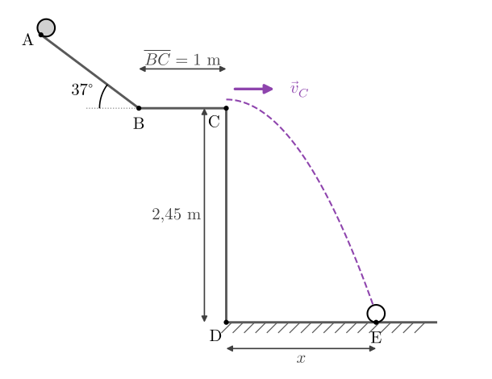

# Examen tipo de Física I — resolución

Resolución completa del examen tipo propuesto de Física I que publica la FRBA (`FISICA-1-EXAMEN-TIPO-PROPUESTO.pdf`). El examen trae al final las respuestas numéricas; acá se desarrolla cada problema y se contrastan los resultados con esa clave. Tres problemas coinciden con la clave. En el 2, la clave tiene invertidos los incisos. En el 3, el valor de la clave no se puede reproducir con los datos.

Se usa $g = 10\ \text{m/s}^2$. Notación (con el término del Sears en inglés): $K$ energía cinética (*kinetic energy*), $U$ energía potencial (*potential energy*), $W$ trabajo (*work*), $\vec w$ peso (*weight*), $\mu_k$ coeficiente de rozamiento cinético (*kinetic friction*), $I$ momento de inercia (*moment of inertia*), $\gamma = v^2/R$ aceleración radial.

---

## Problema 1 — Resorte, choque plástico y vía circular

### 1.1 Enunciado

> El carrito 1 de la figura está comprimiendo un resorte en el punto A. Se libera el sistema y el carrito 1 choca plásticamente con el carrito 2, que se hallaba en reposo. El conjunto entra en la vía circular, que presenta rozamiento en la mitad izquierda, por el punto C con una velocidad de 10 m/s, y la abandona por el mismo punto con una velocidad de 6 m/s. Hallar:
>
> a) la velocidad del conjunto cuando alcanza el punto D;
> b) la reacción del vínculo (N) en el punto D;
> c) el trabajo de la fuerza de rozamiento;
> d) la constante elástica del resorte.
>
> La superficie horizontal no presenta rozamiento. Datos: $m_1 = m_2 = 4{,}5$ kg; $\Delta x = 0{,}75$ m; $R = 0{,}9$ m.

### 1.2 a) Velocidad en D

El conjunto ($m = m_1 + m_2 = 9$ kg) entra por C hacia la derecha y sube por la **mitad derecha**, que no tiene rozamiento. La normal es perpendicular a la vía en cada punto y no trabaja, así que de C a D se conserva la energía mecánica. D está a $2R = 1{,}8$ m sobre C:

$$
\begin{aligned}
\tfrac{1}{2}\,m\,v_C^2 &= \tfrac{1}{2}\,m\,v_D^2 + m\,g\,(2R) \implies v_D = \sqrt{v_C^2 - 4\,g\,R} \\
v_D &= \sqrt{100\ \tfrac{\text{m}^2}{\text{s}^2} - 4 \cdot 10\ \tfrac{\text{m}}{\text{s}^2} \cdot 0{,}9\ \text{m}} = \sqrt{64\ \tfrac{\text{m}^2}{\text{s}^2}} \implies {\color{ForestGreen}\boxed{v_D = 8\ \text{m/s}}}
\end{aligned}
$$

### 1.3 b) Reacción en D

En D, la vía está por encima del carrito: la normal y el peso apuntan hacia abajo, hacia el centro. Con $y$ hacia arriba, $\vec N = (0;\,-N)$, $\vec w = (0;\,-m\,g)$ y la aceleración es la radial, $\vec a = (0;\,-\gamma)$ con $\gamma = v_D^2/R$:

$$
-N - m\,g = -m\,\frac{v_D^2}{R} \implies N = m\left(\frac{v_D^2}{R} - g\right) = 9\ \text{kg}\left(\frac{64\ \text{m}^2/\text{s}^2}{0{,}9\ \text{m}} - 10\ \tfrac{\text{m}}{\text{s}^2}\right) \implies {\color{ForestGreen}\boxed{N = 550\ \text{N}}}
$$

### 1.4 c) Trabajo del rozamiento

Entre la entrada y la salida por C el conjunto vuelve a la misma altura: el peso hace trabajo total nulo y la normal no trabaja. Todo el cambio de energía cinética se debe al rozamiento de la mitad izquierda:

$$
W_f = \Delta K = \tfrac{1}{2}\,m\,(v_{\text{sale}}^2 - v_C^2) = \tfrac{1}{2} \cdot 9\ \text{kg} \cdot (36 - 100)\ \tfrac{\text{m}^2}{\text{s}^2} \implies {\color{ForestGreen}\boxed{W_f = -288\ \text{J}}}
$$

### 1.5 d) Constante del resorte

En el choque plástico se conserva la cantidad de movimiento. El conjunto sale a $10$ m/s, que es la velocidad con que llega a C (el piso no tiene rozamiento):

$$
m_1\,v_1 = (m_1 + m_2)\,v_C \implies v_1 = \frac{9\ \text{kg} \cdot 10\ \text{m/s}}{4{,}5\ \text{kg}} = {\color{RoyalBlue} 20\ \text{m/s}}
$$

La energía del resorte comprimido pasa entera al carrito 1 antes del choque:

$$
\tfrac{1}{2}\,k\,\Delta x^2 = \tfrac{1}{2}\,m_1\,v_1^2 \implies k = \frac{m_1\,v_1^2}{\Delta x^2} = \frac{4{,}5\ \text{kg} \cdot 400\ \text{m}^2/\text{s}^2}{0{,}5625\ \text{m}^2} \implies {\color{ForestGreen}\boxed{k = 3200\ \text{N/m}}}
$$

> [!NOTE]
> En el choque plástico se pierde la mitad de la energía cinética: antes, $\tfrac{1}{2}(4{,}5)(20)^2 = 900$ J; después, $\tfrac{1}{2}(9)(10)^2 = 450$ J. Por eso $k$ no se puede calcular con la energía del conjunto en C.

> [!TIP]
> **Respuesta:** a) $v_D = 8$ m/s; b) $N = 550$ N; c) $W_f = -288$ J; d) $k = 3200$ N/m. Coinciden con la clave del examen.

<!-- salto-pagina -->

## Problema 2 — Bloque entre dos resortes con un tramo con rozamiento

### 2.1 Enunciado

> Un bloque de masa $M$ es impulsado por un resorte de constante elástica $k_1$ y se desliza sobre la superficie horizontal, que presenta rozamiento en el tramo AB, deteniéndose justo en el punto A. Se sabe que la compresión que experimenta el resorte de constante $k_2$ es de 1 m. Hallar:
>
> a) la constante elástica $k_2$;
> b) la constante elástica $k_1$, sabiendo que la compresión que presentaba dicho resorte era también de 1 m.
>
> Datos: $M = 1$ kg; $\mu_k = 0{,}25$; $\overline{AB} = 2$ m.

### 2.2 El recorrido

El bloque cruza AB hacia la derecha, comprime el resorte 2, vuelve, cruza AB hacia la izquierda y se detiene justo en A: pasa **dos veces** por el tramo con rozamiento. Fuera de AB no hay rozamiento y la energía mecánica se conserva.

En cada pasada, el rozamiento cinético es opuesto al desplazamiento y su trabajo es:

$$
W_f = \vec f_k \cdot \Delta \vec r = -\mu_k\,M\,g\,\overline{AB} = -0{,}25 \cdot 1\ \text{kg} \cdot 10\ \tfrac{\text{m}}{\text{s}^2} \cdot 2\ \text{m} = {\color{RoyalBlue} -5\ \text{J}}
$$

### 2.3 a) Constante $k_2$

Desde el resorte 2 comprimido 1 m (bloque en reposo) hasta A (bloque en reposo), el bloque pasa una vez por AB:

$$
\tfrac{1}{2}\,k_2\,(1\ \text{m})^2 + W_f = 0 \implies \tfrac{1}{2}\,k_2 \cdot 1\ \text{m}^2 = 5\ \text{J} \implies {\color{ForestGreen}\boxed{k_2 = 10\ \text{N/m}}}
$$

### 2.4 b) Constante $k_1$

Desde el resorte 1 comprimido 1 m hasta A, al final, el bloque pasa dos veces por AB:

$$
\tfrac{1}{2}\,k_1\,(1\ \text{m})^2 + 2\,W_f = 0 \implies \tfrac{1}{2}\,k_1 \cdot 1\ \text{m}^2 = 10\ \text{J} \implies {\color{ForestGreen}\boxed{k_1 = 20\ \text{N/m}}}
$$

> [!CAUTION]
> **Error en la clave:** la clave del examen dice «a) $k_1 = 20$ N/m; b) $k_2 = 10$ N/m», pero el inciso a) pide $k_2$ y el b) pide $k_1$. Los valores son correctos; los incisos están invertidos.

> [!TIP]
> **Respuesta:** a) $k_2 = 10$ N/m; b) $k_1 = 20$ N/m.

<!-- salto-pagina -->

## Problema 3 — Cilindro que rueda, polea y bloque colgante

### 3.1 Enunciado

> Un cilindro uniforme de masa $m$ y radio $R$ tiene arrollada una cuerda que está unida a un bloque de masa $M = 3$ kg. La cuerda pasa por una polea de masa despreciable. El cilindro rueda sin deslizar por el plano inclinado ($37^\circ$). Hallar la velocidad del bloque cuando ha descendido una altura $h$, sabiendo que el sistema parte del reposo.
>
> Datos: $m = 2$ kg; $M = 3$ kg; $R = 0{,}5$ m; $h = 1$ m.

El examen escribe «$R = 0{,}5$ m $= 1$ m»: el segundo dato es la altura $h$.

### 3.2 Relación de velocidades

La cuerda sale de la **parte superior** del cilindro, paralela al plano. El cilindro rueda sin deslizar: el punto de contacto P está instantáneamente en reposo y el cilindro gira alrededor de P. Un punto a distancia $d$ de P tiene velocidad $\omega\,d$:

$$
v_{\text{cm}} = \omega\,R \qquad\qquad v_{\text{arriba}} = \omega\,(2R) = 2\,v_{\text{cm}}
$$

La cuerda es inextensible: el punto de arriba se mueve como el bloque, $v = 2\,v_{\text{cm}}$. Por lo tanto, cuando el bloque baja $h$, el centro del cilindro sube $h/2$ **a lo largo del plano**, es decir, una altura $\tfrac{h}{2}\,\mathrm{sen}\,37^\circ$.

### 3.3 Conservación de la energía

El rozamiento estático actúa en P, que no se desplaza: no trabaja. La polea no tiene masa. Se conserva la energía mecánica del sistema cilindro + bloque:

$$
\underbrace{M\,g\,h}_{\text{baja el bloque}} - \underbrace{m\,g\,\tfrac{h}{2}\,\mathrm{sen}\,37^\circ}_{\text{sube el cilindro}} = \tfrac{1}{2}\,M\,v^2 + \tfrac{1}{2}\,m\,v_{\text{cm}}^2 + \tfrac{1}{2}\left(\tfrac{1}{2}\,m\,R^2\right)\omega^2
$$

Con $v_{\text{cm}} = v/2$ y $\omega = v_{\text{cm}}/R$, la energía cinética del cilindro es $\tfrac{3}{4}\,m\,v_{\text{cm}}^2 = {\color{RoyalBlue}\tfrac{3}{16}\,m\,v^2}$ (el radio se simplifica):

$$
3 \cdot 10 \cdot 1\ \text{J} - 2 \cdot 10 \cdot 0{,}5 \cdot 0{,}6\ \text{J} = \left(\tfrac{1}{2} \cdot 3 + \tfrac{3}{16} \cdot 2\right)\text{kg}\cdot v^2 \implies 24\ \text{J} = 1{,}875\ \text{kg}\cdot v^2
$$

$$
v = \sqrt{\frac{24\ \text{J}}{1{,}875\ \text{kg}}} = \sqrt{12{,}8\ \tfrac{\text{m}^2}{\text{s}^2}} \implies {\color{ForestGreen}\boxed{v \approx 3{,}58\ \text{m/s}}}
$$

**Comprobación por dinámica.** Bloque: $M\,g - T = M\,a$. Cilindro, con ejes del plano: $T + f - m\,g\,\mathrm{sen}\,37^\circ = m\,a_{\text{cm}}$; torque respecto del centro: $T\,R - f\,R = \tfrac{1}{2}\,m\,R^2\,\alpha$, con $\alpha = a_{\text{cm}}/R$. Sumando las dos ecuaciones del cilindro, $2\,T - m\,g\,\mathrm{sen}\,37^\circ = \tfrac{3}{2}\,m\,a_{\text{cm}}$, y con $a = 2\,a_{\text{cm}}$:

$$
a_{\text{cm}} = \frac{M\,g - \tfrac{1}{2}\,m\,g\,\mathrm{sen}\,37^\circ}{2\,M + \tfrac{3}{4}\,m} = \frac{30 - 6}{6 + 1{,}5}\ \tfrac{\text{m}}{\text{s}^2} = 3{,}2\ \tfrac{\text{m}}{\text{s}^2} \implies a = 6{,}4\ \tfrac{\text{m}}{\text{s}^2} \implies v^2 = 2\,a\,h = 12{,}8\ \tfrac{\text{m}^2}{\text{s}^2}
$$

Las dos vías coinciden.

> [!CAUTION]
> **La clave no se reproduce:** el examen da $v = 2$ m/s. Con los datos no se obtiene ese valor:
>
> | Lectura de la figura | $v$ |
> |---|---|
> | cuerda desde la parte superior del cilindro (la figura) | $3{,}58$ m/s |
> | cuerda desde el eje del cilindro | $2{,}45$ m/s |
> | cuerda desde la parte superior, con $h$ tal que $v = 2$ m/s | exige $h = 0{,}3125$ m |
>
> Lo más probable es un error de la clave o de los datos publicados. Conviene consultarlo con la cátedra.

> [!TIP]
> **Respuesta:** $v \approx 3{,}58$ m/s (la clave dice 2 m/s; ver arriba).

<!-- salto-pagina -->

## Problema 4 — Esfera que rueda y cae

### 4.1 Enunciado

> Una esfera parte del reposo en el extremo superior de un plano inclinado de pendiente $37^\circ$ y rueda sin deslizar por él; luego continúa en las mismas condiciones a lo largo de una superficie horizontal, que abandona siguiendo la trayectoria indicada en la figura. Hallar la distancia $x$ que alcanza el centro de masa de la esfera cuando se encuentra a 2,45 m por debajo de la superficie horizontal.
>
> Datos: $I_{\text{esf}} = \tfrac{2}{5}\,m\,R^2$; $\overline{AB} = 70$ cm; $\overline{BC} = 1$ m; $\overline{CD} = 2{,}45$ m; $\overline{DE} = x$.

El examen escribe $\overline{CD} = 2{,}45$ **cm**; por el texto del enunciado, son metros.

### 4.2 Velocidad al final del plano

El rozamiento estático no trabaja (rodadura sin deslizar) y se conserva la energía mecánica. El centro de masa baja $\overline{AB}\,\mathrm{sen}\,37^\circ = 0{,}7\ \text{m} \cdot 0{,}6 = 0{,}42$ m. Con $\omega = v/R$:

$$
m\,g\,(0{,}42\ \text{m}) = \tfrac{1}{2}\,m\,v^2 + \tfrac{1}{2}\left(\tfrac{2}{5}\,m\,R^2\right)\frac{v^2}{R^2} = \tfrac{7}{10}\,m\,v^2 \implies v^2 = \frac{10 \cdot 10 \cdot 0{,}42}{7}\ \tfrac{\text{m}^2}{\text{s}^2} = {\color{RoyalBlue} 6\ \tfrac{\text{m}^2}{\text{s}^2}}
$$

En el tramo horizontal BC sigue rodando con la misma velocidad: ninguna fuerza trabaja. Sale de C con $\vec v_C = (\sqrt{6};\ 0)$ m/s $\approx (2{,}45;\ 0)$ m/s.

### 4.3 Caída libre del centro de masa

Desde C, el centro de masa es un proyectil con $\vec a = (0;\,-g)$; la rotación no influye en su trayectoria. Con origen en C:

$$
\begin{aligned}
y(t) &= -\tfrac{1}{2}\,g\,t^2 = -2{,}45\ \text{m} &&\implies t = \sqrt{\frac{2 \cdot 2{,}45\ \text{m}}{10\ \text{m/s}^2}} = {\color{RoyalBlue} 0{,}7\ \text{s}} \\
x(t) &= v_C\,t = \sqrt{6}\ \tfrac{\text{m}}{\text{s}} \cdot 0{,}7\ \text{s} &&\implies {\color{ForestGreen}\boxed{x \approx 1{,}71\ \text{m}}}
\end{aligned}
$$

> [!TIP]
> **Respuesta:** $x \approx 1{,}71$ m. Coincide con la clave.

<!-- solo-md -->

---

**Fuentes:** `FISICA-1-EXAMEN-TIPO-PROPUESTO.pdf` (FRBA, sitio web, carpeta `wp-content/uploads/2017/06/`), con enunciados, figuras y clave de respuestas. Cálculos verificados en `figuras_examen_tipo.py`.

<!-- /solo-md -->
