# Guía de ejercicios extra — 2do parcial de Física I

Resolución de la «Guía de ejercicios extra — 2do parcial» (4 páginas, 23 ejercicios): fluidos, cuerpo rígido, momento cinético y movimiento oscilatorio armónico. La guía no indica materia ni cátedra; sus temas coinciden con las unidades 5 a 12 del programa 2024 de Física I.

Se usa $g = 10\ \text{m/s}^2$. Notación (con el término del Sears en inglés): $\vec w$ peso (*weight*), $\vec B$ empuje (*buoyant force*), $K$ energía cinética (*kinetic energy*), $U$ energía potencial (*potential energy*), $W$ trabajo (*work*), $\mu_s$ y $\mu_k$ coeficientes de rozamiento estático y cinético (*static*, *kinetic friction*; la guía los llama $\mu_E$ y $\mu_C$), $I$ momento de inercia (*moment of inertia*), $\tau_z$ torque (*torque*), $\vec L$ momento cinético (*angular momentum*), $\alpha_z$ aceleración angular (*angular acceleration*).

Convención para la rotación: eje $z$ saliente de la hoja, positivo antihorario. Los torques y momentos cinéticos se calculan como producto vectorial, $\tau_z = x\,F_y - y\,F_x$ y $L_z = x\,p_y - y\,p_x$, con $(x;\,y)$ el punto de aplicación respecto del eje.

---

## Fluidos: hidrostática e hidrodinámica

### F1 — Cuerpo de hierro sumergido colgado de un hilo

> Un objeto sumergido de 5 kg de masa se encuentra suspendido de un hilo y totalmente sumergido en un recipiente con un líquido desconocido. El objeto no está en contacto con el recipiente y la tensión del hilo es de 22,50 N. Determine la densidad del líquido (la densidad del hierro es 7900 kg/m³).

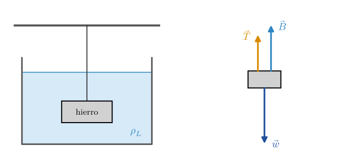

El objeto es de hierro, así que su volumen es

$$
V = \frac{m}{\rho_{\text{Fe}}} = \frac{5\ \text{kg}}{7900\ \text{kg/m}^3} = {\color{RoyalBlue} 6{,}33 \cdot 10^{-4}\ \text{m}^3}
$$

En equilibrio, con $y$ hacia arriba: $T + B - w = 0$, entonces $B = m\,g - T = 50\ \text{N} - 22{,}5\ \text{N} = {\color{RoyalBlue} 27{,}5\ \text{N}}$. El empuje es el peso del líquido desalojado, $B = \rho_L\,g\,V$, y el objeto está totalmente sumergido:

$$
\rho_L = \frac{B}{g\,V} = \frac{27{,}5\ \text{N}}{10\ \tfrac{\text{m}}{\text{s}^2} \cdot 6{,}33 \cdot 10^{-4}\ \text{m}^3} \implies {\color{ForestGreen}\boxed{\rho_L \approx 4345\ \text{kg/m}^3}}
$$

Es menor que la del hierro, como debe ser: si fuera mayor, el objeto flotaría y el hilo no estaría tenso.

### F2 — Dos cuerpos unidos por una soga

> Dos cuerpos unidos por una soga ideal están en reposo dentro de un recipiente que contiene un líquido, como se muestra en la figura; el cuerpo 2 está totalmente sumergido y el 1 parcialmente. Calcular: a) la tensión en la soga; b) el volumen del cuerpo 1 que sobresale por encima de la superficie libre del líquido.

> [!CAUTION]
> **Faltan datos:** la guía no da masas, volúmenes ni densidades. Se resuelve en forma literal, con densidades $\rho_1$, $\rho_2$ y $\rho_L$ (líquido) y volúmenes $V_1$, $V_2$.

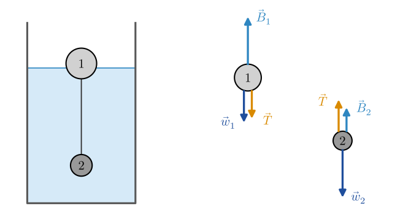

**a) Cuerpo 2** (totalmente sumergido, cuelga de la soga): $T + B_2 - w_2 = 0$:

$$
{\color{ForestGreen}\boxed{T = w_2 - B_2 = (\rho_2 - \rho_L)\,g\,V_2}}
$$

Para que la soga esté tensa hace falta $\rho_2 > \rho_L$: el cuerpo 2 se hundiría solo.

**b) Cuerpo 1** (flota, la soga tira hacia abajo): $B_1 - w_1 - T = 0$, con $B_1 = \rho_L\,g\,V_{s1}$:

$$
\rho_L\,g\,V_{s1} = \rho_1\,g\,V_1 + (\rho_2 - \rho_L)\,g\,V_2 \implies {\color{ForestGreen}\boxed{V_{\text{fuera}} = V_1 - V_{s1} = V_1 - \frac{\rho_1\,V_1 + (\rho_2 - \rho_L)\,V_2}{\rho_L}}}
$$

Equivale a considerar el sistema completo: el empuje total iguala al peso total, $\rho_L\,(V_{s1} + V_2) = \rho_1\,V_1 + \rho_2\,V_2$.

### F3 — Esfera atada al fondo

> Una esfera de densidad $\delta = 0{,}3$ g/cm³ y volumen $V = 1500$ cm³ se encuentra parcialmente sumergida en agua, unida al fondo del recipiente por una cuerda ideal. a) Sabiendo que la densidad del agua es 1 g/cm³ y que la tensión en la cuerda es 3 N, determine qué porcentaje del volumen de la esfera está sumergido. b) ¿Qué porcentaje quedaría sumergido si se cortara la cuerda?

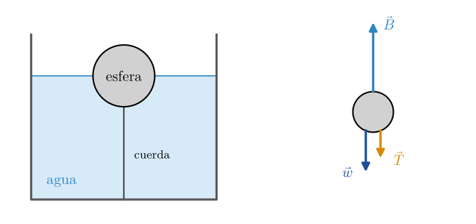

**a)** Masa: $m = \delta\,V = 0{,}3\ \tfrac{\text{g}}{\text{cm}^3} \cdot 1500\ \text{cm}^3 = 450\ \text{g}$, entonces $w = 4{,}5$ N. La cuerda tira hacia abajo: $B - w - T = 0$, de donde $B = 4{,}5\ \text{N} + 3\ \text{N} = {\color{RoyalBlue} 7{,}5\ \text{N}}$.

$$
V_s = \frac{B}{\rho_{\text{agua}}\,g} = \frac{7{,}5\ \text{N}}{1000\ \tfrac{\text{kg}}{\text{m}^3} \cdot 10\ \tfrac{\text{m}}{\text{s}^2}} = 7{,}5 \cdot 10^{-4}\ \text{m}^3 = 750\ \text{cm}^3 \implies {\color{ForestGreen}\boxed{\tfrac{V_s}{V} = 50\,\text{\%}}}
$$

**b)** Sin cuerda, la esfera flota con $B = w$: $\rho_{\text{agua}}\,g\,V_s = \delta\,g\,V$, entonces

$$
\frac{V_s}{V} = \frac{\delta}{\rho_{\text{agua}}} = \frac{0{,}3}{1} \implies {\color{ForestGreen}\boxed{30\,\text{\%}}}
$$

### F4 — Cubo flotante

> Un cubo de masa $m = 400$ g se encuentra flotando en equilibrio en un líquido, con 1/5 de su volumen sumergido. ¿Qué fuerza hacia abajo habría que aplicarle al cubo para mantenerlo totalmente sumergido en ese líquido?

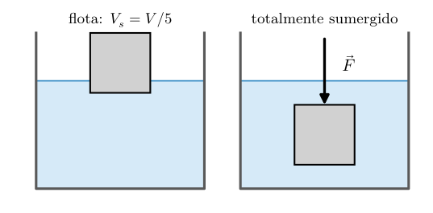

Flotando: $B = w = m\,g = 4$ N, y ese empuje corresponde a $V/5$. El empuje es proporcional al volumen sumergido: totalmente sumergido, $B' = 5 \cdot 4\ \text{N} = 20$ N. En equilibrio, $B' - w - F = 0$:

$$
F = B' - w = 20\ \text{N} - 4\ \text{N} \implies {\color{ForestGreen}\boxed{F = 16\ \text{N}}}
$$

### F5 — Cañería que se angosta y desciende

> Una cañería horizontal, de sección circular de 25 mm de diámetro interior, transporta agua de densidad 1 kg/dm³ con velocidad de 1 m/s y presión de $10^5$ Pa. En cierto lugar la cañería reduce el diámetro interior a 12 mm y desciende 3 mm respecto del nivel inicial. Determine la presión que tendrá el agua en el nuevo nivel.

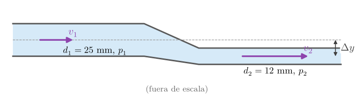

**Continuidad** (el caudal $A\,v$ es el mismo):

$$
A_1\,v_1 = A_2\,v_2 \implies v_2 = \left(\frac{d_1}{d_2}\right)^2 v_1 = \left(\frac{25}{12}\right)^2 \cdot 1\ \tfrac{\text{m}}{\text{s}} = {\color{RoyalBlue} 4{,}34\ \text{m/s}}
$$

> [!CAUTION]
> El enunciado dice «3 mm», pero es una errata: el mismo problema es el ej. 3 del 2º parcial del curso Z1054 (Prof. R. Vella, 1/12/2020), donde la cañería «desciende hasta un subsuelo, ubicado a una altura de 3 m». Se resuelve con $y_1 - y_2 = 3$ m.

**Bernoulli**, con $y_1 - y_2 = 3$ m:

$$
p_2 = p_1 + \tfrac{1}{2}\,\rho\,(v_1^2 - v_2^2) + \rho\,g\,(y_1 - y_2) = 10^5\ \text{Pa} + 500\ \tfrac{\text{kg}}{\text{m}^3}\,(1 - 18{,}84)\ \tfrac{\text{m}^2}{\text{s}^2} + 1000\ \tfrac{\text{kg}}{\text{m}^3} \cdot 10\ \tfrac{\text{m}}{\text{s}^2} \cdot 3\ \text{m}
$$

$$
p_2 = 10^5\ \text{Pa} - 8919\ \text{Pa} + 30\,000\ \text{Pa} \implies {\color{ForestGreen}\boxed{p_2 \approx 1{,}21 \cdot 10^5\ \text{Pa}}}
$$

> [!NOTE]
> El parcial pide además el caudal másico, igual en toda la cañería:
>
> $$\dot m = \rho\,A_1\,v_1 = 1000\ \tfrac{\text{kg}}{\text{m}^3} \cdot \pi\,(0{,}0125\ \text{m})^2 \cdot 1\ \tfrac{\text{m}}{\text{s}} \approx 0{,}49\ \tfrac{\text{kg}}{\text{s}}$$
>
> Con el «3 mm» literal, la altura aportaría solo 30 Pa: $p_2 \approx 9{,}11 \cdot 10^4$ Pa.

<!-- salto-pagina -->

## Cuerpo rígido: cinemática y dinámica

### R1 — Cilindro que sube por una rampa sin rozamiento

> Un cilindro macizo y homogéneo rueda sin deslizar sobre una superficie horizontal con velocidad del centro de masa de 1 m/s. Calcular la altura máxima $H$ que alcanza al subir por un plano inclinado que no tiene rozamiento.

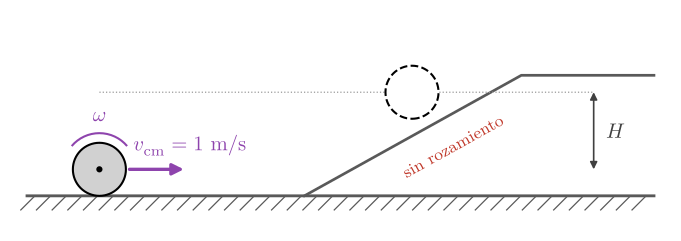

En la rampa sin rozamiento, las únicas fuerzas son el peso y la normal, que pasan por el centro de masa: **no hay torque respecto del centro de masa**, y la velocidad angular $\omega$ se mantiene constante. La energía cinética de rotación no se transforma: solo la de traslación pasa a energía potencial.

$$
\tfrac{1}{2}\,m\,v_{\text{cm}}^2 = m\,g\,H \implies H = \frac{v_{\text{cm}}^2}{2\,g} = \frac{(1\ \text{m/s})^2}{2 \cdot 10\ \text{m/s}^2} \implies {\color{ForestGreen}\boxed{H = 0{,}05\ \text{m}}}
$$

> [!NOTE]
> Si la rampa tuviera rozamiento suficiente para que siguiera rodando, también la rotación se convertiría en altura: $\tfrac{3}{4}\,m\,v_{\text{cm}}^2 = m\,g\,H$ y $H = 0{,}075$ m. Esa es la trampa del ejercicio.

### R2 — Disco tirado del centro

> Un disco de masa $M = 0{,}5$ kg y radio $R = 0{,}2$ m se apoya sobre un plano horizontal con rozamiento ($\mu_s = 0{,}4$; $\mu_k = 0{,}1$). Se tira del centro del disco con una fuerza $F$ horizontal y constante. a) Si $F = 3$ N, determine si el cuerpo desliza o no. Justifique. b) Si $F = 8$ N, determine la velocidad del centro de masa a los 3 s.

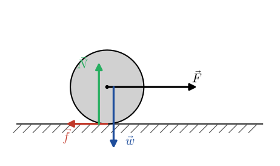

Se supone rodadura y se calcula el rozamiento necesario. Con $\vec f = (-f;\ 0)$ aplicado en $(0;\,-R)$, su torque respecto del centro es $\tau_z = x\,f_y - y\,f_x = -R\,f$. $F$, $\vec w$ y $\vec N$ pasan por el centro.

$$
\begin{aligned}
x:&\quad F - f = M\,a \\
\text{rotación:}&\quad -R\,f = I\,\alpha_z = \tfrac{1}{2}\,M\,R^2\,\alpha_z,\quad \text{rodadura: } \alpha_z = -\frac{a}{R} \implies f = \tfrac{1}{2}\,M\,a
\end{aligned}
$$

Sumando: $F = \tfrac{3}{2}\,M\,a$, entonces $a = \tfrac{2F}{3M}$ y ${\color{RoyalBlue} f = F/3}$. El máximo que puede dar el rozamiento estático es $\mu_s\,N = 0{,}4 \cdot 5\ \text{N} = {\color{RoyalBlue} 2\ \text{N}}$.

**a)** $F = 3$ N: $f = 1\ \text{N} \le 2$ N. ${\color{ForestGreen}\boxed{\text{No desliza}}}$: rueda con $a = 4$ m/s².

**b)** $F = 8$ N: haría falta $f = 2{,}67\ \text{N} > 2$ N, así que **desliza** y actúa el rozamiento cinético, $f = \mu_k\,N = 0{,}5$ N:

$$
a = \frac{F - \mu_k\,N}{M} = \frac{8\ \text{N} - 0{,}5\ \text{N}}{0{,}5\ \text{kg}} = 15\ \tfrac{\text{m}}{\text{s}^2} \implies v_{\text{cm}}(3\ \text{s}) = 15\ \tfrac{\text{m}}{\text{s}^2} \cdot 3\ \text{s} \implies {\color{ForestGreen}\boxed{v_{\text{cm}} = 45\ \text{m/s}}}
$$

Mientras tanto gira con $|\alpha_z| = \tfrac{\mu_k\,N\,R}{I} = 10$ rad/s²: a los 3 s, $\omega\,R = 6$ m/s, muy lejos de 45 m/s, lo que confirma que desliza.

### R3 — Dos ruedas solidarias con dos masas colgantes

> Dos cuerpos cuelgan de cuerdas enrolladas a dos ruedas unidas entre sí, que pueden girar respecto de un mismo eje. El momento de inercia total de las dos ruedas es 40 kg·m². El cuerpo $m_1 = 24$ kg cuelga de la rueda de radio $r_1 = 1{,}2$ m y $m_2$ cuelga de la rueda pequeña, de radio $r_2 = 0{,}4$ m. a) Calcular $m_2$ para que la aceleración angular de las ruedas sea nula. b) Si se coloca con suavidad una masa extra de 12 kg sobre $m_1$, calcular la aceleración angular de las ruedas.

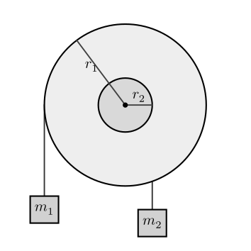

Las cuerdas cuelgan en lados opuestos: $m_1$ en $(-r_1;\,0)$ y $m_2$ en $(r_2;\,0)$, con fuerzas verticales. Torques: $\tau_{1,z} = (-r_1)(-T_1) = r_1\,T_1$ (antihorario) y $\tau_{2,z} = r_2\,(-T_2) = -r_2\,T_2$ (horario).

**a)** Sin aceleración, cada tensión iguala al peso y el torque neto es nulo:

$$
r_1\,m_1\,g = r_2\,m_2\,g \implies m_2 = \frac{r_1}{r_2}\,m_1 = \frac{1{,}2}{0{,}4} \cdot 24\ \text{kg} \implies {\color{ForestGreen}\boxed{m_2 = 72\ \text{kg}}}
$$

**b)** Con $m_1' = 36$ kg, $m_1'$ baja con $a_1 = \alpha\,r_1$ y $m_2$ sube con $a_2 = \alpha\,r_2$:

$$
m_1'\,g - T_1 = m_1'\,\alpha\,r_1 \qquad T_2 - m_2\,g = m_2\,\alpha\,r_2 \qquad r_1\,T_1 - r_2\,T_2 = I\,\alpha
$$

Despejando $T_1$ y $T_2$ y reemplazando en la ecuación de rotación:

$$
\alpha = \frac{(m_1'\,r_1 - m_2\,r_2)\,g}{I + m_1'\,r_1^2 + m_2\,r_2^2} = \frac{(43{,}2 - 28{,}8)\ \text{kg·m} \cdot 10\ \tfrac{\text{m}}{\text{s}^2}}{(40 + 51{,}84 + 11{,}52)\ \text{kg·m}^2} \implies {\color{ForestGreen}\boxed{\alpha \approx 1{,}39\ \text{rad/s}^2}}
$$

en sentido antihorario: baja $m_1$.

### R4 — Yo-yo con dos fuerzas

> El yo-yo de la figura es un disco de masa $M = 1$ kg, radio exterior $R = 20$ cm y radio interior $r = 10$ cm. Se le aplican las fuerzas $F_1 = 6$ N y $F_2 = 2$ N como indica la figura. Determinar: a) las aceleraciones lineal y angular, si no hubiera roce con el plano; b) la fuerza de roce estática necesaria para que ruede sin deslizar.

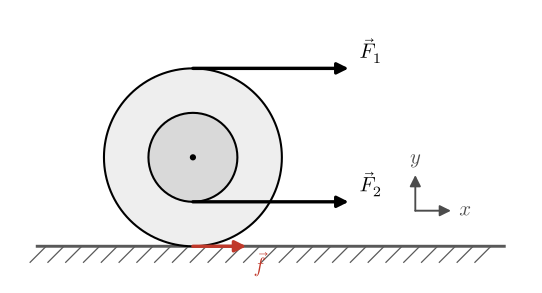

Según la figura, $\vec F_1 = (6;\,0)$ N actúa en el borde superior, $(0;\,R)$, y $\vec F_2 = (2;\,0)$ N en el borde inferior del disco interior, $(0;\,-r)$. Se toma el yo-yo como disco homogéneo: $I = \tfrac{1}{2}\,M\,R^2 = 0{,}02$ kg·m².

$$
\tau_{1,z} = -R\,F_1 = -0{,}2\ \text{m} \cdot 6\ \text{N} = -1{,}2\ \text{N·m} \qquad \tau_{2,z} = -(-r)\,F_2 = 0{,}1\ \text{m} \cdot 2\ \text{N} = +0{,}2\ \text{N·m}
$$

**a) Sin roce:**

$$
a = \frac{F_1 + F_2}{M} = {\color{ForestGreen}\boxed{8\ \text{m/s}^2}} \qquad \alpha_z = \frac{-1{,}2 + 0{,}2}{0{,}02}\ \tfrac{\text{rad}}{\text{s}^2} \implies {\color{ForestGreen}\boxed{\alpha_z = -50\ \text{rad/s}^2}}\ \text{(horario)}
$$

Para rodar con $a = 8$ m/s² haría falta $|\alpha_z| = a/R = 40$ rad/s²: sin roce, gira de más y patina.

**b) Rodadura**, con roce $\vec f = (f;\,0)$ en $(0;\,-R)$, de torque $\tau_z = R\,f$, y $\alpha_z = -a/R$:

$$
\begin{aligned}
x:&\quad F_1 + F_2 + f = M\,a \implies a = 8 + f \quad (\text{en unidades SI}) \\
z:&\quad -1{,}0 + 0{,}2\,f = 0{,}02 \cdot \left(-\frac{a}{0{,}2}\right) = -0{,}1\,a
\end{aligned}
$$

Reemplazando $a$: $-1 + 0{,}2\,f = -0{,}8 - 0{,}1\,f$, entonces

$$
{\color{ForestGreen}\boxed{f = \tfrac{2}{3}\ \text{N} \approx 0{,}67\ \text{N}}}\ \text{hacia adelante} \qquad a = 8{,}67\ \text{m/s}^2
$$

Es positiva: el roce empuja hacia adelante, porque el torque de $F_1$ tiende a hacerlo girar más rápido de lo que corresponde a la rodadura.

### R5 — Disco en un plano inclinado con fuerza horizontal

> Un disco homogéneo de 10 kg y 20 cm de radio está apoyado sobre un plano inclinado de 30° y tiene aplicada en su centro una fuerza horizontal de 100 N. El coeficiente de roce estático es 0,35 y el cinético, 0,2. Determinar: a) si el cuerpo rueda sin deslizar; b) la aceleración del centro de masa.

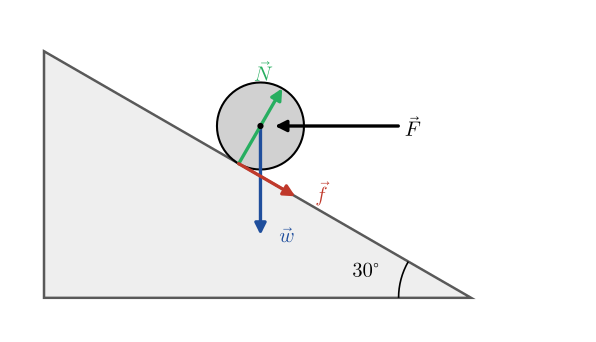

La fuerza empuja hacia el plano. Ejes del plano: $x$ hacia arriba del plano, $y$ perpendicular y saliente. Componentes:

$$
\begin{aligned}
\vec F &= (F\cos 30^\circ;\ -F\,\mathrm{sen}\,30^\circ) = (86{,}6;\ -50)\ \text{N} \\
\vec w &= (-m\,g\,\mathrm{sen}\,30^\circ;\ -m\,g\cos 30^\circ) = (-50;\ -86{,}6)\ \text{N}
\end{aligned}
$$

$$
y:\quad N = 86{,}6\ \text{N} + 50\ \text{N} = {\color{RoyalBlue} 136{,}6\ \text{N}} \qquad\qquad \text{fuerza neta en } x \text{ sin roce: } P = 86{,}6 - 50 = {\color{RoyalBlue} 36{,}6\ \text{N}}
$$

Como en el R2, para un disco con la fuerza en el centro, la rodadura exige $|f| = P/3$ y $a = \tfrac{2P}{3m}$:

$$
|f| = \frac{36{,}6\ \text{N}}{3} = 12{,}2\ \text{N} \le \mu_s\,N = 0{,}35 \cdot 136{,}6\ \text{N} = 47{,}8\ \text{N}
$$

**a)** ${\color{ForestGreen}\boxed{\text{Rueda sin deslizar}}}$ (el roce, de 12,2 N, apunta hacia abajo del plano).

**b)**

$$
a = \frac{2 \cdot 36{,}6\ \text{N}}{3 \cdot 10\ \text{kg}} \implies {\color{ForestGreen}\boxed{a \approx 2{,}44\ \text{m/s}^2}}\ \text{hacia arriba del plano}
$$

### R6 — Esfera que baja por una pista y sale horizontal

> Una esfera maciza de masa $m = 3$ kg y radio $R = 0{,}1$ m parte del reposo en A y desciende rodando sin deslizar. En el punto B abandona la pista horizontalmente y llega al suelo en C. Hallar: a) la aceleración del centro de masa de la esfera al pasar por B; b) el trabajo neto que recibe la esfera entre A y C.

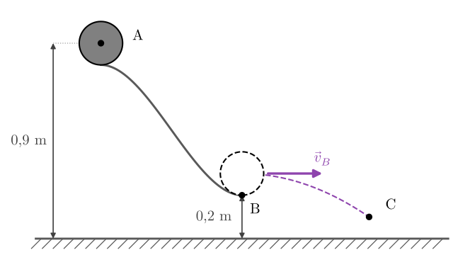

De la figura: el centro de masa está a 0,9 m del suelo en A; la pista, a 0,2 m en B, así que el centro de masa está a $0{,}2 + 0{,}1 = 0{,}3$ m. Rodadura, con $I = \tfrac{2}{5}\,m\,R^2$: $K = \tfrac{7}{10}\,m\,v^2$.

**Velocidad en B** (el roce estático no trabaja):

$$
m\,g\,(0{,}9 - 0{,}3)\ \text{m} = \tfrac{7}{10}\,m\,v_B^2 \implies v_B = \sqrt{\frac{10 \cdot 10 \cdot 0{,}6}{7}}\ \tfrac{\text{m}}{\text{s}} = {\color{RoyalBlue} 2{,}93\ \text{m/s}}
$$

**a)** En B la pista es horizontal: la componente tangencial de la aceleración es nula, porque la del peso a lo largo de la pista es $g\,\mathrm{sen}\,0^\circ = 0$. La componente normal, $\gamma = v_B^2/\rho$, depende del radio de curvatura $\rho$ de la pista en B, que la figura no da. Apenas deja la pista, el centro de masa cae libremente: ${\color{ForestGreen}\boxed{\vec a = (0;\ -g) = (0;\ -10)\ \text{m/s}^2}}$.

> [!NOTE]
> El enunciado no permite calcular la aceleración sobre la pista en B. Puede ser que pida la *velocidad* ($v_B \approx 2{,}93$ m/s, o $3{,}16$ m/s si se toma el desnivel de la pista, 0,7 m, en lugar del del centro de masa) o la aceleración justo al salir, que es $g$.

**b)** Por el teorema del trabajo y la energía, el trabajo neto es el cambio de energía cinética total (traslación + rotación). En vuelo la rotación no cambia; en C el centro de masa está a $R = 0{,}1$ m del suelo:

$$
W_{\text{neto}} = \Delta K = m\,g\,(0{,}9 - 0{,}1)\ \text{m} = 3\ \text{kg} \cdot 10\ \tfrac{\text{m}}{\text{s}^2} \cdot 0{,}8\ \text{m} \implies {\color{ForestGreen}\boxed{W_{\text{neto}} = 24\ \text{J}}}
$$

Es el trabajo del peso: la normal no trabaja y el roce estático tampoco.

### R7 — Disco que rueda sobre la mesa y bloque colgante

> El disco de masa $m_1 = 4$ kg y radio $R = 0{,}6$ m tiene enrollada una cuerda inextensible de masa despreciable que lo vincula con la masa $m_2 = 1$ kg. La polea fija tiene masa despreciable. Hallar la velocidad del bloque a los 5 s, sabiendo que el disco parte del reposo y rueda sin deslizar.

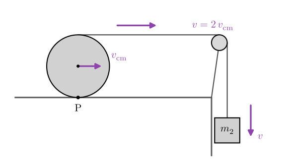

La cuerda sale de la parte superior del disco: el disco gira alrededor del punto de contacto P y el punto de arriba va al doble de velocidad que el centro, así que $a_2 = 2\,a_{\text{cm}}$.

$$
\begin{aligned}
\text{bloque:}&\quad m_2\,g - T = m_2\,(2\,a_{\text{cm}}) \\
\text{disco, traslación:}&\quad T + f = m_1\,a_{\text{cm}} \\
\text{disco, rotación (respecto del centro):}&\quad T\,R - f\,R = \tfrac{1}{2}\,m_1\,R^2\,\frac{a_{\text{cm}}}{R} \implies T - f = \tfrac{1}{2}\,m_1\,a_{\text{cm}}
\end{aligned}
$$

Sumando las del disco: $T = \tfrac{3}{4}\,m_1\,a_{\text{cm}} = 3\,a_{\text{cm}}$ (SI). En la del bloque: $10 - 3\,a_{\text{cm}} = 2\,a_{\text{cm}}$, entonces $a_{\text{cm}} = 2$ m/s² y $a_2 = {\color{RoyalBlue} 4\ \text{m/s}^2}$.

$$
v_2(5\ \text{s}) = a_2\,t = 4\ \tfrac{\text{m}}{\text{s}^2} \cdot 5\ \text{s} \implies {\color{ForestGreen}\boxed{v_2 = 20\ \text{m/s}}}
$$

El radio no interviene. El roce resulta $f = T - \tfrac{1}{2}\,m_1\,a_{\text{cm}} = 6 - 4 = 2$ N, hacia adelante.

<!-- salto-pagina -->

### R8 — Péndulo balístico

> Un proyectil de masa $m_p = 8$ g incide horizontalmente con velocidad $v_{0p}$ y se incrusta en el bloque puntual de masa $M = 1800$ g de un péndulo ideal (barrita de masa despreciable). El bloque con el proyectil asciende $h = 12$ cm. a) Calcular $v_{0p}$. b) Determinar si hubo variación de energía mecánica y, en caso afirmativo, justificar por qué.

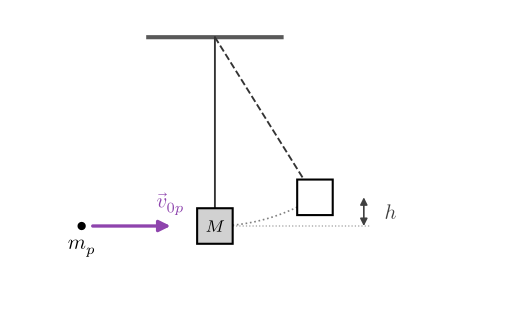

Son dos etapas. **Choque** (instantáneo): se conserva la cantidad de movimiento horizontal. **Subida**: se conserva la energía mecánica, porque la tensión de la barra es perpendicular a la trayectoria.

$$
\text{subida:}\quad \tfrac{1}{2}\,(m_p + M)\,V^2 = (m_p + M)\,g\,h \implies V = \sqrt{2\,g\,h} = \sqrt{2 \cdot 10 \cdot 0{,}12}\ \tfrac{\text{m}}{\text{s}} = {\color{RoyalBlue} 1{,}55\ \text{m/s}}
$$

$$
\text{choque:}\quad m_p\,v_{0p} = (m_p + M)\,V \implies v_{0p} = \frac{1{,}808\ \text{kg}}{0{,}008\ \text{kg}} \cdot 1{,}55\ \tfrac{\text{m}}{\text{s}} \implies {\color{ForestGreen}\boxed{v_{0p} \approx 350\ \text{m/s}}}
$$

**b)** Sí. Antes del choque, $K = \tfrac{1}{2}\,(0{,}008)(350)^2 \approx 490$ J; después, $\tfrac{1}{2}\,(1{,}808)(1{,}55)^2 \approx 2{,}17$ J. Se pierden **unos 488 J (99,6 %)**: el choque es plástico, y esa energía se va en deformar el bloque y en calor durante la penetración del proyectil.

### R9 — Bala que se incrusta en un bloque

> Una bala de masa $m = 100$ g se mueve horizontalmente a 200 m/s y se incrusta en un bloque de masa $M$ en reposo sobre una superficie horizontal lisa. Después del choque el conjunto se mueve a 20 m/s. Determinar el trabajo total de las fuerzas que actuaron sobre el sistema en el choque.

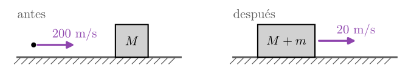

Cantidad de movimiento: $0{,}1\ \text{kg} \cdot 200\ \tfrac{\text{m}}{\text{s}} = (0{,}1 + M) \cdot 20\ \tfrac{\text{m}}{\text{s}}$, entonces ${\color{RoyalBlue} M = 0{,}9\ \text{kg}}$. Trabajo total, por el teorema del trabajo y la energía:

$$
W = \Delta K = \tfrac{1}{2}\,(1\ \text{kg})\,(20\ \tfrac{\text{m}}{\text{s}})^2 - \tfrac{1}{2}\,(0{,}1\ \text{kg})\,(200\ \tfrac{\text{m}}{\text{s}})^2 = 200\ \text{J} - 2000\ \text{J} \implies {\color{ForestGreen}\boxed{W = -1800\ \text{J}}}
$$

Lo hacen las fuerzas internas entre la bala y el bloque: se cancelan en la cantidad de movimiento, pero no en el trabajo, porque sus puntos de aplicación se desplazan distinto.

### R10 — Varilla que gira y pelotita que la frena

> Una varilla de largo $L = 1{,}4$ m y masa $M = 1$ kg, sobre una superficie horizontal sin rozamiento, gira con $\omega_0 = 3{,}3\ \text{s}^{-1}$ en sentido horario alrededor de un eje fijo, perpendicular a la figura, que pasa por su centro de masa O. Se arroja contra ella una pelotita de masa $m = M/4$ que se mueve hacia la izquierda con velocidad $V_0$. La pelotita choca contra la varilla a una distancia $x = L/3$ del borde, justo cuando la varilla es perpendicular a $\vec V_0$. El choque es elástico y la varilla queda en reposo. Determine $V_0$.

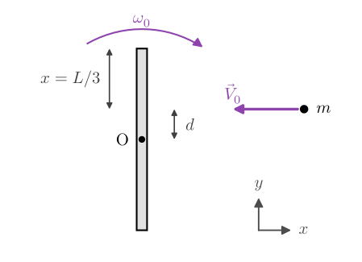

El eje es fijo: no se conserva la cantidad de movimiento (el eje ejerce una fuerza), pero sí el **momento cinético respecto de O**, porque esa fuerza no hace torque respecto de O. El choque es elástico: también se conserva la energía cinética.

Datos: $I = \tfrac{1}{12}\,M\,L^2 = 0{,}1633$ kg·m²; el impacto está a $d = \tfrac{L}{2} - \tfrac{L}{3} = \tfrac{L}{6} = 0{,}2333$ m sobre O; $m = 0{,}25$ kg. La pelotita, en $(x;\,d)$ con $\vec p = (m\,v_x;\,0)$, tiene $L_z = -d\,m\,v_x$. Antes, $v_x = -V_0$ y la varilla gira con $\omega_z = -3{,}3$ rad/s; después, la varilla está quieta y la pelotita sale con $v_x'$:

$$
\begin{aligned}
L_z:&\quad m\,d\,V_0 - I\,\omega_0 = -m\,d\,v_x' &&\implies v_x' = -V_0 + \frac{I\,\omega_0}{m\,d} = -V_0 + {\color{RoyalBlue} 9{,}24\ \text{m/s}} \\
K:&\quad \tfrac{1}{2}\,m\,V_0^2 + \tfrac{1}{2}\,I\,\omega_0^2 = \tfrac{1}{2}\,m\,v_x'^2 &&\implies V_0^2 + 7{,}115\ \tfrac{\text{m}^2}{\text{s}^2} = v_x'^2
\end{aligned}
$$

Reemplazando $v_x'$: $V_0^2 + 7{,}115 = 85{,}38 - 18{,}48\,V_0 + V_0^2$, entonces

$$
{\color{ForestGreen}\boxed{V_0 \approx 4{,}24\ \text{m/s}}} \qquad v_x' \approx +5{,}0\ \text{m/s (rebota hacia la derecha)}
$$

<!-- salto-pagina -->

## Momento cinético

### MC1 — Barra que cae con roce en el eje

> Una barra homogénea de masa 1 kg y longitud 0,4 m cuelga de un pivote O y puede girar en un plano vertical. Se la suelta desde la posición horizontal. a) ¿Qué momento de roce, supuesto constante, actúa sobre el eje, si al pasar por la posición vertical la velocidad del centro de masa es de 1 m/s? b) Determinar el vector momento cinético de la barra respecto de O cuando pasa por la vertical.

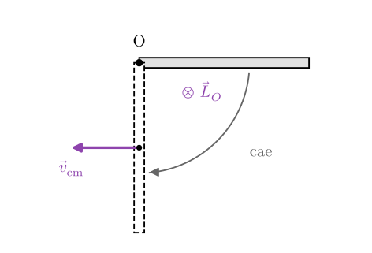

Momento de inercia respecto del extremo: $I_O = \tfrac{1}{3}\,M\,L^2 = 0{,}0533$ kg·m². En la vertical, el centro de masa está a $L/2 = 0{,}2$ m de O: $\omega = \tfrac{v_{\text{cm}}}{L/2} = 5$ rad/s.

**a)** El roce del eje hace un trabajo $W = -\tau\,\theta$ en el giro de $\theta = \pi/2$:

$$
M\,g\,\tfrac{L}{2} - \tau\,\tfrac{\pi}{2} = \tfrac{1}{2}\,I_O\,\omega^2 \implies 2\ \text{J} - \tau\,\tfrac{\pi}{2} = 0{,}667\ \text{J} \implies {\color{ForestGreen}\boxed{\tau \approx 0{,}85\ \text{N·m}}}
$$

**b)** La barra cae en sentido horario: en la vertical, el centro de masa, en $(0;\,-0{,}2)$ m, se mueve hacia $-x$, y $\omega_z = -5$ rad/s. Para un cuerpo rígido que gira alrededor de un eje fijo, $\vec L_O = I_O\,\vec\omega$:

$$
\vec L_O = I_O\,\omega_z\,\hat k = 0{,}0533\ \text{kg·m}^2 \cdot (-5\ \text{rad/s})\,\hat k \implies {\color{ForestGreen}\boxed{\vec L_O \approx -0{,}267\,\hat k\ \text{kg·m}^2/\text{s}}}
$$

Módulo $0{,}267$ kg·m²/s, perpendicular al plano de giro y **entrante** a la hoja (horario).

### MC2 — Disco colgado y bala que se incrusta

> Un disco homogéneo de masa $m = 0{,}2$ kg y radio $R = 20$ cm está suspendido y puede rotar alrededor del punto A de su borde. Una bala de igual masa choca con el disco y queda adherida a él en un punto del borde. Calcular la velocidad del proyectil para que, después del impacto, el conjunto se aparte un ángulo máximo de 30°.

> [!NOTE]
> **Modelo adoptado:** impacto horizontal en el punto del borde opuesto a A. La figura muestra la bala llegando por el costado izquierdo, pero con el impacto ahí el centro de masa del conjunto queda corrido respecto de la vertical de A y, al girar, primero *baja*: «apartarse 30°» no tiene un sentido único. Con el impacto en el punto opuesto, el conjunto queda simétrico y el problema es el usual.

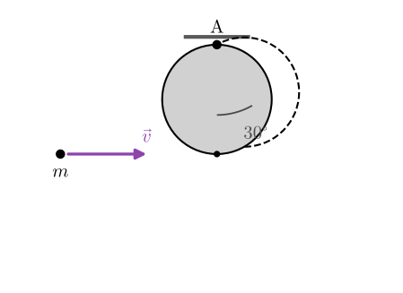

**Choque:** se conserva el momento cinético respecto de A (la fuerza del eje no hace torque). La bala, en $(0;\,-2R)$ con $\vec p = (m\,v;\,0)$, tiene $L_z = -(-2R)\,m\,v = 2\,m\,v\,R$. Momento de inercia del conjunto respecto de A (Steiner para el disco y la bala puntual):

$$
I_A = \underbrace{\tfrac{1}{2}\,m\,R^2 + m\,R^2}_{\text{disco}} + \underbrace{m\,(2R)^2}_{\text{bala}} = 5{,}5\,m\,R^2 = 0{,}044\ \text{kg·m}^2 \qquad 2\,m\,v\,R = I_A\,\omega
$$

**Subida:** el centro de masa del conjunto, a $d = \tfrac{R + 2R}{2} = 1{,}5\,R = 0{,}3$ m de A, sube $d\,(1 - \cos 30^\circ)$:

$$
\tfrac{1}{2}\,I_A\,\omega^2 = 2\,m\,g\,d\,(1 - \cos 30^\circ) = 0{,}4 \cdot 10 \cdot 0{,}3 \cdot 0{,}134\ \text{J} = 0{,}161\ \text{J} \implies \omega = 2{,}70\ \text{rad/s}
$$

$$
v = \frac{I_A\,\omega}{2\,m\,R} = \frac{0{,}044 \cdot 2{,}70}{2 \cdot 0{,}2 \cdot 0{,}2}\ \tfrac{\text{m}}{\text{s}} \implies {\color{ForestGreen}\boxed{v \approx 1{,}49\ \text{m/s}}}
$$

### MC3 — Cuerpo colgado de un resorte

> Un objeto de 2 kg está sujeto a un resorte vertical de $k = 200$ N/m que cuelga del techo. Se lo separa 10 cm hacia abajo desde su posición de equilibrio y se lo deja en libertad. Tomando $t = 0$ en el instante en que se lo suelta, determine: a) la ecuación horaria de la posición, respecto de un sistema de referencia con origen en el equilibrio y positivo hacia arriba; b) la fuerza que soporta el techo en $t = 0$.

Este ejercicio es de movimiento oscilatorio armónico, aunque la guía lo ubica en momento cinético.

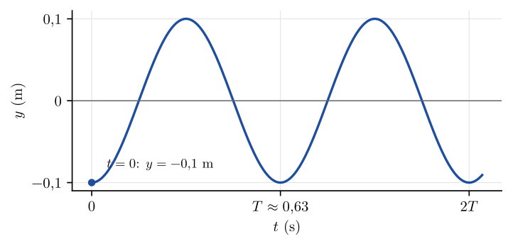

**a)** $\omega = \sqrt{k/m} = \sqrt{200/2} = 10$ rad/s. Se suelta desde el reposo en $y = -0{,}1$ m: es un extremo, así que $A = 0{,}1$ m. Con $y(t) = A\cos(\omega\,t + \varphi_0)$: $\cos\varphi_0 = -1$, entonces $\varphi_0 = \pi$.

$$
{\color{ForestGreen}\boxed{y(t) = 0{,}1\ \text{m}\cdot\cos(10\,t + \pi) = -0{,}1\ \text{m}\cdot\cos(10\,t)}}
$$

**b)** En el equilibrio el resorte está estirado $m\,g/k = 0{,}1$ m. En $t = 0$, 10 cm más: $0{,}2$ m. El resorte tira del techo con

$$
F = k\,\Delta\ell = 200\ \tfrac{\text{N}}{\text{m}} \cdot 0{,}2\ \text{m} \implies {\color{ForestGreen}\boxed{F = 40\ \text{N}}}\ \text{hacia abajo}
$$

<!-- salto-pagina -->

## Movimiento oscilatorio armónico

### MAS1 — Péndulo físico: cambio del punto de suspensión

> Un péndulo físico consiste en una varilla ($I_{\text{cm}} = \tfrac{1}{12}\,m\,L^2$) de longitud $L$ y masa $m$ que oscila con período $T_1 = 0{,}93$ s cuando se la suspende de uno de sus extremos. Determine el nuevo período si se la suspende desde un punto situado a $L/5$ del extremo. Indique el valor con 3 decimales.

El ejercicio 3 de esta sección es idéntico a este.

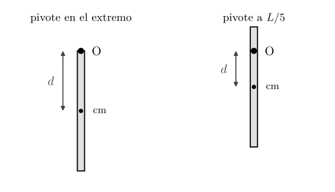

Período de un péndulo físico, con $d$ la distancia del pivote al centro de masa e $I_O = I_{\text{cm}} + m\,d^2$ (Steiner):

$$
T = 2\pi\sqrt{\frac{I_O}{m\,g\,d}} = 2\pi\sqrt{\frac{I_{\text{cm}}/m + d^2}{g\,d}}
$$

| Pivote | $d$ | $I_{\text{cm}}/m + d^2$ | $\dfrac{I_{\text{cm}}/m + d^2}{d}$ |
|---|---|---|---|
| extremo | $0{,}5\,L$ | $\tfrac{1}{12}L^2 + 0{,}25\,L^2 = 0{,}3333\,L^2$ | $0{,}6667\,L$ |
| a $L/5$ del extremo | $0{,}3\,L$ | $\tfrac{1}{12}L^2 + 0{,}09\,L^2 = 0{,}1733\,L^2$ | $0{,}5778\,L$ |

Dividiendo, se simplifican $L$, $g$ y $2\pi$:

$$
\frac{T_2}{T_1} = \sqrt{\frac{0{,}5778}{0{,}6667}} = 0{,}93095 \implies T_2 = 0{,}93\ \text{s} \cdot 0{,}93095 \implies {\color{ForestGreen}\boxed{T_2 \approx 0{,}866\ \text{s}}}
$$

### MAS2 — Velocidad y aceleración en un punto

> Una partícula vinculada a un resorte describe un MAS. La amplitud es 5 cm y cada segundo efectúa media vibración. Calcular las velocidades y aceleraciones que puede tener la partícula al pasar por $x = 3$ cm.

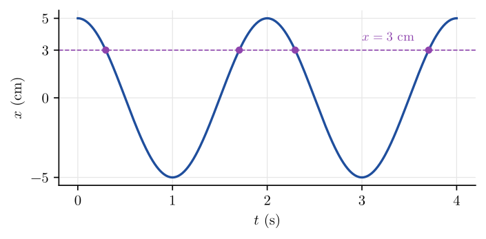

Media vibración por segundo: una oscilación completa cada 2 s, entonces $T = 2$ s y $\omega = 2\pi/T = \pi$ rad/s. Con $x = A\cos(\omega t + \varphi_0)$ y $v = -A\,\omega\,\mathrm{sen}(\omega t + \varphi_0)$ resulta $v^2 = \omega^2\,(A^2 - x^2)$:

$$
v = \pm\,\omega\sqrt{A^2 - x^2} = \pm\,\pi\ \tfrac{\text{rad}}{\text{s}}\sqrt{25 - 9}\ \text{cm} \implies {\color{ForestGreen}\boxed{v \approx \pm\,12{,}57\ \text{cm/s}}}
$$

$$
a = -\omega^2\,x = -\pi^2\ \tfrac{1}{\text{s}^2} \cdot 3\ \text{cm} \implies {\color{ForestGreen}\boxed{a \approx -29{,}6\ \text{cm/s}^2}}
$$

La velocidad tiene dos signos posibles (pasa por $x = 3$ cm yendo y volviendo); la aceleración, uno solo, siempre hacia el equilibrio.

### MAS3

Es igual al MAS1: $T_2 \approx 0{,}866$ s.

### MAS4 — Cuerpo colgado de un resorte, soltado desde otra longitud

> Un cuerpo de masa $m = 2$ kg cuelga en reposo de un techo, sostenido por un resorte ideal de $k = 200$ N/m y longitud natural $\ell_0 = 50$ cm. Se lleva el cuerpo a la posición en que el resorte mide 40 cm y en $t = 0$ se lo suelta con velocidad nula. a) Calcule la longitud del resorte en el equilibrio, y la frecuencia angular y el período del MAS para $t > 0$. b) Determine la amplitud y la fase inicial, y escriba las ecuaciones de posición y velocidad para $t > 0$.

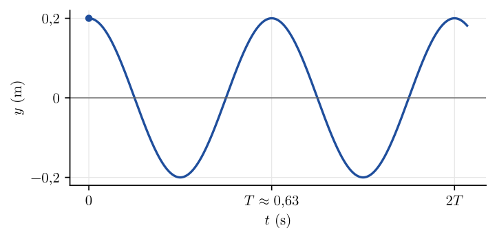

**a)** En el equilibrio, $k\,\Delta\ell = m\,g$: $\Delta\ell = \tfrac{20\ \text{N}}{200\ \text{N/m}} = 0{,}1$ m.

$$
{\color{ForestGreen}\boxed{\ell_{\text{eq}} = 0{,}6\ \text{m}}} \qquad {\color{ForestGreen}\boxed{\omega = \sqrt{k/m} = 10\ \text{rad/s}}} \qquad {\color{ForestGreen}\boxed{T = \tfrac{2\pi}{\omega} \approx 0{,}628\ \text{s}}}
$$

**b)** Eje $y$ con origen en el equilibrio y positivo hacia arriba. Con el resorte de 40 cm, el cuerpo está 20 cm más arriba que en el equilibrio (60 cm): $y(0) = +0{,}2$ m, con velocidad nula. Es un extremo:

$$
{\color{ForestGreen}\boxed{A = 0{,}2\ \text{m}}} \qquad \cos\varphi_0 = 1 \implies {\color{ForestGreen}\boxed{\varphi_0 = 0}}
$$

$$
y(t) = 0{,}2\ \text{m}\cdot\cos(10\,t) \qquad\qquad v(t) = -2\ \tfrac{\text{m}}{\text{s}}\cdot\mathrm{sen}(10\,t)
$$

Con el eje positivo hacia abajo, la fase inicial sería $\pi$.

### MAS5 — Resorte horizontal con longitudes extremas

> Un cuerpo de masa $m = 0{,}5$ kg realiza un MAS sobre una superficie horizontal sin rozamiento, unido a un resorte ideal fijo a una pared. Las longitudes mínima y máxima del resorte son 30 cm y 50 cm, y la velocidad máxima es 2 m/s. a) Determine la amplitud y la longitud natural del resorte. b) Calcule la frecuencia angular y la constante elástica.

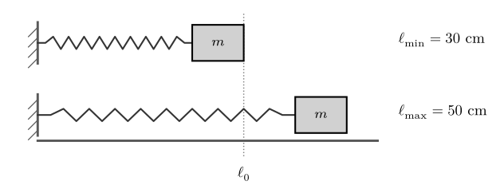

**a)** En horizontal, el equilibrio está en la longitud natural, en el medio de los extremos:

$$
{\color{ForestGreen}\boxed{A = \frac{\ell_{\max} - \ell_{\min}}{2} = 10\ \text{cm}}} \qquad {\color{ForestGreen}\boxed{\ell_0 = \frac{\ell_{\max} + \ell_{\min}}{2} = 40\ \text{cm}}}
$$

**b)** La velocidad máxima, en el equilibrio, es $v_{\max} = A\,\omega$:

$$
{\color{ForestGreen}\boxed{\omega = \frac{v_{\max}}{A} = \frac{2\ \text{m/s}}{0{,}1\ \text{m}} = 20\ \text{rad/s}}} \qquad {\color{ForestGreen}\boxed{k = m\,\omega^2 = 0{,}5\ \text{kg} \cdot 400\ \tfrac{1}{\text{s}^2} = 200\ \text{N/m}}}
$$

<!-- salto-pagina -->

## Resumen de resultados

| Ejercicio | Resultado |
|---|---|
| F1 | $\rho_L \approx 4345$ kg/m³ |
| F2 | $T = (\rho_2 - \rho_L)\,g\,V_2$; $V_{\text{fuera}} = V_1 - [\rho_1 V_1 + (\rho_2 - \rho_L) V_2]/\rho_L$ (faltan datos) |
| F3 | a) 50 %; b) 30 % |
| F4 | $F = 16$ N |
| F5 | $p_2 \approx 1{,}21 \cdot 10^5$ Pa (con 3 m) |
| R1 | $H = 0{,}05$ m |
| R2 | a) no desliza ($f = 1$ N $\le 2$ N); b) desliza, $v_{\text{cm}} = 45$ m/s |
| R3 | a) $m_2 = 72$ kg; b) $\alpha \approx 1{,}39$ rad/s² |
| R4 | a) $a = 8$ m/s², $\alpha_z = -50$ rad/s²; b) $f \approx 0{,}67$ N hacia adelante |
| R5 | a) rueda sin deslizar; b) $a \approx 2{,}44$ m/s² hacia arriba |
| R6 | a) al dejar la pista, $\vec a = (0;\,-10)$ m/s² ($v_B \approx 2{,}93$ m/s); b) $W = 24$ J |
| R7 | $v = 20$ m/s |
| R8 | a) $v_{0p} \approx 350$ m/s; b) sí, se pierden ≈ 488 J (choque plástico) |
| R9 | $W = -1800$ J |
| R10 | $V_0 \approx 4{,}24$ m/s |
| MC1 | a) $\tau \approx 0{,}85$ N·m; b) $\vec L_O \approx -0{,}267\,\hat k$ kg·m²/s |
| MC2 | $v \approx 1{,}49$ m/s (impacto opuesto a A) |
| MC3 | a) $y = -0{,}1\cos(10\,t)$ m; b) 40 N |
| MAS1 / MAS3 | $T_2 \approx 0{,}866$ s |
| MAS2 | $v \approx \pm 12{,}57$ cm/s; $a \approx -29{,}6$ cm/s² |
| MAS4 | $\ell_{\text{eq}} = 0{,}6$ m, $\omega = 10$ rad/s, $T \approx 0{,}628$ s; $A = 0{,}2$ m, $\varphi_0 = 0$ |
| MAS5 | $A = 10$ cm, $\ell_0 = 40$ cm; $\omega = 20$ rad/s, $k = 200$ N/m |

<!-- solo-md -->

---

**Fuentes:** `Guia_extra_2do_parcial.pdf` (guía de ejercicios extra, 2do parcial; 4 páginas, creada el 27/oct/2026; descargada por el usuario el 22/nov/2026). Programa analítico 2024 de Física I (FRBA) para ubicar los temas. Cálculos verificados en `figuras_guia_extra.py`.

<!-- /solo-md -->
