# Integrador del 2do parcial de Física I

<!-- Generado por armar_integrador.py a partir de los cuatro documentos de 2do_parcial/. No editar a mano: corregir el documento de origen y correr make. -->

Los 53 ejercicios distintos de los cuatro documentos de `2do_parcial/`, ordenados por tema y, dentro de cada tema, de menor a mayor dificultad. Los temas siguen el orden de los capítulos del Sears (11.ª ed. en español; en la 13.ª en inglés, fluidos es el cap. 12 y MAS el 14). Las resoluciones son las de los documentos de origen, sin cambios.

| Documento de origen | Qué es |
|---|---|
| Parciales de Vella (`parciales_vella/`) | evaluaciones del curso Z1054, Prof. R. Vella, 2020–2021, contrastadas con sus resoluciones |
| Examen tipo (`examen_tipo/`) | examen tipo propuesto por la FRBA, con su clave |
| Guía extra (`guia_extra/`) | guía de ejercicios extra para el 2do parcial |
| Parcial 2002 (`parcial_2002/`) | parcial de 2002 del que solo queda la resolución; enunciados reconstruidos |

**Nivel:** 1, un solo concepto; 2, dos etapas o ecuaciones acopladas; 3, integra varios temas o tiene una trampa. **Prioridad:** alta, tomado en una evaluación real (Vella) o en el examen tipo, y más si se repitió; media, guía extra; baja, enunciado reconstruido o sin datos (sirve para practicar el método, no para fijarse en los números).

Repetidos, que aparecen una sola vez: Vella Q1 = Vella R1 (ej. 6); Vella A1 = Vella H2 (ej. 46); Vella B4 = Vella P4 (ej. 12); Guía MAS3 = Guía MAS1 (ej. 43); Guía F5 = Vella P3 (ej. 53).

Se usa $g = 10\ \text{m/s}^2$. Notación (con el término del Sears en inglés): $\vec w$ peso (*weight*), $\vec N$ normal, $\vec f$ rozamiento (*friction*), $\vec B$ empuje (*buoyant force*), $K$ energía cinética, $U$ energía potencial, $W$ trabajo (*work*), $\mu_s$ y $\mu_k$ coeficientes de rozamiento estático y cinético, $I$ momento de inercia, $\tau_z$ torque, $\vec L$ momento cinético (*angular momentum*), $\gamma_z$ aceleración angular y $a_{\text{rad}} = v^2/R$ aceleración radial. Rotación: eje $z$ saliente de la hoja, positivo antihorario; $\tau_z = x\,F_y - y\,F_x$ y $L_z = x\,p_y - y\,p_x$. En las resoluciones, azul = resultado intermedio y verde = resultado final.

> [!NOTE]
> Conviene hacer cada ejercicio sin mirar la resolución y después comparar con el resultado en verde.

<!-- salto-pagina -->

## 1. Energía, cantidad de movimiento y choques (Sears caps. 7 y 8)

Conservación de la energía con resortes y rozamiento ($W_{nc} = \Delta E$), conservación de la cantidad de movimiento y choques. Es la base de todo lo que sigue: en los bloques de rígido se vuelve a usar el mismo balance de energía, con un término más.

| Ej. | Origen | Nivel | Prioridad | Qué tiene |
|----|----------|-----|---------|-------------------------------------|
| 1 | Guía R9 | 1 | media | choque plástico; trabajo de las fuerzas internas |
| 2 | Vella B2 | 1 | alta | clasificar un choque con los datos |
| 3 | Ex. tipo 2 | 2 | alta | solo cap. 7: dos pasadas por el tramo con rozamiento |
| 4 | Guía R8 | 2 | media | choque y después energía; pregunta conceptual |
| 5 | Vella P1 | 2 | alta | choque en el plano, por componentes, y frenado |
| 6 | Vella R1 | 2 | alta | tomado dos veces; termina en una cuadrática |
| 7 | 2002 P2 | 2 | baja | datos supuestos: practicar el método |
| 8 | 2002 P1 | 3 | baja | deduce las fórmulas del choque elástico |
| 9 | Vella A2 | 3 | alta | el más completo: péndulo, choque elástico, resorte y rozamiento |
| 10 | Ex. tipo 1 | 3 | alta | suma la dinámica circular del cap. 5 (normal en D) |

<!-- solo-pdf
```{=latex}
\par\penalty-100\begingroup\dimen0=\pagegoal\advance\dimen0 by -\pagetotal
\ifdim\dimen0<14\baselineskip\newpage\fi\endgroup
```
-->

### Ejercicio 1 — Bala que se incrusta en un bloque

*Origen:* Guía extra — R9. *Nivel* 1, *prioridad* media.

> Una bala de masa $m = 100$ g se mueve horizontalmente a 200 m/s y se incrusta en un bloque de masa $M$ en reposo sobre una superficie horizontal lisa. Después del choque el conjunto se mueve a 20 m/s. Determinar el trabajo total de las fuerzas que actuaron sobre el sistema en el choque.

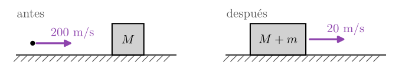

Cantidad de movimiento: $0{,}1\ \text{kg} \cdot 200\ \tfrac{\text{m}}{\text{s}} = (0{,}1 + M) \cdot 20\ \tfrac{\text{m}}{\text{s}}$, entonces ${\color{RoyalBlue} M = 0{,}9\ \text{kg}}$. Trabajo total, por el teorema del trabajo y la energía:

$$
W = \Delta K = \tfrac{1}{2}\,(1\ \text{kg})\,(20\ \tfrac{\text{m}}{\text{s}})^2 - \tfrac{1}{2}\,(0{,}1\ \text{kg})\,(200\ \tfrac{\text{m}}{\text{s}})^2 = 200\ \text{J} - 2000\ \text{J} \implies {\color{ForestGreen}\boxed{W = -1800\ \text{J}}}
$$

Lo hacen las fuerzas internas entre la bala y el bloque: se cancelan en la cantidad de movimiento, pero no en el trabajo, porque sus puntos de aplicación se desplazan distinto.

<!-- solo-pdf
```{=latex}
\par\penalty-100\begingroup\dimen0=\pagegoal\advance\dimen0 by -\pagetotal
\ifdim\dimen0<14\baselineskip\newpage\fi\endgroup
```
-->

### Ejercicio 2 — Choque en una dimensión: ¿qué tipo de choque?

*Origen:* Parciales de Vella (Z1054) — tema B, sin fecha, B2. *Nivel* 1, *prioridad* alta.

> Dos partículas de 5 kg y 20 kg se desplazan en una misma vía rectilínea; sus velocidades son 20 m/s hacia la derecha y 10 m/s hacia la izquierda, respectivamente. Si se detecta que la velocidad de la partícula de menor masa, después del choque, es de 20 m/s hacia la izquierda, determine: a) la velocidad de la otra partícula inmediatamente después de chocar; b) justifique qué tipo de choque se produjo.

**a)** Con $x$ hacia la derecha, se conserva la cantidad de movimiento:

$$
5 \cdot 20 + 20 \cdot (-10) = 5 \cdot (-20) + 20\,v_2' \implies -100 = -100 + 20\,v_2' \implies {\color{ForestGreen}\boxed{v_2' = 0}}
$$

**b)** $K_{\text{antes}} = \tfrac12 \cdot 5 \cdot 20^2 + \tfrac12 \cdot 20 \cdot 10^2 = 2000$ J, y $K_{\text{después}} = \tfrac12 \cdot 5 \cdot 20^2 = 1000$ J. Se pierde la mitad de la energía cinética y las partículas se separan después del choque:

> [!TIP]
> **Respuesta:** el choque es **inelástico, pero no plástico**. Su coeficiente de restitución es $e = \dfrac{v_2' - v_1'}{v_1 - v_2} = \dfrac{0 + 20}{20 + 10} = \tfrac23$.

<!-- solo-pdf
```{=latex}
\par\penalty-100\begingroup\dimen0=\pagegoal\advance\dimen0 by -\pagetotal
\ifdim\dimen0<14\baselineskip\newpage\fi\endgroup
```
-->

### Ejercicio 3 — Bloque entre dos resortes con un tramo con rozamiento

*Origen:* Examen tipo (FRBA) — problema 2. *Nivel* 2, *prioridad* alta.

#### Enunciado

> Un bloque de masa $M$ es impulsado por un resorte de constante elástica $k_1$ y se desliza sobre la superficie horizontal, que presenta rozamiento en el tramo AB, deteniéndose justo en el punto A. Se sabe que la compresión que experimenta el resorte de constante $k_2$ es de 1 m. Hallar:
>
> a) la constante elástica $k_2$;
> b) la constante elástica $k_1$, sabiendo que la compresión que presentaba dicho resorte era también de 1 m.
>
> Datos: $M = 1$ kg; $\mu_k = 0{,}25$; $\overline{AB} = 2$ m.

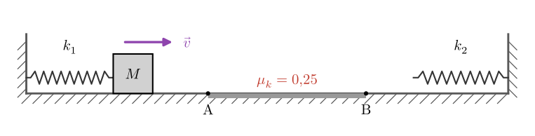

#### El recorrido

El bloque cruza AB hacia la derecha, comprime el resorte 2, vuelve, cruza AB hacia la izquierda y se detiene justo en A: pasa **dos veces** por el tramo con rozamiento. Fuera de AB no hay rozamiento y la energía mecánica se conserva.

En cada pasada, el rozamiento cinético es opuesto al desplazamiento y su trabajo es:

$$
W_f = \vec f_k \cdot \Delta \vec r = -\mu_k\,M\,g\,\overline{AB} = -0{,}25 \cdot 1\ \text{kg} \cdot 10\ \tfrac{\text{m}}{\text{s}^2} \cdot 2\ \text{m} = {\color{RoyalBlue} -5\ \text{J}}
$$

#### a) Constante $k_2$

Desde el resorte 2 comprimido 1 m (bloque en reposo) hasta A (bloque en reposo), el bloque pasa una vez por AB:

$$
\tfrac{1}{2}\,k_2\,(1\ \text{m})^2 + W_f = 0 \implies \tfrac{1}{2}\,k_2 \cdot 1\ \text{m}^2 = 5\ \text{J} \implies {\color{ForestGreen}\boxed{k_2 = 10\ \text{N/m}}}
$$

#### b) Constante $k_1$

Desde el resorte 1 comprimido 1 m hasta A, al final, el bloque pasa dos veces por AB:

$$
\tfrac{1}{2}\,k_1\,(1\ \text{m})^2 + 2\,W_f = 0 \implies \tfrac{1}{2}\,k_1 \cdot 1\ \text{m}^2 = 10\ \text{J} \implies {\color{ForestGreen}\boxed{k_1 = 20\ \text{N/m}}}
$$

> [!CAUTION]
> **Error en la clave:** la clave del examen dice «a) $k_1 = 20$ N/m; b) $k_2 = 10$ N/m», pero el inciso a) pide $k_2$ y el b) pide $k_1$. Los valores son correctos; los incisos están invertidos.

> [!TIP]
> **Respuesta:** a) $k_2 = 10$ N/m; b) $k_1 = 20$ N/m.

<!-- solo-pdf
```{=latex}
\par\penalty-100\begingroup\dimen0=\pagegoal\advance\dimen0 by -\pagetotal
\ifdim\dimen0<14\baselineskip\newpage\fi\endgroup
```
-->

### Ejercicio 4 — Péndulo balístico

*Origen:* Guía extra — R8. *Nivel* 2, *prioridad* media.

> Un proyectil de masa $m_p = 8$ g incide horizontalmente con velocidad $v_{0p}$ y se incrusta en el bloque puntual de masa $M = 1800$ g de un péndulo ideal (barrita de masa despreciable). El bloque con el proyectil asciende $h = 12$ cm. a) Calcular $v_{0p}$. b) Determinar si hubo variación de energía mecánica y, en caso afirmativo, justificar por qué.

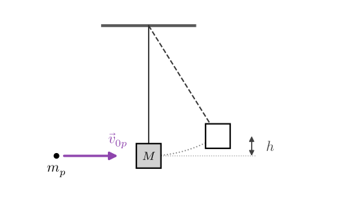

Son dos etapas. **Choque** (instantáneo): se conserva la cantidad de movimiento horizontal. **Subida**: se conserva la energía mecánica, porque la tensión de la barra es perpendicular a la trayectoria.

$$
\text{subida:}\quad \tfrac{1}{2}\,(m_p + M)\,V^2 = (m_p + M)\,g\,h \implies V = \sqrt{2\,g\,h} = \sqrt{2 \cdot 10 \cdot 0{,}12}\ \tfrac{\text{m}}{\text{s}} = {\color{RoyalBlue} 1{,}55\ \text{m/s}}
$$

$$
\text{choque:}\quad m_p\,v_{0p} = (m_p + M)\,V \implies v_{0p} = \frac{1{,}808\ \text{kg}}{0{,}008\ \text{kg}} \cdot 1{,}55\ \tfrac{\text{m}}{\text{s}} \implies {\color{ForestGreen}\boxed{v_{0p} \approx 350\ \text{m/s}}}
$$

**b)** Sí. Antes del choque, $K = \tfrac{1}{2}\,(0{,}008)(350)^2 \approx 490$ J; después, $\tfrac{1}{2}\,(1{,}808)(1{,}55)^2 \approx 2{,}17$ J. Se pierden **unos 488 J (99,6 %)**: el choque es plástico, y esa energía se va en deformar el bloque y en calor durante la penetración del proyectil.

<!-- solo-pdf
```{=latex}
\par\penalty-100\begingroup\dimen0=\pagegoal\advance\dimen0 by -\pagetotal
\ifdim\dimen0<14\baselineskip\newpage\fi\endgroup
```
-->

### Ejercicio 5 — Choque plástico en el plano y frenado con rozamiento

*Origen:* Parciales de Vella (Z1054) — 2º parcial, 1/12/2020, P1. *Nivel* 2, *prioridad* alta.

> Una partícula de 10 kg de masa se mueve en la dirección del eje X con una velocidad de 2 m/s, cuando es chocada en forma perfectamente plástica por otra partícula de 1 kg de masa que se mueve en la dirección del eje Y, con una velocidad de 20 m/s, según el gráfico (vista superior). Inmediatamente después del choque el conjunto se mueve sobre el mismo plano horizontal pero que ahora presenta fricción ($\mu_c = 0{,}2$). Determine la distancia que recorren juntas hasta detenerse.

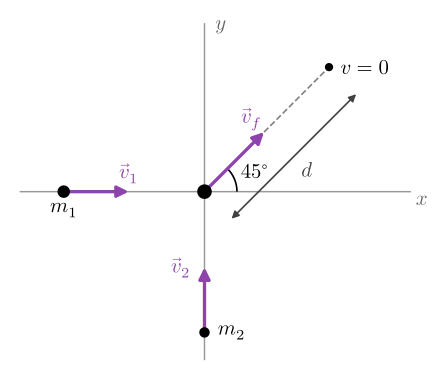

**Choque:** se conserva la cantidad de movimiento, vector por vector:

$$
m_1\,\vec v_1 + m_2\,\vec v_2 = (m_1 + m_2)\,\vec v_f \implies \vec v_f = \frac{(10 \cdot 2;\ 1 \cdot 20)\ \text{kg·m/s}}{11\ \text{kg}} = {\color{RoyalBlue}(1{,}82;\ 1{,}82)\ \text{m/s}}
$$

$|\vec v_f| = \sqrt2 \cdot 1{,}818\ \text{m/s} = {\color{RoyalBlue} 2{,}57\ \text{m/s}}$, a 45° del eje $x$.

**Frenado:** el rozamiento es la única fuerza que trabaja, $W_f = \Delta K$:

$$
-\mu_k\,(m_1 + m_2)\,g\,d = 0 - \tfrac12\,(m_1 + m_2)\,v_f^2 \implies d = \frac{v_f^2}{2\,\mu_k\,g} = \frac{(2{,}571\ \text{m/s})^2}{2 \cdot 0{,}2 \cdot 10\ \text{m/s}^2} \implies {\color{ForestGreen}\boxed{d \approx 1{,}65\ \text{m}}}
$$

> [!CAUTION]
> La resolución de Vella da $d \cong 1{,}63$ m porque redondea $|\vec v_f|$ a 2,55 m/s; el módulo correcto es $\sqrt{1{,}818^2 + 1{,}818^2} = 2{,}571$ m/s. La diferencia es solo de redondeo.

<!-- solo-pdf
```{=latex}
\par\penalty-100\begingroup\dimen0=\pagegoal\advance\dimen0 by -\pagetotal
\ifdim\dimen0<14\baselineskip\newpage\fi\endgroup
```
-->

### Ejercicio 6 — Choque plástico contra un bloque apoyado en un resorte

*Origen:* Parciales de Vella (Z1054) — 1º recuperatorio, 18/12/2020, R1; repetido como Q1 (recuperatorio, 23/2/2021). *Nivel* 2, *prioridad* alta.

> Una partícula de 100 g de masa se lanza en dirección horizontal con una velocidad de 7 m/s y choca en forma perfectamente plástica contra un bloque de 900 g de masa, que se encuentra en reposo sobre una superficie horizontal y en contacto con un resorte ideal no deformado ($k = 98$ N/m). Si el coeficiente de roce cinético entre el bloque y la superficie es $\mu_c = 0{,}25$, determine la máxima compresión del resorte.

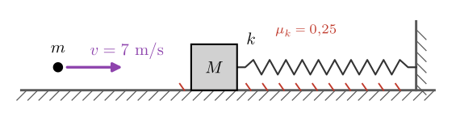

**Choque:** $m\,v = (m + M)\,v' \implies v' = \dfrac{0{,}1\ \text{kg} \cdot 7\ \text{m/s}}{1\ \text{kg}} = {\color{RoyalBlue} 0{,}7\ \text{m/s}}$.

**Compresión:** el rozamiento es la fuerza no conservativa, $W_f = \Delta E$, con el resorte comprimido $x$ al detenerse:

$$
-\mu_k\,(m + M)\,g\,x = \tfrac12\,k\,x^2 - \tfrac12\,(m + M)\,v'^2 \implies 49\,x^2 + 2{,}5\,x - 0{,}245 = 0
$$

con los coeficientes en N/m, N y J. La raíz positiva es

$$
{\color{ForestGreen}\boxed{x \approx 0{,}050\ \text{m} = 5{,}0\ \text{cm}}}
$$

Coincide con Vella ($x_1 = 0{,}049$ m, truncado; la otra raíz, negativa, se descarta).

<!-- solo-pdf
```{=latex}
\par\penalty-100\begingroup\dimen0=\pagegoal\advance\dimen0 by -\pagetotal
\ifdim\dimen0<14\baselineskip\newpage\fi\endgroup
```
-->

### Ejercicio 7 — Dos bloques, dos resortes y un choque plástico

*Origen:* Parcial 2002 (resolución de H. Cassia) — problema 2, enunciado reconstruido. *Nivel* 2, *prioridad* baja.

#### Enunciado reconstruido

> Sobre un piso horizontal sin rozamiento hay dos bloques entre dos paredes. El bloque 1, de masa $m_1 = 1$ kg, comprime $x_1 = 0{,}168$ m un resorte de constante $k_1 = 1280$ N/m fijo a la pared izquierda; el bloque 2, de masa $m_2 = 4$ kg, comprime $x_2 = 0{,}1$ m un resorte de constante $k_2 = 1600$ N/m fijo a la pared derecha. Se sueltan los dos bloques; cuando los resortes recuperan su longitud natural, los bloques se separan de ellos, se acercan y chocan plásticamente.
>
> a) Calcular la velocidad del conjunto después del choque. ¿Contra qué resorte se mueve?
> b) Calcular cuánto comprime el conjunto a ese resorte.

| Dato | Valor | Origen |
|---|---|---|
| Velocidad del bloque 1 al dejar el resorte | $6$ m/s | dado |
| Velocidad del bloque 2 al dejar el resorte | $2$ m/s | dado |
| Relación de masas | $m_2 = 4\,m_1$ | deducido de $v' = -0{,}4$ m/s |
| Masa del bloque 1 | $m_1 = 1$ kg | **supuesto** (fija la escala) |
| Resorte 1 | $k_1 = 1280$ N/m, $x_1 = 0{,}168$ m | deducido: la compresión final de $0{,}025$ m exige $k_1/m_1 = 1280\ \text{s}^{-2}$ |
| Resorte 2 | $k_2 = 1600$ N/m, $x_2 = 0{,}1$ m | $k_2$ **supuesto**; $x_2$ deducido de $v_2 = 2$ m/s |

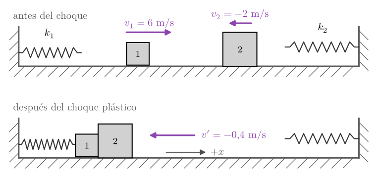

#### Velocidades al dejar los resortes

Sin rozamiento, la energía potencial elástica de cada resorte pasa entera a energía cinética de su bloque:

$$
\tfrac{1}{2}\,k_1\,x_1^2 = \tfrac{1}{2}\,m_1\,v_1^2 \implies v_1 = \sqrt{\frac{k_1}{m_1}}\;x_1 = \sqrt{\frac{1280\ \text{N/m}}{1\ \text{kg}}} \cdot 0{,}168\ \text{m} = {\color{RoyalBlue} 6\ \text{m/s}}
$$

$$
v_2 = \sqrt{\frac{k_2}{m_2}}\;x_2 = \sqrt{\frac{1600\ \text{N/m}}{4\ \text{kg}}} \cdot 0{,}1\ \text{m} = {\color{RoyalBlue} 2\ \text{m/s}}
$$

Con el eje $x$ positivo hacia la derecha, el bloque 1 va a $+6$ m/s y el bloque 2 a $-2$ m/s.

#### a) Choque plástico

En el choque las fuerzas externas horizontales son nulas, así que se conserva la cantidad de movimiento $\vec p$ (*momentum*); en un choque plástico los cuerpos salen juntos:

$$
m_1\,v_1 + m_2\,v_2 = (m_1 + m_2)\,v' \implies v' = \frac{1\ \text{kg} \cdot 6\ \tfrac{\text{m}}{\text{s}} + 4\ \text{kg} \cdot \left(-2\ \tfrac{\text{m}}{\text{s}}\right)}{5\ \text{kg}} \implies {\color{ForestGreen}\boxed{v' = -0{,}4\ \text{m/s}}}
$$

Es negativa: el conjunto se mueve hacia la izquierda, **contra el resorte 1**.

#### b) Compresión del resorte 1

Después del choque vuelve a conservarse la energía mecánica:

$$
\tfrac{1}{2}\,(m_1 + m_2)\,v'^2 = \tfrac{1}{2}\,k_1\,x_1'^2 \implies x_1' = \sqrt{\frac{m_1 + m_2}{k_1}}\;|v'| = \sqrt{\frac{5\ \text{kg}}{1280\ \text{N/m}}} \cdot 0{,}4\ \tfrac{\text{m}}{\text{s}} \implies {\color{ForestGreen}\boxed{x_1' = 0{,}025\ \text{m}}}
$$

> [!NOTE]
> La resolución original escribe $x_1' = -0{,}025$ m. La raíz es positiva; el signo solo indica que la compresión es hacia la izquierda. La energía cinética que se pierde en el choque, $\tfrac{1}{2}(1)(6)^2 + \tfrac{1}{2}(4)(2)^2 - \tfrac{1}{2}(5)(0{,}4)^2 = 25{,}6$ J, es justamente la razón de que la compresión final sea tan chica.

> [!TIP]
> **Respuesta:** a) $v' = -0{,}4$ m/s, hacia el resorte 1; b) lo comprime $0{,}025$ m.

<!-- solo-pdf
```{=latex}
\par\penalty-100\begingroup\dimen0=\pagegoal\advance\dimen0 by -\pagetotal
\ifdim\dimen0<14\baselineskip\newpage\fi\endgroup
```
-->

### Ejercicio 8 — Pista circular, choque elástico y tramo con rozamiento

*Origen:* Parcial 2002 (resolución de H. Cassia) — problema 1, enunciado reconstruido. *Nivel* 3, *prioridad* baja.

#### Enunciado reconstruido

> El cuerpo 1, de masa $m_1$, parte del reposo en el punto A de una pista sin rozamiento con forma de cuarto de circunferencia de radio $R = 0{,}8$ m. En el punto B, al pie de la pista, choca en forma perfectamente elástica con el cuerpo 2, de masa $m_2 = 2\,m_1$, que estaba en reposo. Después del choque, el cuerpo 2 recorre el tramo horizontal BC, de 1,7 m y con rozamiento, y se detiene en C.
>
> a) Calcular el coeficiente de rozamiento cinético del tramo BC.
> b) Calcular la altura que alcanza el cuerpo 1 al volver a subir por la pista.
>
> Explicar: ¿por qué la aceleración entre A y B no es constante? ¿Por qué, si el choque es perfectamente elástico, el cuerpo 1 no vuelve a la altura de A?

| Dato | Valor | Origen |
|---|---|---|
| Radio de la pista | $R = 0{,}8$ m | dado ($v_B = \sqrt{2 \cdot 10 \cdot 0{,}8}$) |
| Relación de masas | $m_2 = 2\,m_1$ | deducido de $v_1' = -\tfrac{4}{3}$ m/s con $v_1 = 4$ m/s |
| Tramo con rozamiento | $\overline{BC} = 1{,}7$ m | dado |
| Cuerpo 2 antes del choque | en reposo | dado |

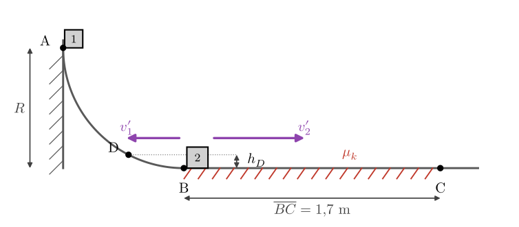

#### Bajada de A a B

Sobre el cuerpo 1 actúan el peso $\vec w$ y la normal $\vec N$ de la pista. La normal es perpendicular a la pista y, por lo tanto, al desplazamiento $d\vec r$ en cada punto: su trabajo es nulo, ${\color{RoyalBlue}W_N = \int \vec N \cdot d\vec r = 0}$. Solo trabaja el peso, que es conservativo, así que se conserva la energía mecánica:

$$
K_A + U_A = K_B + U_B \implies 0 + m_1\,g\,R = \tfrac{1}{2}\,m_1\,v_B^2 + 0
$$

$$
v_B = \sqrt{2\,g\,R} = \sqrt{2 \cdot 10\ \tfrac{\text{m}}{\text{s}^2} \cdot 0{,}8\ \text{m}} = {\color{RoyalBlue} 4\ \text{m/s}}
$$

#### Choque perfectamente elástico en B

En un choque perfectamente elástico se conservan la cantidad de movimiento y la energía cinética. Con $v_1 = v_B$ y $v_2 = 0$:

$$
\begin{aligned}
m_1\,v_1 &= m_1\,v_1' + m_2\,v_2' &&\implies m_1\,(v_1 - v_1') = m_2\,v_2' \\
\tfrac{1}{2}\,m_1\,v_1^2 &= \tfrac{1}{2}\,m_1\,v_1'^2 + \tfrac{1}{2}\,m_2\,v_2'^2 &&\implies m_1\,(v_1 - v_1')(v_1 + v_1') = m_2\,v_2'^2
\end{aligned}
$$

Dividiendo la segunda por la primera, $v_1 + v_1' = v_2'$. Reemplazando en la primera:

$$
v_1' = \frac{m_1 - m_2}{m_1 + m_2}\,v_1 \qquad\qquad v_2' = \frac{2\,m_1}{m_1 + m_2}\,v_1
$$

Con $m_2 = 2\,m_1$:

$$
v_1' = \frac{m_1 - 2\,m_1}{3\,m_1} \cdot 4\ \tfrac{\text{m}}{\text{s}} = {\color{RoyalBlue} -\tfrac{4}{3}\ \text{m/s} \approx -1{,}33\ \text{m/s}} \qquad\qquad v_2' = \frac{2\,m_1}{3\,m_1} \cdot 4\ \tfrac{\text{m}}{\text{s}} = {\color{RoyalBlue} \tfrac{8}{3}\ \text{m/s} \approx 2{,}67\ \text{m/s}}
$$

El signo negativo indica que el cuerpo 1 rebota y vuelve hacia la pista.

#### a) Tramo BC: coeficiente de rozamiento

En BC, la normal y el peso son perpendiculares al desplazamiento y no trabajan; solo trabaja el rozamiento cinético, $\vec f_k = (-\mu_k\,m_2\,g;\ 0)$, con $\Delta \vec r = (\overline{BC};\ 0)$. Por el teorema del trabajo y la energía cinética:

$$
W_{f_k} = \vec f_k \cdot \Delta \vec r = -\mu_k\,m_2\,g\,\overline{BC} = \Delta K = 0 - \tfrac{1}{2}\,m_2\,v_2'^2
$$

$$
\mu_k = \frac{v_2'^2}{2\,g\,\overline{BC}} = \frac{\left(\tfrac{8}{3}\ \text{m/s}\right)^2}{2 \cdot 10\ \tfrac{\text{m}}{\text{s}^2} \cdot 1{,}7\ \text{m}} = \frac{7{,}11\ \text{m}^2/\text{s}^2}{34\ \text{m}^2/\text{s}^2} \implies {\color{ForestGreen}\boxed{\mu_k \approx 0{,}21}}
$$

La masa se simplifica: no hace falta conocer $m_2$.

#### b) Altura que alcanza el cuerpo 1

El cuerpo 1 vuelve por la pista sin rozamiento, así que se conserva la energía mecánica entre B y el punto D donde se detiene:

$$
\tfrac{1}{2}\,m_1\,v_1'^2 = m_1\,g\,h_D \implies h_D = \frac{v_1'^2}{2\,g} = \frac{\left(\tfrac{4}{3}\ \text{m/s}\right)^2}{2 \cdot 10\ \tfrac{\text{m}}{\text{s}^2}} \implies {\color{ForestGreen}\boxed{h_D \approx 0{,}089\ \text{m} \approx 9\ \text{cm}}}
$$

> [!TIP]
> **Respuesta:** a) $\mu_k \approx 0{,}21$ (la resolución redondea a $0{,}2$); b) $h_D \approx 0{,}09$ m.

#### Las dos preguntas conceptuales

**¿Por qué la aceleración entre A y B no es constante?** En cada punto de la pista, la componente del peso tangente a la trayectoria es $g\,\mathrm{sen}\,\theta$, donde $\theta$ es la inclinación de la tangente en ese punto. En un cuarto de circunferencia, $\theta$ cambia de $90^\circ$ en A a $0^\circ$ en B; además, la trayectoria es curva y aparece una aceleración radial $a_{\text{rad}} = v^2/R$ que crece a medida que el cuerpo gana velocidad. Por eso no sirven las ecuaciones de aceleración constante y se resuelve por energía.

**¿Por qué el cuerpo 1 no vuelve a la altura de A?** En el choque elástico se conserva la energía cinética **del sistema**, no la de cada cuerpo. El cuerpo 1 le transfiere al cuerpo 2 la mayor parte de su energía: después del choque le quedan $\left(\tfrac{1}{3}\right)^2 = \tfrac{1}{9}$ de su energía cinética inicial, y por eso sube a $R/9 \approx 0{,}089$ m.

<!-- solo-pdf
```{=latex}
\par\penalty-100\begingroup\dimen0=\pagegoal\advance\dimen0 by -\pagetotal
\ifdim\dimen0<14\baselineskip\newpage\fi\endgroup
```
-->

### Ejercicio 9 — Péndulo, choque elástico y resorte con rozamiento

*Origen:* Parciales de Vella (Z1054) — tema A, sin fecha, A2. *Nivel* 3, *prioridad* alta.

> Se aparta 30° de la vertical un péndulo ideal de 2 m de longitud y 2 kg de masa. Al soltarse y llegar a la parte más baja, impacta con otra partícula de 1 kg de masa que se hallaba en reposo. Como consecuencia del choque elástico, esta última recorre una superficie horizontal impactando con un resorte ideal ($k = 1000$ N/m), el cual se encuentra con su longitud natural a una distancia $d = 1$ m de la partícula. Si hay fricción ($\mu_c = 0{,}2$) en toda la superficie, determine la máxima compresión del resorte.

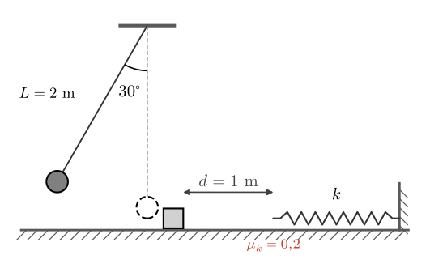

**Bajada del péndulo**, por energía:

$$
v = \sqrt{2\,g\,L\,(1 - \cos 30°)} = \sqrt{2 \cdot 10 \cdot 2 \cdot 0{,}134}\ \text{m/s} = {\color{RoyalBlue} 2{,}31\ \text{m/s}}
$$

**Choque elástico** contra la partícula en reposo:

$$
v_2' = \frac{2\,m_1}{m_1 + m_2}\,v = \frac{4}{3} \cdot 2{,}315\ \text{m/s} = {\color{RoyalBlue} 3{,}09\ \text{m/s}}
$$

El péndulo sigue a $(m_1 - m_2)\,v/(m_1 + m_2) = 0{,}77$ m/s, sin efecto sobre lo que sigue.

**Recorrido y compresión**, con rozamiento a lo largo de $d + x$: $W_f = \Delta E$.

$$
\tfrac12\,m_2\,v_2'^2 = \mu_k\,m_2\,g\,(d + x) + \tfrac12\,k\,x^2 \implies 4{,}76\ \text{J} = 2\ \text{N} \cdot (1\ \text{m} + x) + 500\ \tfrac{\text{N}}{\text{m}}\,x^2
$$

$$
500\,x^2 + 2\,x - 2{,}76 = 0 \implies {\color{ForestGreen}\boxed{x \approx 0{,}072\ \text{m} = 7{,}2\ \text{cm}}}
$$

<!-- solo-pdf
```{=latex}
\par\penalty-100\begingroup\dimen0=\pagegoal\advance\dimen0 by -\pagetotal
\ifdim\dimen0<14\baselineskip\newpage\fi\endgroup
```
-->

### Ejercicio 10 — Resorte, choque plástico y vía circular

*Origen:* Examen tipo (FRBA) — problema 1. *Nivel* 3, *prioridad* alta.

#### Enunciado

> El carrito 1 de la figura está comprimiendo un resorte en el punto A. Se libera el sistema y el carrito 1 choca plásticamente con el carrito 2, que se hallaba en reposo. El conjunto entra en la vía circular, que presenta rozamiento en la mitad izquierda, por el punto C con una velocidad de 10 m/s, y la abandona por el mismo punto con una velocidad de 6 m/s. Hallar:
>
> a) la velocidad del conjunto cuando alcanza el punto D;
> b) la reacción del vínculo (N) en el punto D;
> c) el trabajo de la fuerza de rozamiento;
> d) la constante elástica del resorte.
>
> La superficie horizontal no presenta rozamiento. Datos: $m_1 = m_2 = 4{,}5$ kg; $\Delta x = 0{,}75$ m; $R = 0{,}9$ m.

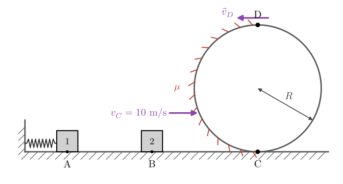

#### a) Velocidad en D

El conjunto ($m = m_1 + m_2 = 9$ kg) entra por C hacia la derecha y sube por la **mitad derecha**, que no tiene rozamiento. La normal es perpendicular a la vía en cada punto y no trabaja, así que de C a D se conserva la energía mecánica. D está a $2R = 1{,}8$ m sobre C:

$$
\begin{aligned}
\tfrac{1}{2}\,m\,v_C^2 &= \tfrac{1}{2}\,m\,v_D^2 + m\,g\,(2R) \implies v_D = \sqrt{v_C^2 - 4\,g\,R} \\
v_D &= \sqrt{100\ \tfrac{\text{m}^2}{\text{s}^2} - 4 \cdot 10\ \tfrac{\text{m}}{\text{s}^2} \cdot 0{,}9\ \text{m}} = \sqrt{64\ \tfrac{\text{m}^2}{\text{s}^2}} \implies {\color{ForestGreen}\boxed{v_D = 8\ \text{m/s}}}
\end{aligned}
$$

#### b) Reacción en D

En D, la vía está por encima del carrito: la normal y el peso apuntan hacia abajo, hacia el centro. Con $y$ hacia arriba, $\vec N = (0;\,-N)$, $\vec w = (0;\,-m\,g)$ y la aceleración es la radial, $\vec a = (0;\,-a_{\text{rad}})$ con $a_{\text{rad}} = v_D^2/R$:

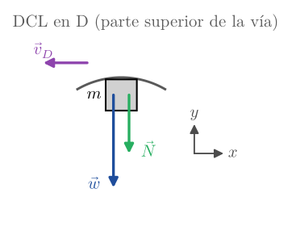

$$
-N - m\,g = -m\,\frac{v_D^2}{R} \implies N = m\left(\frac{v_D^2}{R} - g\right) = 9\ \text{kg}\left(\frac{64\ \text{m}^2/\text{s}^2}{0{,}9\ \text{m}} - 10\ \tfrac{\text{m}}{\text{s}^2}\right) \implies {\color{ForestGreen}\boxed{N = 550\ \text{N}}}
$$

#### c) Trabajo del rozamiento

Entre la entrada y la salida por C el conjunto vuelve a la misma altura: el peso hace trabajo total nulo y la normal no trabaja. Todo el cambio de energía cinética se debe al rozamiento de la mitad izquierda:

$$
W_f = \Delta K = \tfrac{1}{2}\,m\,(v_{\text{sale}}^2 - v_C^2) = \tfrac{1}{2} \cdot 9\ \text{kg} \cdot (36 - 100)\ \tfrac{\text{m}^2}{\text{s}^2} \implies {\color{ForestGreen}\boxed{W_f = -288\ \text{J}}}
$$

#### d) Constante del resorte

En el choque plástico se conserva la cantidad de movimiento. El conjunto sale a $10$ m/s, que es la velocidad con que llega a C (el piso no tiene rozamiento):

$$
m_1\,v_1 = (m_1 + m_2)\,v_C \implies v_1 = \frac{9\ \text{kg} \cdot 10\ \text{m/s}}{4{,}5\ \text{kg}} = {\color{RoyalBlue} 20\ \text{m/s}}
$$

La energía del resorte comprimido pasa entera al carrito 1 antes del choque:

$$
\tfrac{1}{2}\,k\,\Delta x^2 = \tfrac{1}{2}\,m_1\,v_1^2 \implies k = \frac{m_1\,v_1^2}{\Delta x^2} = \frac{4{,}5\ \text{kg} \cdot 400\ \text{m}^2/\text{s}^2}{0{,}5625\ \text{m}^2} \implies {\color{ForestGreen}\boxed{k = 3200\ \text{N/m}}}
$$

> [!NOTE]
> En el choque plástico se pierde la mitad de la energía cinética: antes, $\tfrac{1}{2}(4{,}5)(20)^2 = 900$ J; después, $\tfrac{1}{2}(9)(10)^2 = 450$ J. Por eso $k$ no se puede calcular con la energía del conjunto en C.

> [!TIP]
> **Respuesta:** a) $v_D = 8$ m/s; b) $N = 550$ N; c) $W_f = -288$ J; d) $k = 3200$ N/m. Coinciden con la clave del examen.

<!-- salto-pagina -->

## 2. Energía en el cuerpo rígido (Sears cap. 9 y rodadura del cap. 10)

El mismo balance de energía del bloque anterior, ahora con energía cinética de rotación, $\tfrac12\,I\,\omega^2$, y la condición de rodadura $v_{\text{cm}} = \omega\,R$. El rozamiento estático de la rodadura no trabaja.

| Ej. | Origen | Nivel | Prioridad | Qué tiene |
|----|----------|-----|---------|-------------------------------------|
| 11 | Guía R1 | 1 | media | trampa: sin rozamiento la rotación no se convierte en altura |
| 12 | Vella P4 | 2 | alta | tomado dos veces: rodadura y resorte |
| 13 | Ex. tipo 4 | 2 | alta | rodadura y después tiro horizontal (cap. 3) |
| 14 | Guía R6 | 2 | media | el inciso a) no se puede calcular con la figura |
| 15 | 2002 P4 | 2 | baja | datos supuestos: polea con masa y resorte |
| 16 | Vella R5 | 3 | alta | resorte, polea con masa y dos partículas |
| 17 | Ex. tipo 3 | 3 | alta | relación de velocidades 2:1; la clave no se reproduce |
| 18 | Vella Q4 | 3 | alta | Steiner y tensión en la vertical; tiene un supuesto |

<!-- solo-pdf
```{=latex}
\par\penalty-100\begingroup\dimen0=\pagegoal\advance\dimen0 by -\pagetotal
\ifdim\dimen0<14\baselineskip\newpage\fi\endgroup
```
-->

### Ejercicio 11 — Cilindro que sube por una rampa sin rozamiento

*Origen:* Guía extra — R1. *Nivel* 1, *prioridad* media.

> Un cilindro macizo y homogéneo rueda sin deslizar sobre una superficie horizontal con velocidad del centro de masa de 1 m/s. Calcular la altura máxima $H$ que alcanza al subir por un plano inclinado que no tiene rozamiento.

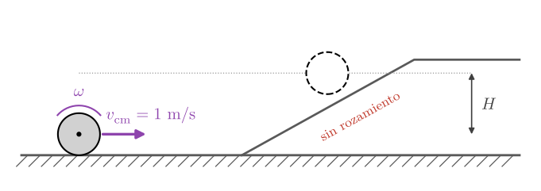

En la rampa sin rozamiento, las únicas fuerzas son el peso y la normal, que pasan por el centro de masa: **no hay torque respecto del centro de masa**, y la velocidad angular $\omega$ se mantiene constante. La energía cinética de rotación no se transforma: solo la de traslación pasa a energía potencial.

$$
\tfrac{1}{2}\,m\,v_{\text{cm}}^2 = m\,g\,H \implies H = \frac{v_{\text{cm}}^2}{2\,g} = \frac{(1\ \text{m/s})^2}{2 \cdot 10\ \text{m/s}^2} \implies {\color{ForestGreen}\boxed{H = 0{,}05\ \text{m}}}
$$

> [!NOTE]
> Si la rampa tuviera rozamiento suficiente para que siguiera rodando, también la rotación se convertiría en altura: $\tfrac{3}{4}\,m\,v_{\text{cm}}^2 = m\,g\,H$ y $H = 0{,}075$ m. Esa es la trampa del ejercicio.

<!-- solo-pdf
```{=latex}
\par\penalty-100\begingroup\dimen0=\pagegoal\advance\dimen0 by -\pagetotal
\ifdim\dimen0<14\baselineskip\newpage\fi\endgroup
```
-->

### Ejercicio 12 — Cilindro que baja rodando y estira un resorte

*Origen:* Parciales de Vella (Z1054) — 2º parcial, 1/12/2020, P4; repetido como B4 (tema B, sin fecha). *Nivel* 2, *prioridad* alta.

> El sistema de la figura parte del reposo, el resorte ideal ($k = 250$ N/m) no presenta deformación inicial. Luego el cilindro macizo y homogéneo de 10 kg de masa comienza a descender rodando sin resbalar por el plano ($\alpha = 30°$). Determinar la velocidad del centro de masa del mismo cuando su centro se desplazó una distancia de 20 cm a lo largo del plano. Considerar $I_{\text{cm}} = \tfrac12\,m\,r^2$.

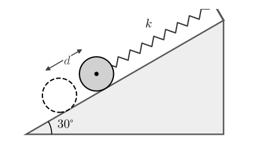

Rueda sin resbalar: el rozamiento estático no trabaja y se conserva la energía mecánica. Con $d = 0{,}2$ m, el centro baja $h = d\,\mathrm{sen}\,30° = 0{,}1$ m y el resorte se estira $d$. La energía cinética del cilindro que rueda es $K = \tfrac12\,m\,v^2 + \tfrac12\,I_{\text{cm}}\,\omega^2 = \tfrac34\,m\,v^2$ (con $\omega = v/r$):

$$
m\,g\,h = \tfrac12\,k\,d^2 + \tfrac34\,m\,v^2 \implies 10\ \text{J} = 5\ \text{J} + 7{,}5\ \text{kg} \cdot v^2 \implies {\color{ForestGreen}\boxed{v_{\text{cm}} \approx 0{,}82\ \text{m/s}}}
$$

Coincide con Vella ($v_{\text{cm}} = 0{,}81$ m/s, truncado).

<!-- solo-pdf
```{=latex}
\par\penalty-100\begingroup\dimen0=\pagegoal\advance\dimen0 by -\pagetotal
\ifdim\dimen0<14\baselineskip\newpage\fi\endgroup
```
-->

### Ejercicio 13 — Esfera que rueda y cae

*Origen:* Examen tipo (FRBA) — problema 4. *Nivel* 2, *prioridad* alta.

#### Enunciado

> Una esfera parte del reposo en el extremo superior de un plano inclinado de pendiente $37^\circ$ y rueda sin deslizar por él; luego continúa en las mismas condiciones a lo largo de una superficie horizontal, que abandona siguiendo la trayectoria indicada en la figura. Hallar la distancia $x$ que alcanza el centro de masa de la esfera cuando se encuentra a 2,45 m por debajo de la superficie horizontal.
>
> Datos: $I_{\text{esf}} = \tfrac{2}{5}\,m\,R^2$; $\overline{AB} = 70$ cm; $\overline{BC} = 1$ m; $\overline{CD} = 2{,}45$ m; $\overline{DE} = x$.

El examen escribe $\overline{CD} = 2{,}45$ **cm**; por el texto del enunciado, son metros.

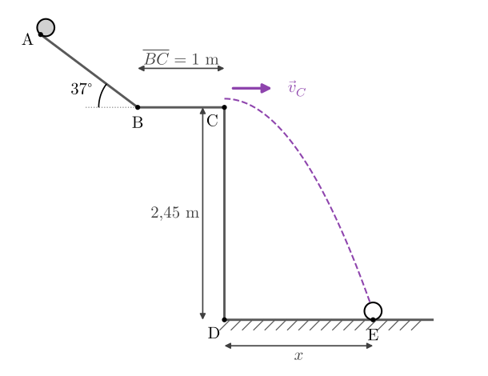

#### Velocidad al final del plano

El rozamiento estático no trabaja (rodadura sin deslizar) y se conserva la energía mecánica. El centro de masa baja $\overline{AB}\,\mathrm{sen}\,37^\circ = 0{,}7\ \text{m} \cdot 0{,}6 = 0{,}42$ m. Con $\omega = v/R$:

$$
m\,g\,(0{,}42\ \text{m}) = \tfrac{1}{2}\,m\,v^2 + \tfrac{1}{2}\left(\tfrac{2}{5}\,m\,R^2\right)\frac{v^2}{R^2} = \tfrac{7}{10}\,m\,v^2 \implies v^2 = \frac{10 \cdot 10 \cdot 0{,}42}{7}\ \tfrac{\text{m}^2}{\text{s}^2} = {\color{RoyalBlue} 6\ \tfrac{\text{m}^2}{\text{s}^2}}
$$

En el tramo horizontal BC sigue rodando con la misma velocidad: ninguna fuerza trabaja. Sale de C con $\vec v_C = (\sqrt{6};\ 0)$ m/s $\approx (2{,}45;\ 0)$ m/s.

#### Caída libre del centro de masa

Desde C, el centro de masa es un proyectil con $\vec a = (0;\,-g)$; la rotación no influye en su trayectoria. Con origen en C:

$$
\begin{aligned}
y(t) &= -\tfrac{1}{2}\,g\,t^2 = -2{,}45\ \text{m} &&\implies t = \sqrt{\frac{2 \cdot 2{,}45\ \text{m}}{10\ \text{m/s}^2}} = {\color{RoyalBlue} 0{,}7\ \text{s}} \\
x(t) &= v_C\,t = \sqrt{6}\ \tfrac{\text{m}}{\text{s}} \cdot 0{,}7\ \text{s} &&\implies {\color{ForestGreen}\boxed{x \approx 1{,}71\ \text{m}}}
\end{aligned}
$$

> [!TIP]
> **Respuesta:** $x \approx 1{,}71$ m. Coincide con la clave.

<!-- solo-pdf
```{=latex}
\par\penalty-100\begingroup\dimen0=\pagegoal\advance\dimen0 by -\pagetotal
\ifdim\dimen0<14\baselineskip\newpage\fi\endgroup
```
-->

### Ejercicio 14 — Esfera que baja por una pista y sale horizontal

*Origen:* Guía extra — R6. *Nivel* 2, *prioridad* media.

> Una esfera maciza de masa $m = 3$ kg y radio $R = 0{,}1$ m parte del reposo en A y desciende rodando sin deslizar. En el punto B abandona la pista horizontalmente y llega al suelo en C. Hallar: a) la aceleración del centro de masa de la esfera al pasar por B; b) el trabajo neto que recibe la esfera entre A y C.

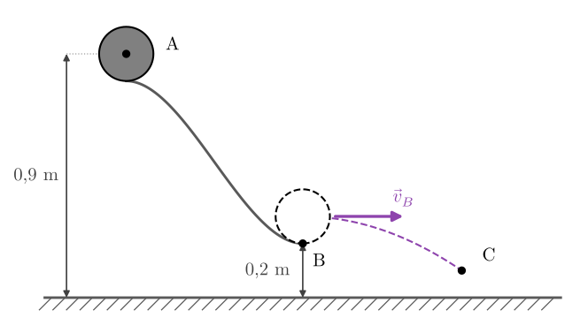

De la figura: el centro de masa está a 0,9 m del suelo en A; la pista, a 0,2 m en B, así que el centro de masa está a $0{,}2 + 0{,}1 = 0{,}3$ m. Rodadura, con $I = \tfrac{2}{5}\,m\,R^2$: $K = \tfrac{7}{10}\,m\,v^2$.

**Velocidad en B** (el roce estático no trabaja):

$$
m\,g\,(0{,}9 - 0{,}3)\ \text{m} = \tfrac{7}{10}\,m\,v_B^2 \implies v_B = \sqrt{\frac{10 \cdot 10 \cdot 0{,}6}{7}}\ \tfrac{\text{m}}{\text{s}} = {\color{RoyalBlue} 2{,}93\ \text{m/s}}
$$

**a)** En B la pista es horizontal: la componente tangencial de la aceleración es nula, porque la del peso a lo largo de la pista es $g\,\mathrm{sen}\,0^\circ = 0$. La componente normal, $a_{\text{rad}} = v_B^2/\rho$, depende del radio de curvatura $\rho$ de la pista en B, que la figura no da. Apenas deja la pista, el centro de masa cae libremente: ${\color{ForestGreen}\boxed{\vec a = (0;\ -g) = (0;\ -10)\ \text{m/s}^2}}$.

> [!NOTE]
> El enunciado no permite calcular la aceleración sobre la pista en B. Puede ser que pida la *velocidad* ($v_B \approx 2{,}93$ m/s, o $3{,}16$ m/s si se toma el desnivel de la pista, 0,7 m, en lugar del del centro de masa) o la aceleración justo al salir, que es $g$.

**b)** Por el teorema del trabajo y la energía, el trabajo neto es el cambio de energía cinética total (traslación + rotación). En vuelo la rotación no cambia; en C el centro de masa está a $R = 0{,}1$ m del suelo:

$$
W_{\text{neto}} = \Delta K = m\,g\,(0{,}9 - 0{,}1)\ \text{m} = 3\ \text{kg} \cdot 10\ \tfrac{\text{m}}{\text{s}^2} \cdot 0{,}8\ \text{m} \implies {\color{ForestGreen}\boxed{W_{\text{neto}} = 24\ \text{J}}}
$$

Es el trabajo del peso: la normal no trabaja y el roce estático tampoco.

<!-- solo-pdf
```{=latex}
\par\penalty-100\begingroup\dimen0=\pagegoal\advance\dimen0 by -\pagetotal
\ifdim\dimen0<14\baselineskip\newpage\fi\endgroup
```
-->

### Ejercicio 15 — Bloque, polea con masa y resorte

*Origen:* Parcial 2002 (resolución de H. Cassia) — problema 4, enunciado reconstruido. *Nivel* 2, *prioridad* baja.

#### Enunciado reconstruido

> Un bloque de masa $m$, apoyado en un plano inclinado $37^\circ$ sin rozamiento, está atado a una cuerda que pasa por una polea (disco homogéneo de masa $M$ y radio $R$, sin rozamiento en el eje) y cuyo otro extremo está sujeto a un resorte de constante $k$ fijo al piso. Se suelta el bloque desde el reposo en A, con el resorte sin estirar. Calcular la velocidad del bloque en B, después de bajar $\Delta x$ por el plano.

| Dato | Valor | Origen |
|---|---|---|
| Inclinación | $37^\circ$ ($\mathrm{sen} = 0{,}6$) | dado |
| Polea | disco: $I = \tfrac{1}{2}\,M\,R^2$ | dado |
| Masas y desplazamiento | $m = 2$ kg, $M = 2$ kg, $\Delta x = 0{,}5$ m | **supuestos** |
| Resorte | $k = 36$ N/m | deducido para que $v_B = 1$ m/s, como en la resolución |

> [!NOTE]
> La resolución no muestra dónde está el resorte; solo dice que su estiramiento es $\Delta x$. La disposición de la figura (cuerda por la polea hasta un resorte fijo al piso) es la más simple compatible con su ecuación de energía. Los cuatro valores de la tabla no se pueden recuperar por separado: cualquier combinación que cumpla la ecuación de 4.2 con $v_B = 1$ m/s reproduce el resultado.

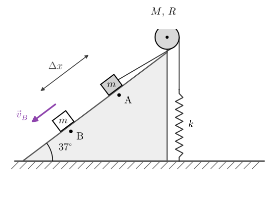

#### Conservación de la energía

No hay rozamiento y la normal no trabaja: se conserva la energía mecánica del sistema bloque + polea + resorte. Al bajar $\Delta x$ por el plano, el bloque desciende $h = \Delta x\,\mathrm{sen}\,37^\circ$, la cuerda inextensible estira el resorte $\Delta x$ y la polea gira con $\omega = v/R$ (la cuerda no desliza):

$$
\underbrace{K_A + K_{\text{rot},A} + U_A + U_{\text{el},A}}_{0\ +\ 0\ +\ m\,g\,h\ +\ 0} = \underbrace{K_B + K_{\text{rot},B} + U_B + U_{\text{el},B}}_{\tfrac{1}{2}m\,v_B^2\ +\ \tfrac{1}{2}I\,\omega_B^2\ +\ 0\ +\ \tfrac{1}{2}k\,\Delta x^2}
$$

Con $\tfrac{1}{2}\,I\,\omega_B^2 = \tfrac{1}{2}\left(\tfrac{1}{2}\,M\,R^2\right)\left(\tfrac{v_B}{R}\right)^2 = {\color{RoyalBlue}\tfrac{1}{4}\,M\,v_B^2}$ (el radio se simplifica):

$$
m\,g\,\Delta x\,\mathrm{sen}\,37^\circ = \tfrac{1}{2}\left(m + \tfrac{M}{2}\right)v_B^2 + \tfrac{1}{2}\,k\,\Delta x^2 \implies v_B = \sqrt{\frac{2\,m\,g\,\Delta x\,\mathrm{sen}\,37^\circ - k\,\Delta x^2}{m + M/2}}
$$

#### Valor numérico

$$
v_B = \sqrt{\frac{2 \cdot 2\ \text{kg} \cdot 10\ \tfrac{\text{m}}{\text{s}^2} \cdot 0{,}5\ \text{m} \cdot 0{,}6 - 36\ \tfrac{\text{N}}{\text{m}} \cdot (0{,}5\ \text{m})^2}{2\ \text{kg} + 1\ \text{kg}}} = \sqrt{\frac{12\ \text{J} - 9\ \text{J}}{3\ \text{kg}}} \implies {\color{ForestGreen}\boxed{v_B = 1\ \text{m/s}}}
$$

La resolución original explica por qué no conviene la vía de Newton: la fuerza del resorte, $F_x = -k\,x$, cambia con el estiramiento, y con ella la tensión y la aceleración; el balance de energía no necesita esa información.

> [!TIP]
> **Respuesta:** $v_B = 1$ m/s con los datos de la tabla (expresión general al final de 4.2).

<!-- solo-pdf
```{=latex}
\par\penalty-100\begingroup\dimen0=\pagegoal\advance\dimen0 by -\pagetotal
\ifdim\dimen0<14\baselineskip\newpage\fi\endgroup
```
-->

### Ejercicio 16 — Resorte, polea con masa y dos partículas

*Origen:* Parciales de Vella (Z1054) — 1º recuperatorio, 18/12/2020, R5. *Nivel* 3, *prioridad* alta.

> En el sistema de la figura, el resorte ideal ($k = 20$ N/m) se halla en un extremo fijo al piso y en el otro a una partícula $m_1$ de masa 8 kg. La polea de geometría cilíndrica ($I_{\text{cm}} = \tfrac12\,m\,r^2$) tiene una masa de 2 kg, y la otra partícula $m_2$, de 15 kg de masa, se encuentra posicionada a la misma altura con respecto al piso que la otra. Cuando el sistema se deja en libertad el resorte está estirado 1 m. Determine el módulo de la velocidad de la partícula $m_2$ cuando llegue al piso.

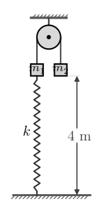

Sin rozamiento ni deslizamiento de la cuerda, se conserva la energía mecánica. Cuando $m_2$ baja $H = 4$ m, $m_1$ sube 4 m y el resorte pasa de 1 m a 5 m de estiramiento. Las dos partículas tienen la misma rapidez $v$, y la polea gira con $\omega = v/r$, así que $\tfrac12\,I\,\omega^2 = \tfrac12 \cdot \tfrac12\,m_p\,v^2$. Con alturas medidas desde el piso:

$$
\tfrac12\,k\,(1\ \text{m})^2 + m_1\,g\,H + m_2\,g\,H = \tfrac12\,k\,(5\ \text{m})^2 + m_1\,g\,(2H) + \tfrac12\,\big(m_1 + m_2 + \tfrac12\,m_p \cdot 2\big)\,v^2
$$

$$
10\ \text{J} + 320\ \text{J} + 600\ \text{J} = 250\ \text{J} + 640\ \text{J} + 12\ \text{kg} \cdot v^2 \implies {\color{ForestGreen}\boxed{v \approx 1{,}83\ \text{m/s}}}
$$

Coincide con Vella ($v \cong 1{,}82$ m/s, truncado).

<!-- solo-pdf
```{=latex}
\par\penalty-100\begingroup\dimen0=\pagegoal\advance\dimen0 by -\pagetotal
\ifdim\dimen0<14\baselineskip\newpage\fi\endgroup
```
-->

### Ejercicio 17 — Cilindro que rueda, polea y bloque colgante

*Origen:* Examen tipo (FRBA) — problema 3. *Nivel* 3, *prioridad* alta.

#### Enunciado

> Un cilindro uniforme de masa $m$ y radio $R$ tiene arrollada una cuerda que está unida a un bloque de masa $M = 3$ kg. La cuerda pasa por una polea de masa despreciable. El cilindro rueda sin deslizar por el plano inclinado ($37^\circ$). Hallar la velocidad del bloque cuando ha descendido una altura $h$, sabiendo que el sistema parte del reposo.
>
> Datos: $m = 2$ kg; $M = 3$ kg; $R = 0{,}5$ m; $h = 1$ m.

El examen escribe «$R = 0{,}5$ m $= 1$ m»: el segundo dato es la altura $h$.

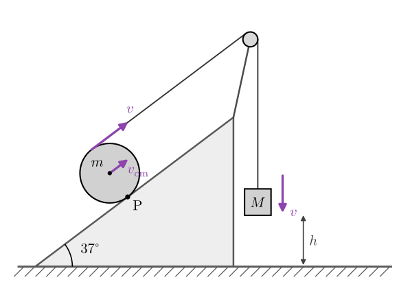

#### Relación de velocidades

La cuerda sale de la **parte superior** del cilindro, paralela al plano. El cilindro rueda sin deslizar: el punto de contacto P está instantáneamente en reposo y el cilindro gira alrededor de P. Un punto a distancia $d$ de P tiene velocidad $\omega\,d$:

$$
v_{\text{cm}} = \omega\,R \qquad\qquad v_{\text{arriba}} = \omega\,(2R) = 2\,v_{\text{cm}}
$$

La cuerda es inextensible: el punto de arriba se mueve como el bloque, $v = 2\,v_{\text{cm}}$. Por lo tanto, cuando el bloque baja $h$, el centro del cilindro sube $h/2$ **a lo largo del plano**, es decir, una altura $\tfrac{h}{2}\,\mathrm{sen}\,37^\circ$.

#### Conservación de la energía

El rozamiento estático actúa en P, que no se desplaza: no trabaja. La polea no tiene masa. Se conserva la energía mecánica del sistema cilindro + bloque:

$$
\underbrace{M\,g\,h}_{\text{baja el bloque}} - \underbrace{m\,g\,\tfrac{h}{2}\,\mathrm{sen}\,37^\circ}_{\text{sube el cilindro}} = \tfrac{1}{2}\,M\,v^2 + \tfrac{1}{2}\,m\,v_{\text{cm}}^2 + \tfrac{1}{2}\left(\tfrac{1}{2}\,m\,R^2\right)\omega^2
$$

Con $v_{\text{cm}} = v/2$ y $\omega = v_{\text{cm}}/R$, la energía cinética del cilindro es $\tfrac{3}{4}\,m\,v_{\text{cm}}^2 = {\color{RoyalBlue}\tfrac{3}{16}\,m\,v^2}$ (el radio se simplifica):

$$
3 \cdot 10 \cdot 1\ \text{J} - 2 \cdot 10 \cdot 0{,}5 \cdot 0{,}6\ \text{J} = \left(\tfrac{1}{2} \cdot 3 + \tfrac{3}{16} \cdot 2\right)\text{kg}\cdot v^2 \implies 24\ \text{J} = 1{,}875\ \text{kg}\cdot v^2
$$

$$
v = \sqrt{\frac{24\ \text{J}}{1{,}875\ \text{kg}}} = \sqrt{12{,}8\ \tfrac{\text{m}^2}{\text{s}^2}} \implies {\color{ForestGreen}\boxed{v \approx 3{,}58\ \text{m/s}}}
$$

**Comprobación por dinámica.** Bloque: $M\,g - T = M\,a$. Cilindro, con ejes del plano: $T + f - m\,g\,\mathrm{sen}\,37^\circ = m\,a_{\text{cm}}$; torque respecto del centro: $T\,R - f\,R = \tfrac{1}{2}\,m\,R^2\,\gamma$, con $\gamma = a_{\text{cm}}/R$. Sumando las dos ecuaciones del cilindro, $2\,T - m\,g\,\mathrm{sen}\,37^\circ = \tfrac{3}{2}\,m\,a_{\text{cm}}$, y con $a = 2\,a_{\text{cm}}$:

$$
a_{\text{cm}} = \frac{M\,g - \tfrac{1}{2}\,m\,g\,\mathrm{sen}\,37^\circ}{2\,M + \tfrac{3}{4}\,m} = \frac{30 - 6}{6 + 1{,}5}\ \tfrac{\text{m}}{\text{s}^2} = 3{,}2\ \tfrac{\text{m}}{\text{s}^2} \implies a = 6{,}4\ \tfrac{\text{m}}{\text{s}^2} \implies v^2 = 2\,a\,h = 12{,}8\ \tfrac{\text{m}^2}{\text{s}^2}
$$

Las dos vías coinciden.

> [!CAUTION]
> **La clave no se reproduce:** el examen da $v = 2$ m/s. Con los datos no se obtiene ese valor:
>
> | Lectura de la figura | $v$ |
> |---|---|
> | cuerda desde la parte superior del cilindro (la figura) | $3{,}58$ m/s |
> | cuerda desde el eje del cilindro | $2{,}45$ m/s |
> | cuerda desde la parte superior, con $h$ tal que $v = 2$ m/s | exige $h = 0{,}3125$ m |
>
> Lo más probable es un error de la clave o de los datos publicados. Conviene consultarlo con la cátedra.

> [!TIP]
> **Respuesta:** $v \approx 3{,}58$ m/s (la clave dice 2 m/s; ver arriba).

<!-- solo-pdf
```{=latex}
\par\penalty-100\begingroup\dimen0=\pagegoal\advance\dimen0 by -\pagetotal
\ifdim\dimen0<14\baselineskip\newpage\fi\endgroup
```
-->

### Ejercicio 18 — Barra unida al pivote por una cuerda

*Origen:* Parciales de Vella (Z1054) — recuperatorio, 23/2/2021, Q4. *Nivel* 3, *prioridad* alta.

> Una barra de longitud 2 m y 1 kg de masa descansa en posición horizontal, pudiendo girar libremente alrededor de O; la cuerda que articula la barra con el soporte tiene masa despreciable y 1 m de longitud. Al poner el sistema en libertad, se pide determinar la velocidad del centro de masa cuando pasa por la posición vertical y la tensión de la cuerda en esta misma posición. $I_{\text{cm}} = \tfrac{1}{12}\,m\,\ell^2$.

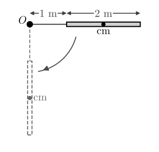

> [!NOTE]
> **Supuesto:** cuerda y barra giran alineadas, como un único cuerpo rígido alrededor de O. Es lo que sugiere el dato de $I_{\text{cm}}$, que se traslada a O con Steiner. Con una cuerda real, la barra se doblaría respecto de ella durante la caída (péndulo doble).

El centro de masa está a $d = 1\ \text{m} + 1\ \text{m} = 2$ m de O:

$$
I_O = \tfrac{1}{12}\,m\,\ell^2 + m\,d^2 = \tfrac13\ \text{kg·m}^2 + 4\ \text{kg·m}^2 = {\color{RoyalBlue} 4{,}33\ \text{kg·m}^2}
$$

Al llegar a la vertical, el centro de masa bajó $d$. Por energía:

$$
m\,g\,d = \tfrac12\,I_O\,\omega^2 \implies \omega = \sqrt{\frac{2 \cdot 20\ \text{J}}{4{,}33\ \text{kg·m}^2}} = 3{,}04\ \text{rad/s} \implies {\color{ForestGreen}\boxed{v_{\text{cm}} = \omega\,d \approx 6{,}08\ \text{m/s}}}
$$

En la vertical el peso no hace torque respecto de O, así que $\gamma_z = 0$ y el centro de masa solo tiene aceleración centrípeta, $\omega^2 d$, hacia O (arriba):

$$
T - m\,g = m\,\omega^2\,d \implies T = 10\ \text{N} + 1\ \text{kg} \cdot 9{,}23\ \text{s}^{-2} \cdot 2\ \text{m} \implies {\color{ForestGreen}\boxed{T \approx 28{,}5\ \text{N}}}
$$

<!-- salto-pagina -->

## 3. Dinámica de rotación: torque y rodadura (Sears cap. 10)

Segunda ley para la rotación, $\tau_z = I\,\gamma_z$, junto con la de traslación. En la rodadura hay que decidir el sentido del rozamiento estático: se supone uno y el signo lo confirma.

| Ej. | Origen | Nivel | Prioridad | Qué tiene |
|----|----------|-----|---------|-------------------------------------|
| 19 | Vella B5 | 1 | alta | eje fijo y aceleración angular constante |
| 20 | Vella Q5 | 2 | alta | esfera y aro: $a = g\,\mathrm{sen}\,\alpha / (1 + c)$ |
| 21 | Vella A5 | 2 | alta | literal: rozamiento necesario contra $\mu_s N$ |
| 22 | Guía R3 | 2 | media | eje fijo con dos masas colgantes |
| 23 | 2002 P3 | 2 | baja | polea con inercia; rozamiento deducido |
| 24 | Guía R2 | 2 | media | ¿rueda o desliza? Rozamiento necesario contra el disponible |
| 25 | Vella P5 | 2 | alta | cuerda en la periferia, plano inclinado |
| 26 | Vella R4 | 2 | alta | agrega la energía cinética y su control por trabajo |
| 27 | Guía R5 | 3 | media | fuerza horizontal sobre un plano inclinado |
| 28 | Vella A4 | 3 | alta | cuerda en un tambor: el rozamiento cambia de sentido según $r$ |
| 29 | Guía R7 | 3 | media | disco y bloque: $a_{\text{bloque}} = 2\,a_{\text{cm}}$ |
| 30 | Guía R4 | 3 | media | yo-yo con dos fuerzas en radios distintos |

<!-- solo-pdf
```{=latex}
\par\penalty-100\begingroup\dimen0=\pagegoal\advance\dimen0 by -\pagetotal
\ifdim\dimen0<14\baselineskip\newpage\fi\endgroup
```
-->

### Ejercicio 19 — Volante frenado

*Origen:* Parciales de Vella (Z1054) — tema B, sin fecha, B5. *Nivel* 1, *prioridad* alta.

> El volante de la figura, de geometría cilíndrica ($I_{\text{cm}} = \tfrac12\,M\,R^2$), de masa 4 kg y radio 20 cm, se encuentra girando con velocidad angular de intensidad $\omega_0 = 20$ rad/s. Se le aplica un momento de frenado de intensidad $M = 2$ N·m. Determine el número de vueltas girado desde que se aplicó el freno hasta detenerse, y cuánto demoró en hacerlo.

$I = \tfrac12 \cdot 4\ \text{kg} \cdot (0{,}2\ \text{m})^2 = 0{,}08\ \text{kg·m}^2$, y el freno da una desaceleración $|\gamma_z| = 2\ \text{N·m} / 0{,}08\ \text{kg·m}^2 = {\color{RoyalBlue} 25\ \text{rad/s}^2}$.

$$
t = \frac{\omega_0}{|\gamma_z|} = \frac{20}{25}\ \text{s} \implies {\color{ForestGreen}\boxed{t = 0{,}8\ \text{s}}} \qquad \Delta\theta = \frac{\omega_0^2}{2\,|\gamma_z|} = 8\ \text{rad} \implies {\color{ForestGreen}\boxed{\approx 1{,}27\ \text{vueltas}}}
$$

<!-- solo-pdf
```{=latex}
\par\penalty-100\begingroup\dimen0=\pagegoal\advance\dimen0 by -\pagetotal
\ifdim\dimen0<14\baselineskip\newpage\fi\endgroup
```
-->

### Ejercicio 20 — Esfera y aro rodando por el mismo plano

*Origen:* Parciales de Vella (Z1054) — recuperatorio, 23/2/2021, Q5. *Nivel* 2, *prioridad* alta.

> Se dejan caer rodando sin resbalar, desde la parte superior de un plano inclinado ($\alpha = 30°$) de longitud 5 m, una esfera maciza y homogénea ($I_{\text{cm}} = \tfrac25\,m\,r^2$) y un aro ($I_{\text{cm}} = m\,r^2$). Se pide determinar: a) la aceleración del centro de masa de cada uno de ellos; b) el tiempo que emplea cada uno en llegar a la base del plano.

Con $I_{\text{cm}} = c\,m\,r^2$, las ecuaciones de traslación y rotación dan $a = \dfrac{g\,\mathrm{sen}\,\alpha}{1 + c}$, independiente de $m$ y $r$. Partiendo del reposo, $t = \sqrt{2L/a}$:

| | $c$ | a) $a_{\text{cm}}$ | b) $t$ |
|---|---|---|---|
| esfera | 2/5 | ${\color{ForestGreen} 3{,}57\ \text{m/s}^2}$ | ${\color{ForestGreen} 1{,}67\ \text{s}}$ |
| aro | 1 | ${\color{ForestGreen} 2{,}5\ \text{m/s}^2}$ | ${\color{ForestGreen} 2{,}00\ \text{s}}$ |

El aro tiene la masa lejos del eje, así que una parte mayor de su energía se va en girar y llega después.

<!-- solo-pdf
```{=latex}
\par\penalty-100\begingroup\dimen0=\pagegoal\advance\dimen0 by -\pagetotal
\ifdim\dimen0<14\baselineskip\newpage\fi\endgroup
```
-->

### Ejercicio 21 — Ángulo máximo para que la esfera ruede sin resbalar

*Origen:* Parciales de Vella (Z1054) — tema A, sin fecha, A5. *Nivel* 2, *prioridad* alta.

> Se deja caer una esfera maciza y homogénea ($I_{\text{cm}} = \tfrac25\,m\,r^2$), rodando sobre un plano inclinado. Sabiendo que el coeficiente de rozamiento estático entre la esfera y el plano es $\mu_e$, determine una expresión que permita calcular el ángulo máximo que puede tener el plano para que la esfera no resbale sobre el mismo.

Rodando sin resbalar, como en el ejercicio 20: $a = \tfrac57\,g\,\mathrm{sen}\,\theta$. La traslación, $m\,g\,\mathrm{sen}\,\theta - f = m\,a$, da el rozamiento necesario:

$$
f = \tfrac27\,m\,g\,\mathrm{sen}\,\theta
$$

No resbala mientras $f \le \mu_s\,N = \mu_s\,m\,g\cos\theta$:

$$
\tfrac27\,\mathrm{sen}\,\theta \le \mu_s \cos\theta \implies {\color{ForestGreen}\boxed{\theta_{\max} = \arctan\!\left(\tfrac72\,\mu_s\right)}}
$$

<!-- solo-pdf
```{=latex}
\par\penalty-100\begingroup\dimen0=\pagegoal\advance\dimen0 by -\pagetotal
\ifdim\dimen0<14\baselineskip\newpage\fi\endgroup
```
-->

### Ejercicio 22 — Dos ruedas solidarias con dos masas colgantes

*Origen:* Guía extra — R3. *Nivel* 2, *prioridad* media.

> Dos cuerpos cuelgan de cuerdas enrolladas a dos ruedas unidas entre sí, que pueden girar respecto de un mismo eje. El momento de inercia total de las dos ruedas es 40 kg·m². El cuerpo $m_1 = 24$ kg cuelga de la rueda de radio $r_1 = 1{,}2$ m y $m_2$ cuelga de la rueda pequeña, de radio $r_2 = 0{,}4$ m. a) Calcular $m_2$ para que la aceleración angular de las ruedas sea nula. b) Si se coloca con suavidad una masa extra de 12 kg sobre $m_1$, calcular la aceleración angular de las ruedas.

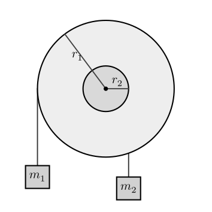

Las cuerdas cuelgan en lados opuestos: $m_1$ en $(-r_1;\,0)$ y $m_2$ en $(r_2;\,0)$, con fuerzas verticales. Torques: $\tau_{1,z} = (-r_1)(-T_1) = r_1\,T_1$ (antihorario) y $\tau_{2,z} = r_2\,(-T_2) = -r_2\,T_2$ (horario).

**a)** Sin aceleración, cada tensión iguala al peso y el torque neto es nulo:

$$
r_1\,m_1\,g = r_2\,m_2\,g \implies m_2 = \frac{r_1}{r_2}\,m_1 = \frac{1{,}2}{0{,}4} \cdot 24\ \text{kg} \implies {\color{ForestGreen}\boxed{m_2 = 72\ \text{kg}}}
$$

**b)** Con $m_1' = 36$ kg, $m_1'$ baja con $a_1 = \gamma\,r_1$ y $m_2$ sube con $a_2 = \gamma\,r_2$:

$$
m_1'\,g - T_1 = m_1'\,\gamma\,r_1 \qquad T_2 - m_2\,g = m_2\,\gamma\,r_2 \qquad r_1\,T_1 - r_2\,T_2 = I\,\gamma
$$

Despejando $T_1$ y $T_2$ y reemplazando en la ecuación de rotación:

$$
\gamma = \frac{(m_1'\,r_1 - m_2\,r_2)\,g}{I + m_1'\,r_1^2 + m_2\,r_2^2} = \frac{(43{,}2 - 28{,}8)\ \text{kg·m} \cdot 10\ \tfrac{\text{m}}{\text{s}^2}}{(40 + 51{,}84 + 11{,}52)\ \text{kg·m}^2} \implies {\color{ForestGreen}\boxed{\gamma \approx 1{,}39\ \text{rad/s}^2}}
$$

en sentido antihorario: baja $m_1$.

<!-- solo-pdf
```{=latex}
\par\penalty-100\begingroup\dimen0=\pagegoal\advance\dimen0 by -\pagetotal
\ifdim\dimen0<14\baselineskip\newpage\fi\endgroup
```
-->

### Ejercicio 23 — Polea con inercia que frena a un bloque en un plano inclinado

*Origen:* Parcial 2002 (resolución de H. Cassia) — problema 3, enunciado reconstruido. *Nivel* 2, *prioridad* baja.

#### Enunciado reconstruido

> Una polea, que es un disco homogéneo de masa $m_p = 2\,m$ y radio $R$, puede girar alrededor de un eje fijo O. Tiene enrollada una cuerda inextensible y de masa despreciable, paralela a un plano inclinado $53^\circ$, cuyo otro extremo está atado a un bloque de masa $m$ apoyado en el plano. El coeficiente de rozamiento cinético entre el bloque y el plano es $\mu_k = 0{,}25$. En el instante inicial la polea gira en sentido horario con velocidad angular $\omega_0$ tal que $\omega_0\,R = 5$ m/s, y el bloque sube por el plano.
>
> a) Calcular la aceleración del bloque.
> b) Calcular el tiempo que tarda en detenerse.
> c) Calcular la longitud de cuerda que se enrolla en la polea hasta ese momento.

| Dato | Valor | Origen |
|---|---|---|
| Inclinación | $53^\circ$ ($\mathrm{sen} = 0{,}8$; $\cos = 0{,}6$) | dado |
| Masa de la polea | $m_p = 2\,m$, disco: $I = \tfrac{1}{2}\,m_p\,R^2 = m\,R^2$ | dado |
| Velocidad inicial | $v_0 = \omega_0\,R = 5$ m/s | dado |
| Rozamiento | $\mu_k = 0{,}25$ | deducido de $a = 4{,}75$ m/s² |

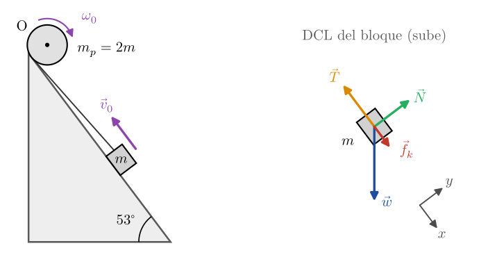

#### DCL del bloque y segunda ley de Newton

Ejes del plano: $x$ hacia abajo del plano, $y$ perpendicular y saliente. El bloque sube (velocidad en $-x$), así que el rozamiento cinético apunta en $+x$. La cuerda tira hacia la polea, en $-x$:

$$
\vec w = (m\,g\,\mathrm{sen}\,53^\circ;\ -m\,g\cos 53^\circ) \qquad \vec N = (0;\ N) \qquad \vec T = (-T;\ 0) \qquad \vec f_k = (\mu_k\,N;\ 0)
$$

$$
\begin{aligned}
y:&\quad N - m\,g\cos 53^\circ = 0 \implies N = m\,g\cos 53^\circ \\
x:&\quad m\,g\,\mathrm{sen}\,53^\circ + \mu_k\,m\,g\cos 53^\circ - T = m\,a_x
\end{aligned}
$$

#### Polea: torque y aceleración angular

Sobre la polea actúan su peso y la reacción del eje, que pasan por O y no producen torque (*torque*), y la tensión. La cuerda sale tangente a la polea, del lado del plano: el punto de aplicación respecto de O es $\vec r = (0;\ -R)$, y la cuerda tira de la polea hacia el bloque con $\vec T' = (T;\ 0)$. El torque es el producto vectorial:

$$
\tau_z = (\vec r \times \vec T')_z = r_x\,T'_y - r_y\,T'_x = 0 \cdot 0 - (-R)\,T = {\color{RoyalBlue} R\,T}
$$

Como la cuerda no desliza, la velocidad del punto tangente es la del bloque: $v_x = \omega_z\,R$, y por lo tanto $a_x = \gamma_z\,R$. Con $I = m\,R^2$:

$$
\tau_z = I\,\gamma_z \implies R\,T = m\,R^2\,\frac{a_x}{R} \implies {\color{RoyalBlue} T = m\,a_x}
$$

#### a) Aceleración

Reemplazando $T$ en la ecuación en $x$:

$$
m\,g\,(\mathrm{sen}\,53^\circ + \mu_k\cos 53^\circ) = 2\,m\,a_x \implies a_x = \frac{10\ \tfrac{\text{m}}{\text{s}^2}\,(0{,}8 + 0{,}25 \cdot 0{,}6)}{2} \implies {\color{ForestGreen}\boxed{a_x = 4{,}75\ \text{m/s}^2}}
$$

Es positiva mientras la velocidad es negativa: el bloque **frena**. La masa $m$ se simplifica.

> [!NOTE]
> La cuerda se mantiene tensa: si estuviera floja, el bloque solo frenaría a $g\,(\mathrm{sen}\,53^\circ + \mu_k\cos 53^\circ) = 9{,}5$ m/s², más que con la cuerda. Es la polea, con su inercia, la que tira del bloque hacia arriba y lo frena más despacio.

#### b) y c) Tiempo y longitud de cuerda

Con aceleración constante y $v_{0x} = -5$ m/s:

$$
v_x = v_{0x} + a_x\,t \implies 0 = -5\ \tfrac{\text{m}}{\text{s}} + 4{,}75\ \tfrac{\text{m}}{\text{s}^2}\,t \implies {\color{ForestGreen}\boxed{t \approx 1{,}05\ \text{s}}}
$$

$$
v_x^2 = v_{0x}^2 + 2\,a_x\,\Delta x \implies \Delta x = -\frac{v_{0x}^2}{2\,a_x} = -\frac{25\ \text{m}^2/\text{s}^2}{9{,}5\ \text{m/s}^2} \implies {\color{ForestGreen}\boxed{|\Delta x| \approx 2{,}63\ \text{m}}}
$$

El bloque sube $2{,}63$ m por el plano, que es la longitud de cuerda que se enrolla en la polea.

> [!TIP]
> **Respuesta:** a) $a = 4{,}75$ m/s², opuesta a la velocidad; b) $t \approx 1{,}05$ s; c) $2{,}63$ m de cuerda.

<!-- solo-pdf
```{=latex}
\par\penalty-100\begingroup\dimen0=\pagegoal\advance\dimen0 by -\pagetotal
\ifdim\dimen0<14\baselineskip\newpage\fi\endgroup
```
-->

### Ejercicio 24 — Disco tirado del centro

*Origen:* Guía extra — R2. *Nivel* 2, *prioridad* media.

> Un disco de masa $M = 0{,}5$ kg y radio $R = 0{,}2$ m se apoya sobre un plano horizontal con rozamiento ($\mu_s = 0{,}4$; $\mu_k = 0{,}1$). Se tira del centro del disco con una fuerza $F$ horizontal y constante. a) Si $F = 3$ N, determine si el cuerpo desliza o no. Justifique. b) Si $F = 8$ N, determine la velocidad del centro de masa a los 3 s.

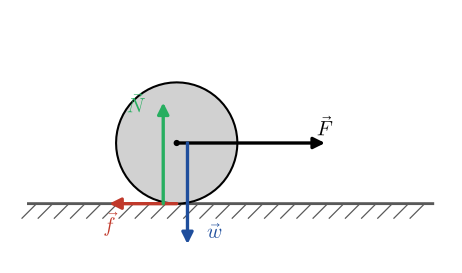

Se supone rodadura y se calcula el rozamiento necesario. Con $\vec f = (-f;\ 0)$ aplicado en $(0;\,-R)$, su torque respecto del centro es $\tau_z = x\,f_y - y\,f_x = -R\,f$. $F$, $\vec w$ y $\vec N$ pasan por el centro.

$$
\begin{aligned}
x:&\quad F - f = M\,a \\
\text{rotación:}&\quad -R\,f = I\,\gamma_z = \tfrac{1}{2}\,M\,R^2\,\gamma_z,\quad \text{rodadura: } \gamma_z = -\frac{a}{R} \implies f = \tfrac{1}{2}\,M\,a
\end{aligned}
$$

Sumando: $F = \tfrac{3}{2}\,M\,a$, entonces $a = \tfrac{2F}{3M}$ y ${\color{RoyalBlue} f = F/3}$. El máximo que puede dar el rozamiento estático es $\mu_s\,N = 0{,}4 \cdot 5\ \text{N} = {\color{RoyalBlue} 2\ \text{N}}$.

**a)** $F = 3$ N: $f = 1\ \text{N} \le 2$ N. ${\color{ForestGreen}\boxed{\text{No desliza}}}$: rueda con $a = 4$ m/s².

**b)** $F = 8$ N: haría falta $f = 2{,}67\ \text{N} > 2$ N, así que **desliza** y actúa el rozamiento cinético, $f = \mu_k\,N = 0{,}5$ N:

$$
a = \frac{F - \mu_k\,N}{M} = \frac{8\ \text{N} - 0{,}5\ \text{N}}{0{,}5\ \text{kg}} = 15\ \tfrac{\text{m}}{\text{s}^2} \implies v_{\text{cm}}(3\ \text{s}) = 15\ \tfrac{\text{m}}{\text{s}^2} \cdot 3\ \text{s} \implies {\color{ForestGreen}\boxed{v_{\text{cm}} = 45\ \text{m/s}}}
$$

Mientras tanto gira con $|\gamma_z| = \tfrac{\mu_k\,N\,R}{I} = 10$ rad/s²: a los 3 s, $\omega\,R = 6$ m/s, muy lejos de 45 m/s, lo que confirma que desliza.

<!-- solo-pdf
```{=latex}
\par\penalty-100\begingroup\dimen0=\pagegoal\advance\dimen0 by -\pagetotal
\ifdim\dimen0<14\baselineskip\newpage\fi\endgroup
```
-->

### Ejercicio 25 — Cilindro tirado por una cuerda que sube por el plano

*Origen:* Parciales de Vella (Z1054) — 2º parcial, 1/12/2020, P5. *Nivel* 2, *prioridad* alta.

> Un cilindro macizo y homogéneo ($I_{\text{cm}} = \tfrac12\,m\,r^2$) de masa 1 kg asciende rodando sin resbalar por un plano inclinado, según muestra el gráfico, mientras se le aplica una fuerza de intensidad 10 N mediante una cuerda enrollada en su periferia, de masa y espesor despreciables. Determine la intensidad de la fuerza de rozamiento y la aceleración del centro de masa.

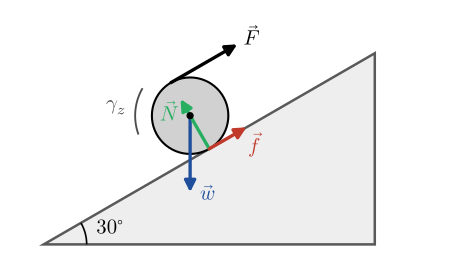

Ejes: $x$ paralelo al plano hacia arriba, $y$ normal. La cuerda tira en $(0;\,r)$ con $\vec F = (F;\,0)$ y el rozamiento actúa en $(0;\,-r)$ con $\vec f = (f;\,0)$; se supone $f$ hacia arriba y el signo lo confirma. Rodar hacia arriba es girar en sentido horario: $\gamma_z = -a/r$.

**Rotación** respecto del centro de masa: $\tau_z = 0 \cdot 0 - r\,F + r\,f$:

$$
\tfrac12\,m\,r^2\,\gamma_z = -r\,F + r\,f \implies \tfrac12\,m\,a = F - f
$$

**Traslación** según $x$:

$$
F + f - m\,g\,\mathrm{sen}\,30° = m\,a
$$

Sumando: $2F - m\,g\,\mathrm{sen}\,30° = \tfrac32\,m\,a \implies a = \dfrac{20\ \text{N} - 5\ \text{N}}{1{,}5\ \text{kg}}$, y $f = F - \tfrac12\,m\,a$:

$$
{\color{ForestGreen}\boxed{a_{\text{cm}} = 10\ \text{m/s}^2}} \qquad {\color{ForestGreen}\boxed{f = 5\ \text{N}\ \text{hacia arriba del plano}}}
$$

Coincide con Vella.

<!-- solo-pdf
```{=latex}
\par\penalty-100\begingroup\dimen0=\pagegoal\advance\dimen0 by -\pagetotal
\ifdim\dimen0<14\baselineskip\newpage\fi\endgroup
```
-->

### Ejercicio 26 — Cilindro tirado desde arriba: energía cinética a los 5 s

*Origen:* Parciales de Vella (Z1054) — 1º recuperatorio, 18/12/2020, R4. *Nivel* 2, *prioridad* alta.

> Se arrolla una cuerda inextensible de masa y espesor despreciables alrededor de un cilindro macizo y homogéneo ($I_{\text{cm}} = \tfrac12\,M\,R^2$), de 0,5 m de radio y 4 kg de masa, que se encuentra en reposo. En su extremo se ejerce una fuerza de intensidad $F = 30$ N, como se indica en la figura. El cilindro rueda sin resbalar sobre una superficie horizontal con fricción. Determine la energía cinética del mismo al cabo de 5 segundos.

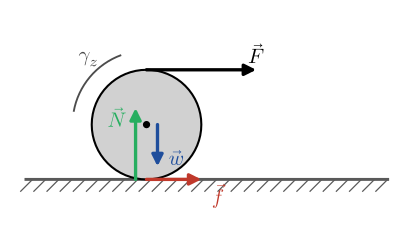

La cuerda tira en $(0;\,R)$ con $\vec F = (F;\,0)$ y el rozamiento actúa en $(0;\,-R)$ con $\vec f = (f;\,0)$. Avanza a la derecha girando en sentido horario: $\gamma_z = -a/R$.

$$
\tfrac12\,M\,R^2\,\gamma_z = -R\,F + R\,f \implies \tfrac12\,M\,a = F - f \qquad\qquad F + f = M\,a
$$

Sumando, $2F = \tfrac32\,M\,a$:

$$
a = \frac{4\,F}{3\,M} = {\color{RoyalBlue} 10\ \text{m/s}^2}, \qquad f = M\,a - F = {\color{RoyalBlue} 10\ \text{N}}\ \text{hacia adelante}, \qquad \gamma_z = -20\ \text{s}^{-2}
$$

A los 5 s, partiendo del reposo: $v_{\text{cm}} = 50$ m/s y $\omega = 100$ rad/s.

$$
K = \tfrac12\,M\,v_{\text{cm}}^2 + \tfrac12\,I_{\text{cm}}\,\omega^2 = 5000\ \text{J} + \tfrac12 \cdot 0{,}5\ \text{kg·m}^2 \cdot (100\ \text{s}^{-1})^2 \implies {\color{ForestGreen}\boxed{K = 7500\ \text{J}}}
$$

Control por trabajo: el rozamiento de rodadura no trabaja, y el punto de arriba avanza el doble que el centro, $2 \cdot \tfrac12\,a\,t^2 = 250$ m. Entonces $W_F = 30\ \text{N} \cdot 250\ \text{m} = 7500$ J. Coincide con Vella.

<!-- solo-pdf
```{=latex}
\par\penalty-100\begingroup\dimen0=\pagegoal\advance\dimen0 by -\pagetotal
\ifdim\dimen0<14\baselineskip\newpage\fi\endgroup
```
-->

### Ejercicio 27 — Disco en un plano inclinado con fuerza horizontal

*Origen:* Guía extra — R5. *Nivel* 3, *prioridad* media.

> Un disco homogéneo de 10 kg y 20 cm de radio está apoyado sobre un plano inclinado de 30° y tiene aplicada en su centro una fuerza horizontal de 100 N. El coeficiente de roce estático es 0,35 y el cinético, 0,2. Determinar: a) si el cuerpo rueda sin deslizar; b) la aceleración del centro de masa.

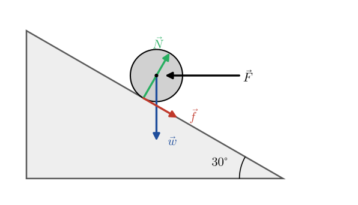

La fuerza empuja hacia el plano. Ejes del plano: $x$ hacia arriba del plano, $y$ perpendicular y saliente. Componentes:

$$
\begin{aligned}
\vec F &= (F\cos 30^\circ;\ -F\,\mathrm{sen}\,30^\circ) = (86{,}6;\ -50)\ \text{N} \\
\vec w &= (-m\,g\,\mathrm{sen}\,30^\circ;\ -m\,g\cos 30^\circ) = (-50;\ -86{,}6)\ \text{N}
\end{aligned}
$$

$$
y:\quad N = 86{,}6\ \text{N} + 50\ \text{N} = {\color{RoyalBlue} 136{,}6\ \text{N}} \qquad\qquad \text{fuerza neta en } x \text{ sin roce: } P = 86{,}6 - 50 = {\color{RoyalBlue} 36{,}6\ \text{N}}
$$

Como en el ejercicio 24, para un disco con la fuerza en el centro, la rodadura exige $|f| = P/3$ y $a = \tfrac{2P}{3m}$:

$$
|f| = \frac{36{,}6\ \text{N}}{3} = 12{,}2\ \text{N} \le \mu_s\,N = 0{,}35 \cdot 136{,}6\ \text{N} = 47{,}8\ \text{N}
$$

**a)** ${\color{ForestGreen}\boxed{\text{Rueda sin deslizar}}}$ (el roce, de 12,2 N, apunta hacia abajo del plano).

**b)**

$$
a = \frac{2 \cdot 36{,}6\ \text{N}}{3 \cdot 10\ \text{kg}} \implies {\color{ForestGreen}\boxed{a \approx 2{,}44\ \text{m/s}^2}}\ \text{hacia arriba del plano}
$$

<!-- solo-pdf
```{=latex}
\par\penalty-100\begingroup\dimen0=\pagegoal\advance\dimen0 by -\pagetotal
\ifdim\dimen0<14\baselineskip\newpage\fi\endgroup
```
-->

### Ejercicio 28 — Cilindro con tambor tirado desde arriba del tambor

*Origen:* Parciales de Vella (Z1054) — tema A, sin fecha, A4. *Nivel* 3, *prioridad* alta.

> Un cilindro homogéneo ($I_{\text{cm}} = \tfrac12\,M\,R^2$) de masa $M$ y radio $R = 60$ cm está acelerado por una fuerza $F$ de intensidad 30 N, la cual se aplica mediante una cuerda enrollada alrededor de un tambor de masa despreciable y radio $r = 40$ cm, unido al cilindro, como muestra la figura. El coeficiente de rozamiento estático es suficiente para que el cilindro ruede sin resbalar. Determine la fuerza de rozamiento en módulo, dirección y sentido.

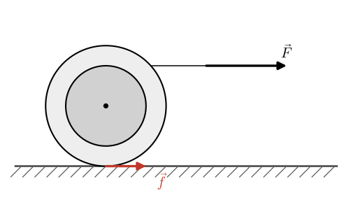

La cuerda sale de la parte superior del tambor: $\vec F = (F;\,0)$ en $(0;\,r)$; rozamiento $\vec f = (f;\,0)$ en $(0;\,-R)$, supuesto hacia adelante. Rueda hacia adelante: $\gamma_z = -a/R$.

$$
\tfrac12\,M\,R^2\,\gamma_z = -r\,F + R\,f \implies \tfrac12\,M\,R\,a = r\,F - R\,f \qquad\qquad F + f = M\,a
$$

Reemplazando $M\,a$ de la segunda en la primera:

$$
\tfrac12\,R\,(F + f) = r\,F - R\,f \implies f = \frac{F\,(r - R/2)}{\tfrac32\,R} = \frac{30\ \text{N} \cdot 0{,}1\ \text{m}}{0{,}9\ \text{m}}
$$

$$
{\color{ForestGreen}\boxed{f \approx 3{,}33\ \text{N},\ \text{horizontal, en el mismo sentido que } F}}
$$

No depende de $M$. Con $r > R/2$ el rozamiento acompaña a $F$; con $r < R/2$ se opondría, y con $r = R/2$ sería nulo.

<!-- solo-pdf
```{=latex}
\par\penalty-100\begingroup\dimen0=\pagegoal\advance\dimen0 by -\pagetotal
\ifdim\dimen0<14\baselineskip\newpage\fi\endgroup
```
-->

### Ejercicio 29 — Disco que rueda sobre la mesa y bloque colgante

*Origen:* Guía extra — R7. *Nivel* 3, *prioridad* media.

> El disco de masa $m_1 = 4$ kg y radio $R = 0{,}6$ m tiene enrollada una cuerda inextensible de masa despreciable que lo vincula con la masa $m_2 = 1$ kg. La polea fija tiene masa despreciable. Hallar la velocidad del bloque a los 5 s, sabiendo que el disco parte del reposo y rueda sin deslizar.

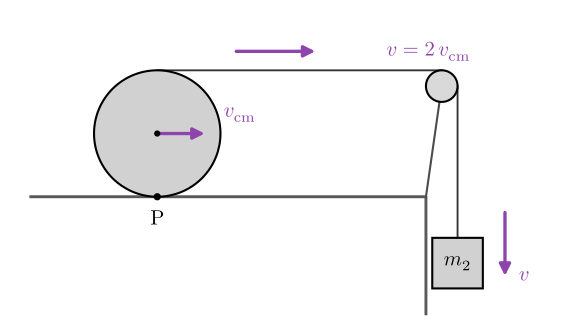

La cuerda sale de la parte superior del disco: el disco gira alrededor del punto de contacto P y el punto de arriba va al doble de velocidad que el centro, así que $a_2 = 2\,a_{\text{cm}}$.

$$
\begin{aligned}
\text{bloque:}&\quad m_2\,g - T = m_2\,(2\,a_{\text{cm}}) \\
\text{disco, traslación:}&\quad T + f = m_1\,a_{\text{cm}} \\
\text{disco, rotación (respecto del centro):}&\quad T\,R - f\,R = \tfrac{1}{2}\,m_1\,R^2\,\frac{a_{\text{cm}}}{R} \implies T - f = \tfrac{1}{2}\,m_1\,a_{\text{cm}}
\end{aligned}
$$

Sumando las del disco: $T = \tfrac{3}{4}\,m_1\,a_{\text{cm}} = 3\,a_{\text{cm}}$ (SI). En la del bloque: $10 - 3\,a_{\text{cm}} = 2\,a_{\text{cm}}$, entonces $a_{\text{cm}} = 2$ m/s² y $a_2 = {\color{RoyalBlue} 4\ \text{m/s}^2}$.

$$
v_2(5\ \text{s}) = a_2\,t = 4\ \tfrac{\text{m}}{\text{s}^2} \cdot 5\ \text{s} \implies {\color{ForestGreen}\boxed{v_2 = 20\ \text{m/s}}}
$$

El radio no interviene. El roce resulta $f = T - \tfrac{1}{2}\,m_1\,a_{\text{cm}} = 6 - 4 = 2$ N, hacia adelante.

<!-- solo-pdf
```{=latex}
\par\penalty-100\begingroup\dimen0=\pagegoal\advance\dimen0 by -\pagetotal
\ifdim\dimen0<14\baselineskip\newpage\fi\endgroup
```
-->

### Ejercicio 30 — Yo-yo con dos fuerzas

*Origen:* Guía extra — R4. *Nivel* 3, *prioridad* media.

> El yo-yo de la figura es un disco de masa $M = 1$ kg, radio exterior $R = 20$ cm y radio interior $r = 10$ cm. Se le aplican las fuerzas $F_1 = 6$ N y $F_2 = 2$ N como indica la figura. Determinar: a) las aceleraciones lineal y angular, si no hubiera roce con el plano; b) la fuerza de roce estática necesaria para que ruede sin deslizar.

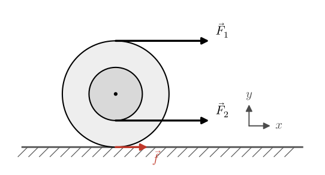

Según la figura, $\vec F_1 = (6;\,0)$ N actúa en el borde superior, $(0;\,R)$, y $\vec F_2 = (2;\,0)$ N en el borde inferior del disco interior, $(0;\,-r)$. Se toma el yo-yo como disco homogéneo: $I = \tfrac{1}{2}\,M\,R^2 = 0{,}02$ kg·m².

$$
\tau_{1,z} = -R\,F_1 = -0{,}2\ \text{m} \cdot 6\ \text{N} = -1{,}2\ \text{N·m} \qquad \tau_{2,z} = -(-r)\,F_2 = 0{,}1\ \text{m} \cdot 2\ \text{N} = +0{,}2\ \text{N·m}
$$

**a) Sin roce:**

$$
a = \frac{F_1 + F_2}{M} = {\color{ForestGreen}\boxed{8\ \text{m/s}^2}} \qquad \gamma_z = \frac{-1{,}2 + 0{,}2}{0{,}02}\ \tfrac{\text{rad}}{\text{s}^2} \implies {\color{ForestGreen}\boxed{\gamma_z = -50\ \text{rad/s}^2}}\ \text{(horario)}
$$

Para rodar con $a = 8$ m/s² haría falta $|\gamma_z| = a/R = 40$ rad/s²: sin roce, gira de más y patina.

**b) Rodadura**, con roce $\vec f = (f;\,0)$ en $(0;\,-R)$, de torque $\tau_z = R\,f$, y $\gamma_z = -a/R$:

$$
\begin{aligned}
x:&\quad F_1 + F_2 + f = M\,a \implies a = 8 + f \quad (\text{en unidades SI}) \\
z:&\quad -1{,}0 + 0{,}2\,f = 0{,}02 \cdot \left(-\frac{a}{0{,}2}\right) = -0{,}1\,a
\end{aligned}
$$

Reemplazando $a$: $-1 + 0{,}2\,f = -0{,}8 - 0{,}1\,f$, entonces

$$
{\color{ForestGreen}\boxed{f = \tfrac{2}{3}\ \text{N} \approx 0{,}67\ \text{N}}}\ \text{hacia adelante} \qquad a = 8{,}67\ \text{m/s}^2
$$

Es positiva: el roce empuja hacia adelante, porque el torque de $F_1$ tiende a hacerlo girar más rápido de lo que corresponde a la rodadura.

<!-- salto-pagina -->

## 4. Momento cinético (Sears cap. 10)

Momento cinético respecto de un eje fijo, $L_z = I\,\omega_z$ para el rígido y $L_z = x\,p_y - y\,p_x$ para una partícula. En un choque contra un cuerpo con eje fijo no se conserva $\vec p$ (el eje hace fuerza), pero sí $L_z$ respecto del eje.

| Ej. | Origen | Nivel | Prioridad | Qué tiene |
|----|----------|-----|---------|-------------------------------------|
| 31 | Guía MC1 | 2 | media | energía con un torque de roce y vector $\vec L$ |
| 32 | Guía MC2 | 3 | media | choque plástico con eje fijo y después energía; modelo adoptado |
| 33 | Guía R10 | 3 | media | choque elástico con eje fijo: $L_z$ y $K$ a la vez |

<!-- solo-pdf
```{=latex}
\par\penalty-100\begingroup\dimen0=\pagegoal\advance\dimen0 by -\pagetotal
\ifdim\dimen0<14\baselineskip\newpage\fi\endgroup
```
-->

### Ejercicio 31 — Barra que cae con roce en el eje

*Origen:* Guía extra — MC1. *Nivel* 2, *prioridad* media.

> Una barra homogénea de masa 1 kg y longitud 0,4 m cuelga de un pivote O y puede girar en un plano vertical. Se la suelta desde la posición horizontal. a) ¿Qué momento de roce, supuesto constante, actúa sobre el eje, si al pasar por la posición vertical la velocidad del centro de masa es de 1 m/s? b) Determinar el vector momento cinético de la barra respecto de O cuando pasa por la vertical.

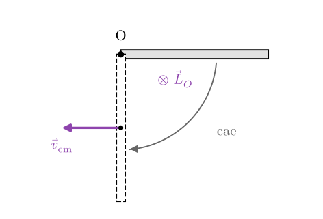

Momento de inercia respecto del extremo: $I_O = \tfrac{1}{3}\,M\,L^2 = 0{,}0533$ kg·m². En la vertical, el centro de masa está a $L/2 = 0{,}2$ m de O: $\omega = \tfrac{v_{\text{cm}}}{L/2} = 5$ rad/s.

**a)** El roce del eje hace un trabajo $W = -\tau\,\theta$ en el giro de $\theta = \pi/2$:

$$
M\,g\,\tfrac{L}{2} - \tau\,\tfrac{\pi}{2} = \tfrac{1}{2}\,I_O\,\omega^2 \implies 2\ \text{J} - \tau\,\tfrac{\pi}{2} = 0{,}667\ \text{J} \implies {\color{ForestGreen}\boxed{\tau \approx 0{,}85\ \text{N·m}}}
$$

**b)** La barra cae en sentido horario: en la vertical, el centro de masa, en $(0;\,-0{,}2)$ m, se mueve hacia $-x$, y $\omega_z = -5$ rad/s. Para un cuerpo rígido que gira alrededor de un eje fijo, $\vec L_O = I_O\,\vec\omega$:

$$
\vec L_O = I_O\,\omega_z\,\hat k = 0{,}0533\ \text{kg·m}^2 \cdot (-5\ \text{rad/s})\,\hat k \implies {\color{ForestGreen}\boxed{\vec L_O \approx -0{,}267\,\hat k\ \text{kg·m}^2/\text{s}}}
$$

Módulo $0{,}267$ kg·m²/s, perpendicular al plano de giro y **entrante** a la hoja (horario).

<!-- solo-pdf
```{=latex}
\par\penalty-100\begingroup\dimen0=\pagegoal\advance\dimen0 by -\pagetotal
\ifdim\dimen0<14\baselineskip\newpage\fi\endgroup
```
-->

### Ejercicio 32 — Disco colgado y bala que se incrusta

*Origen:* Guía extra — MC2. *Nivel* 3, *prioridad* media.

> Un disco homogéneo de masa $m = 0{,}2$ kg y radio $R = 20$ cm está suspendido y puede rotar alrededor del punto A de su borde. Una bala de igual masa choca con el disco y queda adherida a él en un punto del borde. Calcular la velocidad del proyectil para que, después del impacto, el conjunto se aparte un ángulo máximo de 30°.

> [!NOTE]
> **Modelo adoptado:** impacto horizontal en el punto del borde opuesto a A. La figura muestra la bala llegando por el costado izquierdo, pero con el impacto ahí el centro de masa del conjunto queda corrido respecto de la vertical de A y, al girar, primero *baja*: «apartarse 30°» no tiene un sentido único. Con el impacto en el punto opuesto, el conjunto queda simétrico y el problema es el usual.

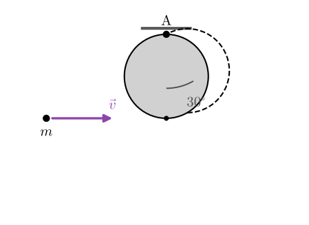

**Choque:** se conserva el momento cinético respecto de A (la fuerza del eje no hace torque). La bala, en $(0;\,-2R)$ con $\vec p = (m\,v;\,0)$, tiene $L_z = -(-2R)\,m\,v = 2\,m\,v\,R$. Momento de inercia del conjunto respecto de A (Steiner para el disco y la bala puntual):

$$
I_A = \underbrace{\tfrac{1}{2}\,m\,R^2 + m\,R^2}_{\text{disco}} + \underbrace{m\,(2R)^2}_{\text{bala}} = 5{,}5\,m\,R^2 = 0{,}044\ \text{kg·m}^2 \qquad 2\,m\,v\,R = I_A\,\omega
$$

**Subida:** el centro de masa del conjunto, a $d = \tfrac{R + 2R}{2} = 1{,}5\,R = 0{,}3$ m de A, sube $d\,(1 - \cos 30^\circ)$:

$$
\tfrac{1}{2}\,I_A\,\omega^2 = 2\,m\,g\,d\,(1 - \cos 30^\circ) = 0{,}4 \cdot 10 \cdot 0{,}3 \cdot 0{,}134\ \text{J} = 0{,}161\ \text{J} \implies \omega = 2{,}70\ \text{rad/s}
$$

$$
v = \frac{I_A\,\omega}{2\,m\,R} = \frac{0{,}044 \cdot 2{,}70}{2 \cdot 0{,}2 \cdot 0{,}2}\ \tfrac{\text{m}}{\text{s}} \implies {\color{ForestGreen}\boxed{v \approx 1{,}49\ \text{m/s}}}
$$

<!-- solo-pdf
```{=latex}
\par\penalty-100\begingroup\dimen0=\pagegoal\advance\dimen0 by -\pagetotal
\ifdim\dimen0<14\baselineskip\newpage\fi\endgroup
```
-->

### Ejercicio 33 — Varilla que gira y pelotita que la frena

*Origen:* Guía extra — R10. *Nivel* 3, *prioridad* media.

> Una varilla de largo $L = 1{,}4$ m y masa $M = 1$ kg, sobre una superficie horizontal sin rozamiento, gira con $\omega_0 = 3{,}3\ \text{s}^{-1}$ en sentido horario alrededor de un eje fijo, perpendicular a la figura, que pasa por su centro de masa O. Se arroja contra ella una pelotita de masa $m = M/4$ que se mueve hacia la izquierda con velocidad $V_0$. La pelotita choca contra la varilla a una distancia $x = L/3$ del borde, justo cuando la varilla es perpendicular a $\vec V_0$. El choque es elástico y la varilla queda en reposo. Determine $V_0$.

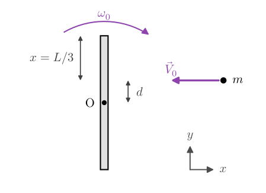

El eje es fijo: no se conserva la cantidad de movimiento (el eje ejerce una fuerza), pero sí el **momento cinético respecto de O**, porque esa fuerza no hace torque respecto de O. El choque es elástico: también se conserva la energía cinética.

Datos: $I = \tfrac{1}{12}\,M\,L^2 = 0{,}1633$ kg·m²; el impacto está a $d = \tfrac{L}{2} - \tfrac{L}{3} = \tfrac{L}{6} = 0{,}2333$ m sobre O; $m = 0{,}25$ kg. La pelotita, en $(x;\,d)$ con $\vec p = (m\,v_x;\,0)$, tiene $L_z = -d\,m\,v_x$. Antes, $v_x = -V_0$ y la varilla gira con $\omega_z = -3{,}3$ rad/s; después, la varilla está quieta y la pelotita sale con $v_x'$:

$$
\begin{aligned}
L_z:&\quad m\,d\,V_0 - I\,\omega_0 = -m\,d\,v_x' &&\implies v_x' = -V_0 + \frac{I\,\omega_0}{m\,d} = -V_0 + {\color{RoyalBlue} 9{,}24\ \text{m/s}} \\
K:&\quad \tfrac{1}{2}\,m\,V_0^2 + \tfrac{1}{2}\,I\,\omega_0^2 = \tfrac{1}{2}\,m\,v_x'^2 &&\implies V_0^2 + 7{,}115\ \tfrac{\text{m}^2}{\text{s}^2} = v_x'^2
\end{aligned}
$$

Reemplazando $v_x'$: $V_0^2 + 7{,}115 = 85{,}38 - 18{,}48\,V_0 + V_0^2$, entonces

$$
{\color{ForestGreen}\boxed{V_0 \approx 4{,}24\ \text{m/s}}} \qquad v_x' \approx +5{,}0\ \text{m/s (rebota hacia la derecha)}
$$

<!-- salto-pagina -->

## 5. Movimiento periódico (MAS) (Sears cap. 13)

Período, amplitud, energía y ecuación horaria del MAS; resorte vertical (el equilibrio se corre $m\,g/k$), resortes en serie y péndulo físico.

| Ej. | Origen | Nivel | Prioridad | Qué tiene |
|----|----------|-----|---------|-------------------------------------|
| 34 | Vella Q2 | 1 | alta | amplitud desde el período y la fuerza máxima |
| 35 | Vella B3 | 1 | alta | estiramiento de equilibrio desde el período |
| 36 | Guía MAS5 | 1 | media | longitudes extremas y velocidad máxima |
| 37 | Guía MAS2 | 1 | media | velocidad y aceleración en un punto |
| 38 | Vella R2 | 2 | alta | fracciones de energía cinética y potencial |
| 39 | Vella P2 | 2 | alta | resorte vertical: período, $v_{\max}$ y fuerza en el techo |
| 40 | Guía MC3 | 2 | media | ecuación horaria y fuerza en el techo |
| 41 | Guía MAS4 | 2 | media | amplitud y fase inicial desde otra longitud |
| 42 | Vella A3 | 2 | alta | resortes en serie |
| 43 | Guía MAS1 | 3 | media | péndulo físico con Steiner |

<!-- solo-pdf
```{=latex}
\par\penalty-100\begingroup\dimen0=\pagegoal\advance\dimen0 by -\pagetotal
\ifdim\dimen0<14\baselineskip\newpage\fi\endgroup
```
-->

### Ejercicio 34 — Amplitud a partir del período y la fuerza máxima

*Origen:* Parciales de Vella (Z1054) — recuperatorio, 23/2/2021, Q2. *Nivel* 1, *prioridad* alta.

> Una partícula de 40 g de masa unida a un resorte horizontal realiza un movimiento oscilatorio armónico simple con un período de oscilación de 0,32 s. Sabiendo que la intensidad máxima de la fuerza responsable del movimiento es de 10 N, determine la amplitud del movimiento.

$$
k = m\left(\frac{2\pi}{T}\right)^2 = 0{,}04\ \text{kg} \cdot \left(\frac{2\pi}{0{,}32\ \text{s}}\right)^2 = {\color{RoyalBlue} 15{,}4\ \text{N/m}}
$$

$$
F_{\max} = k\,A \implies A = \frac{10\ \text{N}}{15{,}4\ \text{N/m}} \implies {\color{ForestGreen}\boxed{A \approx 0{,}65\ \text{m}}}
$$

<!-- solo-pdf
```{=latex}
\par\penalty-100\begingroup\dimen0=\pagegoal\advance\dimen0 by -\pagetotal
\ifdim\dimen0<14\baselineskip\newpage\fi\endgroup
```
-->

### Ejercicio 35 — Estiramiento de equilibrio a partir del período

*Origen:* Parciales de Vella (Z1054) — tema B, sin fecha, B3. *Nivel* 1, *prioridad* alta.

> Una partícula colgada de un resorte vertical oscila con un período de 0,5 s. Determine el estiramiento del resorte cuando el sistema está en su posición de equilibrio estático.

En el equilibrio, $k\,x_e = m\,g$, y $\omega^2 = k/m$:

$$
x_e = \frac{m\,g}{k} = \frac{g}{\omega^2} = \frac{g\,T^2}{4\pi^2} = \frac{10 \cdot 0{,}25}{39{,}48}\ \text{m} \implies {\color{ForestGreen}\boxed{x_e \approx 0{,}063\ \text{m} = 6{,}3\ \text{cm}}}
$$

<!-- solo-pdf
```{=latex}
\par\penalty-100\begingroup\dimen0=\pagegoal\advance\dimen0 by -\pagetotal
\ifdim\dimen0<14\baselineskip\newpage\fi\endgroup
```
-->

### Ejercicio 36 — Resorte horizontal con longitudes extremas

*Origen:* Guía extra — MAS5. *Nivel* 1, *prioridad* media.

> Un cuerpo de masa $m = 0{,}5$ kg realiza un MAS sobre una superficie horizontal sin rozamiento, unido a un resorte ideal fijo a una pared. Las longitudes mínima y máxima del resorte son 30 cm y 50 cm, y la velocidad máxima es 2 m/s. a) Determine la amplitud y la longitud natural del resorte. b) Calcule la frecuencia angular y la constante elástica.

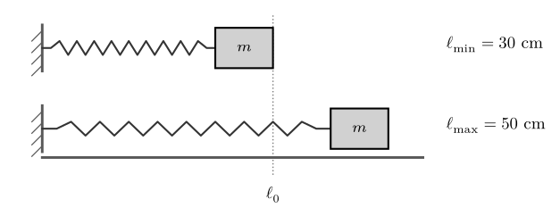

**a)** En horizontal, el equilibrio está en la longitud natural, en el medio de los extremos:

$$
{\color{ForestGreen}\boxed{A = \frac{\ell_{\max} - \ell_{\min}}{2} = 10\ \text{cm}}} \qquad {\color{ForestGreen}\boxed{\ell_0 = \frac{\ell_{\max} + \ell_{\min}}{2} = 40\ \text{cm}}}
$$

**b)** La velocidad máxima, en el equilibrio, es $v_{\max} = A\,\omega$:

$$
{\color{ForestGreen}\boxed{\omega = \frac{v_{\max}}{A} = \frac{2\ \text{m/s}}{0{,}1\ \text{m}} = 20\ \text{rad/s}}} \qquad {\color{ForestGreen}\boxed{k = m\,\omega^2 = 0{,}5\ \text{kg} \cdot 400\ \tfrac{1}{\text{s}^2} = 200\ \text{N/m}}}
$$

<!-- solo-pdf
```{=latex}
\par\penalty-100\begingroup\dimen0=\pagegoal\advance\dimen0 by -\pagetotal
\ifdim\dimen0<14\baselineskip\newpage\fi\endgroup
```
-->

### Ejercicio 37 — Velocidad y aceleración en un punto

*Origen:* Guía extra — MAS2. *Nivel* 1, *prioridad* media.

> Una partícula vinculada a un resorte describe un MAS. La amplitud es 5 cm y cada segundo efectúa media vibración. Calcular las velocidades y aceleraciones que puede tener la partícula al pasar por $x = 3$ cm.

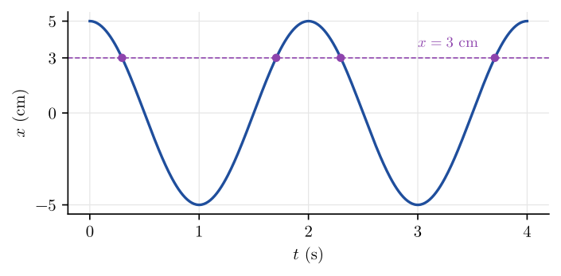

Media vibración por segundo: una oscilación completa cada 2 s, entonces $T = 2$ s y $\omega = 2\pi/T = \pi$ rad/s. Con $x = A\cos(\omega t + \varphi_0)$ y $v = -A\,\omega\,\mathrm{sen}(\omega t + \varphi_0)$ resulta $v^2 = \omega^2\,(A^2 - x^2)$:

$$
v = \pm\,\omega\sqrt{A^2 - x^2} = \pm\,\pi\ \tfrac{\text{rad}}{\text{s}}\sqrt{25 - 9}\ \text{cm} \implies {\color{ForestGreen}\boxed{v \approx \pm\,12{,}57\ \text{cm/s}}}
$$

$$
a = -\omega^2\,x = -\pi^2\ \tfrac{1}{\text{s}^2} \cdot 3\ \text{cm} \implies {\color{ForestGreen}\boxed{a \approx -29{,}6\ \text{cm/s}^2}}
$$

La velocidad tiene dos signos posibles (pasa por $x = 3$ cm yendo y volviendo); la aceleración, uno solo, siempre hacia el equilibrio.

<!-- solo-pdf
```{=latex}
\par\penalty-100\begingroup\dimen0=\pagegoal\advance\dimen0 by -\pagetotal
\ifdim\dimen0<14\baselineskip\newpage\fi\endgroup
```
-->

### Ejercicio 38 — Fracciones de energía en el MAS

*Origen:* Parciales de Vella (Z1054) — 1º recuperatorio, 18/12/2020, R2. *Nivel* 2, *prioridad* alta.

> Una partícula está unida al extremo de un resorte ideal dispuesto horizontalmente que oscila con movimiento armónico simple. Cuando el desplazamiento de la misma es la cuarta parte de la amplitud, ¿qué proporción de la energía mecánica es cinética y qué proporción es potencial? Determine además en qué posición se igualan estas energías.

La energía mecánica es $E = \tfrac12\,k\,A^2$ y la potencial elástica, $U = \tfrac12\,k\,x^2$. Entonces $U/E = (x/A)^2$ y $K/E = 1 - (x/A)^2$.

Con $x = A/4$:

$$
{\color{ForestGreen}\boxed{U = \tfrac{1}{16}\,E}} \qquad {\color{ForestGreen}\boxed{K = \tfrac{15}{16}\,E}}
$$

Se igualan cuando $U = E/2$, o sea $(x/A)^2 = 1/2$:

$$
{\color{ForestGreen}\boxed{x = \pm\frac{\sqrt2}{2}\,A \approx \pm 0{,}71\,A}}
$$

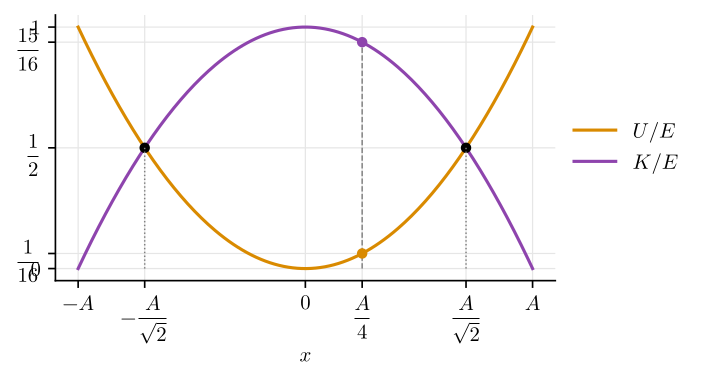

Coincide con Vella, que llega a lo mismo con $x = A\cos(\omega t + \varphi_0)$ y las fases $\pi/4$ y $3\pi/4$.

<!-- solo-pdf
```{=latex}
\par\penalty-100\begingroup\dimen0=\pagegoal\advance\dimen0 by -\pagetotal
\ifdim\dimen0<14\baselineskip\newpage\fi\endgroup
```
-->

### Ejercicio 39 — Partícula colgada de un resorte vertical

*Origen:* Parciales de Vella (Z1054) — 2º parcial, 1/12/2020, P2. *Nivel* 2, *prioridad* alta.

> Se fija el extremo de un resorte ideal de longitud natural 10 cm al techo, mientras que en el otro extremo del mismo se le une una partícula de 1 kg de masa. El sistema alcanza su posición de equilibrio estático quedando el resorte estirado hasta una longitud de 12 cm. Desde ahí se lo separa 5 cm, para dar comienzo a la oscilación. Determine: a) período de oscilación; b) velocidad máxima de la partícula; c) fuerza máxima que soporta el techo.

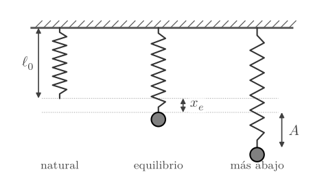

En el equilibrio, $k\,x_e = m\,g$ con $x_e = 12 - 10 = 2$ cm: $k = \dfrac{10\ \text{N}}{0{,}02\ \text{m}} = {\color{RoyalBlue} 500\ \text{N/m}}$, y $\omega = \sqrt{k/m} = {\color{RoyalBlue} 22{,}36\ \text{rad/s}}$. La amplitud es $A = 5$ cm.

**a)** $T = 2\pi\sqrt{m/k} = 2\pi\sqrt{1\ \text{kg} / 500\ \text{N/m}} \implies {\color{ForestGreen}\boxed{T \approx 0{,}281\ \text{s}}}$

**b)** $v_{\max} = \omega\,A = 22{,}36\ \text{s}^{-1} \cdot 0{,}05\ \text{m} \implies {\color{ForestGreen}\boxed{v_{\max} \approx 1{,}12\ \text{m/s}}}$

**c)** El resorte tira más del techo en el punto más bajo, con estiramiento $x_e + A = 7$ cm:

$$
F_{\max} = k\,(x_e + A) = 500\ \tfrac{\text{N}}{\text{m}} \cdot 0{,}07\ \text{m} \implies {\color{ForestGreen}\boxed{F_{\max} = 35\ \text{N}}}
$$

Coincide con Vella en los tres incisos. En el punto más alto el resorte queda comprimido 3 cm y empuja al techo hacia arriba con 15 N.

<!-- solo-pdf
```{=latex}
\par\penalty-100\begingroup\dimen0=\pagegoal\advance\dimen0 by -\pagetotal
\ifdim\dimen0<14\baselineskip\newpage\fi\endgroup
```
-->

### Ejercicio 40 — Cuerpo colgado de un resorte

*Origen:* Guía extra — MC3. *Nivel* 2, *prioridad* media.

> Un objeto de 2 kg está sujeto a un resorte vertical de $k = 200$ N/m que cuelga del techo. Se lo separa 10 cm hacia abajo desde su posición de equilibrio y se lo deja en libertad. Tomando $t = 0$ en el instante en que se lo suelta, determine: a) la ecuación horaria de la posición, respecto de un sistema de referencia con origen en el equilibrio y positivo hacia arriba; b) la fuerza que soporta el techo en $t = 0$.

Este ejercicio es de movimiento oscilatorio armónico, aunque la guía lo ubica en momento cinético.

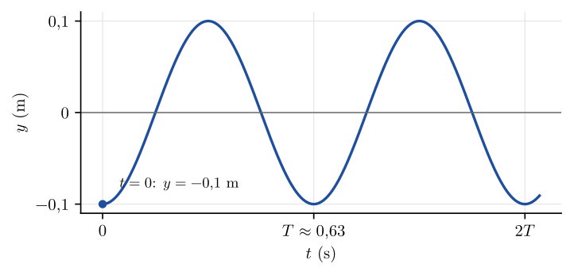

**a)** $\omega = \sqrt{k/m} = \sqrt{200/2} = 10$ rad/s. Se suelta desde el reposo en $y = -0{,}1$ m: es un extremo, así que $A = 0{,}1$ m. Con $y(t) = A\cos(\omega\,t + \varphi_0)$: $\cos\varphi_0 = -1$, entonces $\varphi_0 = \pi$.

$$
{\color{ForestGreen}\boxed{y(t) = 0{,}1\ \text{m}\cdot\cos(10\,t + \pi) = -0{,}1\ \text{m}\cdot\cos(10\,t)}}
$$

**b)** En el equilibrio el resorte está estirado $m\,g/k = 0{,}1$ m. En $t = 0$, 10 cm más: $0{,}2$ m. El resorte tira del techo con

$$
F = k\,\Delta\ell = 200\ \tfrac{\text{N}}{\text{m}} \cdot 0{,}2\ \text{m} \implies {\color{ForestGreen}\boxed{F = 40\ \text{N}}}\ \text{hacia abajo}
$$

<!-- solo-pdf
```{=latex}
\par\penalty-100\begingroup\dimen0=\pagegoal\advance\dimen0 by -\pagetotal
\ifdim\dimen0<14\baselineskip\newpage\fi\endgroup
```
-->

### Ejercicio 41 — Cuerpo colgado de un resorte, soltado desde otra longitud

*Origen:* Guía extra — MAS4. *Nivel* 2, *prioridad* media.

> Un cuerpo de masa $m = 2$ kg cuelga en reposo de un techo, sostenido por un resorte ideal de $k = 200$ N/m y longitud natural $\ell_0 = 50$ cm. Se lleva el cuerpo a la posición en que el resorte mide 40 cm y en $t = 0$ se lo suelta con velocidad nula. a) Calcule la longitud del resorte en el equilibrio, y la frecuencia angular y el período del MAS para $t > 0$. b) Determine la amplitud y la fase inicial, y escriba las ecuaciones de posición y velocidad para $t > 0$.

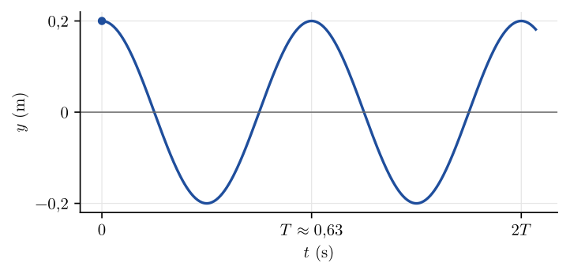

**a)** En el equilibrio, $k\,\Delta\ell = m\,g$: $\Delta\ell = \tfrac{20\ \text{N}}{200\ \text{N/m}} = 0{,}1$ m.

$$
{\color{ForestGreen}\boxed{\ell_{\text{eq}} = 0{,}6\ \text{m}}} \qquad {\color{ForestGreen}\boxed{\omega = \sqrt{k/m} = 10\ \text{rad/s}}} \qquad {\color{ForestGreen}\boxed{T = \tfrac{2\pi}{\omega} \approx 0{,}628\ \text{s}}}
$$

**b)** Eje $y$ con origen en el equilibrio y positivo hacia arriba. Con el resorte de 40 cm, el cuerpo está 20 cm más arriba que en el equilibrio (60 cm): $y(0) = +0{,}2$ m, con velocidad nula. Es un extremo:

$$
{\color{ForestGreen}\boxed{A = 0{,}2\ \text{m}}} \qquad \cos\varphi_0 = 1 \implies {\color{ForestGreen}\boxed{\varphi_0 = 0}}
$$

$$
y(t) = 0{,}2\ \text{m}\cdot\cos(10\,t) \qquad\qquad v(t) = -2\ \tfrac{\text{m}}{\text{s}}\cdot\mathrm{sen}(10\,t)
$$

Con el eje positivo hacia abajo, la fase inicial sería $\pi$.

<!-- solo-pdf
```{=latex}
\par\penalty-100\begingroup\dimen0=\pagegoal\advance\dimen0 by -\pagetotal
\ifdim\dimen0<14\baselineskip\newpage\fi\endgroup
```
-->

### Ejercicio 42 — Dos resortes en serie

*Origen:* Parciales de Vella (Z1054) — tema A, sin fecha, A3. *Nivel* 2, *prioridad* alta.

> El sistema de la figura oscila con período $T = 1$ s. Sabiendo que la masa suspendida es de 3 kg y que la constante elástica del resorte superior es $k_1 = 236{,}8$ N/m, determine el valor de la constante elástica $k_2$ del resorte inferior. Los resortes son ideales, es decir, de masas despreciables.

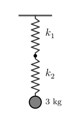

$$
k_{\text{eq}} = m\left(\frac{2\pi}{T}\right)^2 = 3\ \text{kg} \cdot (2\pi\ \text{s}^{-1})^2 = {\color{RoyalBlue} 118{,}4\ \text{N/m}}
$$

En serie, $\dfrac{1}{k_{\text{eq}}} = \dfrac{1}{k_1} + \dfrac{1}{k_2}$:

$$
k_2 = \frac{k_{\text{eq}}\,k_1}{k_1 - k_{\text{eq}}} = \frac{118{,}4 \cdot 236{,}8}{236{,}8 - 118{,}4}\ \text{N/m} \implies {\color{ForestGreen}\boxed{k_2 \approx 237\ \text{N/m}}}
$$

Es igual a $k_1$: dos resortes iguales en serie dan la mitad de la constante.

<!-- solo-pdf
```{=latex}
\par\penalty-100\begingroup\dimen0=\pagegoal\advance\dimen0 by -\pagetotal
\ifdim\dimen0<14\baselineskip\newpage\fi\endgroup
```
-->

### Ejercicio 43 — Péndulo físico: cambio del punto de suspensión

*Origen:* Guía extra — MAS1; también es el MAS3 de la guía extra. *Nivel* 3, *prioridad* media.

> Un péndulo físico consiste en una varilla ($I_{\text{cm}} = \tfrac{1}{12}\,m\,L^2$) de longitud $L$ y masa $m$ que oscila con período $T_1 = 0{,}93$ s cuando se la suspende de uno de sus extremos. Determine el nuevo período si se la suspende desde un punto situado a $L/5$ del extremo. Indique el valor con 3 decimales.

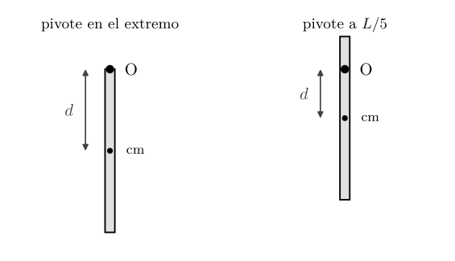

Período de un péndulo físico, con $d$ la distancia del pivote al centro de masa e $I_O = I_{\text{cm}} + m\,d^2$ (Steiner):

$$
T = 2\pi\sqrt{\frac{I_O}{m\,g\,d}} = 2\pi\sqrt{\frac{I_{\text{cm}}/m + d^2}{g\,d}}
$$

| Pivote | $d$ | $I_{\text{cm}}/m + d^2$ | $\dfrac{I_{\text{cm}}/m + d^2}{d}$ |
|---|---|---|---|
| extremo | $0{,}5\,L$ | $\tfrac{1}{12}L^2 + 0{,}25\,L^2 = 0{,}3333\,L^2$ | $0{,}6667\,L$ |
| a $L/5$ del extremo | $0{,}3\,L$ | $\tfrac{1}{12}L^2 + 0{,}09\,L^2 = 0{,}1733\,L^2$ | $0{,}5778\,L$ |

Dividiendo, se simplifican $L$, $g$ y $2\pi$:

$$
\frac{T_2}{T_1} = \sqrt{\frac{0{,}5778}{0{,}6667}} = 0{,}93095 \implies T_2 = 0{,}93\ \text{s} \cdot 0{,}93095 \implies {\color{ForestGreen}\boxed{T_2 \approx 0{,}866\ \text{s}}}
$$

<!-- salto-pagina -->

## 6. Mecánica de fluidos (Sears cap. 14)

Empuje (principio de Arquímedes) en equilibrio y en movimiento, continuidad y Bernoulli. Es independiente de los bloques anteriores.

| Ej. | Origen | Nivel | Prioridad | Qué tiene |
|----|----------|-----|---------|-------------------------------------|
| 44 | Guía F4 | 1 | media | empuje proporcional al volumen sumergido |
| 45 | Guía F3 | 1 | media | esfera atada al fondo |
| 46 | Vella H2 | 1 | alta | tomado dos veces: cuerpo entre dos líquidos |
| 47 | Guía F1 | 1 | media | densidad del líquido desde la tensión |
| 48 | Vella H1 | 1 | alta | el error típico: olvidar el peso del tronco |
| 49 | Vella Q3 | 2 | alta | cantidad mínima de troncos |
| 50 | Vella R3 | 2 | alta | resorte bajo el agua: ¿estirado o comprimido? |
| 51 | Vella B1 | 2 | alta | dinámica con empuje |
| 52 | Guía F2 | 2 | baja | sin datos: resuelto en forma literal |
| 53 | Vella P3 | 2 | alta | continuidad y Bernoulli; también es el F5 de la guía |

<!-- solo-pdf
```{=latex}
\par\penalty-100\begingroup\dimen0=\pagegoal\advance\dimen0 by -\pagetotal
\ifdim\dimen0<14\baselineskip\newpage\fi\endgroup
```
-->

### Ejercicio 44 — Cubo flotante

*Origen:* Guía extra — F4. *Nivel* 1, *prioridad* media.

> Un cubo de masa $m = 400$ g se encuentra flotando en equilibrio en un líquido, con 1/5 de su volumen sumergido. ¿Qué fuerza hacia abajo habría que aplicarle al cubo para mantenerlo totalmente sumergido en ese líquido?

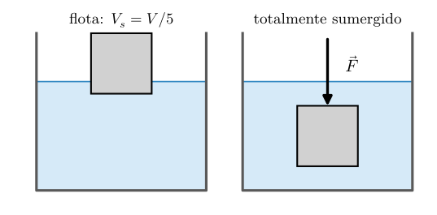

Flotando: $B = w = m\,g = 4$ N, y ese empuje corresponde a $V/5$. El empuje es proporcional al volumen sumergido: totalmente sumergido, $B' = 5 \cdot 4\ \text{N} = 20$ N. En equilibrio, $B' - w - F = 0$:

$$
F = B' - w = 20\ \text{N} - 4\ \text{N} \implies {\color{ForestGreen}\boxed{F = 16\ \text{N}}}
$$

<!-- solo-pdf
```{=latex}
\par\penalty-100\begingroup\dimen0=\pagegoal\advance\dimen0 by -\pagetotal
\ifdim\dimen0<14\baselineskip\newpage\fi\endgroup
```
-->

### Ejercicio 45 — Esfera atada al fondo

*Origen:* Guía extra — F3. *Nivel* 1, *prioridad* media.

> Una esfera de densidad $\delta = 0{,}3$ g/cm³ y volumen $V = 1500$ cm³ se encuentra parcialmente sumergida en agua, unida al fondo del recipiente por una cuerda ideal. a) Sabiendo que la densidad del agua es 1 g/cm³ y que la tensión en la cuerda es 3 N, determine qué porcentaje del volumen de la esfera está sumergido. b) ¿Qué porcentaje quedaría sumergido si se cortara la cuerda?

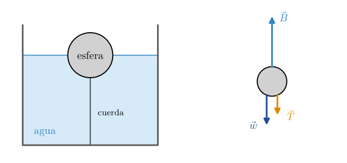

**a)** Masa: $m = \delta\,V = 0{,}3\ \tfrac{\text{g}}{\text{cm}^3} \cdot 1500\ \text{cm}^3 = 450\ \text{g}$, entonces $w = 4{,}5$ N. La cuerda tira hacia abajo: $B - w - T = 0$, de donde $B = 4{,}5\ \text{N} + 3\ \text{N} = {\color{RoyalBlue} 7{,}5\ \text{N}}$.

$$
V_s = \frac{B}{\rho_{\text{agua}}\,g} = \frac{7{,}5\ \text{N}}{1000\ \tfrac{\text{kg}}{\text{m}^3} \cdot 10\ \tfrac{\text{m}}{\text{s}^2}} = 7{,}5 \cdot 10^{-4}\ \text{m}^3 = 750\ \text{cm}^3 \implies {\color{ForestGreen}\boxed{\tfrac{V_s}{V} = 50\,\text{\%}}}
$$

**b)** Sin cuerda, la esfera flota con $B = w$: $\rho_{\text{agua}}\,g\,V_s = \delta\,g\,V$, entonces

$$
\frac{V_s}{V} = \frac{\delta}{\rho_{\text{agua}}} = \frac{0{,}3}{1} \implies {\color{ForestGreen}\boxed{30\,\text{\%}}}
$$

<!-- solo-pdf
```{=latex}
\par\penalty-100\begingroup\dimen0=\pagegoal\advance\dimen0 by -\pagetotal
\ifdim\dimen0<14\baselineskip\newpage\fi\endgroup
```
-->

### Ejercicio 46 — Cuerpo entre dos líquidos

*Origen:* Parciales de Vella (Z1054) — evaluación de hidrostática, ago/2020, H2; repetido como A1 (tema A, sin fecha). *Nivel* 1, *prioridad* alta.

> El recipiente de la figura contiene dos líquidos no miscibles de densidades $\delta_1 = 0{,}8$ kg/dm³ y $\delta_2 = 1$ kg/dm³. El cuerpo de densidad $\delta_c$ se encuentra en equilibrio estático, con 1/3 de su volumen sumergido en el líquido de densidad $\delta_2$ y el resto en el otro. Determinar la densidad del cuerpo C.

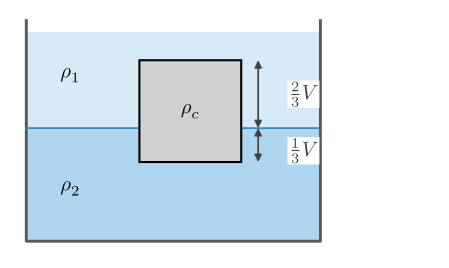

Cada líquido empuja con el peso del volumen que desaloja: $B_1 + B_2 = w$.

$$
\rho_1\,g\,\tfrac23 V + \rho_2\,g\,\tfrac13 V = \rho_c\,g\,V \implies \rho_c = \tfrac23\,800\ \tfrac{\text{kg}}{\text{m}^3} + \tfrac13\,1000\ \tfrac{\text{kg}}{\text{m}^3} \implies {\color{ForestGreen}\boxed{\rho_c \approx 866{,}7\ \text{kg/m}^3}}
$$

Coincide con las dos resoluciones escaneadas. La densidad queda entre las de los dos líquidos, como debe ser para que el cuerpo flote en la interfase.

<!-- solo-pdf
```{=latex}
\par\penalty-100\begingroup\dimen0=\pagegoal\advance\dimen0 by -\pagetotal
\ifdim\dimen0<14\baselineskip\newpage\fi\endgroup
```
-->

### Ejercicio 47 — Cuerpo de hierro sumergido colgado de un hilo

*Origen:* Guía extra — F1. *Nivel* 1, *prioridad* media.

> Un objeto sumergido de 5 kg de masa se encuentra suspendido de un hilo y totalmente sumergido en un recipiente con un líquido desconocido. El objeto no está en contacto con el recipiente y la tensión del hilo es de 22,50 N. Determine la densidad del líquido (la densidad del hierro es 7900 kg/m³).

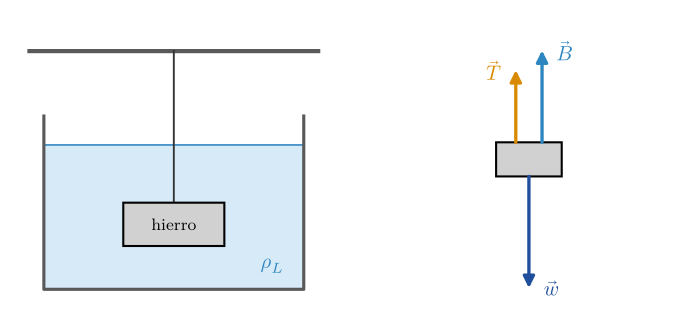

El objeto es de hierro, así que su volumen es

$$
V = \frac{m}{\rho_{\text{Fe}}} = \frac{5\ \text{kg}}{7900\ \text{kg/m}^3} = {\color{RoyalBlue} 6{,}33 \cdot 10^{-4}\ \text{m}^3}
$$

En equilibrio, con $y$ hacia arriba: $T + B - w = 0$, entonces $B = m\,g - T = 50\ \text{N} - 22{,}5\ \text{N} = {\color{RoyalBlue} 27{,}5\ \text{N}}$. El empuje es el peso del líquido desalojado, $B = \rho_L\,g\,V$, y el objeto está totalmente sumergido:

$$
\rho_L = \frac{B}{g\,V} = \frac{27{,}5\ \text{N}}{10\ \tfrac{\text{m}}{\text{s}^2} \cdot 6{,}33 \cdot 10^{-4}\ \text{m}^3} \implies {\color{ForestGreen}\boxed{\rho_L \approx 4345\ \text{kg/m}^3}}
$$

Es menor que la del hierro, como debe ser: si fuera mayor, el objeto flotaría y el hilo no estaría tenso.

<!-- solo-pdf
```{=latex}
\par\penalty-100\begingroup\dimen0=\pagegoal\advance\dimen0 by -\pagetotal
\ifdim\dimen0<14\baselineskip\newpage\fi\endgroup
```
-->

### Ejercicio 48 — Tronco que sostiene a un hombre

*Origen:* Parciales de Vella (Z1054) — evaluación de hidrostática, ago/2020, H1. *Nivel* 1, *prioridad* alta.

> Un hombre de 80 kg de masa se encuentra parado sobre un tronco de madera ($\delta = 0{,}8$ g/cm³) de geometría cilíndrica y 1 m de largo, que flota en agua ($\delta = 1$ g/cm³). Determinar el diámetro mínimo que debería tener el tronco para que la persona no se moje los pies.

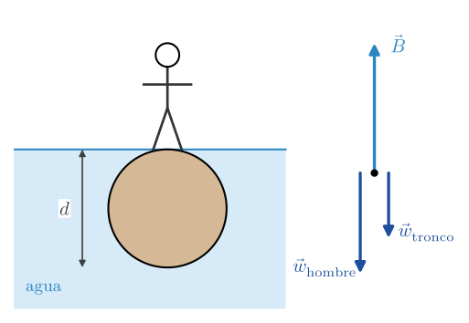

El diámetro es mínimo cuando el tronco queda justo al ras del agua: totalmente sumergido, con $V = \pi\,d^2 L / 4$. En equilibrio, el empuje sostiene al hombre y al tronco:

$$
B = w_{\text{hombre}} + w_{\text{tronco}} \implies \rho_a\,g\,V = m\,g + \rho_t\,g\,V \implies V = \frac{m}{\rho_a - \rho_t} = \frac{80\ \text{kg}}{200\ \text{kg/m}^3} = {\color{RoyalBlue} 0{,}4\ \text{m}^3}
$$

$$
d = \sqrt{\frac{4\,V}{\pi\,L}} = \sqrt{\frac{4 \cdot 0{,}4\ \text{m}^3}{\pi \cdot 1\ \text{m}}} \implies {\color{ForestGreen}\boxed{d \approx 0{,}71\ \text{m}}}
$$

> [!NOTE]
> Coincide con la resolución de Vella ($d \cong 0{,}71$ m). La otra resolución escaneada, de un alumno, llega a 0,319 m porque iguala el empuje solo al peso del hombre (olvida el peso del tronco); el ejercicio aparece tachado como incorrecto.

<!-- solo-pdf
```{=latex}
\par\penalty-100\begingroup\dimen0=\pagegoal\advance\dimen0 by -\pagetotal
\ifdim\dimen0<14\baselineskip\newpage\fi\endgroup
```
-->

### Ejercicio 49 — Balsa de troncos

*Origen:* Parciales de Vella (Z1054) — recuperatorio, 23/2/2021, Q3. *Nivel* 2, *prioridad* alta.

> Tres niños, cada uno de los cuales tiene una masa de 40 kg, fabrican una balsa uniendo troncos ($\delta = 0{,}8$ g/cm³) de geometría cilíndrica de 1,8 m de longitud cada uno y 30 cm de diámetro. Determinar la menor cantidad de troncos necesarios para mantener a flote la balsa, con los niños sobre ella. Considere la densidad del agua de 1 g/cm³.

Cada tronco tiene $V = \pi\,(0{,}15\ \text{m})^2 \cdot 1{,}8\ \text{m} = {\color{RoyalBlue} 0{,}127\ \text{m}^3}$. Totalmente sumergido, sostiene además de su propio peso una carga $(\rho_a - \rho_t)\,g\,V = 200 \cdot 10 \cdot 0{,}127\ \text{N} = {\color{RoyalBlue} 254\ \text{N}}$. Los niños pesan 1200 N:

$$
n \ge \frac{1200\ \text{N}}{254\ \text{N}} = 4{,}72 \implies {\color{ForestGreen}\boxed{n = 5\ \text{troncos}}}
$$

<!-- solo-pdf
```{=latex}
\par\penalty-100\begingroup\dimen0=\pagegoal\advance\dimen0 by -\pagetotal
\ifdim\dimen0<14\baselineskip\newpage\fi\endgroup
```
-->

### Ejercicio 50 — Bloque de madera atado a un resorte bajo el agua

*Origen:* Parciales de Vella (Z1054) — 1º recuperatorio, 18/12/2020, R3. *Nivel* 2, *prioridad* alta.

> Un resorte ideal ($k = 160$ N/m) reposa verticalmente en el fondo de un recipiente lleno de agua ($\delta = 1$ g/cm³). Un bloque de madera ($\delta = 0{,}65$ g/cm³) de 5 kg de masa se une al resorte, permitiendo al sistema (bloque–resorte) alcanzar el equilibrio estático. Determine la deformación máxima que experimenta el resorte, indicando si es una compresión o un estiramiento.

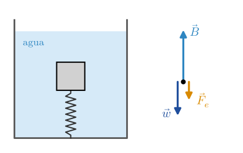

La madera es menos densa que el agua: el empuje supera al peso y el resorte tiene que **tirar hacia abajo**, así que está **estirado**. Con $V = m/\rho_m = 7{,}69 \cdot 10^{-3}$ m³, $B = \rho_a\,g\,V = {\color{RoyalBlue} 76{,}9\ \text{N}}$ y $w = 50$ N. En equilibrio, $B = w + k\,x$:

$$
x = \frac{m\,g\,(\rho_a - \rho_m)}{k\,\rho_m} = \frac{50\ \text{N} \cdot 350\ \text{kg/m}^3}{160\ \text{N/m} \cdot 650\ \text{kg/m}^3} \implies {\color{ForestGreen}\boxed{x \approx 0{,}168\ \text{m},\ \text{estiramiento}}}
$$

Coincide con Vella ($x \cong 0{,}168$ m).

> [!NOTE]
> Vella toma como «deformación máxima» la del equilibrio estático, que es lo que describe el enunciado. Si el bloque se uniera con el resorte sin deformar y se lo soltara, en un modelo ideal oscilaría alrededor de ese equilibrio y el estiramiento máximo sería el doble, ≈ 0,34 m; la viscosidad del agua amortigua la oscilación y el sistema termina en 0,168 m.

<!-- solo-pdf
```{=latex}
\par\penalty-100\begingroup\dimen0=\pagegoal\advance\dimen0 by -\pagetotal
\ifdim\dimen0<14\baselineskip\newpage\fi\endgroup
```
-->

### Ejercicio 51 — Esfera que cae dentro de un líquido

*Origen:* Parciales de Vella (Z1054) — tema B, sin fecha, B1. *Nivel* 2, *prioridad* alta.

> Un depósito contiene un líquido de densidad $\delta_1$. Se sumerge completamente en él una esfera de metal maciza de radio $R$ y densidad $\delta_2$. Despreciando la viscosidad del líquido y suponiendo que $\delta_2/\delta_1 = 3$, determine el tiempo que demora la esfera en descender 11 m en profundidad cuando se la deja caer.

Sobre la esfera actúan el peso y el empuje (sin viscosidad):

$$
m\,a = w - B = (\rho_2 - \rho_1)\,g\,V \implies a = g\left(1 - \frac{\rho_1}{\rho_2}\right) = \tfrac23 \cdot 10\ \tfrac{\text{m}}{\text{s}^2} = {\color{RoyalBlue} 6{,}67\ \text{m/s}^2}
$$

$$
t = \sqrt{\frac{2\,h}{a}} = \sqrt{\frac{2 \cdot 11\ \text{m}}{6{,}67\ \text{m/s}^2}} \implies {\color{ForestGreen}\boxed{t \approx 1{,}82\ \text{s}}}
$$

No depende de $R$.

<!-- solo-pdf
```{=latex}
\par\penalty-100\begingroup\dimen0=\pagegoal\advance\dimen0 by -\pagetotal
\ifdim\dimen0<14\baselineskip\newpage\fi\endgroup
```
-->

### Ejercicio 52 — Dos cuerpos unidos por una soga

*Origen:* Guía extra — F2. *Nivel* 2, *prioridad* baja.

> Dos cuerpos unidos por una soga ideal están en reposo dentro de un recipiente que contiene un líquido, como se muestra en la figura; el cuerpo 2 está totalmente sumergido y el 1 parcialmente. Calcular: a) la tensión en la soga; b) el volumen del cuerpo 1 que sobresale por encima de la superficie libre del líquido.

> [!CAUTION]
> **Faltan datos:** la guía no da masas, volúmenes ni densidades. Se resuelve en forma literal, con densidades $\rho_1$, $\rho_2$ y $\rho_L$ (líquido) y volúmenes $V_1$, $V_2$.

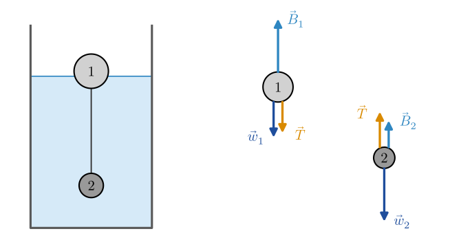

**a) Cuerpo 2** (totalmente sumergido, cuelga de la soga): $T + B_2 - w_2 = 0$:

$$
{\color{ForestGreen}\boxed{T = w_2 - B_2 = (\rho_2 - \rho_L)\,g\,V_2}}
$$

Para que la soga esté tensa hace falta $\rho_2 > \rho_L$: el cuerpo 2 se hundiría solo.

**b) Cuerpo 1** (flota, la soga tira hacia abajo): $B_1 - w_1 - T = 0$, con $B_1 = \rho_L\,g\,V_{s1}$:

$$
\rho_L\,g\,V_{s1} = \rho_1\,g\,V_1 + (\rho_2 - \rho_L)\,g\,V_2 \implies {\color{ForestGreen}\boxed{V_{\text{fuera}} = V_1 - V_{s1} = V_1 - \frac{\rho_1\,V_1 + (\rho_2 - \rho_L)\,V_2}{\rho_L}}}
$$

Equivale a considerar el sistema completo: el empuje total iguala al peso total, $\rho_L\,(V_{s1} + V_2) = \rho_1\,V_1 + \rho_2\,V_2$.

<!-- solo-pdf
```{=latex}
\par\penalty-100\begingroup\dimen0=\pagegoal\advance\dimen0 by -\pagetotal
\ifdim\dimen0<14\baselineskip\newpage\fi\endgroup
```
-->

### Ejercicio 53 — Cañería que baja hasta un subsuelo

*Origen:* Parciales de Vella (Z1054) — 2º parcial, 1/12/2020, P3; también es el F5 de la guía extra. *Nivel* 2, *prioridad* alta.

> Una cañería de 25 mm de diámetro interior transporta agua de densidad 1 kg/dm³ por una superficie horizontal con velocidad de 1 m/s, a la presión de $10^5$ Pa en su interior. En cierto lugar reduce su diámetro interior a 12 mm y desciende hasta un subsuelo, ubicado a una altura de 3 m con respecto a la superficie horizontal. Determine: a) la velocidad y el caudal másico de salida del agua en la parte inferior de la cañería; b) la presión que tendrá el agua en el subsuelo.

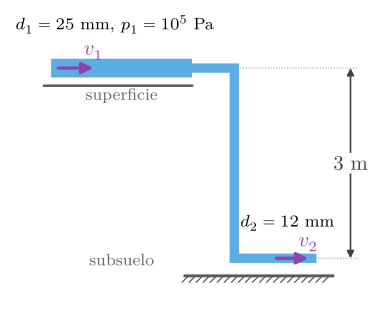

**a)** Por continuidad, $A_1\,v_1 = A_2\,v_2$:

$$
v_2 = \left(\frac{d_1}{d_2}\right)^2 v_1 = \left(\frac{25}{12}\right)^2 \cdot 1\ \tfrac{\text{m}}{\text{s}} \implies {\color{ForestGreen}\boxed{v_2 \approx 4{,}34\ \text{m/s}}}
$$

El caudal másico es el mismo en toda la cañería:

$$
\dot m = \rho\,A_1\,v_1 = 1000\ \tfrac{\text{kg}}{\text{m}^3} \cdot \pi\,(0{,}0125\ \text{m})^2 \cdot 1\ \tfrac{\text{m}}{\text{s}} \implies {\color{ForestGreen}\boxed{\dot m \approx 0{,}49\ \text{kg/s}}}
$$

**b)** Bernoulli entre la superficie (1) y el subsuelo (2), con $y_1 - y_2 = 3$ m:

$$
p_2 = p_1 + \tfrac12\,\rho\,(v_1^2 - v_2^2) + \rho\,g\,(y_1 - y_2) = 10^5\ \text{Pa} - 8919\ \text{Pa} + 30\,000\ \text{Pa} \implies {\color{ForestGreen}\boxed{p_2 \approx 1{,}21 \cdot 10^5\ \text{Pa}}}
$$

Coincide con Vella ($v_2 = 4{,}34$ m/s, $\dot m \cong 0{,}49$ kg/s, $p_2 \cong 121\,082$ Pa).

<!-- solo-md -->

---

**Fuentes:** los cuatro documentos de `2do_parcial/` (`parciales_vella/`, `examen_tipo/`, `guia_extra/`, `parcial_2002/`), con sus propias fuentes y la verificación numérica de cada resultado en sus scripts de figuras. Orden de temas: Sears, Zemansky, Young y Freedman, *Física universitaria*, vol. 1, 11.ª ed.

<!-- /solo-md -->
