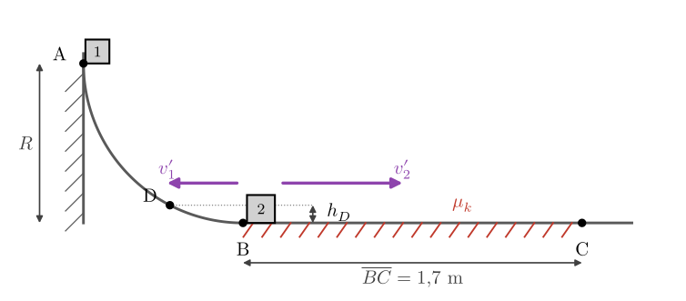
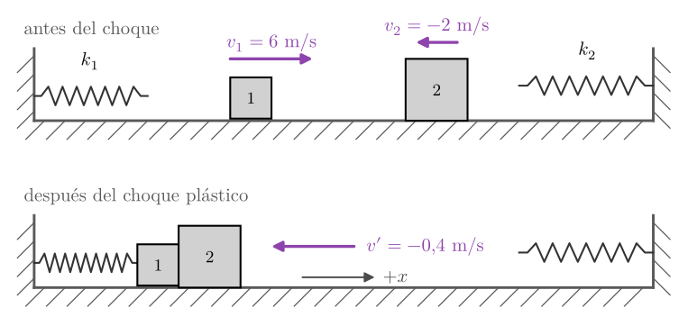
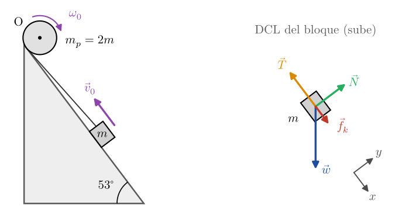
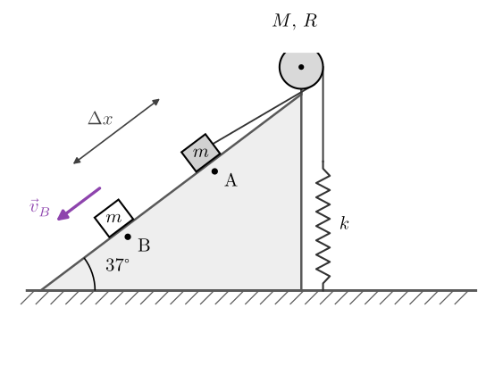

# Parcial de Física I (2002) — enunciados reconstruidos

Resolución de un parcial de Física I de 2002, con los enunciados reconstruidos a partir de la resolución publicada por la cátedra (autor: H. Cassia). Del parcial original solo se conserva la resolución: el archivo `parwebresuelto.pdf`, dentro de `finaldefisica1.zip`, publicado en el sitio de la FRBA. Tiene los esquemas y los cálculos, pero no los enunciados.

**Cómo se reconstruyó cada dato:**

| Origen | Significado |
|---|---|
| **dado** | aparece escrito en la resolución |
| **deducido** | se despeja de los resultados de la resolución |
| **supuesto** | no se puede recuperar; se eligió un valor que reproduce los resultados de la resolución |

Se usa $g = 10\ \text{m/s}^2$, igual que la resolución.

Notación (con el término del Sears en inglés): $K$ energía cinética (*kinetic energy*), $U$ energía potencial (*potential energy*), $W$ trabajo (*work*), $\vec w$ peso (*weight*), $\mu_k$ coeficiente de rozamiento cinético (*kinetic friction*), $I$ momento de inercia (*moment of inertia*), $\alpha_z$ aceleración angular (*angular acceleration*). La resolución original llama $\gamma$ a la aceleración angular; acá $\gamma$ no se usa, porque en el curso es la aceleración radial.

---

## Problema 1 — Pista circular, choque elástico y tramo con rozamiento

### 1.1 Enunciado reconstruido

> El cuerpo 1, de masa $m_1$, parte del reposo en el punto A de una pista sin rozamiento con forma de cuarto de circunferencia de radio $R = 0{,}8$ m. En el punto B, al pie de la pista, choca en forma perfectamente elástica con el cuerpo 2, de masa $m_2 = 2\,m_1$, que estaba en reposo. Después del choque, el cuerpo 2 recorre el tramo horizontal BC, de 1,7 m y con rozamiento, y se detiene en C.
>
> a) Calcular el coeficiente de rozamiento cinético del tramo BC.
> b) Calcular la altura que alcanza el cuerpo 1 al volver a subir por la pista.
>
> Explicar: ¿por qué la aceleración entre A y B no es constante? ¿Por qué, si el choque es perfectamente elástico, el cuerpo 1 no vuelve a la altura de A?

| Dato | Valor | Origen |
|---|---|---|
| Radio de la pista | $R = 0{,}8$ m | dado ($v_B = \sqrt{2 \cdot 10 \cdot 0{,}8}$) |
| Relación de masas | $m_2 = 2\,m_1$ | deducido de $v_1' = -\tfrac{4}{3}$ m/s con $v_1 = 4$ m/s |
| Tramo con rozamiento | $\overline{BC} = 1{,}7$ m | dado |
| Cuerpo 2 antes del choque | en reposo | dado |

### 1.2 Bajada de A a B

Sobre el cuerpo 1 actúan el peso $\vec w$ y la normal $\vec N$ de la pista. La normal es perpendicular a la pista y, por lo tanto, al desplazamiento $d\vec r$ en cada punto: su trabajo es nulo, ${\color{RoyalBlue}W_N = \int \vec N \cdot d\vec r = 0}$. Solo trabaja el peso, que es conservativo, así que se conserva la energía mecánica:

$$
K_A + U_A = K_B + U_B \implies 0 + m_1\,g\,R = \tfrac{1}{2}\,m_1\,v_B^2 + 0
$$

$$
v_B = \sqrt{2\,g\,R} = \sqrt{2 \cdot 10\ \tfrac{\text{m}}{\text{s}^2} \cdot 0{,}8\ \text{m}} = {\color{RoyalBlue} 4\ \text{m/s}}
$$

### 1.3 Choque perfectamente elástico en B

En un choque perfectamente elástico se conservan la cantidad de movimiento y la energía cinética. Con $v_1 = v_B$ y $v_2 = 0$:

$$
\begin{aligned}
m_1\,v_1 &= m_1\,v_1' + m_2\,v_2' &&\implies m_1\,(v_1 - v_1') = m_2\,v_2' \\
\tfrac{1}{2}\,m_1\,v_1^2 &= \tfrac{1}{2}\,m_1\,v_1'^2 + \tfrac{1}{2}\,m_2\,v_2'^2 &&\implies m_1\,(v_1 - v_1')(v_1 + v_1') = m_2\,v_2'^2
\end{aligned}
$$

Dividiendo la segunda por la primera, $v_1 + v_1' = v_2'$. Reemplazando en la primera:

$$
v_1' = \frac{m_1 - m_2}{m_1 + m_2}\,v_1 \qquad\qquad v_2' = \frac{2\,m_1}{m_1 + m_2}\,v_1
$$

Con $m_2 = 2\,m_1$:

$$
v_1' = \frac{m_1 - 2\,m_1}{3\,m_1} \cdot 4\ \tfrac{\text{m}}{\text{s}} = {\color{RoyalBlue} -\tfrac{4}{3}\ \text{m/s} \approx -1{,}33\ \text{m/s}} \qquad\qquad v_2' = \frac{2\,m_1}{3\,m_1} \cdot 4\ \tfrac{\text{m}}{\text{s}} = {\color{RoyalBlue} \tfrac{8}{3}\ \text{m/s} \approx 2{,}67\ \text{m/s}}
$$

El signo negativo indica que el cuerpo 1 rebota y vuelve hacia la pista.

### 1.4 a) Tramo BC: coeficiente de rozamiento

En BC, la normal y el peso son perpendiculares al desplazamiento y no trabajan; solo trabaja el rozamiento cinético, $\vec f_k = (-\mu_k\,m_2\,g;\ 0)$, con $\Delta \vec r = (\overline{BC};\ 0)$. Por el teorema del trabajo y la energía cinética:

$$
W_{f_k} = \vec f_k \cdot \Delta \vec r = -\mu_k\,m_2\,g\,\overline{BC} = \Delta K = 0 - \tfrac{1}{2}\,m_2\,v_2'^2
$$

$$
\mu_k = \frac{v_2'^2}{2\,g\,\overline{BC}} = \frac{\left(\tfrac{8}{3}\ \text{m/s}\right)^2}{2 \cdot 10\ \tfrac{\text{m}}{\text{s}^2} \cdot 1{,}7\ \text{m}} = \frac{7{,}11\ \text{m}^2/\text{s}^2}{34\ \text{m}^2/\text{s}^2} \implies {\color{ForestGreen}\boxed{\mu_k \approx 0{,}21}}
$$

La masa se simplifica: no hace falta conocer $m_2$.

### 1.5 b) Altura que alcanza el cuerpo 1

El cuerpo 1 vuelve por la pista sin rozamiento, así que se conserva la energía mecánica entre B y el punto D donde se detiene:

$$
\tfrac{1}{2}\,m_1\,v_1'^2 = m_1\,g\,h_D \implies h_D = \frac{v_1'^2}{2\,g} = \frac{\left(\tfrac{4}{3}\ \text{m/s}\right)^2}{2 \cdot 10\ \tfrac{\text{m}}{\text{s}^2}} \implies {\color{ForestGreen}\boxed{h_D \approx 0{,}089\ \text{m} \approx 9\ \text{cm}}}
$$

> [!TIP]
> **Respuesta:** a) $\mu_k \approx 0{,}21$ (la resolución redondea a $0{,}2$); b) $h_D \approx 0{,}09$ m.

### 1.6 Las dos preguntas conceptuales

**¿Por qué la aceleración entre A y B no es constante?** En cada punto de la pista, la componente del peso tangente a la trayectoria es $g\,\mathrm{sen}\,\theta$, donde $\theta$ es la inclinación de la tangente en ese punto. En un cuarto de circunferencia, $\theta$ cambia de $90^\circ$ en A a $0^\circ$ en B; además, la trayectoria es curva y aparece una aceleración radial $\gamma = v^2/R$ que crece a medida que el cuerpo gana velocidad. Por eso no sirven las ecuaciones de aceleración constante y se resuelve por energía.

**¿Por qué el cuerpo 1 no vuelve a la altura de A?** En el choque elástico se conserva la energía cinética **del sistema**, no la de cada cuerpo. El cuerpo 1 le transfiere al cuerpo 2 la mayor parte de su energía: después del choque le quedan $\left(\tfrac{1}{3}\right)^2 = \tfrac{1}{9}$ de su energía cinética inicial, y por eso sube a $R/9 \approx 0{,}089$ m.

<!-- salto-pagina -->

## Problema 2 — Dos bloques, dos resortes y un choque plástico

### 2.1 Enunciado reconstruido

> Sobre un piso horizontal sin rozamiento hay dos bloques entre dos paredes. El bloque 1, de masa $m_1 = 1$ kg, comprime $x_1 = 0{,}168$ m un resorte de constante $k_1 = 1280$ N/m fijo a la pared izquierda; el bloque 2, de masa $m_2 = 4$ kg, comprime $x_2 = 0{,}1$ m un resorte de constante $k_2 = 1600$ N/m fijo a la pared derecha. Se sueltan los dos bloques; cuando los resortes recuperan su longitud natural, los bloques se separan de ellos, se acercan y chocan plásticamente.
>
> a) Calcular la velocidad del conjunto después del choque. ¿Contra qué resorte se mueve?
> b) Calcular cuánto comprime el conjunto a ese resorte.

| Dato | Valor | Origen |
|---|---|---|
| Velocidad del bloque 1 al dejar el resorte | $6$ m/s | dado |
| Velocidad del bloque 2 al dejar el resorte | $2$ m/s | dado |
| Relación de masas | $m_2 = 4\,m_1$ | deducido de $v' = -0{,}4$ m/s |
| Masa del bloque 1 | $m_1 = 1$ kg | **supuesto** (fija la escala) |
| Resorte 1 | $k_1 = 1280$ N/m, $x_1 = 0{,}168$ m | deducido: la compresión final de $0{,}025$ m exige $k_1/m_1 = 1280\ \text{s}^{-2}$ |
| Resorte 2 | $k_2 = 1600$ N/m, $x_2 = 0{,}1$ m | $k_2$ **supuesto**; $x_2$ deducido de $v_2 = 2$ m/s |

### 2.2 Velocidades al dejar los resortes

Sin rozamiento, la energía potencial elástica de cada resorte pasa entera a energía cinética de su bloque:

$$
\tfrac{1}{2}\,k_1\,x_1^2 = \tfrac{1}{2}\,m_1\,v_1^2 \implies v_1 = \sqrt{\frac{k_1}{m_1}}\;x_1 = \sqrt{\frac{1280\ \text{N/m}}{1\ \text{kg}}} \cdot 0{,}168\ \text{m} = {\color{RoyalBlue} 6\ \text{m/s}}
$$

$$
v_2 = \sqrt{\frac{k_2}{m_2}}\;x_2 = \sqrt{\frac{1600\ \text{N/m}}{4\ \text{kg}}} \cdot 0{,}1\ \text{m} = {\color{RoyalBlue} 2\ \text{m/s}}
$$

Con el eje $x$ positivo hacia la derecha, el bloque 1 va a $+6$ m/s y el bloque 2 a $-2$ m/s.

### 2.3 a) Choque plástico

En el choque las fuerzas externas horizontales son nulas, así que se conserva la cantidad de movimiento $\vec p$ (*momentum*); en un choque plástico los cuerpos salen juntos:

$$
m_1\,v_1 + m_2\,v_2 = (m_1 + m_2)\,v' \implies v' = \frac{1\ \text{kg} \cdot 6\ \tfrac{\text{m}}{\text{s}} + 4\ \text{kg} \cdot \left(-2\ \tfrac{\text{m}}{\text{s}}\right)}{5\ \text{kg}} \implies {\color{ForestGreen}\boxed{v' = -0{,}4\ \text{m/s}}}
$$

Es negativa: el conjunto se mueve hacia la izquierda, **contra el resorte 1**.

### 2.4 b) Compresión del resorte 1

Después del choque vuelve a conservarse la energía mecánica:

$$
\tfrac{1}{2}\,(m_1 + m_2)\,v'^2 = \tfrac{1}{2}\,k_1\,x_1'^2 \implies x_1' = \sqrt{\frac{m_1 + m_2}{k_1}}\;|v'| = \sqrt{\frac{5\ \text{kg}}{1280\ \text{N/m}}} \cdot 0{,}4\ \tfrac{\text{m}}{\text{s}} \implies {\color{ForestGreen}\boxed{x_1' = 0{,}025\ \text{m}}}
$$

> [!NOTE]
> La resolución original escribe $x_1' = -0{,}025$ m. La raíz es positiva; el signo solo indica que la compresión es hacia la izquierda. La energía cinética que se pierde en el choque, $\tfrac{1}{2}(1)(6)^2 + \tfrac{1}{2}(4)(2)^2 - \tfrac{1}{2}(5)(0{,}4)^2 = 25{,}6$ J, es justamente la razón de que la compresión final sea tan chica.

> [!TIP]
> **Respuesta:** a) $v' = -0{,}4$ m/s, hacia el resorte 1; b) lo comprime $0{,}025$ m.

<!-- salto-pagina -->

## Problema 3 — Polea con inercia que frena a un bloque en un plano inclinado

### 3.1 Enunciado reconstruido

> Una polea, que es un disco homogéneo de masa $m_p = 2\,m$ y radio $R$, puede girar alrededor de un eje fijo O. Tiene enrollada una cuerda inextensible y de masa despreciable, paralela a un plano inclinado $53^\circ$, cuyo otro extremo está atado a un bloque de masa $m$ apoyado en el plano. El coeficiente de rozamiento cinético entre el bloque y el plano es $\mu_k = 0{,}25$. En el instante inicial la polea gira en sentido horario con velocidad angular $\omega_0$ tal que $\omega_0\,R = 5$ m/s, y el bloque sube por el plano.
>
> a) Calcular la aceleración del bloque.
> b) Calcular el tiempo que tarda en detenerse.
> c) Calcular la longitud de cuerda que se enrolla en la polea hasta ese momento.

| Dato | Valor | Origen |
|---|---|---|
| Inclinación | $53^\circ$ ($\mathrm{sen} = 0{,}8$; $\cos = 0{,}6$) | dado |
| Masa de la polea | $m_p = 2\,m$, disco: $I = \tfrac{1}{2}\,m_p\,R^2 = m\,R^2$ | dado |
| Velocidad inicial | $v_0 = \omega_0\,R = 5$ m/s | dado |
| Rozamiento | $\mu_k = 0{,}25$ | deducido de $a = 4{,}75$ m/s² |

### 3.2 DCL del bloque y segunda ley de Newton

Ejes del plano: $x$ hacia abajo del plano, $y$ perpendicular y saliente. El bloque sube (velocidad en $-x$), así que el rozamiento cinético apunta en $+x$. La cuerda tira hacia la polea, en $-x$:

$$
\vec w = (m\,g\,\mathrm{sen}\,53^\circ;\ -m\,g\cos 53^\circ) \qquad \vec N = (0;\ N) \qquad \vec T = (-T;\ 0) \qquad \vec f_k = (\mu_k\,N;\ 0)
$$

$$
\begin{aligned}
y:&\quad N - m\,g\cos 53^\circ = 0 \implies N = m\,g\cos 53^\circ \\
x:&\quad m\,g\,\mathrm{sen}\,53^\circ + \mu_k\,m\,g\cos 53^\circ - T = m\,a_x
\end{aligned}
$$

### 3.3 Polea: torque y aceleración angular

Sobre la polea actúan su peso y la reacción del eje, que pasan por O y no producen torque (*torque*), y la tensión. La cuerda sale tangente a la polea, del lado del plano: el punto de aplicación respecto de O es $\vec r = (0;\ -R)$, y la cuerda tira de la polea hacia el bloque con $\vec T' = (T;\ 0)$. El torque es el producto vectorial:

$$
\tau_z = (\vec r \times \vec T')_z = r_x\,T'_y - r_y\,T'_x = 0 \cdot 0 - (-R)\,T = {\color{RoyalBlue} R\,T}
$$

Como la cuerda no desliza, la velocidad del punto tangente es la del bloque: $v_x = \omega_z\,R$, y por lo tanto $a_x = \alpha_z\,R$. Con $I = m\,R^2$:

$$
\tau_z = I\,\alpha_z \implies R\,T = m\,R^2\,\frac{a_x}{R} \implies {\color{RoyalBlue} T = m\,a_x}
$$

### 3.4 a) Aceleración

Reemplazando $T$ en la ecuación en $x$:

$$
m\,g\,(\mathrm{sen}\,53^\circ + \mu_k\cos 53^\circ) = 2\,m\,a_x \implies a_x = \frac{10\ \tfrac{\text{m}}{\text{s}^2}\,(0{,}8 + 0{,}25 \cdot 0{,}6)}{2} \implies {\color{ForestGreen}\boxed{a_x = 4{,}75\ \text{m/s}^2}}
$$

Es positiva mientras la velocidad es negativa: el bloque **frena**. La masa $m$ se simplifica.

> [!NOTE]
> La cuerda se mantiene tensa: si estuviera floja, el bloque solo frenaría a $g\,(\mathrm{sen}\,53^\circ + \mu_k\cos 53^\circ) = 9{,}5$ m/s², más que con la cuerda. Es la polea, con su inercia, la que tira del bloque hacia arriba y lo frena más despacio.

### 3.5 b) y c) Tiempo y longitud de cuerda

Con aceleración constante y $v_{0x} = -5$ m/s:

$$
v_x = v_{0x} + a_x\,t \implies 0 = -5\ \tfrac{\text{m}}{\text{s}} + 4{,}75\ \tfrac{\text{m}}{\text{s}^2}\,t \implies {\color{ForestGreen}\boxed{t \approx 1{,}05\ \text{s}}}
$$

$$
v_x^2 = v_{0x}^2 + 2\,a_x\,\Delta x \implies \Delta x = -\frac{v_{0x}^2}{2\,a_x} = -\frac{25\ \text{m}^2/\text{s}^2}{9{,}5\ \text{m/s}^2} \implies {\color{ForestGreen}\boxed{|\Delta x| \approx 2{,}63\ \text{m}}}
$$

El bloque sube $2{,}63$ m por el plano, que es la longitud de cuerda que se enrolla en la polea.

> [!TIP]
> **Respuesta:** a) $a = 4{,}75$ m/s², opuesta a la velocidad; b) $t \approx 1{,}05$ s; c) $2{,}63$ m de cuerda.

<!-- salto-pagina -->

## Problema 4 — Bloque, polea con masa y resorte

### 4.1 Enunciado reconstruido

> Un bloque de masa $m$, apoyado en un plano inclinado $37^\circ$ sin rozamiento, está atado a una cuerda que pasa por una polea (disco homogéneo de masa $M$ y radio $R$, sin rozamiento en el eje) y cuyo otro extremo está sujeto a un resorte de constante $k$ fijo al piso. Se suelta el bloque desde el reposo en A, con el resorte sin estirar. Calcular la velocidad del bloque en B, después de bajar $\Delta x$ por el plano.

| Dato | Valor | Origen |
|---|---|---|
| Inclinación | $37^\circ$ ($\mathrm{sen} = 0{,}6$) | dado |
| Polea | disco: $I = \tfrac{1}{2}\,M\,R^2$ | dado |
| Masas y desplazamiento | $m = 2$ kg, $M = 2$ kg, $\Delta x = 0{,}5$ m | **supuestos** |
| Resorte | $k = 36$ N/m | deducido para que $v_B = 1$ m/s, como en la resolución |

> [!NOTE]
> La resolución no muestra dónde está el resorte; solo dice que su estiramiento es $\Delta x$. La disposición de la figura (cuerda por la polea hasta un resorte fijo al piso) es la más simple compatible con su ecuación de energía. Los cuatro valores de la tabla no se pueden recuperar por separado: cualquier combinación que cumpla la ecuación de 4.2 con $v_B = 1$ m/s reproduce el resultado.

### 4.2 Conservación de la energía

No hay rozamiento y la normal no trabaja: se conserva la energía mecánica del sistema bloque + polea + resorte. Al bajar $\Delta x$ por el plano, el bloque desciende $h = \Delta x\,\mathrm{sen}\,37^\circ$, la cuerda inextensible estira el resorte $\Delta x$ y la polea gira con $\omega = v/R$ (la cuerda no desliza):

$$
\underbrace{K_A + K_{\text{rot},A} + U_A + U_{\text{el},A}}_{0\ +\ 0\ +\ m\,g\,h\ +\ 0} = \underbrace{K_B + K_{\text{rot},B} + U_B + U_{\text{el},B}}_{\tfrac{1}{2}m\,v_B^2\ +\ \tfrac{1}{2}I\,\omega_B^2\ +\ 0\ +\ \tfrac{1}{2}k\,\Delta x^2}
$$

Con $\tfrac{1}{2}\,I\,\omega_B^2 = \tfrac{1}{2}\left(\tfrac{1}{2}\,M\,R^2\right)\left(\tfrac{v_B}{R}\right)^2 = {\color{RoyalBlue}\tfrac{1}{4}\,M\,v_B^2}$ (el radio se simplifica):

$$
m\,g\,\Delta x\,\mathrm{sen}\,37^\circ = \tfrac{1}{2}\left(m + \tfrac{M}{2}\right)v_B^2 + \tfrac{1}{2}\,k\,\Delta x^2 \implies v_B = \sqrt{\frac{2\,m\,g\,\Delta x\,\mathrm{sen}\,37^\circ - k\,\Delta x^2}{m + M/2}}
$$

### 4.3 Valor numérico

$$
v_B = \sqrt{\frac{2 \cdot 2\ \text{kg} \cdot 10\ \tfrac{\text{m}}{\text{s}^2} \cdot 0{,}5\ \text{m} \cdot 0{,}6 - 36\ \tfrac{\text{N}}{\text{m}} \cdot (0{,}5\ \text{m})^2}{2\ \text{kg} + 1\ \text{kg}}} = \sqrt{\frac{12\ \text{J} - 9\ \text{J}}{3\ \text{kg}}} \implies {\color{ForestGreen}\boxed{v_B = 1\ \text{m/s}}}
$$

La resolución original explica por qué no conviene la vía de Newton: la fuerza del resorte, $F_x = -k\,x$, cambia con el estiramiento, y con ella la tensión y la aceleración; el balance de energía no necesita esa información.

> [!TIP]
> **Respuesta:** $v_B = 1$ m/s con los datos de la tabla (expresión general al final de 4.2).

<!-- solo-md -->

---

**Fuentes:** resolución original `Parcial_2002_resolucion_Cassia.pdf` (H. Cassia, abril de 2002; publicada en el sitio de la FRBA dentro de `finaldefisica1.zip`, carpeta `wp-content/uploads/2017/06/`). Valores deducidos y supuestos explicados en cada tabla; cálculos verificados en `figuras_parcial_2002.py`.

<!-- /solo-md -->
