# Parciales del 2do parcial de Física I — curso Z1054 (Prof. R. Vella)

Resolución de seis evaluaciones del curso Z1054 de Física I (FRBA, Prof. R. Vella, 2020–2021): la evaluación de proceso de hidrostática, el 2º parcial, sus dos recuperatorios y dos temas sin fecha que llegaron en fotos. Donde existe la resolución manuscrita del docente, cada resultado se contrasta con ella.

| Código | Evaluación | Fecha | Resolución del docente |
|---|---|---|---|
| H1–H2 | Evaluación de proceso: hidrostática | ago/2020 | sí (y una de un alumno) |
| P1–P5 | 2º parcial | 1/12/2020 | sí |
| R1–R5 | 1º recuperatorio del 2º parcial | 18/12/2020 | sí |
| Q1–Q5 | Recuperatorio del 2º parcial | 23/2/2021 | no |
| A1–A5 | Tema A, sin fecha (foto) | — | no |
| B1–B5 | Tema B, sin fecha (foto) | — | no |

Los temas A y B tienen el formato de Vella (misma grilla de notas y el mismo pie: «Condición mínima de aprobación 50 % bien resuelto»). Hay ejercicios repetidos: Q1 = R1, A1 = H2 y B4 = P4. Además, P3 es el F5 de la guía de ejercicios extra (`../guia_extra/`), y confirma que el «3 mm» de la guía es una errata de «3 m».

Se usa $g = 10\ \text{m/s}^2$, como piden los parciales. Notación (con el término del Sears en inglés): $\vec w$ peso (*weight*), $\vec B$ empuje (*buoyant force*), $\vec N$ normal, $\vec f$ rozamiento (*friction*), $K$ energía cinética (*kinetic energy*), $U$ energía potencial (*potential energy*), $W$ trabajo (*work*), $\mu_s$ y $\mu_k$ coeficientes de rozamiento estático y cinético (*static*, *kinetic friction*; los parciales los llaman $\mu_e$ y $\mu_c$), $I$ momento de inercia (*moment of inertia*), $\tau_z$ torque (*torque*), $\gamma_z$ aceleración angular (*angular acceleration*). Las densidades van con $\rho$ (los parciales usan $\delta$).

Convención para la rotación: eje $z$ saliente de la hoja, positivo antihorario. Los torques se calculan como producto vectorial, $\tau_z = x\,F_y - y\,F_x$, con $(x;\,y)$ el punto de aplicación respecto del centro de masa.

---

## Evaluación de proceso: hidrostática (agosto de 2020)

### H1 — Tronco que sostiene a un hombre

> Un hombre de 80 kg de masa se encuentra parado sobre un tronco de madera ($\delta = 0{,}8$ g/cm³) de geometría cilíndrica y 1 m de largo, que flota en agua ($\delta = 1$ g/cm³). Determinar el diámetro mínimo que debería tener el tronco para que la persona no se moje los pies.

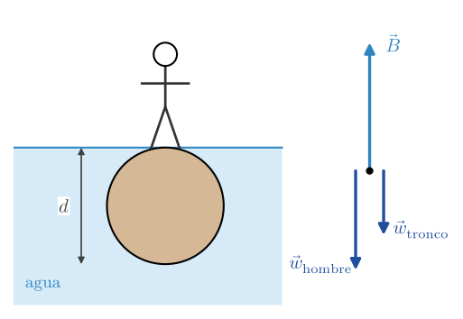

El diámetro es mínimo cuando el tronco queda justo al ras del agua: totalmente sumergido, con $V = \pi\,d^2 L / 4$. En equilibrio, el empuje sostiene al hombre y al tronco:

$$
B = w_{\text{hombre}} + w_{\text{tronco}} \implies \rho_a\,g\,V = m\,g + \rho_t\,g\,V \implies V = \frac{m}{\rho_a - \rho_t} = \frac{80\ \text{kg}}{200\ \text{kg/m}^3} = {\color{RoyalBlue} 0{,}4\ \text{m}^3}
$$

$$
d = \sqrt{\frac{4\,V}{\pi\,L}} = \sqrt{\frac{4 \cdot 0{,}4\ \text{m}^3}{\pi \cdot 1\ \text{m}}} \implies {\color{ForestGreen}\boxed{d \approx 0{,}71\ \text{m}}}
$$

> [!NOTE]
> Coincide con la resolución de Vella ($d \cong 0{,}71$ m). La otra resolución escaneada, de un alumno, llega a 0,319 m porque iguala el empuje solo al peso del hombre (olvida el peso del tronco); el ejercicio aparece tachado como incorrecto.

### H2 — Cuerpo entre dos líquidos (= A1)

> El recipiente de la figura contiene dos líquidos no miscibles de densidades $\delta_1 = 0{,}8$ kg/dm³ y $\delta_2 = 1$ kg/dm³. El cuerpo de densidad $\delta_c$ se encuentra en equilibrio estático, con 1/3 de su volumen sumergido en el líquido de densidad $\delta_2$ y el resto en el otro. Determinar la densidad del cuerpo C.

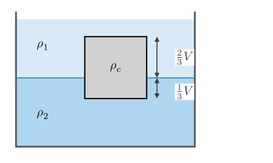

Cada líquido empuja con el peso del volumen que desaloja: $B_1 + B_2 = w$.

$$
\rho_1\,g\,\tfrac23 V + \rho_2\,g\,\tfrac13 V = \rho_c\,g\,V \implies \rho_c = \tfrac23\,800\ \tfrac{\text{kg}}{\text{m}^3} + \tfrac13\,1000\ \tfrac{\text{kg}}{\text{m}^3} \implies {\color{ForestGreen}\boxed{\rho_c \approx 866{,}7\ \text{kg/m}^3}}
$$

Coincide con las dos resoluciones escaneadas. La densidad queda entre las de los dos líquidos, como debe ser para que el cuerpo flote en la interfase.

<!-- salto-pagina -->

## 2º parcial (1 de diciembre de 2020)

### P1 — Choque plástico en el plano y frenado con rozamiento

> Una partícula de 10 kg de masa se mueve en la dirección del eje X con una velocidad de 2 m/s, cuando es chocada en forma perfectamente plástica por otra partícula de 1 kg de masa que se mueve en la dirección del eje Y, con una velocidad de 20 m/s, según el gráfico (vista superior). Inmediatamente después del choque el conjunto se mueve sobre el mismo plano horizontal pero que ahora presenta fricción ($\mu_c = 0{,}2$). Determine la distancia que recorren juntas hasta detenerse.

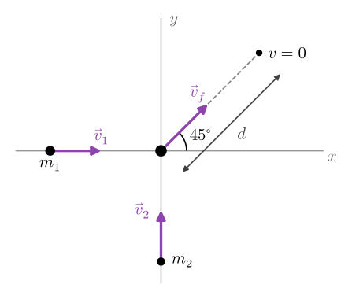

**Choque:** se conserva la cantidad de movimiento, vector por vector:

$$
m_1\,\vec v_1 + m_2\,\vec v_2 = (m_1 + m_2)\,\vec v_f \implies \vec v_f = \frac{(10 \cdot 2;\ 1 \cdot 20)\ \text{kg·m/s}}{11\ \text{kg}} = {\color{RoyalBlue}(1{,}82;\ 1{,}82)\ \text{m/s}}
$$

$|\vec v_f| = \sqrt2 \cdot 1{,}818\ \text{m/s} = {\color{RoyalBlue} 2{,}57\ \text{m/s}}$, a 45° del eje $x$.

**Frenado:** el rozamiento es la única fuerza que trabaja, $W_f = \Delta K$:

$$
-\mu_k\,(m_1 + m_2)\,g\,d = 0 - \tfrac12\,(m_1 + m_2)\,v_f^2 \implies d = \frac{v_f^2}{2\,\mu_k\,g} = \frac{(2{,}571\ \text{m/s})^2}{2 \cdot 0{,}2 \cdot 10\ \text{m/s}^2} \implies {\color{ForestGreen}\boxed{d \approx 1{,}65\ \text{m}}}
$$

> [!CAUTION]
> La resolución de Vella da $d \cong 1{,}63$ m porque redondea $|\vec v_f|$ a 2,55 m/s; el módulo correcto es $\sqrt{1{,}818^2 + 1{,}818^2} = 2{,}571$ m/s. La diferencia es solo de redondeo.

### P2 — Partícula colgada de un resorte vertical

> Se fija el extremo de un resorte ideal de longitud natural 10 cm al techo, mientras que en el otro extremo del mismo se le une una partícula de 1 kg de masa. El sistema alcanza su posición de equilibrio estático quedando el resorte estirado hasta una longitud de 12 cm. Desde ahí se lo separa 5 cm, para dar comienzo a la oscilación. Determine: a) período de oscilación; b) velocidad máxima de la partícula; c) fuerza máxima que soporta el techo.

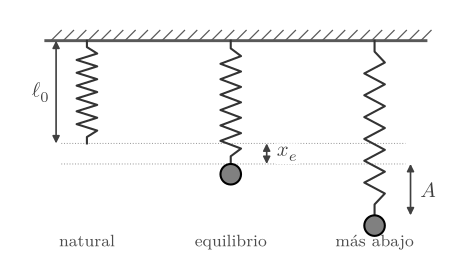

En el equilibrio, $k\,x_e = m\,g$ con $x_e = 12 - 10 = 2$ cm: $k = \dfrac{10\ \text{N}}{0{,}02\ \text{m}} = {\color{RoyalBlue} 500\ \text{N/m}}$, y $\omega = \sqrt{k/m} = {\color{RoyalBlue} 22{,}36\ \text{rad/s}}$. La amplitud es $A = 5$ cm.

**a)** $T = 2\pi\sqrt{m/k} = 2\pi\sqrt{1\ \text{kg} / 500\ \text{N/m}} \implies {\color{ForestGreen}\boxed{T \approx 0{,}281\ \text{s}}}$

**b)** $v_{\max} = \omega\,A = 22{,}36\ \text{s}^{-1} \cdot 0{,}05\ \text{m} \implies {\color{ForestGreen}\boxed{v_{\max} \approx 1{,}12\ \text{m/s}}}$

**c)** El resorte tira más del techo en el punto más bajo, con estiramiento $x_e + A = 7$ cm:

$$
F_{\max} = k\,(x_e + A) = 500\ \tfrac{\text{N}}{\text{m}} \cdot 0{,}07\ \text{m} \implies {\color{ForestGreen}\boxed{F_{\max} = 35\ \text{N}}}
$$

Coincide con Vella en los tres incisos. En el punto más alto el resorte queda comprimido 3 cm y empuja al techo hacia arriba con 15 N.

### P3 — Cañería que baja hasta un subsuelo

> Una cañería de 25 mm de diámetro interior transporta agua de densidad 1 kg/dm³ por una superficie horizontal con velocidad de 1 m/s, a la presión de $10^5$ Pa en su interior. En cierto lugar reduce su diámetro interior a 12 mm y desciende hasta un subsuelo, ubicado a una altura de 3 m con respecto a la superficie horizontal. Determine: a) la velocidad y el caudal másico de salida del agua en la parte inferior de la cañería; b) la presión que tendrá el agua en el subsuelo.

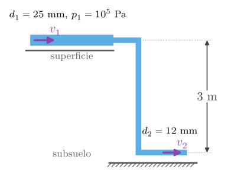

**a)** Por continuidad, $A_1\,v_1 = A_2\,v_2$:

$$
v_2 = \left(\frac{d_1}{d_2}\right)^2 v_1 = \left(\frac{25}{12}\right)^2 \cdot 1\ \tfrac{\text{m}}{\text{s}} \implies {\color{ForestGreen}\boxed{v_2 \approx 4{,}34\ \text{m/s}}}
$$

El caudal másico es el mismo en toda la cañería:

$$
\dot m = \rho\,A_1\,v_1 = 1000\ \tfrac{\text{kg}}{\text{m}^3} \cdot \pi\,(0{,}0125\ \text{m})^2 \cdot 1\ \tfrac{\text{m}}{\text{s}} \implies {\color{ForestGreen}\boxed{\dot m \approx 0{,}49\ \text{kg/s}}}
$$

**b)** Bernoulli entre la superficie (1) y el subsuelo (2), con $y_1 - y_2 = 3$ m:

$$
p_2 = p_1 + \tfrac12\,\rho\,(v_1^2 - v_2^2) + \rho\,g\,(y_1 - y_2) = 10^5\ \text{Pa} - 8919\ \text{Pa} + 30\,000\ \text{Pa} \implies {\color{ForestGreen}\boxed{p_2 \approx 1{,}21 \cdot 10^5\ \text{Pa}}}
$$

Coincide con Vella ($v_2 = 4{,}34$ m/s, $\dot m \cong 0{,}49$ kg/s, $p_2 \cong 121\,082$ Pa).

<!-- salto-pagina -->

### P4 — Cilindro que baja rodando y estira un resorte (= B4)

> El sistema de la figura parte del reposo, el resorte ideal ($k = 250$ N/m) no presenta deformación inicial. Luego el cilindro macizo y homogéneo de 10 kg de masa comienza a descender rodando sin resbalar por el plano ($\alpha = 30°$). Determinar la velocidad del centro de masa del mismo cuando su centro se desplazó una distancia de 20 cm a lo largo del plano. Considerar $I_{\text{cm}} = \tfrac12\,m\,r^2$.

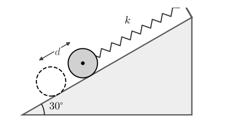

Rueda sin resbalar: el rozamiento estático no trabaja y se conserva la energía mecánica. Con $d = 0{,}2$ m, el centro baja $h = d\,\mathrm{sen}\,30° = 0{,}1$ m y el resorte se estira $d$. La energía cinética del cilindro que rueda es $K = \tfrac12\,m\,v^2 + \tfrac12\,I_{\text{cm}}\,\omega^2 = \tfrac34\,m\,v^2$ (con $\omega = v/r$):

$$
m\,g\,h = \tfrac12\,k\,d^2 + \tfrac34\,m\,v^2 \implies 10\ \text{J} = 5\ \text{J} + 7{,}5\ \text{kg} \cdot v^2 \implies {\color{ForestGreen}\boxed{v_{\text{cm}} \approx 0{,}82\ \text{m/s}}}
$$

Coincide con Vella ($v_{\text{cm}} = 0{,}81$ m/s, truncado).

### P5 — Cilindro tirado por una cuerda que sube por el plano

> Un cilindro macizo y homogéneo ($I_{\text{cm}} = \tfrac12\,m\,r^2$) de masa 1 kg asciende rodando sin resbalar por un plano inclinado, según muestra el gráfico, mientras se le aplica una fuerza de intensidad 10 N mediante una cuerda enrollada en su periferia, de masa y espesor despreciables. Determine la intensidad de la fuerza de rozamiento y la aceleración del centro de masa.

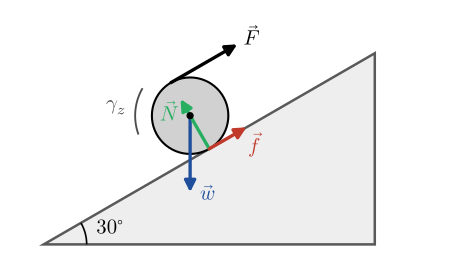

Ejes: $x$ paralelo al plano hacia arriba, $y$ normal. La cuerda tira en $(0;\,r)$ con $\vec F = (F;\,0)$ y el rozamiento actúa en $(0;\,-r)$ con $\vec f = (f;\,0)$; se supone $f$ hacia arriba y el signo lo confirma. Rodar hacia arriba es girar en sentido horario: $\gamma_z = -a/r$.

**Rotación** respecto del centro de masa: $\tau_z = 0 \cdot 0 - r\,F + r\,f$:

$$
\tfrac12\,m\,r^2\,\gamma_z = -r\,F + r\,f \implies \tfrac12\,m\,a = F - f
$$

**Traslación** según $x$:

$$
F + f - m\,g\,\mathrm{sen}\,30° = m\,a
$$

Sumando: $2F - m\,g\,\mathrm{sen}\,30° = \tfrac32\,m\,a \implies a = \dfrac{20\ \text{N} - 5\ \text{N}}{1{,}5\ \text{kg}}$, y $f = F - \tfrac12\,m\,a$:

$$
{\color{ForestGreen}\boxed{a_{\text{cm}} = 10\ \text{m/s}^2}} \qquad {\color{ForestGreen}\boxed{f = 5\ \text{N}\ \text{hacia arriba del plano}}}
$$

Coincide con Vella.

<!-- salto-pagina -->

## 1º recuperatorio del 2º parcial (18 de diciembre de 2020)

### R1 — Choque plástico contra un bloque apoyado en un resorte (= Q1)

> Una partícula de 100 g de masa se lanza en dirección horizontal con una velocidad de 7 m/s y choca en forma perfectamente plástica contra un bloque de 900 g de masa, que se encuentra en reposo sobre una superficie horizontal y en contacto con un resorte ideal no deformado ($k = 98$ N/m). Si el coeficiente de roce cinético entre el bloque y la superficie es $\mu_c = 0{,}25$, determine la máxima compresión del resorte.

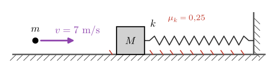

**Choque:** $m\,v = (m + M)\,v' \implies v' = \dfrac{0{,}1\ \text{kg} \cdot 7\ \text{m/s}}{1\ \text{kg}} = {\color{RoyalBlue} 0{,}7\ \text{m/s}}$.

**Compresión:** el rozamiento es la fuerza no conservativa, $W_f = \Delta E$, con el resorte comprimido $x$ al detenerse:

$$
-\mu_k\,(m + M)\,g\,x = \tfrac12\,k\,x^2 - \tfrac12\,(m + M)\,v'^2 \implies 49\,x^2 + 2{,}5\,x - 0{,}245 = 0
$$

con los coeficientes en N/m, N y J. La raíz positiva es

$$
{\color{ForestGreen}\boxed{x \approx 0{,}050\ \text{m} = 5{,}0\ \text{cm}}}
$$

Coincide con Vella ($x_1 = 0{,}049$ m, truncado; la otra raíz, negativa, se descarta).

### R2 — Fracciones de energía en el MAS

> Una partícula está unida al extremo de un resorte ideal dispuesto horizontalmente que oscila con movimiento armónico simple. Cuando el desplazamiento de la misma es la cuarta parte de la amplitud, ¿qué proporción de la energía mecánica es cinética y qué proporción es potencial? Determine además en qué posición se igualan estas energías.

La energía mecánica es $E = \tfrac12\,k\,A^2$ y la potencial elástica, $U = \tfrac12\,k\,x^2$. Entonces $U/E = (x/A)^2$ y $K/E = 1 - (x/A)^2$.

Con $x = A/4$:

$$
{\color{ForestGreen}\boxed{U = \tfrac{1}{16}\,E}} \qquad {\color{ForestGreen}\boxed{K = \tfrac{15}{16}\,E}}
$$

Se igualan cuando $U = E/2$, o sea $(x/A)^2 = 1/2$:

$$
{\color{ForestGreen}\boxed{x = \pm\frac{\sqrt2}{2}\,A \approx \pm 0{,}71\,A}}
$$

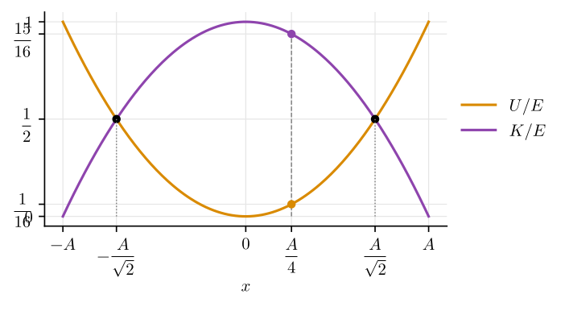

Coincide con Vella, que llega a lo mismo con $x = A\cos(\omega t + \varphi_0)$ y las fases $\pi/4$ y $3\pi/4$.

### R3 — Bloque de madera atado a un resorte bajo el agua

> Un resorte ideal ($k = 160$ N/m) reposa verticalmente en el fondo de un recipiente lleno de agua ($\delta = 1$ g/cm³). Un bloque de madera ($\delta = 0{,}65$ g/cm³) de 5 kg de masa se une al resorte, permitiendo al sistema (bloque–resorte) alcanzar el equilibrio estático. Determine la deformación máxima que experimenta el resorte, indicando si es una compresión o un estiramiento.

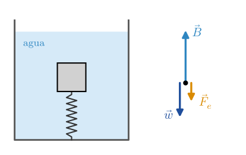

La madera es menos densa que el agua: el empuje supera al peso y el resorte tiene que **tirar hacia abajo**, así que está **estirado**. Con $V = m/\rho_m = 7{,}69 \cdot 10^{-3}$ m³, $B = \rho_a\,g\,V = {\color{RoyalBlue} 76{,}9\ \text{N}}$ y $w = 50$ N. En equilibrio, $B = w + k\,x$:

$$
x = \frac{m\,g\,(\rho_a - \rho_m)}{k\,\rho_m} = \frac{50\ \text{N} \cdot 350\ \text{kg/m}^3}{160\ \text{N/m} \cdot 650\ \text{kg/m}^3} \implies {\color{ForestGreen}\boxed{x \approx 0{,}168\ \text{m},\ \text{estiramiento}}}
$$

Coincide con Vella ($x \cong 0{,}168$ m).

> [!NOTE]
> Vella toma como «deformación máxima» la del equilibrio estático, que es lo que describe el enunciado. Si el bloque se uniera con el resorte sin deformar y se lo soltara, en un modelo ideal oscilaría alrededor de ese equilibrio y el estiramiento máximo sería el doble, ≈ 0,34 m; la viscosidad del agua amortigua la oscilación y el sistema termina en 0,168 m.

### R4 — Cilindro tirado desde arriba: energía cinética a los 5 s

> Se arrolla una cuerda inextensible de masa y espesor despreciables alrededor de un cilindro macizo y homogéneo ($I_{\text{cm}} = \tfrac12\,M\,R^2$), de 0,5 m de radio y 4 kg de masa, que se encuentra en reposo. En su extremo se ejerce una fuerza de intensidad $F = 30$ N, como se indica en la figura. El cilindro rueda sin resbalar sobre una superficie horizontal con fricción. Determine la energía cinética del mismo al cabo de 5 segundos.

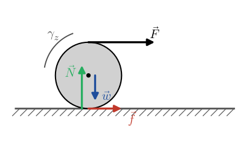

La cuerda tira en $(0;\,R)$ con $\vec F = (F;\,0)$ y el rozamiento actúa en $(0;\,-R)$ con $\vec f = (f;\,0)$. Avanza a la derecha girando en sentido horario: $\gamma_z = -a/R$.

$$
\tfrac12\,M\,R^2\,\gamma_z = -R\,F + R\,f \implies \tfrac12\,M\,a = F - f \qquad\qquad F + f = M\,a
$$

Sumando, $2F = \tfrac32\,M\,a$:

$$
a = \frac{4\,F}{3\,M} = {\color{RoyalBlue} 10\ \text{m/s}^2}, \qquad f = M\,a - F = {\color{RoyalBlue} 10\ \text{N}}\ \text{hacia adelante}, \qquad \gamma_z = -20\ \text{s}^{-2}
$$

A los 5 s, partiendo del reposo: $v_{\text{cm}} = 50$ m/s y $\omega = 100$ rad/s.

$$
K = \tfrac12\,M\,v_{\text{cm}}^2 + \tfrac12\,I_{\text{cm}}\,\omega^2 = 5000\ \text{J} + \tfrac12 \cdot 0{,}5\ \text{kg·m}^2 \cdot (100\ \text{s}^{-1})^2 \implies {\color{ForestGreen}\boxed{K = 7500\ \text{J}}}
$$

Control por trabajo: el rozamiento de rodadura no trabaja, y el punto de arriba avanza el doble que el centro, $2 \cdot \tfrac12\,a\,t^2 = 250$ m. Entonces $W_F = 30\ \text{N} \cdot 250\ \text{m} = 7500$ J. Coincide con Vella.

<!-- salto-pagina -->

### R5 — Resorte, polea con masa y dos partículas

> En el sistema de la figura, el resorte ideal ($k = 20$ N/m) se halla en un extremo fijo al piso y en el otro a una partícula $m_1$ de masa 8 kg. La polea de geometría cilíndrica ($I_{\text{cm}} = \tfrac12\,m\,r^2$) tiene una masa de 2 kg, y la otra partícula $m_2$, de 15 kg de masa, se encuentra posicionada a la misma altura con respecto al piso que la otra. Cuando el sistema se deja en libertad el resorte está estirado 1 m. Determine el módulo de la velocidad de la partícula $m_2$ cuando llegue al piso.

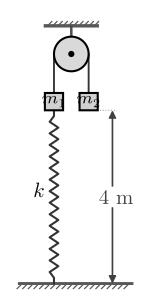

Sin rozamiento ni deslizamiento de la cuerda, se conserva la energía mecánica. Cuando $m_2$ baja $H = 4$ m, $m_1$ sube 4 m y el resorte pasa de 1 m a 5 m de estiramiento. Las dos partículas tienen la misma rapidez $v$, y la polea gira con $\omega = v/r$, así que $\tfrac12\,I\,\omega^2 = \tfrac12 \cdot \tfrac12\,m_p\,v^2$. Con alturas medidas desde el piso:

$$
\tfrac12\,k\,(1\ \text{m})^2 + m_1\,g\,H + m_2\,g\,H = \tfrac12\,k\,(5\ \text{m})^2 + m_1\,g\,(2H) + \tfrac12\,\big(m_1 + m_2 + \tfrac12\,m_p \cdot 2\big)\,v^2
$$

$$
10\ \text{J} + 320\ \text{J} + 600\ \text{J} = 250\ \text{J} + 640\ \text{J} + 12\ \text{kg} \cdot v^2 \implies {\color{ForestGreen}\boxed{v \approx 1{,}83\ \text{m/s}}}
$$

Coincide con Vella ($v \cong 1{,}82$ m/s, truncado).

<!-- salto-pagina -->

## Recuperatorio del 2º parcial (23 de febrero de 2021)

No hay resolución del docente para este recuperatorio.

### Q1 — Repite R1

Mismo enunciado y datos que R1: ${\color{ForestGreen}\boxed{x \approx 5{,}0\ \text{cm}}}$.

### Q2 — Amplitud a partir del período y la fuerza máxima

> Una partícula de 40 g de masa unida a un resorte horizontal realiza un movimiento oscilatorio armónico simple con un período de oscilación de 0,32 s. Sabiendo que la intensidad máxima de la fuerza responsable del movimiento es de 10 N, determine la amplitud del movimiento.

$$
k = m\left(\frac{2\pi}{T}\right)^2 = 0{,}04\ \text{kg} \cdot \left(\frac{2\pi}{0{,}32\ \text{s}}\right)^2 = {\color{RoyalBlue} 15{,}4\ \text{N/m}}
$$

$$
F_{\max} = k\,A \implies A = \frac{10\ \text{N}}{15{,}4\ \text{N/m}} \implies {\color{ForestGreen}\boxed{A \approx 0{,}65\ \text{m}}}
$$

### Q3 — Balsa de troncos

> Tres niños, cada uno de los cuales tiene una masa de 40 kg, fabrican una balsa uniendo troncos ($\delta = 0{,}8$ g/cm³) de geometría cilíndrica de 1,8 m de longitud cada uno y 30 cm de diámetro. Determinar la menor cantidad de troncos necesarios para mantener a flote la balsa, con los niños sobre ella. Considere la densidad del agua de 1 g/cm³.

Cada tronco tiene $V = \pi\,(0{,}15\ \text{m})^2 \cdot 1{,}8\ \text{m} = {\color{RoyalBlue} 0{,}127\ \text{m}^3}$. Totalmente sumergido, sostiene además de su propio peso una carga $(\rho_a - \rho_t)\,g\,V = 200 \cdot 10 \cdot 0{,}127\ \text{N} = {\color{RoyalBlue} 254\ \text{N}}$. Los niños pesan 1200 N:

$$
n \ge \frac{1200\ \text{N}}{254\ \text{N}} = 4{,}72 \implies {\color{ForestGreen}\boxed{n = 5\ \text{troncos}}}
$$

<!-- salto-pagina -->

### Q4 — Barra unida al pivote por una cuerda

> Una barra de longitud 2 m y 1 kg de masa descansa en posición horizontal, pudiendo girar libremente alrededor de O; la cuerda que articula la barra con el soporte tiene masa despreciable y 1 m de longitud. Al poner el sistema en libertad, se pide determinar la velocidad del centro de masa cuando pasa por la posición vertical y la tensión de la cuerda en esta misma posición. $I_{\text{cm}} = \tfrac{1}{12}\,m\,\ell^2$.

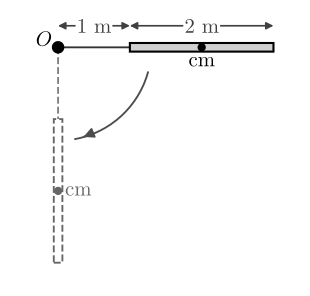

> [!NOTE]
> **Supuesto:** cuerda y barra giran alineadas, como un único cuerpo rígido alrededor de O. Es lo que sugiere el dato de $I_{\text{cm}}$, que se traslada a O con Steiner. Con una cuerda real, la barra se doblaría respecto de ella durante la caída (péndulo doble).

El centro de masa está a $d = 1\ \text{m} + 1\ \text{m} = 2$ m de O:

$$
I_O = \tfrac{1}{12}\,m\,\ell^2 + m\,d^2 = \tfrac13\ \text{kg·m}^2 + 4\ \text{kg·m}^2 = {\color{RoyalBlue} 4{,}33\ \text{kg·m}^2}
$$

Al llegar a la vertical, el centro de masa bajó $d$. Por energía:

$$
m\,g\,d = \tfrac12\,I_O\,\omega^2 \implies \omega = \sqrt{\frac{2 \cdot 20\ \text{J}}{4{,}33\ \text{kg·m}^2}} = 3{,}04\ \text{rad/s} \implies {\color{ForestGreen}\boxed{v_{\text{cm}} = \omega\,d \approx 6{,}08\ \text{m/s}}}
$$

En la vertical el peso no hace torque respecto de O, así que $\gamma_z = 0$ y el centro de masa solo tiene aceleración centrípeta, $\omega^2 d$, hacia O (arriba):

$$
T - m\,g = m\,\omega^2\,d \implies T = 10\ \text{N} + 1\ \text{kg} \cdot 9{,}23\ \text{s}^{-2} \cdot 2\ \text{m} \implies {\color{ForestGreen}\boxed{T \approx 28{,}5\ \text{N}}}
$$

<!-- salto-pagina -->

### Q5 — Esfera y aro rodando por el mismo plano

> Se dejan caer rodando sin resbalar, desde la parte superior de un plano inclinado ($\alpha = 30°$) de longitud 5 m, una esfera maciza y homogénea ($I_{\text{cm}} = \tfrac25\,m\,r^2$) y un aro ($I_{\text{cm}} = m\,r^2$). Se pide determinar: a) la aceleración del centro de masa de cada uno de ellos; b) el tiempo que emplea cada uno en llegar a la base del plano.

Con $I_{\text{cm}} = c\,m\,r^2$, las ecuaciones de traslación y rotación dan $a = \dfrac{g\,\mathrm{sen}\,\alpha}{1 + c}$, independiente de $m$ y $r$. Partiendo del reposo, $t = \sqrt{2L/a}$:

| | $c$ | a) $a_{\text{cm}}$ | b) $t$ |
|---|---|---|---|
| esfera | 2/5 | ${\color{ForestGreen} 3{,}57\ \text{m/s}^2}$ | ${\color{ForestGreen} 1{,}67\ \text{s}}$ |
| aro | 1 | ${\color{ForestGreen} 2{,}5\ \text{m/s}^2}$ | ${\color{ForestGreen} 2{,}00\ \text{s}}$ |

El aro tiene la masa lejos del eje, así que una parte mayor de su energía se va en girar y llega después.

<!-- salto-pagina -->

## Tema A (sin fecha)

### A1 — Repite H2

Mismo enunciado que H2: ${\color{ForestGreen}\boxed{\rho_c \approx 866{,}7\ \text{kg/m}^3}}$.

### A2 — Péndulo, choque elástico y resorte con rozamiento

> Se aparta 30° de la vertical un péndulo ideal de 2 m de longitud y 2 kg de masa. Al soltarse y llegar a la parte más baja, impacta con otra partícula de 1 kg de masa que se hallaba en reposo. Como consecuencia del choque elástico, esta última recorre una superficie horizontal impactando con un resorte ideal ($k = 1000$ N/m), el cual se encuentra con su longitud natural a una distancia $d = 1$ m de la partícula. Si hay fricción ($\mu_c = 0{,}2$) en toda la superficie, determine la máxima compresión del resorte.

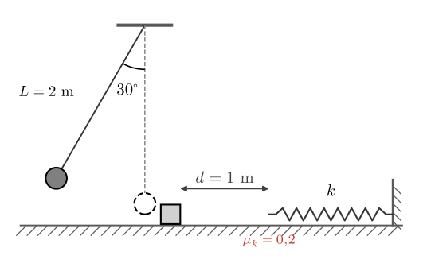

**Bajada del péndulo**, por energía:

$$
v = \sqrt{2\,g\,L\,(1 - \cos 30°)} = \sqrt{2 \cdot 10 \cdot 2 \cdot 0{,}134}\ \text{m/s} = {\color{RoyalBlue} 2{,}31\ \text{m/s}}
$$

**Choque elástico** contra la partícula en reposo:

$$
v_2' = \frac{2\,m_1}{m_1 + m_2}\,v = \frac{4}{3} \cdot 2{,}315\ \text{m/s} = {\color{RoyalBlue} 3{,}09\ \text{m/s}}
$$

El péndulo sigue a $(m_1 - m_2)\,v/(m_1 + m_2) = 0{,}77$ m/s, sin efecto sobre lo que sigue.

**Recorrido y compresión**, con rozamiento a lo largo de $d + x$: $W_f = \Delta E$.

$$
\tfrac12\,m_2\,v_2'^2 = \mu_k\,m_2\,g\,(d + x) + \tfrac12\,k\,x^2 \implies 4{,}76\ \text{J} = 2\ \text{N} \cdot (1\ \text{m} + x) + 500\ \tfrac{\text{N}}{\text{m}}\,x^2
$$

$$
500\,x^2 + 2\,x - 2{,}76 = 0 \implies {\color{ForestGreen}\boxed{x \approx 0{,}072\ \text{m} = 7{,}2\ \text{cm}}}
$$

<!-- salto-pagina -->

### A3 — Dos resortes en serie

> El sistema de la figura oscila con período $T = 1$ s. Sabiendo que la masa suspendida es de 3 kg y que la constante elástica del resorte superior es $k_1 = 236{,}8$ N/m, determine el valor de la constante elástica $k_2$ del resorte inferior. Los resortes son ideales, es decir, de masas despreciables.

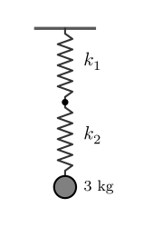

$$
k_{\text{eq}} = m\left(\frac{2\pi}{T}\right)^2 = 3\ \text{kg} \cdot (2\pi\ \text{s}^{-1})^2 = {\color{RoyalBlue} 118{,}4\ \text{N/m}}
$$

En serie, $\dfrac{1}{k_{\text{eq}}} = \dfrac{1}{k_1} + \dfrac{1}{k_2}$:

$$
k_2 = \frac{k_{\text{eq}}\,k_1}{k_1 - k_{\text{eq}}} = \frac{118{,}4 \cdot 236{,}8}{236{,}8 - 118{,}4}\ \text{N/m} \implies {\color{ForestGreen}\boxed{k_2 \approx 237\ \text{N/m}}}
$$

Es igual a $k_1$: dos resortes iguales en serie dan la mitad de la constante.

### A4 — Cilindro con tambor tirado desde arriba del tambor

> Un cilindro homogéneo ($I_{\text{cm}} = \tfrac12\,M\,R^2$) de masa $M$ y radio $R = 60$ cm está acelerado por una fuerza $F$ de intensidad 30 N, la cual se aplica mediante una cuerda enrollada alrededor de un tambor de masa despreciable y radio $r = 40$ cm, unido al cilindro, como muestra la figura. El coeficiente de rozamiento estático es suficiente para que el cilindro ruede sin resbalar. Determine la fuerza de rozamiento en módulo, dirección y sentido.

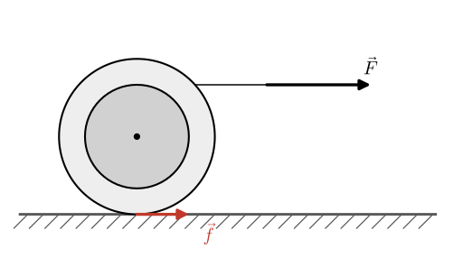

La cuerda sale de la parte superior del tambor: $\vec F = (F;\,0)$ en $(0;\,r)$; rozamiento $\vec f = (f;\,0)$ en $(0;\,-R)$, supuesto hacia adelante. Rueda hacia adelante: $\gamma_z = -a/R$.

$$
\tfrac12\,M\,R^2\,\gamma_z = -r\,F + R\,f \implies \tfrac12\,M\,R\,a = r\,F - R\,f \qquad\qquad F + f = M\,a
$$

Reemplazando $M\,a$ de la segunda en la primera:

$$
\tfrac12\,R\,(F + f) = r\,F - R\,f \implies f = \frac{F\,(r - R/2)}{\tfrac32\,R} = \frac{30\ \text{N} \cdot 0{,}1\ \text{m}}{0{,}9\ \text{m}}
$$

$$
{\color{ForestGreen}\boxed{f \approx 3{,}33\ \text{N},\ \text{horizontal, en el mismo sentido que } F}}
$$

No depende de $M$. Con $r > R/2$ el rozamiento acompaña a $F$; con $r < R/2$ se opondría, y con $r = R/2$ sería nulo.

### A5 — Ángulo máximo para que la esfera ruede sin resbalar

> Se deja caer una esfera maciza y homogénea ($I_{\text{cm}} = \tfrac25\,m\,r^2$), rodando sobre un plano inclinado. Sabiendo que el coeficiente de rozamiento estático entre la esfera y el plano es $\mu_e$, determine una expresión que permita calcular el ángulo máximo que puede tener el plano para que la esfera no resbale sobre el mismo.

Rodando sin resbalar, como en Q5: $a = \tfrac57\,g\,\mathrm{sen}\,\theta$. La traslación, $m\,g\,\mathrm{sen}\,\theta - f = m\,a$, da el rozamiento necesario:

$$
f = \tfrac27\,m\,g\,\mathrm{sen}\,\theta
$$

No resbala mientras $f \le \mu_s\,N = \mu_s\,m\,g\cos\theta$:

$$
\tfrac27\,\mathrm{sen}\,\theta \le \mu_s \cos\theta \implies {\color{ForestGreen}\boxed{\theta_{\max} = \arctan\!\left(\tfrac72\,\mu_s\right)}}
$$

<!-- salto-pagina -->

## Tema B (sin fecha)

### B1 — Esfera que cae dentro de un líquido

> Un depósito contiene un líquido de densidad $\delta_1$. Se sumerge completamente en él una esfera de metal maciza de radio $R$ y densidad $\delta_2$. Despreciando la viscosidad del líquido y suponiendo que $\delta_2/\delta_1 = 3$, determine el tiempo que demora la esfera en descender 11 m en profundidad cuando se la deja caer.

Sobre la esfera actúan el peso y el empuje (sin viscosidad):

$$
m\,a = w - B = (\rho_2 - \rho_1)\,g\,V \implies a = g\left(1 - \frac{\rho_1}{\rho_2}\right) = \tfrac23 \cdot 10\ \tfrac{\text{m}}{\text{s}^2} = {\color{RoyalBlue} 6{,}67\ \text{m/s}^2}
$$

$$
t = \sqrt{\frac{2\,h}{a}} = \sqrt{\frac{2 \cdot 11\ \text{m}}{6{,}67\ \text{m/s}^2}} \implies {\color{ForestGreen}\boxed{t \approx 1{,}82\ \text{s}}}
$$

No depende de $R$.

### B2 — Choque en una dimensión: ¿qué tipo de choque?

> Dos partículas de 5 kg y 20 kg se desplazan en una misma vía rectilínea; sus velocidades son 20 m/s hacia la derecha y 10 m/s hacia la izquierda, respectivamente. Si se detecta que la velocidad de la partícula de menor masa, después del choque, es de 20 m/s hacia la izquierda, determine: a) la velocidad de la otra partícula inmediatamente después de chocar; b) justifique qué tipo de choque se produjo.

**a)** Con $x$ hacia la derecha, se conserva la cantidad de movimiento:

$$
5 \cdot 20 + 20 \cdot (-10) = 5 \cdot (-20) + 20\,v_2' \implies -100 = -100 + 20\,v_2' \implies {\color{ForestGreen}\boxed{v_2' = 0}}
$$

**b)** $K_{\text{antes}} = \tfrac12 \cdot 5 \cdot 20^2 + \tfrac12 \cdot 20 \cdot 10^2 = 2000$ J, y $K_{\text{después}} = \tfrac12 \cdot 5 \cdot 20^2 = 1000$ J. Se pierde la mitad de la energía cinética y las partículas se separan después del choque:

> [!TIP]
> **Respuesta:** el choque es **inelástico, pero no plástico**. Su coeficiente de restitución es $e = \dfrac{v_2' - v_1'}{v_1 - v_2} = \dfrac{0 + 20}{20 + 10} = \tfrac23$.

### B3 — Estiramiento de equilibrio a partir del período

> Una partícula colgada de un resorte vertical oscila con un período de 0,5 s. Determine el estiramiento del resorte cuando el sistema está en su posición de equilibrio estático.

En el equilibrio, $k\,x_e = m\,g$, y $\omega^2 = k/m$:

$$
x_e = \frac{m\,g}{k} = \frac{g}{\omega^2} = \frac{g\,T^2}{4\pi^2} = \frac{10 \cdot 0{,}25}{39{,}48}\ \text{m} \implies {\color{ForestGreen}\boxed{x_e \approx 0{,}063\ \text{m} = 6{,}3\ \text{cm}}}
$$

### B4 — Repite P4

Mismo enunciado y datos que P4: ${\color{ForestGreen}\boxed{v_{\text{cm}} \approx 0{,}82\ \text{m/s}}}$.

### B5 — Volante frenado

> El volante de la figura, de geometría cilíndrica ($I_{\text{cm}} = \tfrac12\,M\,R^2$), de masa 4 kg y radio 20 cm, se encuentra girando con velocidad angular de intensidad $\omega_0 = 20$ rad/s. Se le aplica un momento de frenado de intensidad $M = 2$ N·m. Determine el número de vueltas girado desde que se aplicó el freno hasta detenerse, y cuánto demoró en hacerlo.

$I = \tfrac12 \cdot 4\ \text{kg} \cdot (0{,}2\ \text{m})^2 = 0{,}08\ \text{kg·m}^2$, y el freno da una desaceleración $|\gamma_z| = 2\ \text{N·m} / 0{,}08\ \text{kg·m}^2 = {\color{RoyalBlue} 25\ \text{rad/s}^2}$.

$$
t = \frac{\omega_0}{|\gamma_z|} = \frac{20}{25}\ \text{s} \implies {\color{ForestGreen}\boxed{t = 0{,}8\ \text{s}}} \qquad \Delta\theta = \frac{\omega_0^2}{2\,|\gamma_z|} = 8\ \text{rad} \implies {\color{ForestGreen}\boxed{\approx 1{,}27\ \text{vueltas}}}
$$

<!-- salto-pagina -->

## Resumen de resultados

| Ejercicio | Resultado | Docente |
|---|---|---|
| H1 | $d \approx 0{,}71$ m | coincide |
| H2 = A1 | $\rho_c \approx 866{,}7$ kg/m³ | coincide |
| P1 | $v_f \approx 2{,}57$ m/s a 45°; $d \approx 1{,}65$ m | 1,63 m (redondeo) |
| P2 | $k = 500$ N/m; $T \approx 0{,}281$ s; $v_{\max} \approx 1{,}12$ m/s; $F_{\max} = 35$ N | coincide |
| P3 | $v_2 \approx 4{,}34$ m/s; $\dot m \approx 0{,}49$ kg/s; $p_2 \approx 1{,}21 \cdot 10^5$ Pa | coincide |
| P4 = B4 | $v_{\text{cm}} \approx 0{,}82$ m/s | coincide |
| P5 | $a = 10$ m/s²; $f = 5$ N hacia arriba | coincide |
| R1 = Q1 | $v' = 0{,}7$ m/s; $x \approx 5{,}0$ cm | coincide |
| R2 | $U = E/16$, $K = 15E/16$; iguales en $x = \pm A/\sqrt2$ | coincide |
| R3 | $x \approx 0{,}168$ m, estiramiento | coincide |
| R4 | $a = 10$ m/s², $f = 10$ N; $K(5\ \text{s}) = 7500$ J | coincide |
| R5 | $v \approx 1{,}83$ m/s | coincide |
| Q2 | $k \approx 15{,}4$ N/m; $A \approx 0{,}65$ m | — |
| Q3 | 5 troncos | — |
| Q4 | $v_{\text{cm}} \approx 6{,}08$ m/s; $T \approx 28{,}5$ N (sistema rígido) | — |
| Q5 | esfera 3,57 m/s², 1,67 s; aro 2,5 m/s², 2,00 s | — |
| A2 | $x \approx 7{,}2$ cm | — |
| A3 | $k_2 \approx 237$ N/m ($= k_1$) | — |
| A4 | $f \approx 3{,}33$ N, mismo sentido que $F$ | — |
| A5 | $\theta_{\max} = \arctan(3{,}5\,\mu_s)$ | — |
| B1 | $t \approx 1{,}82$ s | — |
| B2 | $v_2' = 0$; inelástico, $e = 2/3$ | — |
| B3 | $x_e \approx 6{,}3$ cm | — |
| B5 | $t = 0{,}8$ s; ≈ 1,27 vueltas | — |

<!-- salto-pagina -->

## Clases grabadas de la cátedra

Del índice `Links Clases YouTube.pdf` (2021), las clases que cubren los temas de estos parciales:

| Tema | Clase | Ejercicios |
|---|---|---|
| Choques, cantidad de movimiento | 4.3 — <https://youtu.be/zDi6CXTol8A> | P1, R1, A2, B2 |
| Energía con resortes y rozamiento | 4.2 — <https://youtu.be/es069cP0uWU> | R1, R5, A2 |
| Resortes en serie y en paralelo | 3.9 — <https://youtu.be/POpYvr3My0U> | A3 |
| Dinámica del rígido, Steiner, poleas con masa | 5.2 — <https://youtu.be/d9e_le0-YRs> · 5.3 — <https://youtu.be/TeLgpVHN16o> | P5, R4, A4, A5, Q5, B5 |
| Energía del rígido | 5.4 — <https://youtu.be/U8h12MKLFB4> | P4, R5, Q4 |
| MAS | 6.1 — <https://youtu.be/AT8uLpkePfQ> · 6.2 — <https://youtu.be/-i2LEzQh4vE> | P2, R2, Q2, B3 |
| Hidrostática | 7.1 — <https://youtu.be/AMfQhlWCA84> | H1, H2, R3, Q3, B1 |
| Hidrodinámica, Bernoulli | 7.2 — <https://youtu.be/iilSGdRJyak> | P3 |

<!-- solo-md -->

---

**Fuentes:** enunciados `Ejercicios hidrostática.pdf`, `2º PARCIAL Z1054 2020.pdf`, `1° Rec 2ºPARCIAL Z1054 2020.pdf`, `Rec 2º PARCIAL Z1054 2021.pdf` y dos fotos de WhatsApp (temas A y B); resoluciones manuscritas `Resuelto por Vella - 2º Parcial Z1054.pdf`, `Resuelto por Vella - 1° Recuperatorio 2º Parcial Z1054.pdf`, `Ejercicios hidrostática resuelto por vella.pdf` y `Ejercicios hidrostática resuelto.pdf` (alumno). Todos aportados por el usuario el 22/nov/2026; copias catalogadas en `~/pruebas/materias/fisica/fisica_1/examenes/z1054_vella_2020-2021/`. Cálculos verificados en `figuras_parciales_vella.py`.

<!-- /solo-md -->
