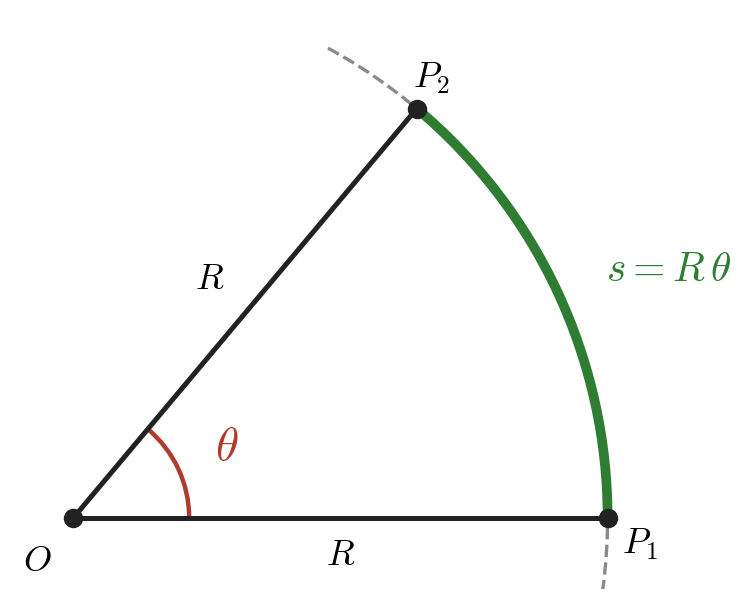
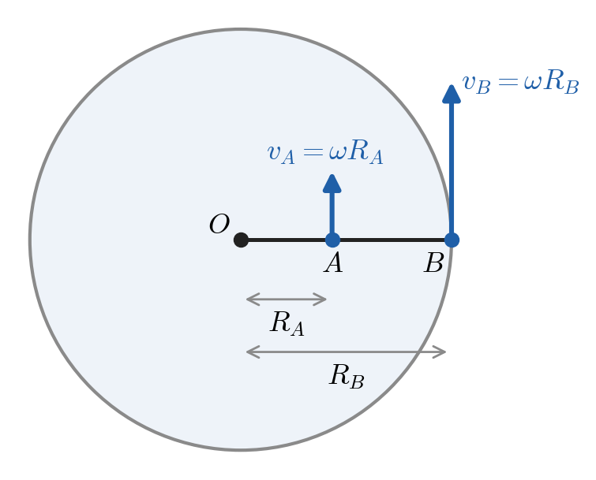
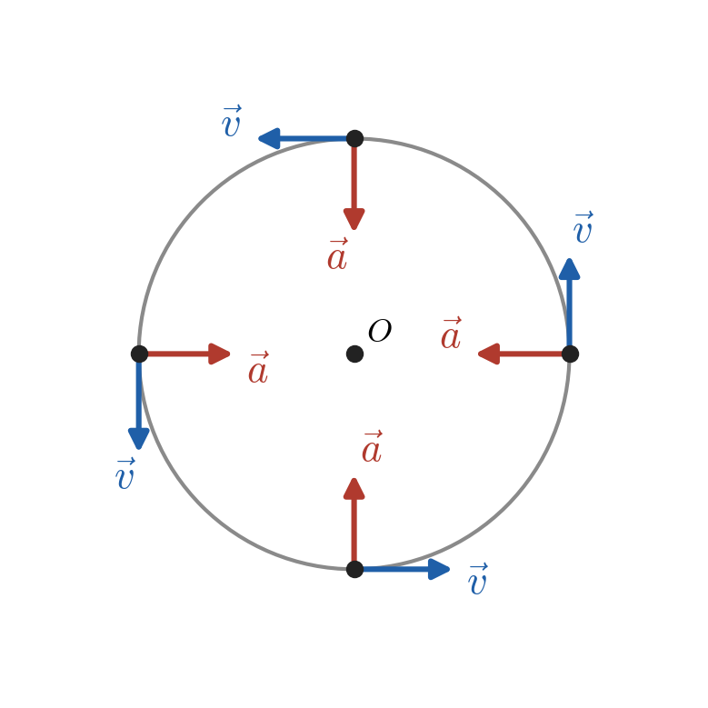
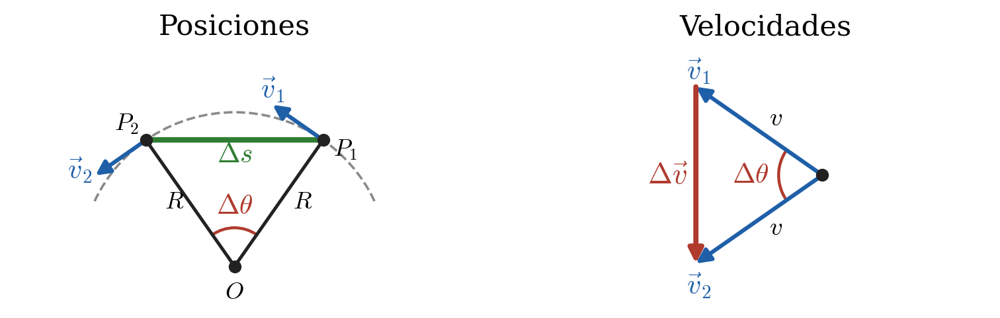

# Física I A1193 — Hoja de fórmulas

Hoja de estudio A4 (`hoja_formulas.tex` → `make` → `build/hoja_formulas.pdf`); a diferencia de la de Química, no tiene que entrar en una carilla. El PDF lleva **solo** las fórmulas que se van pidiendo; las sugerencias extra quedan únicamente en este `.md`.

## Cap. 2 — Movimiento en línea recta

### Definiciones

| Ecuación | Unidades |
|---|---|
| $v_x = \dfrac{dx}{dt}$ $\quad a_x = \dfrac{dv_x}{dt}$ ${\color{ForestGreen}\star}$ cap. 9 | m/s, m/s² |

Abren el capítulo en el PDF, en un solo renglón, con estrella verde hacia $\omega_z$ y $\gamma_z$ del cap. 9 (agregadas el 23/nov/2026).

### Aceleración constante

Solo valen si $a_x$ = cte; $x_0$ y $v_{0x}$ son los valores en $t = 0$. En el PDF, una estrella verde (${\color{ForestGreen}\star}$ cap. 9) remite a las cuatro análogas de rotación. **Colores (desde el 23/nov/2026):** todas las estrellas son verdes, tanto las analogías (misma ecuación con otras variables) como los enlaces (una ecuación que se usa para deducir otra o que continúa en otro capítulo); el rojo queda solo para las trampas importantes, y el azul (RoyalBlue) para resultados clave ($U_{\text{grav}}$, $U_{\text{el}}$, $a_{\text{tan}}$, $a_{\text{rad}}$ del cap. 9).

| Ecuación | Unidades |
|---|---|
| $v_x = v_{0x} + a_x\,t$ | m/s |
| $x = x_0 + v_{0x}\,t + \tfrac{1}{2}\,a_x\,t^2$ | m |
| $v_x^2 = v_{0x}^2 + 2\,a_x\,(x - x_0)$ ${\color{ForestGreen}\star}$ cap. 6 | m²/s² |
| $x - x_0 = \dfrac{v_{0x} + v_x}{2}\,t$ | m |

- **$v_x^2$, sin $t$:** de $v_x = v_{0x} + a_x\,t$ se despeja $t = \dfrac{v_x - v_{0x}}{a_x}$, se reemplaza en la $x$ de la trayectoria, $x(t)$, y se desarrolla.
- **$x - x_0$, sin $a_x$:** se igualan las dos expresiones de la velocidad media $v_{\text{med-}x} = \dfrac{x - x_0}{t} = \dfrac{v_{0x} + v_x}{2}$ (la segunda, solo con $a_x$ cte), y se multiplica por $t$.

## Cap. 3 — Movimiento en dos o tres dimensiones

### Proyectiles

Sin resistencia del aire y con el eje $y$ hacia arriba: $a_x = 0$, $a_y = {\color{BrickRed}-g}$, con $g = 9{,}80$ m/s². Origen en el punto de lanzamiento ($x_0 = y_0 = 0$); $\alpha_0$ es el ángulo de $\vec v_0$ sobre el semieje $+x$. Componentes de la velocidad inicial: $v_{0x} = v_0\cos\alpha_0$, $v_{0y} = v_0\,\mathrm{sen}\,\alpha_0$.

| Ecuación | Unidades |
|---|---|
| $x = (v_0\cos\alpha_0)\,t$ | m |
| $y = (v_0\,\mathrm{sen}\,\alpha_0)\,t - \tfrac{1}{2}\,g\,t^2$ | m |
| $v_x = v_0\cos\alpha_0$ | m/s |
| $v_y = v_0\,\mathrm{sen}\,\alpha_0 - g\,t$ | m/s |

### Movimiento circular uniforme

La rapidez $v$ es constante pero la dirección de $\vec v$ cambia, así que hay aceleración. $a_{\text{rad}}$ es la aceleración **radial**: perpendicular a $\vec v$ y dirigida hacia el centro, por eso también se la llama **centrípeta** («que busca el centro»). $T$ es el período [s], el tiempo de una vuelta. $v$ es la rapidez lineal [m/s], no la angular. La velocidad angular es $\omega = v/R = 2\pi/T$ [rad/s]; con ella, $v = \omega R$ y $a_{\text{rad}} = \omega^2 R$.

**Corrección del 23/nov/2026:** hasta acá la hoja escribía $a_{\text{rad}} = \gamma$. Pero $\gamma$ es la **aceleración angular** (cap. 9, rad/s²), no una aceleración lineal: se sacó de todas las fórmulas y explicaciones de $a_{\text{rad}}$.

| Ecuación | Unidades |
|---|---|
| $a_{\text{rad}} = \dfrac{v^2}{R}$ | m/s² |
| $v = \dfrac{2\pi R}{T}$ | m/s |
| $a_{\text{rad}} = \dfrac{4\pi^2 R}{T^2}$ | m/s² |
| $\omega = \dfrac{v}{R} = \dfrac{2\pi}{T}$ ${\color{ForestGreen}\star}$ cap. 9 | rad/s |
| $a_{\text{rad}} = \omega^2 R$ ${\color{ForestGreen}\star}$ cap. 9 | m/s² |

En el PDF, las dos últimas llevan estrella al cap. 9, donde se deducen en general (con $\omega$ variable). Se quedan acá porque son las de MCU; el cap. 9 no las mueve, las extiende.

#### Por qué $\omega = v/R$ y $a_{\text{rad}} = v^2/R$ (solo en este `.md`)

**La idea de fondo:** $v$ dice cuánto camino se recorre por segundo, y $\omega$ cuánto ángulo se barre por segundo. $R$ es lo que convierte uno en el otro.

**1. Por qué $\omega = v/R$**

El radián se define justamente así: el ángulo es el arco medido en radios.



$$
s = R\,\theta
\quad\xrightarrow{\;\div\,t\;}\quad
\frac{s}{t} = R\,\frac{\theta}{t}
\quad\Rightarrow\quad
v = R\,\omega
\quad\Rightarrow\quad
\omega = \frac{v}{R}
$$

Todos los puntos de un disco barren el mismo ángulo en el mismo tiempo, así que comparten $\omega$. Pero el más alejado recorre más camino, así que tiene más $v$:



Unidades: $\dfrac{\text{m/s}}{\text{m}} = \dfrac{1}{\text{s}}$, que se escribe rad/s porque el radián no tiene dimensión.

**2. Por qué hay aceleración si la rapidez no cambia**

$\vec v$ es tangente al círculo, así que su dirección cambia todo el tiempo. Ese cambio es la aceleración, y apunta hacia el centro:



**3. Por qué $a_{\text{rad}} = v^2/R$**

En un $\Delta t$ chico el cuerpo pasa de $P_1$ a $P_2$ y gira un ángulo $\Delta\theta$. Como $\vec v$ siempre es perpendicular al radio, $\vec v$ gira ese mismo $\Delta\theta$. Quedan dos triángulos con la misma forma (isósceles, con el mismo ángulo $\Delta\theta$):



Como son semejantes, los lados son proporcionales. Después se divide por $\Delta t$:

$$
\frac{\Delta v}{v} = \frac{\Delta s}{R}
\quad\Rightarrow\quad
\frac{\Delta v}{\Delta t} = \frac{v}{R}\cdot\frac{\Delta s}{\Delta t}
\quad\Rightarrow\quad
a_{\text{rad}} = \frac{v}{R}\cdot v = \frac{v^2}{R}
$$

En el último paso, con $\Delta t \to 0$, $\Delta s/\Delta t$ es $v$ y $\Delta v/\Delta t$ es la aceleración.

**Por qué $v$ aparece dos veces.** Cada una tiene un motivo distinto:

- **Una $v$ es la que gira:** cuanto más grande es el vector, más cambia al girar el mismo ángulo.
- **La otra $v$ es lo rápido que gira:** a más rapidez, más ángulo por segundo, porque $\omega = v/R$.

Eso se ve escrito así: $a_{\text{rad}} = \underbrace{\omega}_{\text{lo rápido que gira}}\cdot\underbrace{v}_{\text{lo que gira}} = \dfrac{v}{R}\cdot v = \omega^2 R$.

**4. La misma cuenta con vectores**

Con la posición en componentes, derivar dos veces da todo junto:

$$
\vec r = R\,(\cos\omega t,\ \mathrm{sen}\,\omega t)
\quad\Rightarrow\quad
\vec v = \omega R\,(-\mathrm{sen}\,\omega t,\ \cos\omega t)
\quad\Rightarrow\quad
\vec a = -\omega^2 R\,(\cos\omega t,\ \mathrm{sen}\,\omega t) = -\omega^2\,\vec r
$$

- $|\vec v| = \omega R$: es la relación $v = \omega R$.
- $|\vec a| = \omega^2 R$: es $a_{\text{rad}}$.
- El signo menos de $-\omega^2\vec r$ dice que $\vec a$ es opuesta a $\vec r$: apunta hacia el centro.

**5. Ejemplo y chequeo**

Con $\omega = 4\pi$ rad/s y $R = 0{,}75$ m, las dos fórmulas dan lo mismo:

$$
v = \omega R = 3\pi \approx 9{,}42 \text{ m/s}
\qquad
\frac{v^2}{R} = \frac{(3\pi)^2}{0{,}75} \approx 118 \text{ m/s}^2
\qquad
\omega^2 R = (4\pi)^2 \cdot 0{,}75 \approx 118 \text{ m/s}^2
$$

### Velocidad relativa en el espacio

$P$ es el cuerpo; $A$ y $B$, dos marcos de referencia; $\vec v_{P/A}$, la velocidad de $P$ respecto de $A$. Es una suma vectorial, así que se opera por componentes. Es la transformación de Galileo: vale para rapideces mucho menores que la de la luz ($v \ll c$).

| Ecuación | Unidades |
|---|---|
| $\vec v_{P/A} = \vec v_{P/B} + \vec v_{B/A}$ | m/s |

Sugerencia (no está en el PDF): $\vec v_{A/B} = -\vec v_{B/A}$, para invertir el orden de los subíndices.

## Cap. 4 — Leyes de Newton

### Fuerza neta

Suma vectorial de todas las fuerzas sobre **un** cuerpo; $1\text{ N} = 1\text{ kg}\cdot\text{m/s}^2$. Símbolos habituales: $w$ peso, $n$ normal, $T$ tensión, $f$ rozamiento.

| Ecuación | Unidades |
|---|---|
| $\vec R = \sum\vec F = \vec F_1 + \vec F_2 + \dots$ | N |
| $R_i = \sum F_i \quad (i = x, y, z)$ | N |

### 1.ª ley

$\vec a = 0$: el cuerpo está en reposo **o** se mueve con $\vec v$ constante. Vale solo en marcos inerciales.

| Ecuación | Unidades |
|---|---|
| $\sum\vec F = 0$ | N |

### 2.ª ley

Solo fuerzas externas. $m\vec a$ **no es una fuerza**: no va en el diagrama de cuerpo libre.

| Ecuación | Unidades |
|---|---|
| $\sum\vec F = m\,\vec a$ | N |
| $\sum F_i = m\,a_i \quad (i = x, y, z)$ | N |

### Peso

Fuerza gravitatoria de la Tierra sobre el cuerpo. Módulo: $w = m\,g$ (siempre positivo); dirección: hacia abajo. $m$ es propia del cuerpo; $w$ varía con $g$ según el lugar.

| Ecuación | Unidades |
|---|---|
| $\vec w = m\,\vec g$ | N |

### 3.ª ley

Las dos fuerzas actúan sobre cuerpos **distintos**: nunca se cancelan entre sí. $n$ no es la reacción de $w$: la reacción de $w$ es la atracción del cuerpo sobre la Tierra. Tampoco vale siempre $n = w$ (plano inclinado, ascensor que acelera).

| Ecuación | Unidades |
|---|---|
| $\vec F_{A\,\text{sobre}\,B} = -\vec F_{B\,\text{sobre}\,A}$ | N |

### Método

1. Elegir un cuerpo.
2. Diagrama de cuerpo libre: solo las fuerzas sobre él.
3. $\sum F$ por eje, con un eje en el sentido de $\vec a$.

## Cap. 5 — Aplicación de las leyes de Newton

$T$ no siempre es igual a $w$ (cuerpo colgado de una cuerda que acelera).

### Plano inclinado

Eje $x$ paralelo al plano; $\alpha$ es el ángulo del plano con la horizontal. $n = m\,g\cos\alpha$ solo si ninguna otra fuerza tiene componente perpendicular al plano.

| Ecuación | Unidades |
|---|---|
| $w_\parallel = m\,g\,\mathrm{sen}\,\alpha \qquad w_\perp = m\,g\cos\alpha$ | N |

### Rozamiento

Son relaciones entre módulos, no vectoriales: $\vec f \perp \vec n$. El «=» de $f_s$ vale solo a punto de deslizar; si no, $f_s$ sale de $\sum\vec F = 0$. Por lo general, $\mu_k < \mu_s$.

| Ecuación | Unidades |
|---|---|
| $f_k = \mu_k\,n$ | N |
| $f_s \le \mu_s\,n$ | N |

### Dinámica circular

$\sum\vec F$ apunta hacia el centro: es la resultante de las fuerzas que ya están en el diagrama. No agregar una fuerza «centrífuga»: en un marco inercial no existe.

| Ecuación | Unidades |
|---|---|
| $F_{\text{net}} = m\,a_{\text{rad}} = m\,\dfrac{v^2}{R}$ | N |
| $F_{\text{net}} = m\,\omega^2 R$ | N |

### Resistencia de fluidos

$f$ se opone a $\vec v$. $k$ y $D$ son **constantes** para un cuerpo y un fluido dados: no dependen de $v$. $v_t$ es la rapidez terminal de caída ($a = 0$, $f = m\,g$).

- **$k$ [kg/s]:** crece con el tamaño del cuerpo y la viscosidad del fluido.
- **$D$ [kg/m]:** crece con el área frontal del cuerpo y la densidad del fluido; también influye la forma.

| Ecuación | Unidades | Caso |
|---|---|---|
| $f = k\,v$ | N | Rapidez baja (polvo, bolilla en aceite) |
| $v_t = \dfrac{m\,g}{k}$ | m/s | Rapidez baja |
| $f = D\,v^2$ | N | Rapidez alta (objetos grandes en el aire) |
| $v_t = \sqrt{\dfrac{m\,g}{D}}$ | m/s | Rapidez alta |

Sugerencia (no está en el PDF ni en el cap. 5 del libro): en una esfera, $k = 6\pi\eta r$ (ley de Stokes, $\eta$: viscosidad); en general, $D = \tfrac12 C\rho A$ ($C$: coeficiente de arrastre, $\rho$: densidad, $A$: área frontal).

## Cap. 6 — Trabajo y energía cinética (terminado)

Capítulo estudiado completo. La columna «PDF» de cada tabla indica qué fórmulas están en el PDF.

### La idea que ordena el capítulo

El cap. 6 no agrega una ley nueva: es la 2.ª ley mirada a lo largo del desplazamiento en lugar de a lo largo del tiempo. Todo sale de la ecuación del cap. 2 que ya se obtuvo eliminando $t$:

$$
v_x^2 = v_{0x}^2 + 2\,a_x\,(x - x_0)
\quad\xrightarrow{\;\times\,\frac{m}{2}\;}\quad
\tfrac{1}{2}\,m\,v_x^2 - \tfrac{1}{2}\,m\,v_{0x}^2 = (m\,a_x)\,(x - x_0) = F_x\,(x - x_0)
$$

La diferencia de velocidades al cuadrado es lo que se convierte en $\Delta K$, y $m\,a_x$ es lo que se convierte en fuerza. La derivación completa está en [`energia_casos_limite/01_de_la_cinematica_al_trabajo_energia.md`](../energia_casos_limite/01_de_la_cinematica_al_trabajo_energia.md).

**El siguiente paso conceptual:** esa derivación supone $a_x$ constante, pero el teorema vale también con fuerza variable y trayectoria curva. La misma estructura reaparece sin la hipótesis, porque $a_x = v_x\,\dfrac{dv_x}{dx}$:

$$
\int_{x_1}^{x_2} F_x\,dx = \int_{v_1}^{v_2} m\,v_x\,dv_x = \tfrac{1}{2}\,m\,v_2^2 - \tfrac{1}{2}\,m\,v_1^2
$$

La integral hace el trabajo que antes hacía el álgebra de eliminar $t$, y el resultado es el mismo.

### Orden sugerido de incorporación

Cada bloque usa el anterior. El programa de la materia lista «Trabajo de fuerzas. Trabajo y energía cinética. Potencia».

| Orden | Bloque | Qué aporta |
|---|---|---|
| 1 | Trabajo con fuerza constante | Define $W$ |
| 2 | Energía cinética y teorema | El centro del capítulo |
| 3 | Fuerza variable | Quita la hipótesis de $a$ constante |
| 4 | Resorte | Primer caso de fuerza variable |
| 5 | Potencia | Agrega el tiempo: qué tan rápido se hace el trabajo |

### 1. Trabajo con fuerza constante

| Ecuación | Unidades | PDF |
|---|---|---|
| $W = \vec F\cdot\vec s = F\,s\cos\phi$ | J | sí |
| $W = F_x s_x + F_y s_y + F_z s_z$ | J | sí |

En el PDF: **producto escalar** de $\vec F$ y $\vec s$, $W$ es un **escalar**; $\vec s$ es el desplazamiento recto, con $s_x = x_2 - x_1$; $\phi$ es el ángulo entre $\vec F$ y $\vec s$; $1\text{ J} = 1\text{ N}\cdot\text{m}$.

Notas propuestas, todavía no en el PDF:

- Tiene signo, pero no dirección: $W > 0$ si $\phi < 90^\circ$, $W = 0$ si $\phi = 90^\circ$, $W < 0$ si $\phi > 90^\circ$.
- Siempre es el trabajo de **una** fuerza sobre **un** cuerpo: hay que decir cuál.

Por qué así:

- **La forma por componentes va incluida.** Evita traer un coseno de memoria y da el signo solo.
- **$\vec F \perp \vec s \Rightarrow W = 0$ conecta con lo anterior.** La normal no trabaja en un desplazamiento sobre la superficie, y la resultante centrípeta tampoco: por eso en movimiento circular uniforme $K$ no cambia y la rapidez es constante.
- **Notación:** la hoja usa $\vec s$ y $\phi$, como el Sears (`energia_casos_limite/` usa $\Delta\vec r$ y $\theta$).
- **El «·» de N·m no es un producto escalar:** es la multiplicación común de unidades. El producto escalar opera entre $\vec F$ y $\vec s$; su resultado se mide en N·m.

### 2. Energía cinética y teorema trabajo-energía

Entre dos puntos 1 y 2 del recorrido sobre $x$, la ecuación ${\color{ForestGreen}\star}$ del cap. 2 cambia de nombres: $v_{0x} \to v_1$, $v_x \to v_2$, $x - x_0 \to s$. No hace falta que el punto 1 sea $t = 0$.

| Paso | Ecuación | Unidades | PDF |
|---|---|---|---|
| ${\color{ForestGreen}\star}$ cap. 2 | $v_2^2 = v_1^2 + 2\,a_x\,s$ | m²/s² | sí |
| Se despeja $a_x\,s$ | $a_x\,s = \tfrac{1}{2}\,v_2^2 - \tfrac{1}{2}\,v_1^2$ | m²/s² | sí |
| Se multiplica por $m$, con $\sum F_x = m\,a_x$ | $\bigl(\sum F_x\bigr)\,s = \tfrac{1}{2}\,m\,v_2^2 - \tfrac{1}{2}\,m\,v_1^2$ | J | sí |
| Definición | $K = \tfrac{1}{2}\,m\,v^2$ | J | sí |
| Teorema | $W_{\text{tot}} = K_2 - K_1 = \Delta K$ | J | sí |

Unidades: $\text{kg}\cdot\text{m}^2/\text{s}^2 = (\text{kg}\cdot\text{m}/\text{s}^2)\cdot\text{m} = \text{N}\cdot\text{m} = \text{J}$.

En el PDF: $K$ es escalar y $K \ge 0$; $W_{\text{tot}}$ son todas las fuerzas, no una sola; vale también con fuerza variable y trayectoria curva.

Nota propuesta, todavía no en el PDF: el doble de $v$ da cuatro veces $K$.

### 3. Trabajo con fuerza variable

| Ecuación | Unidades | PDF |
|---|---|---|
| $W = \displaystyle\int_{x_1}^{x_2} F_x\,dx$ | J | sí |
| $W = \displaystyle\int_{P_1}^{P_2} F_\parallel\,dl = \int_{P_1}^{P_2} \vec F\cdot d\vec l$ | J | sí |

En el PDF:

- $W$ es el área bajo la curva $F_x(x)$, con signo.
- La segunda es el caso general: la fuerza puede variar y la trayectoria puede ser curva.
- $d\vec l$: desplazamiento infinitesimal, tangente a la trayectoria (*length*).
- Solo trabaja la componente de $\vec F$ a lo largo del camino ($F_\parallel = F\cos\phi$).

Por qué así: con $F_x$ constante la integral devuelve $F_x\,(x_2 - x_1)$. Conviene pensarla como la generalización del bloque 1, no como otra fórmula.

### 4. Resorte

| Ecuación | Unidades | PDF |
|---|---|---|
| $F_x = k\,x$ | N | sí |
| $W = \tfrac{1}{2}\,k\,x_2^2 - \tfrac{1}{2}\,k\,x_1^2$ | J | sí |

En el PDF:

- $x$: estiramiento desde la longitud natural. $k$ [N/m]: constante de fuerza del resorte.
- Es la fuerza y el trabajo **sobre** el resorte. **Trampa:** el trabajo **del** resorte tiene el signo opuesto.

Por qué así:

- **La fórmula general incluye a la del libro.** $W = \tfrac{1}{2}\,k\,X^2$ es el caso que arranca sin estirar, con $x_1 = 0$.
- **Colisión de símbolos:** esta $k$ no es la $k$ de resistencia de fluidos del cap. 5. Aclararlo por las unidades (N/m frente a kg/s) evita la confusión.
- **Se ve la misma estructura de nuevo:** diferencia de cuadrados, ahora de $x$.

### 5. Potencia

| Ecuación | Unidades | PDF |
|---|---|---|
| $P_{\text{med}} = \dfrac{\Delta W}{\Delta t}$ | W | sí |
| $P = \dfrac{dW}{dt} = \vec F\cdot\vec v$ | W | sí |

En el PDF:

- $1\text{ W} = 1\text{ J/s}$, igual que $1\text{ J} = 1\text{ N}\cdot\text{m}$ en Trabajo.
- $P$ es un escalar.
- Definición: rapidez con que se realiza trabajo.
- De dónde sale $\vec F\cdot\vec v$: en un $dt$ la fuerza trabaja $dW = \vec F\cdot d\vec l$; al dividir por $dt$, $d\vec l/dt = \vec v$, así que $P = \vec F\cdot\vec v$. Por eso tiene la misma forma que $\vec F\cdot\vec s$, con la velocidad en lugar del desplazamiento.
- El kWh es unidad de **energía**, no de potencia.

Por qué así: $\vec F\cdot\vec v$ es la fórmula que más se usa de esta sección y permite pasar directo de fuerza y velocidad a potencia. El tema se conecta con `energia_casos_limite/05_comparativa_potencia_humana.md`.

### Símbolos que conviene separar

Con este capítulo se acumulan letras repetidas. Está en el PDF como bloque **comodín**: puede ir en cualquier columna, o al final de la hoja. Desde el 23/nov/2026 abre la 3.ª carilla (antes estuvo al pie de la col. 2 de la 2.ª, hasta que entró el cap. 8), con las tres entradas del cap. 8 ($\vec p$, $\vec P$, $\vec J$) y dos del cap. 9: $\gamma_z$, aceleración angular [rad/s²], y $a_{\text{rad}}, a_{\text{tan}}$, componentes de $\vec a$ de un punto [m/s²].

| Símbolo | Significado | Unidad |
|---|---|---|
| $W$ (cursiva) | Trabajo (*work*), una magnitud | J |
| W (recta) | Watt, unidad de potencia: $1\text{ W} = 1\text{ J/s}$; la potencia es $P$ | — |
| $w$ | Peso (*weight*) | N |
| $k$ | Constante del resorte / de resistencia de fluidos | N/m / kg/s |
| $\vec r$ | Posición (radio vector) | m |
| $\vec s = \Delta\vec r$ | Desplazamiento recto total, de $P_1$ a $P_2$ | m |
| $d\vec l = d\vec r$ | Tramo del camino, tangente a la trayectoria (*length*) | m |

## Cap. 7 — Energía potencial y conservación de la energía (terminado: el PDF llega hasta el bloque 4)

Igual que el cap. 6: las fórmulas pasan al PDF a medida que se estudian, y la columna «PDF» lleva la cuenta. **En el PDF, el cap. 7 empieza directamente en la 2.ª carilla**: la 1.ª ya no tiene lugar para arrancar un capítulo.

El programa lo reparte en dos clases: «Trabajo de fuerzas conservativas. Energía potencial de fuerzas conservativas» y «Trabajo de fuerzas no conservativas».

### La idea que ordena el capítulo

Es el teorema del cap. 6 con el trabajo total separado en dos partes:

$$
W_{\text{tot}} = \Delta K
\qquad
W_{\text{tot}} = W_{\text{cons}} + W_{\text{otras}}
\qquad
W_{\text{cons}} = -\Delta U
$$

$$
\Rightarrow\quad \Delta K + \Delta U = W_{\text{otras}}
\quad\Longleftrightarrow\quad
K_1 + U_1 + W_{\text{otras}} = K_2 + U_2
$$

El trabajo de las fuerzas conservativas (peso, resorte) se pasa al otro lado como energía potencial, y en $W_{\text{otras}}$ queda todo lo demás (rozamiento, tensión de una cuerda, una mano que empuja). Si $W_{\text{otras}} = 0$, se conserva $E = K + U$. Todo el capítulo es esta línea más los casos particulares de $U$.

### Orden sugerido de incorporación

| Orden | Bloque | Qué aporta |
|---|---|---|
| 1 | Energía potencial gravitatoria | Primera $U$; el trabajo del peso no depende del camino |
| 2 | Energía potencial elástica | Segunda $U$; conecta con el resorte del cap. 6 |
| 3 | Conservación de la energía mecánica | $E = K + U$, con y sin $W_{\text{otras}}$ |
| 4 | Fuerzas conservativas y no conservativas | Por qué existe $U$ para unas y no para otras; energía interna |
| 5 | Fuerza a partir de $U$ | El camino inverso: derivar $U$ da la fuerza |
| 6 | Diagramas de energía | Equilibrios estable e inestable |

### 1. Energía potencial gravitatoria

| Ecuación | Unidades | PDF |
|---|---|---|
| $W_{\text{grav}} = \vec w\cdot\vec s = -m\,g\,(y_2 - y_1)$ | J | sí |
| $W_{\text{grav}} = m\,g\,y_1 - m\,g\,y_2$ | J | sí |
| $U_{\text{grav}} = m\,g\,y$ | J | sí |
| $W_{\text{grav}} = U_1 - U_2 = -(U_2 - U_1) = -\Delta U_{\text{grav}}$ | J | sí |

En el PDF: abre el capítulo una definición breve de energía potencial (asociada a la posición, capacidad de efectuar trabajo; gravitatoria y elástica). En el bloque: $\vec w = -m\,g\,\hat\jmath$ con eje $y$ hacia arriba; solo cuenta el desplazamiento vertical; nivel de referencia libre; el signo menos desglosado ($\Delta U$ = final − inicial; sube: $\Delta U > 0$, $W < 0$; baja: $\Delta U < 0$, $W > 0$; el peso trabaja a costa de $U$).

Notas propuestas (las que siguen ya quedaron cubiertas en el PDF salvo la de validez cerca de la Tierra):

- $y$: altura, con el eje **hacia arriba** (la misma convención que en proyectiles). El cero de $y$ se elige libremente: solo importa $\Delta U$.
- El signo: si el cuerpo sube, el peso hace trabajo negativo y $U$ aumenta.
- Vale aunque la trayectoria sea curva: el peso solo trabaja con el desplazamiento vertical.

Por qué así:

- **El signo menos de $W = -\Delta U$ es la fuente de casi todos los errores del capítulo.** Conviene que el PDF lo tenga escrito, no solo $U = m g y$.
- **Conexión con el cap. 6:** es $W = \vec F\cdot\vec s$ con $\vec F = -m\,g\,\hat\jmath$, que da $-m\,g\,(y_2 - y_1)$ por componentes, sin ángulos. Lo mismo sale con $\int \vec F\cdot d\vec l$ en un camino curvo: solo sobrevive $dy$.
- **Válida cerca de la superficie de la Tierra**, con $g$ constante. La forma general $U = -G\,m_T\,m/r$ es del cap. 13 y no hace falta ahora.

### 2. Energía potencial elástica

| Ecuación | Unidades | PDF |
|---|---|---|
| $U_{\text{el}} = \tfrac{1}{2}\,k\,x^2$ | J | sí |
| $W_{\text{el}} = \tfrac{1}{2}\,k\,x_1^2 - \tfrac{1}{2}\,k\,x_2^2 = -\Delta U_{\text{el}}$ | J | sí |

En el PDF, armado igual que la gravitatoria: $F_x = -k\,x$ (fuerza **del** resorte, con estrella recíproca al bloque Resorte del cap. 6), $W_{\text{el}}$ como integral y desarrollado, $U_{\text{el}}$, origen fijo en la longitud natural (a diferencia de $y$, que se elige donde convenga), $U_{\text{el}} \ge 0$, el signo según se deforme más o vuelva hacia $x = 0$, y la distinción **por** el resorte ($-\Delta U$) / **sobre** el resorte ($+\Delta U$).

Notas propuestas:

- Ahora la fuerza es la **del** resorte sobre el cuerpo: $F_x = -k\,x$. Es la trampa del bloque «Resorte» del cap. 6 resuelta: allá $F_x = k\,x$ y el trabajo eran **sobre** el resorte; acá es el signo opuesto.
- $x = 0$ es la longitud natural: acá el cero no es libre, a diferencia de $U_{\text{grav}}$.
- $U_{\text{el}} \ge 0$ siempre: estirado o comprimido, el resorte guarda energía.

Por qué así: si en la 2.ª carilla se pone $F_x = -k\,x$, conviene un enlace con estrella al bloque Resorte del cap. 6 (como el que ya une cap. 2 y cap. 6), para que se vea que es el mismo resorte con el signo cambiado y no una contradicción.

### 3. Conservación de la energía mecánica

| Ecuación | Unidades | PDF |
|---|---|---|
| $E = K + U$, con $U = U_{\text{grav}} + U_{\text{el}}$ | J | sí |
| $K_1 + U_1 = K_2 + U_2$ (solo fuerzas conservativas) | J | sí |
| $K_1 + U_1 + W_{\text{otras}} = K_2 + U_2$ | J | sí |

En el PDF: las tres, con $U = U_{\text{grav}} + U_{\text{el}}$, y las tres notas propuestas. Quedan fuera la derivación desde $W_{\text{tot}} = \Delta K$ y el método.

Notas propuestas:

- $W_{\text{otras}}$: trabajo de todas las fuerzas que **no** están en $U$. No se cuenta dos veces: el peso va en $U_{\text{grav}}$ o en $W$, nunca en los dos.
- Con rozamiento, $W_{\text{otras}} < 0$ y $E$ disminuye.
- Es una ecuación escalar: no hace falta descomponer, y no da información sobre el tiempo.

Por qué así:

- **La tercera incluye a la segunda** (con $W_{\text{otras}} = 0$). Se podría poner solo la tercera, pero la segunda es la que más se usa y conviene verla sola.
- **La idea que ordena el capítulo** (la derivación desde $W_{\text{tot}} = \Delta K$) podría ir en el PDF como en el cap. 6 «De la cinemática a la energía»: tres renglones cortos que muestran que el cap. 7 no agrega una ley nueva.
- **Método, en una nota:** elegir estado 1 y estado 2, el cero de $y$, y listar qué fuerzas van en $U$ y cuáles en $W_{\text{otras}}$.

### 4. Fuerzas conservativas y no conservativas

| Ecuación | Unidades | PDF |
|---|---|---|
| $W_{\text{cons}} = -\Delta U$ | J | no |
| $\oint \vec F_{\text{cons}}\cdot d\vec l = 0$ | J | no |
| $\Delta K + \Delta U + \Delta U_{\text{int}} = 0$ | J | sí |
| $\Delta U_{\text{int}} = -W_{\text{otras}}$ (solo rozamiento) | J | sí |

En el PDF, como bloque «Conservación de la energía» después de la mecánica: solo la tercera, con su nota (energía interna y $\Delta U_{\text{int}} = -W_{\text{otras}}$). Las dos primeras quedan acá.

Notas propuestas:

- Conservativa: el trabajo no depende del camino, solo de los extremos; en un camino cerrado es cero; es reversible. Ejemplos: peso, resorte.
- No conservativa: el rozamiento cinético siempre se opone al movimiento, así que en un camino cerrado su trabajo es negativo. No tiene $U$.
- La tercera es la **ley de conservación de la energía**: lo que pierde la energía mecánica aparece como energía interna ($\Delta U_{\text{int}} = -W_{\text{otras}}$ cuando la única fuerza no conservativa es el rozamiento).

Por qué así: la integral cerrada $\oint$ reutiliza el $d\vec l$ que ya está en la hoja; es la forma más compacta de la definición. Si parece demasiado, alcanza con la nota de texto.

### 5. Fuerza a partir de la energía potencial

| Ecuación | Unidades | PDF |
|---|---|---|
| $F_x(x) = -\dfrac{dU(x)}{dx}$ | N | no |
| $\vec F = -\left(\dfrac{\partial U}{\partial x}\,\hat\imath + \dfrac{\partial U}{\partial y}\,\hat\jmath + \dfrac{\partial U}{\partial z}\,\hat k\right) = -\vec\nabla U$ | N | no |

Notas propuestas:

- Es el camino inverso de $W = -\Delta U$: integrar la fuerza da $U$; derivar $U$ da la fuerza.
- Verificación rápida: $U = m\,g\,y \Rightarrow F_y = -m\,g$; $U = \tfrac12\,k\,x^2 \Rightarrow F_x = -k\,x$.
- La fuerza apunta hacia donde $U$ **disminuye**.

Por qué así: la forma vectorial con el gradiente es la que encaja con la preferencia por los vectores y por componentes; la de una dimensión es su caso particular, como pasó con las integrales del cap. 6.

### 6. Diagramas de energía

| Ecuación | Unidades | PDF |
|---|---|---|
| Equilibrio: $\dfrac{dU}{dx} = 0$ | — | no |

Notas propuestas:

- Mínimo de $U$: equilibrio **estable** (la fuerza devuelve al cuerpo). Máximo: **inestable**.
- Con $E$ dada, el cuerpo solo puede estar donde $U \le E$, porque $K \ge 0$. Donde $U = E$ se frena y vuelve (puntos de retorno).

Por qué así: es más un gráfico que una fórmula. Si entra, es con una figura matplotlib en el `.md`, como las de movimiento circular; en el PDF alcanza con las dos notas.

### Símbolos que se suman con el cap. 7

| Símbolo | Significado | Unidad |
|---|---|---|
| $U$ | Energía potencial | J |
| $U_{\text{int}}$ | Energía interna (no es potencial: es la de las partículas del cuerpo) | J |
| $E$ | Energía mecánica total, $K + U$ | J |
| $W_{\text{otras}}$ | Trabajo de las fuerzas que no están en $U$ | J |
| $y$ | Altura, eje hacia arriba (en `energia_casos_limite/` es $h$, *height*) | m |

Conviene agregarlos a «Símbolos que conviene separar» cuando el capítulo pase al PDF, sobre todo $U$ frente a $U_{\text{int}}$ y la $W$ de trabajo frente a $W_{\text{otras}}$.

## Cap. 8 — Cantidad de movimiento, impulso y choques (en el PDF desde el 23/nov/2026)

En el PDF ocupa el resto de la col. 1 y toda la col. 2 de la 2.ª carilla; el cap. 9 sigue en la col. 3. Para que entrara, «Símbolos que conviene separar» pasó a abrir la 3.ª carilla (la hoja puede llegar a 4 carillas: dos hojas doble faz). El Sears en español dice **momento lineal**; la hoja usa **cantidad de movimiento**, como la cátedra, y aclara el nombre del libro una vez.

### La idea que ordena el capítulo

Es otra vez la 2.ª ley, ahora escrita con $\vec p$ e integrada **en el tiempo** (el cap. 6 la integraba en el camino):

$$
\sum\vec F = \frac{d\vec p}{dt}
\quad\xrightarrow{\;\times\,dt,\ \int_{t_1}^{t_2}\;}\quad
\vec J = \int_{t_1}^{t_2}\sum\vec F\,dt = \vec p_2 - \vec p_1
$$

El Sears (§8.1, 12.ª ed. en español) lo dice así: la 2.ª ley es un **principio diferencial**, porque relaciona la fuerza con la rapidez de cambio de $\vec p$ en cada instante. En cambio, $\vec J = \Delta\vec p$ y $W_{\text{tot}} = \Delta K$ son **principios integrales**: relacionan el movimiento en dos instantes separados por un intervalo finito. Al pasar a un sistema, las fuerzas internas se cancelan de a pares por la 3.ª ley. Si además $\sum\vec F_{\text{ext}} = 0$, se conserva $\vec P$, y de ahí salen los choques.

### Qué ya estaba en la hoja y qué se conectó

| Pedido | Ya estaba | Conexión en el PDF |
|---|---|---|
| $\sum\vec F = d\vec p/dt$ | $\sum\vec F = m\,\vec a$ (cap. 4) | Estrellas verdes recíprocas cap. 4 ↔ cap. 8 |
| $\vec p$ frente a $K$ | $K = \tfrac12 m v^2$ (cap. 6) | $K = p^2/2m$, con estrellas recíprocas cap. 6 ↔ cap. 8 |
| Fuerzas internas que se cancelan | 3.ª ley (cap. 4) | Estrella verde al cap. 4 |
| Energía en los choques | $U_{\text{el}}$, $\Delta K + \Delta U + \Delta U_{\text{int}} = 0$ (cap. 7) | Estrella verde al cap. 7 en elástico e inelástico |
| Centro de masa | — | Estrella verde al cap. 10 ($\sum\vec F_{\text{ext}} = M\vec a_{\text{cm}}$, cuerpo rígido) |

Todas son enlaces, ninguna analogía: ninguna fórmula del capítulo es la misma ecuación con otras variables. $\vec J$ bajo $F_x(t)$ y $W$ bajo $F_x(x)$ se parecen, pero no son la misma ecuación, así que la comparación va como nota.

### 1. Cantidad de movimiento y 2.ª ley

| Ecuación | Unidades | PDF |
|---|---|---|
| $\vec p = m\,\vec v \qquad p_i = m\,v_i$ | kg·m/s | sí |
| $\sum\vec F = \dfrac{d\vec p}{dt}$ ${\color{ForestGreen}\star}$ cap. 4 | N | sí |

En el PDF: $\vec p$ es un vector con la dirección de $\vec v$; con $m$ constante, $\dfrac{d(m\vec v)}{dt} = m\,\vec a$ (la 2.ª ley del cap. 4); unidades, $\dfrac{\text{kg·m/s}}{\text{s}} = \text{kg·m/s}^2 = \text{N}$.

Por qué así: $d\vec p/dt$ es la forma en que la escribió Newton y es más general (vale aunque $m$ cambie, como en un cohete, §8.6). Para este curso alcanza con ver que, con $m$ constante, devuelve $m\vec a$.

### 2. Impulso

| Ecuación | Unidades | PDF |
|---|---|---|
| $\vec J = \displaystyle\int_{t_1}^{t_2}\sum\vec F\,dt$ | N·s | sí |
| $\vec J = \vec p_2 - \vec p_1 = \Delta\vec p$ (teorema del impulso) | N·s = kg·m/s | sí |
| $\vec J = \sum\vec F\,\Delta t$ (con $\sum\vec F$ constante) | N·s | sí |
| $\vec J = \vec F_{\text{med}}\,\Delta t$ | N·s | sí |

En el PDF:

- De dónde sale: en cada $dt$, $\sum\vec F\,dt = d\vec p$; se suma de $t_1$ a $t_2$.
- $\vec J$ tiene la dirección de $\Delta\vec p$, no la de $\vec v$ (una pelota que rebota recibe un impulso opuesto a su velocidad inicial).
- $J_x$ es el área bajo la curva $F_x(t)$, con signo, como $W$ es el área bajo $F_x(x)$.
- $\vec F_{\text{med}}$: la fuerza constante que daría el mismo impulso en el mismo $\Delta t$.
- Mismo $\Delta\vec p$ en más $\Delta t$ da menos $F_{\text{med}}$ (bolsa de aire).

Nota que no entró en el PDF por espacio: el teorema vale **por componentes**, $J_x = p_{2x} - p_{1x}$, cada eje por separado (ecuaciones 8.9 del Sears).

Por qué así: la integral es la definición general, y sin ella el teorema solo valdría con fuerza constante. Las otras dos son sus casos de uso: la fuerza constante, y la fuerza media cuando la fuerza real de un golpe no se conoce.

### 3. Cantidad de movimiento y energía cinética

| Ecuación | Unidades | PDF |
|---|---|---|
| $K = \tfrac12\,m\,v^2 = \dfrac{(m\,v)^2}{2\,m} = \dfrac{p^2}{2\,m}$ ${\color{ForestGreen}\star}$ cap. 6 | J | sí |

| | $\vec p$ | $K$ |
|---|---|---|
| Tipo | Vector | Escalar, $\ge 0$ |
| Cambia con | $\vec J$: la fuerza a lo largo del **tiempo** | $W$: la fuerza a lo largo del **camino** |
| Teorema | $\vec J = \Delta\vec p$ | $W_{\text{tot}} = \Delta K$ |
| En un choque aislado | Se conserva siempre | Solo si es elástico |

En el PDF: las dos primeras filas, «mismo $p$: el más liviano tiene más $K$» y la distinción diferencial / integral.

Ejemplo del Sears (§8.1): dos pelotas con el mismo $p$, de 0,10 kg y 0,50 kg. Frenarlas pide el mismo impulso, pero la liviana tiene 5 veces más $K$ y pide 5 veces más trabajo. Con la misma fuerza, se tarda lo mismo en frenar cualquiera de las dos, pero la mano retrocede 5 veces más con la liviana.

### 4. Conservación de la cantidad de movimiento

| Ecuación | Unidades | PDF |
|---|---|---|
| $\vec P = \vec p_A + \vec p_B + \dots$ | kg·m/s | sí |
| $\sum\vec F_{\text{ext}} = d\vec P/dt$ | N | sí |
| $\vec P_1 = \vec P_2$ si $\sum\vec F_{\text{ext}} = 0$ | kg·m/s | sí |

En el PDF: las internas son pares de 3.ª ley y se cancelan (estrella al cap. 4); por componentes, si solo $\sum F_{\text{ext},x} = 0$, solo se conserva $P_x$; vale aunque las fuerzas internas no sean conservativas; comparación con el cap. 7 ($E$ constante si $W_{\text{otras}} = 0$; $\vec P$ constante si $\sum\vec F_{\text{ext}} = 0$).

Por qué así: la última comparación ordena las dos leyes de conservación que ya están en la hoja. Tienen condiciones distintas y por eso pueden valer por separado: en un choque inelástico se conserva $\vec P$ y no $E$.

### 5. Choques

| Ecuación | Unidades | PDF |
|---|---|---|
| Elástico: $K_1 = K_2$ ${\color{ForestGreen}\star}$ cap. 7 | J | sí |
| Inelástico: $K_2 < K_1$, $\Delta K + \Delta U_{\text{int}} = 0$ ${\color{ForestGreen}\star}$ cap. 7 | J | sí |
| Totalmente inelástico: $m_A\vec v_{A1} + m_B\vec v_{B1} = (m_A + m_B)\,\vec v_2$ | kg·m/s | sí |

Durante el choque, las fuerzas internas son grandes y breves, así que las externas se desprecian. Por eso **$\vec P$ se conserva en todo choque**, y lo que distingue los tipos es qué pasa con $K$:

- **Elástico:** las fuerzas internas son conservativas. $K$ pasa un instante a energía potencial elástica (los cuerpos se comprimen) y vuelve entera.
- **Inelástico:** parte de $K$ se **disipa** (la palabra que se recordaba) en energía interna: deformación, calor, sonido. Es la ley de conservación de la energía del cap. 7: la energía total se conserva, la mecánica no.
- **Totalmente inelástico** (la cátedra le dice **plástico**): los cuerpos quedan pegados y siguen con una sola velocidad.
- **Trampa del Sears:** inelástico no implica pegados. Dos autos que chocan y rebotan también tienen un choque inelástico.

El Sears no recomienda memorizar la $v_2$ ni la $K$ despejadas del choque totalmente inelástico (8.17 y 8.18): conviene plantear la conservación de $\vec P$ cada vez.

### 6. Choque elástico con B en reposo

| Paso | Ecuación | Unidades | PDF |
|---|---|---|---|
| $\vec P$ en $x$ | $m_A v_{A1x} = m_A v_{A2x} + m_B v_{B2x}$ | kg·m/s | sí |
| $K$ | $\tfrac12 m_A v_{A1x}^2 = \tfrac12 m_A v_{A2x}^2 + \tfrac12 m_B v_{B2x}^2$ | J | sí |
| $B$ a la izquierda | $m_B\,v_{B2x} = m_A\,(v_{A1x} - v_{A2x})$ | kg·m/s | sí |
| Ídem, diferencia de cuadrados | $m_B\,v_{B2x}^2 = m_A\,(v_{A1x} - v_{A2x})(v_{A1x} + v_{A2x})$ | J | sí |
| 2.ª ÷ 1.ª | $v_{B2x} = v_{A1x} + v_{A2x}$ | m/s | sí |
| Se reemplaza y se despeja | $v_{A2x} = \dfrac{m_A - m_B}{m_A + m_B}\,v_{A1x}$ | m/s | sí |
| | $v_{B2x} = \dfrac{2\,m_A}{m_A + m_B}\,v_{A1x}$ | m/s | sí |

Casos que se leen de las fórmulas (en el PDF):

- $m_A = m_B$: $A$ se frena en seco y $B$ sale con $v_{A1x}$ (billar).
- $m_A \ll m_B$ (pelota de ping-pong contra bola de boliche): $A$ rebota con casi $-v_{A1x}$ y $B$ casi no se mueve.
- $m_A \gg m_B$: $A$ sigue casi igual y $B$ sale con casi $2\,v_{A1x}$.
- $v_{B2x} - v_{A2x} = v_{A1x}$: después del choque se alejan tan rápido como se acercaban. Es la ecuación del paso 2.ª ÷ 1.ª reordenada, y en el Sears vale para cualquier choque elástico en una dimensión (ec. 8.27).

Por qué así: la división de la $K$ por la de $\vec P$ es el truco de todo el desarrollo. Elimina los cuadrados y deja dos ecuaciones lineales. Por eso conviene tener los pasos y no solo el resultado.

### 7. Centro de masa

| Ecuación | Unidades | PDF |
|---|---|---|
| $\vec r_{\text{cm}} = \dfrac{\sum m_i\,\vec r_i}{M} \qquad M = \sum m_i$ | m | sí |
| $\vec P = M\,\vec v_{\text{cm}}$ | kg·m/s | sí |
| $\sum\vec F_{\text{ext}} = M\,\vec a_{\text{cm}}$ ${\color{ForestGreen}\star}$ cap. 10 | N | sí |

En el PDF: posición media ponderada por las masas; por componentes, $x_{\text{cm}} = \sum m_i\,x_i / M$ (ídem $y$, $z$); en un cuerpo homogéneo está sobre su eje de simetría y puede caer fuera del cuerpo (el centro de una rosquilla); $\vec P = M\vec v_{\text{cm}}$ sale de derivar $\vec r_{\text{cm}}$; el cm se mueve como una partícula de masa $M$; si $\sum\vec F_{\text{ext}} = 0$, $\vec v_{\text{cm}}$ es constante, también durante un choque.

Por qué así: con el centro de masa, la conservación de $\vec P$ se lee como $\vec v_{\text{cm}}$ constante. Además conecta con lo que sigue: en el cuerpo rígido (cap. 10), el movimiento se separa en traslación del cm ($\sum\vec F_{\text{ext}} = M\vec a_{\text{cm}}$) más rotación alrededor del cm. En el cap. 9 aparece en el teorema de los ejes paralelos.

### Símbolos que se suman con el cap. 8

| Símbolo | Significado | Unidad | PDF |
|---|---|---|---|
| $\vec p$ | Cantidad de movimiento de **una** partícula | kg·m/s | sí |
| $\vec P$ | Cantidad de movimiento **total** del sistema; $P$ sola es potencia | kg·m/s | sí |
| $\vec J$ | Impulso. No es el *jerk* (sobreaceleración, $d\vec a/dt$, m/s³), que la hoja no usa | N·s | sí |

## Cap. 9 — Rotación de cuerpos rígidos (en curso: §9.1–9.3)

Estudiado hasta el comienzo de la energía en la rotación (§9.4, sin incluir). Todo el bloque está en el PDF.

### La idea que ordena lo que va del capítulo

Un solo número, $\theta$, describe la posición de todo el cuerpo: todos sus puntos giran el mismo ángulo. A partir de ahí hay dos caminos:

1. **Hacia adentro de la rotación:** $\theta$, $\omega_z$, $\gamma_z$ se definen igual que $x$, $v_x$, $a_x$, y con $\gamma_z$ constante valen las mismas cuatro ecuaciones del cap. 2 (estrella verde).
2. **Hacia cada punto:** $s = r\,\theta$ convierte ángulo en camino; derivándola una vez sale $v = r\,\omega$ y otra vez $a_{\text{tan}} = r\,\gamma$. La componente radial no sale de esa derivada: viene del cap. 3 ($v^2/r$) y se reescribe con $v = r\,\omega$.

### Qué ya estaba en la hoja y qué se hizo

| Pedido | Ya estaba | Decisión |
|---|---|---|
| $s = r\,\theta$ | Solo en este `.md` (cap. 3, «Por qué $\omega = v/R$») | Al PDF en el cap. 9: es el punto de partida |
| $\omega = v/R$, $a_{\text{rad}} = \omega^2 R$ | En el PDF, cap. 3 (MCU) | Se quedan en el cap. 3 con estrella verde al cap. 9; en el cap. 9 se deducen en general |
| $\gamma_z = d\omega_z/dt$ | No (el cap. 3 llamaba $\gamma$ a $a_{\text{rad}}$) | Nueva; $\gamma$ queda solo para la angular y se sacó del cap. 3 |
| Cuatro ecuaciones con $\gamma_z$ cte | Las lineales, en el cap. 2 | Mismo orden que el cap. 2, para que se lean renglón a renglón |

### Notación

- **Aceleración angular: $\gamma_z$** (el Sears usa $\gamma_z$). Tres aceleraciones que no hay que mezclar:
  - $\gamma_z$ [rad/s²]: **angular**, del cuerpo entero; la comparten todos sus puntos.
  - $a_{\text{rad}}$ [m/s²]: componente **centrípeta** de la aceleración lineal de un punto; está siempre que haya movimiento circular, porque cambia la dirección de $\vec v$.
  - $a_{\text{tan}} = r\,\gamma$ [m/s²]: componente **tangencial**; solo existe si cambia la rapidez (positiva si aumenta, negativa si disminuye).
- **$r$ minúscula**, como el Sears en el cap. 9 (en el cap. 3 es $R$, el radio de la trayectoria): acá es la distancia de cada punto al eje, distinta para cada punto.
- **Con subíndice o sin él.** $\omega_z$, $\gamma_z$ tienen signo (como $v_x$, $a_x$); $v$ y $\omega$, sin subíndice, son módulos. Las cuatro ecuaciones usan las de signo; $v = r\,\omega$, las de módulo.

### 1. Coordenada angular

| Ecuación | Unidades | PDF |
|---|---|---|
| $\theta = \dfrac{s}{r}$ | rad | sí |
| $s = r\,\theta$ | m | sí |
| $1\text{ rev} = 360^\circ = 2\pi\text{ rad}$ | — | sí |
| $1\text{ rad} = \dfrac{360^\circ}{2\pi} \approx 57{,}3^\circ$ | — | sí |

En el PDF: de grados a radianes se multiplica por $\pi/180^\circ$; $1\text{ rpm} = 2\pi/60$ rad/s (las máquinas se especifican en rpm).

Por qué así: el radián es lo que hace que $s = r\,\theta$ no lleve factor de conversión. Con $\theta$ en grados haría falta $s = r\,\theta\,\dfrac{2\pi}{360^\circ}$, y ese factor se arrastraría a $v = r\,\omega$ y a $a_{\text{tan}} = r\,\gamma$. Por eso la advertencia en rojo vale para toda la sección.

### 2. Velocidad y aceleración angular

| Ecuación | Unidades | PDF |
|---|---|---|
| $\omega_z = \dfrac{d\theta}{dt}$ | rad/s | sí |
| $\gamma_z = \dfrac{d\omega_z}{dt} = \dfrac{d^2\theta}{dt^2}$ | rad/s² | sí |

Las dos llevan estrella verde hacia $v_x = dx/dt$ y $a_x = dv_x/dt$, que se agregaron al cap. 2: los caps. 2 y 9 quedan simétricos también en las definiciones.

### 3. Aceleración angular constante

| Ecuación | Unidades | PDF |
|---|---|---|
| $\omega_z = \omega_{0z} + \gamma_z\,t$ | rad/s | sí |
| $\theta = \theta_0 + \omega_{0z}\,t + \tfrac{1}{2}\,\gamma_z\,t^2$ | rad | sí |
| $\omega_z^2 = \omega_{0z}^2 + 2\,\gamma_z\,(\theta - \theta_0)$ | rad²/s² | sí |
| $\theta - \theta_0 = \dfrac{\omega_{0z} + \omega_z}{2}\,t$ | rad | sí |

En el PDF, una sola estrella verde al cap. 2, en el renglón del diccionario (mismo criterio que el cap. 2, que marca el bloque una vez). Diccionario: $x \to \theta$, $v_x \to \omega_z$, $a_x \to \gamma_z$. Se deducen igual que las del cap. 2 (eliminando $t$, o igualando las dos expresiones de $\omega_{\text{med-}z}$).

Por qué así: el orden es el del cap. 2 del PDF y el de la tabla 9.1 del Sears, no el de lectura del §9.2; así cada renglón queda frente a su par. La de $\omega_z^2$ conserva la forma del cap. 2 ($\omega_z^2$ solo a la izquierda), y por eso es la que más adelante se convierte en energía, como $v_x^2$ en el cap. 6.

### 4. Cinemática lineal y angular

| Ecuación | Unidades | PDF |
|---|---|---|
| $\dfrac{ds}{dt} = r\,\dfrac{d\theta}{dt}$ | m/s | sí |
| $v = r\,\omega$ ${\color{ForestGreen}\star}$ cap. 3 | m/s | sí |
| $a_{\text{tan}} = \dfrac{dv}{dt} = r\,\dfrac{d\omega}{dt} = r\,\gamma$ | m/s² | sí |
| $a_{\text{rad}} = \dfrac{v^2}{r} = \dfrac{(r\,\omega)^2}{r} = \omega^2\,r$ ${\color{ForestGreen}\star}$ cap. 3 | m/s² | sí |
| $a = \sqrt{a_{\text{tan}}^2 + a_{\text{rad}}^2}$ | m/s² | sí |

En el PDF: $r$ fija para cada punto (por eso sale de la derivada); $\vec v$ tangente; $a_{\text{tan}}$ cambia el módulo de $\vec v$ y es cero en MCU; $a_{\text{rad}}$ cambia la dirección, apunta al eje y vale en cada instante aunque $\omega$ varíe; $\text{m}\cdot\text{rad/s}^2 = \text{m/s}^2$.

Por qué así:

- **$a$ total:** no se pidió, pero cierra la idea de las «dos componentes»: son perpendiculares, así que el módulo sale por Pitágoras (ej. 9.4 del Sears, disco del lanzador).
- **Lo que generaliza al cap. 3:** allá $a_{\text{rad}} = \omega^2 R$ era la única aceleración (MCU). Acá es una de dos; si $\omega$ cambia aparece $a_{\text{tan}}$ y $\vec a$ deja de apuntar al centro.

### 5. Transmisión por cadena o correa

| Ecuación | Unidades | PDF |
|---|---|---|
| $v = r_1\,\omega_1 = r_2\,\omega_2$ | m/s | sí |
| $\dfrac{\omega_2}{\omega_1} = \dfrac{r_1}{r_2} = \dfrac{N_1}{N_2}$ | — | sí |

Es el ejemplo conceptual de los engranes de bicicleta (9.6 en la 12.ª ed. en español). La cadena no se desliza ni se estira: todos sus eslabones van a la misma $v$, que es la del borde de cada rueda. Para que la cadena engrane, los dientes tienen el mismo paso en las dos ruedas, $2\pi r_1/N_1 = 2\pi r_2/N_2$, así que $r$ es proporcional a $N$.

En el PDF: 1 = plato (pedales), 2 = piñón (rueda trasera); la rueda chica gira más rápido; engranajes en contacto directo cumplen la misma relación pero giran en sentido opuesto.

Por qué así: se presenta como «transmisión», no como «bicicleta», porque es la relación de cualquier par polea–correa o engranaje. Es la misma $v = r\,\omega$ del bloque 4 aplicada dos veces, por eso va inmediatamente después.

---

## Compilación

```bash
cd fisica_i/hoja_formulas
make          # -> build/hoja_formulas.pdf
make clean
```

Mismo esquema que `quimica_general/hoja_formulas/`: LaTeX directo (no pasa por `pipeline_pdf/`), `\capitulo{…}`, `\subtema{…}`, `\f{fórmula}{unidades}` y `\nota{…}`.

---

*Fuentes: Sears, F. W.; Zemansky, M. W.; Young, H. D.; Freedman, R. A. — Física universitaria, vol. 1, 11.ª ed. (Pearson Educación, México, 2004; ISBN 970-26-0511-3, ISBN-13 978-970-26-0511-9; traducción de *University Physics*, vol. 1, 11th ed., ISBN 0-8053-9186-X), ejemplar en papel; Sears y Zemansky — Física universitaria, vol. 1, 12.ª ed., `Libros/Fisica-Sears-12Ed-Vol1.pdf` (cap. 8 «Momento lineal, impulso y choques», §8.1–8.5, incluidas las ecs. 8.19–8.25 del choque elástico con un cuerpo en reposo; ejemplo conceptual 9.6, «Engranes de bicicleta»); Young, H. D.; Freedman, R. A. — University Physics with Modern Physics, 13th ed. (Pearson Addison-Wesley, 2012; ISBN 978-0-321-69686-1, student edition), `Libros/Physics-Sears-13Ed-Vol1.pdf` (cap. 2 «Motion Along a Straight Line»; cap. 3 «Motion in Two or Three Dimensions», §3.3–3.5, incluida la derivación de $a_{\text{rad}}$ de §3.4; cap. 9 «Rotation of Rigid Bodies», §9.1–9.3 y tabla 9.1; cap. 4 «Newton's Laws of Motion»; cap. 5 «Applying Newton's Laws»; cap. 6 «Work and Kinetic Energy»; cap. 7 «Potential Energy and Energy Conservation»), `Programa- Bibliografia.pdf`.*
