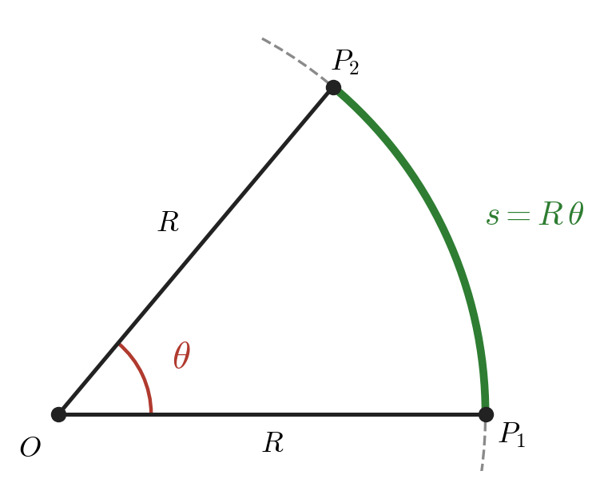
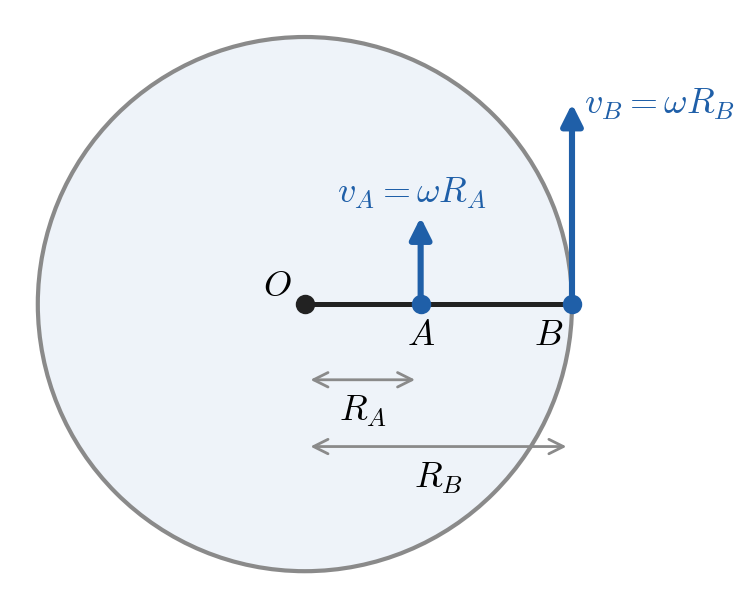
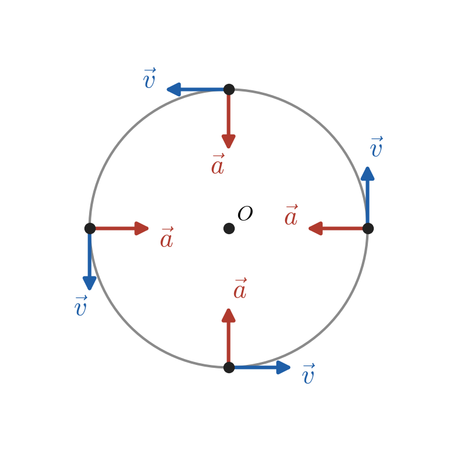
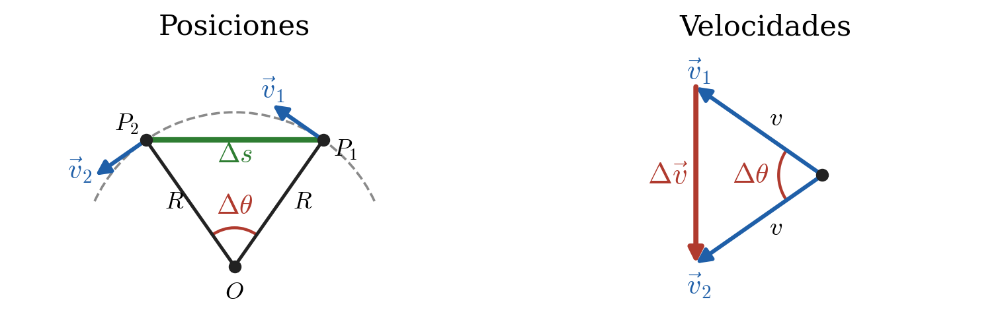

# Física I A1193 — Hoja de fórmulas

Hoja de estudio A4 (`hoja_formulas.tex` → `make` → `build/hoja_formulas.pdf`); a diferencia de la de Química, no tiene que entrar en una carilla. El PDF lleva **solo** las fórmulas que se van pidiendo; las sugerencias extra quedan únicamente en este `.md`.

## Cap. 2 — Movimiento en línea recta

### Aceleración constante

Solo valen si $a_x$ = cte; $x_0$ y $v_{0x}$ son los valores en $t = 0$.

| Ecuación | Unidades |
|---|---|
| $v_x = v_{0x} + a_x\,t$ | m/s |
| $x = x_0 + v_{0x}\,t + \tfrac{1}{2}\,a_x\,t^2$ | m |
| $v_x^2 = v_{0x}^2 + 2\,a_x\,(x - x_0)$ ${\color{BrickRed}\star}$ cap. 6 | m²/s² |
| $x - x_0 = \dfrac{v_{0x} + v_x}{2}\,t$ | m |

- **$v_x^2$, sin $t$:** de $v_x = v_{0x} + a_x\,t$ se despeja $t = \dfrac{v_x - v_{0x}}{a_x}$, se reemplaza en la $x$ de la trayectoria, $x(t)$, y se desarrolla.
- **$x - x_0$, sin $a_x$:** se igualan las dos expresiones de la velocidad media $v_{\text{med-}x} = \dfrac{x - x_0}{t} = \dfrac{v_{0x} + v_x}{2}$ (la segunda, solo con $a_x$ cte), y se multiplica por $t$.

## Cap. 3 — Movimiento en dos o tres dimensiones

### Proyectiles

Sin resistencia del aire y con el eje $y$ hacia arriba: $a_x = 0$, $a_y = {\color{BrickRed}-g}$, con $g = 9{,}80$ m/s². Origen en el punto de lanzamiento ($x_0 = y_0 = 0$); $\alpha_0$ es el ángulo de $\vec v_0$ sobre el semieje $+x$. Componentes de la velocidad inicial: $v_{0x} = v_0\cos\alpha_0$, $v_{0y} = v_0\operatorname{sen}\alpha_0$.

| Ecuación | Unidades |
|---|---|
| $x = (v_0\cos\alpha_0)\,t$ | m |
| $y = (v_0\operatorname{sen}\alpha_0)\,t - \tfrac{1}{2}\,g\,t^2$ | m |
| $v_x = v_0\cos\alpha_0$ | m/s |
| $v_y = v_0\operatorname{sen}\alpha_0 - g\,t$ | m/s |

### Movimiento circular uniforme

La rapidez $v$ es constante pero la dirección de $\vec v$ cambia, así que hay aceleración. $a_{\text{rad}}$ es la aceleración **radial**: perpendicular a $\vec v$ y dirigida hacia el centro, por eso también se la llama **centrípeta** («que busca el centro»). $T$ es el período [s], el tiempo de una vuelta. $v$ es la rapidez lineal [m/s], no la angular. La velocidad angular es $\omega = v/R = 2\pi/T$ [rad/s]; con ella, $v = \omega R$ y $a_{\text{rad}} = \gamma = \omega^2 R$. $\gamma$ es la notación del docente; $a_{\text{rad}}$, la del Sears.

| Ecuación | Unidades |
|---|---|
| $a_{\text{rad}} = \gamma = \dfrac{v^2}{R}$ | m/s² |
| $v = \dfrac{2\pi R}{T}$ | m/s |
| $a_{\text{rad}} = \gamma = \dfrac{4\pi^2 R}{T^2}$ | m/s² |
| $\omega = \dfrac{v}{R} = \dfrac{2\pi}{T}$ | rad/s |
| $a_{\text{rad}} = \gamma = \omega^2 R$ | m/s² |

#### Por qué $\omega = v/R$ y $\gamma = v^2/R$ (solo en este `.md`)

**La idea de fondo:** $v$ dice cuánto camino se recorre por segundo, y $\omega$ cuánto ángulo se barre por segundo. $R$ es lo que convierte uno en el otro.

**1. Por qué $\omega = v/R$**

El radián se define justamente así: el ángulo es el arco medido en radios.



$$
s = R\,\theta
\quad\xrightarrow{\;\div\,t\;}\quad
\frac{s}{t} = R\,\frac{\theta}{t}
\quad\Rightarrow\quad
v = R\,\omega
\quad\Rightarrow\quad
\omega = \frac{v}{R}
$$

Todos los puntos de un disco barren el mismo ángulo en el mismo tiempo, así que comparten $\omega$. Pero el más alejado recorre más camino, así que tiene más $v$:



Unidades: $\dfrac{\text{m/s}}{\text{m}} = \dfrac{1}{\text{s}}$, que se escribe rad/s porque el radián no tiene dimensión.

**2. Por qué hay aceleración si la rapidez no cambia**

$\vec v$ es tangente al círculo, así que su dirección cambia todo el tiempo. Ese cambio es la aceleración, y apunta hacia el centro:



**3. Por qué $\gamma = v^2/R$**

En un $\Delta t$ chico el cuerpo pasa de $P_1$ a $P_2$ y gira un ángulo $\Delta\theta$. Como $\vec v$ siempre es perpendicular al radio, $\vec v$ gira ese mismo $\Delta\theta$. Quedan dos triángulos con la misma forma (isósceles, con el mismo ángulo $\Delta\theta$):



Como son semejantes, los lados son proporcionales. Después se divide por $\Delta t$:

$$
\frac{\Delta v}{v} = \frac{\Delta s}{R}
\quad\Rightarrow\quad
\frac{\Delta v}{\Delta t} = \frac{v}{R}\cdot\frac{\Delta s}{\Delta t}
\quad\Rightarrow\quad
\gamma = \frac{v}{R}\cdot v = \frac{v^2}{R}
$$

En el último paso, con $\Delta t \to 0$, $\Delta s/\Delta t$ es $v$ y $\Delta v/\Delta t$ es la aceleración.

**Por qué $v$ aparece dos veces.** Cada una tiene un motivo distinto:

- **Una $v$ es la que gira:** cuanto más grande es el vector, más cambia al girar el mismo ángulo.
- **La otra $v$ es lo rápido que gira:** a más rapidez, más ángulo por segundo, porque $\omega = v/R$.

Eso se ve escrito así: $\gamma = \underbrace{\omega}_{\text{lo rápido que gira}}\cdot\underbrace{v}_{\text{lo que gira}} = \dfrac{v}{R}\cdot v = \omega^2 R$.

**4. La misma cuenta con vectores**

Con la posición en componentes, derivar dos veces da todo junto:

$$
\vec r = R\,(\cos\omega t,\ \operatorname{sen}\omega t)
\quad\Rightarrow\quad
\vec v = \omega R\,(-\operatorname{sen}\omega t,\ \cos\omega t)
\quad\Rightarrow\quad
\vec a = -\omega^2 R\,(\cos\omega t,\ \operatorname{sen}\omega t) = -\omega^2\,\vec r
$$

- $|\vec v| = \omega R$: es la relación $v = \omega R$.
- $|\vec a| = \omega^2 R$: es $\gamma$.
- El signo menos de $-\omega^2\vec r$ dice que $\vec a$ es opuesta a $\vec r$: apunta hacia el centro.

**5. Ejemplo y chequeo**

Con $\omega = 4\pi$ rad/s y $R = 0{,}75$ m, las dos fórmulas dan lo mismo:

$$
v = \omega R = 3\pi \approx 9{,}42 \text{ m/s}
\qquad
\frac{v^2}{R} = \frac{(3\pi)^2}{0{,}75} \approx 118 \text{ m/s}^2
\qquad
\omega^2 R = (4\pi)^2 \cdot 0{,}75 \approx 118 \text{ m/s}^2
$$

### Velocidad relativa en el espacio

$P$ es el cuerpo; $A$ y $B$, dos marcos de referencia; $\vec v_{P/A}$, la velocidad de $P$ respecto de $A$. Es una suma vectorial, así que se opera por componentes. Es la transformación de Galileo: vale para rapideces mucho menores que la de la luz ($v \ll c$).

| Ecuación | Unidades |
|---|---|
| $\vec v_{P/A} = \vec v_{P/B} + \vec v_{B/A}$ | m/s |

Sugerencia (no está en el PDF): $\vec v_{A/B} = -\vec v_{B/A}$, para invertir el orden de los subíndices.

## Cap. 4 — Leyes de Newton

### Fuerza neta

Suma vectorial de todas las fuerzas sobre **un** cuerpo; $1\text{ N} = 1\text{ kg}\cdot\text{m/s}^2$. Símbolos habituales: $w$ peso, $n$ normal, $T$ tensión, $f$ rozamiento.

| Ecuación | Unidades |
|---|---|
| $\vec R = \sum\vec F = \vec F_1 + \vec F_2 + \dots$ | N |
| $R_i = \sum F_i \quad (i = x, y, z)$ | N |

### 1.ª ley

$\vec a = 0$: el cuerpo está en reposo **o** se mueve con $\vec v$ constante. Vale solo en marcos inerciales.

| Ecuación | Unidades |
|---|---|
| $\sum\vec F = 0$ | N |

### 2.ª ley

Solo fuerzas externas. $m\vec a$ **no es una fuerza**: no va en el diagrama de cuerpo libre.

| Ecuación | Unidades |
|---|---|
| $\sum\vec F = m\,\vec a$ | N |
| $\sum F_i = m\,a_i \quad (i = x, y, z)$ | N |

### Peso

Fuerza gravitatoria de la Tierra sobre el cuerpo. Módulo: $w = m\,g$ (siempre positivo); dirección: hacia abajo. $m$ es propia del cuerpo; $w$ varía con $g$ según el lugar.

| Ecuación | Unidades |
|---|---|
| $\vec w = m\,\vec g$ | N |

### 3.ª ley

Las dos fuerzas actúan sobre cuerpos **distintos**: nunca se cancelan entre sí. $n$ no es la reacción de $w$: la reacción de $w$ es la atracción del cuerpo sobre la Tierra. Tampoco vale siempre $n = w$ (plano inclinado, ascensor que acelera).

| Ecuación | Unidades |
|---|---|
| $\vec F_{A\,\text{sobre}\,B} = -\vec F_{B\,\text{sobre}\,A}$ | N |

### Método

1. Elegir un cuerpo.
2. Diagrama de cuerpo libre: solo las fuerzas sobre él.
3. $\sum F$ por eje, con un eje en el sentido de $\vec a$.

## Cap. 5 — Aplicación de las leyes de Newton

$T$ no siempre es igual a $w$ (cuerpo colgado de una cuerda que acelera).

### Plano inclinado

Eje $x$ paralelo al plano; $\alpha$ es el ángulo del plano con la horizontal. $n = m\,g\cos\alpha$ solo si ninguna otra fuerza tiene componente perpendicular al plano.

| Ecuación | Unidades |
|---|---|
| $w_\parallel = m\,g\operatorname{sen}\alpha \qquad w_\perp = m\,g\cos\alpha$ | N |

### Rozamiento

Son relaciones entre módulos, no vectoriales: $\vec f \perp \vec n$. El «=» de $f_s$ vale solo a punto de deslizar; si no, $f_s$ sale de $\sum\vec F = 0$. Por lo general, $\mu_k < \mu_s$.

| Ecuación | Unidades |
|---|---|
| $f_k = \mu_k\,n$ | N |
| $f_s \le \mu_s\,n$ | N |

### Dinámica circular

$\sum\vec F$ apunta hacia el centro: es la resultante de las fuerzas que ya están en el diagrama. No agregar una fuerza «centrífuga»: en un marco inercial no existe.

| Ecuación | Unidades |
|---|---|
| $F_{\text{net}} = m\,a_{\text{rad}} = m\,\dfrac{v^2}{R}$ | N |
| $F_{\text{net}} = m\,\omega^2 R$ | N |

### Resistencia de fluidos

$f$ se opone a $\vec v$. $k$ y $D$ son **constantes** para un cuerpo y un fluido dados: no dependen de $v$. $v_t$ es la rapidez terminal de caída ($a = 0$, $f = m\,g$).

- **$k$ [kg/s]:** crece con el tamaño del cuerpo y la viscosidad del fluido.
- **$D$ [kg/m]:** crece con el área frontal del cuerpo y la densidad del fluido; también influye la forma.

| Ecuación | Unidades | Caso |
|---|---|---|
| $f = k\,v$ | N | Rapidez baja (polvo, bolilla en aceite) |
| $v_t = \dfrac{m\,g}{k}$ | m/s | Rapidez baja |
| $f = D\,v^2$ | N | Rapidez alta (objetos grandes en el aire) |
| $v_t = \sqrt{\dfrac{m\,g}{D}}$ | m/s | Rapidez alta |

Sugerencia (no está en el PDF ni en el cap. 5 del libro): en una esfera, $k = 6\pi\eta r$ (ley de Stokes, $\eta$: viscosidad); en general, $D = \tfrac12 C\rho A$ ($C$: coeficiente de arrastre, $\rho$: densidad, $A$: área frontal).

## Cap. 6 — Trabajo y energía cinética (en curso: pasa al PDF de a poco)

Esta sección es de análisis: las fórmulas pasan al PDF de a poco, a medida que se estudian. La columna «PDF» de cada tabla lleva la cuenta.

### La idea que ordena el capítulo

El cap. 6 no agrega una ley nueva: es la 2.ª ley mirada a lo largo del desplazamiento en lugar de a lo largo del tiempo. Todo sale de la ecuación del cap. 2 que ya se obtuvo eliminando $t$:

$$
v_x^2 = v_{0x}^2 + 2\,a_x\,(x - x_0)
\quad\xrightarrow{\;\times\,\frac{m}{2}\;}\quad
\tfrac{1}{2}\,m\,v_x^2 - \tfrac{1}{2}\,m\,v_{0x}^2 = (m\,a_x)\,(x - x_0) = F_x\,(x - x_0)
$$

La diferencia de velocidades al cuadrado es lo que se convierte en $\Delta K$, y $m\,a_x$ es lo que se convierte en fuerza. La derivación completa está en [`energia_casos_limite/01_de_la_cinematica_al_trabajo_energia.md`](../energia_casos_limite/01_de_la_cinematica_al_trabajo_energia.md).

**El siguiente paso conceptual:** esa derivación supone $a_x$ constante, pero el teorema vale también con fuerza variable y trayectoria curva. La misma estructura reaparece sin la hipótesis, porque $a_x = v_x\,\dfrac{dv_x}{dx}$:

$$
\int_{x_1}^{x_2} F_x\,dx = \int_{v_1}^{v_2} m\,v_x\,dv_x = \tfrac{1}{2}\,m\,v_2^2 - \tfrac{1}{2}\,m\,v_1^2
$$

La integral hace el trabajo que antes hacía el álgebra de eliminar $t$, y el resultado es el mismo.

### Orden sugerido de incorporación

Cada bloque usa el anterior. El programa de la materia lista «Trabajo de fuerzas. Trabajo y energía cinética. Potencia».

| Orden | Bloque | Qué aporta |
|---|---|---|
| 1 | Trabajo con fuerza constante | Define $W$ |
| 2 | Energía cinética y teorema | El centro del capítulo |
| 3 | Fuerza variable | Quita la hipótesis de $a$ constante |
| 4 | Resorte | Primer caso de fuerza variable |
| 5 | Potencia | Agrega el tiempo: qué tan rápido se hace el trabajo |

### 1. Trabajo con fuerza constante

| Ecuación | Unidades | PDF |
|---|---|---|
| $W = \vec F\cdot\vec s = F\,s\cos\phi$ | J | sí |
| $W = F_x s_x + F_y s_y + F_z s_z$ | J | sí |

En el PDF: **producto escalar** de $\vec F$ y $\vec s$, $W$ es un **escalar**; $\vec s$ es el desplazamiento recto, con $s_x = x_2 - x_1$; $\phi$ es el ángulo entre $\vec F$ y $\vec s$; $1\text{ J} = 1\text{ N}\cdot\text{m}$.

Notas propuestas, todavía no en el PDF:

- Tiene signo, pero no dirección: $W > 0$ si $\phi < 90^\circ$, $W = 0$ si $\phi = 90^\circ$, $W < 0$ si $\phi > 90^\circ$.
- Siempre es el trabajo de **una** fuerza sobre **un** cuerpo: hay que decir cuál.

Por qué así:

- **La forma por componentes va incluida.** Evita traer un coseno de memoria y da el signo solo.
- **$\vec F \perp \vec s \Rightarrow W = 0$ conecta con lo anterior.** La normal no trabaja en un desplazamiento sobre la superficie, y la resultante centrípeta tampoco: por eso en movimiento circular uniforme $K$ no cambia y la rapidez es constante.
- **Notación:** la hoja usa $\vec s$ y $\phi$, como el Sears (`energia_casos_limite/` usa $\Delta\vec r$ y $\theta$).
- **El «·» de N·m no es un producto escalar:** es la multiplicación común de unidades. El producto escalar opera entre $\vec F$ y $\vec s$; su resultado se mide en N·m.

### 2. Energía cinética y teorema trabajo-energía

Entre dos puntos 1 y 2 del recorrido sobre $x$, la ecuación ${\color{BrickRed}\star}$ del cap. 2 cambia de nombres: $v_{0x} \to v_1$, $v_x \to v_2$, $x - x_0 \to s$. No hace falta que el punto 1 sea $t = 0$.

| Paso | Ecuación | Unidades | PDF |
|---|---|---|---|
| ${\color{BrickRed}\star}$ cap. 2 | $v_2^2 = v_1^2 + 2\,a_x\,s$ | m²/s² | sí |
| Se despeja $a_x\,s$ | $a_x\,s = \tfrac{1}{2}\,v_2^2 - \tfrac{1}{2}\,v_1^2$ | m²/s² | sí |
| Se multiplica por $m$, con $\sum F_x = m\,a_x$ | $\bigl(\sum F_x\bigr)\,s = \tfrac{1}{2}\,m\,v_2^2 - \tfrac{1}{2}\,m\,v_1^2$ | J | sí |
| Definición | $K = \tfrac{1}{2}\,m\,v^2$ | J | sí |
| Teorema | $W_{\text{tot}} = K_2 - K_1 = \Delta K$ | J | sí |

Unidades: $\text{kg}\cdot\text{m}^2/\text{s}^2 = (\text{kg}\cdot\text{m}/\text{s}^2)\cdot\text{m} = \text{N}\cdot\text{m} = \text{J}$.

En el PDF: $K$ es escalar y $K \ge 0$; $W_{\text{tot}}$ son todas las fuerzas, no una sola; vale también con fuerza variable y trayectoria curva.

Nota propuesta, todavía no en el PDF: el doble de $v$ da cuatro veces $K$.

### 3. Trabajo con fuerza variable

| Ecuación | Unidades | PDF |
|---|---|---|
| $W = \displaystyle\int_{x_1}^{x_2} F_x\,dx$ | J | no |
| $W = \displaystyle\int_{P_1}^{P_2} \vec F\cdot d\vec l$ | J | no |

Notas propuestas:

- $W$ es el área bajo la curva $F_x(x)$, con signo.
- La segunda es el caso general: la fuerza puede variar y la trayectoria puede ser curva.

Por qué así: con $F_x$ constante la integral devuelve $F_x\,(x_2 - x_1)$. Conviene pensarla como la generalización del bloque 1, no como otra fórmula.

### 4. Resorte

| Ecuación | Unidades | PDF |
|---|---|---|
| $F_x = k\,x$ | N | no |
| $W = \tfrac{1}{2}\,k\,x_2^2 - \tfrac{1}{2}\,k\,x_1^2$ | J | no |

Notas propuestas:

- $x$: estiramiento desde la longitud natural. $k$ [N/m]: constante de fuerza del resorte.
- Es la fuerza y el trabajo **sobre** el resorte. **Trampa:** el trabajo **del** resorte tiene el signo opuesto.

Por qué así:

- **La fórmula general incluye a la del libro.** $W = \tfrac{1}{2}\,k\,X^2$ es el caso que arranca sin estirar, con $x_1 = 0$.
- **Colisión de símbolos:** esta $k$ no es la $k$ de resistencia de fluidos del cap. 5. Aclararlo por las unidades (N/m frente a kg/s) evita la confusión.
- **Se ve la misma estructura de nuevo:** diferencia de cuadrados, ahora de $x$.

### 5. Potencia

| Ecuación | Unidades | PDF |
|---|---|---|
| $P_{\text{med}} = \dfrac{\Delta W}{\Delta t}$ | W | no |
| $P = \dfrac{dW}{dt} = \vec F\cdot\vec v$ | W | no |

Notas propuestas:

- Mostrar de dónde sale la unidad, igual que $1\text{ J} = 1\text{ N}\cdot\text{m}$ en Trabajo: $1\text{ W} = 1\text{ J/s}$, al lado de la fórmula en el PDF.
- $P$ es un escalar.
- $\vec F\cdot\vec v$ tiene la misma forma que $\vec F\cdot\vec s$: cambia el desplazamiento por la velocidad.
- El kWh es unidad de **energía**, no de potencia.

Por qué así: $\vec F\cdot\vec v$ es la fórmula que más se usa de esta sección y permite pasar directo de fuerza y velocidad a potencia. El tema se conecta con `energia_casos_limite/05_comparativa_potencia_humana.md`.

### Símbolos que conviene separar

Con este capítulo se acumulan letras repetidas. Una línea en el PDF evitaría errores:

| Símbolo | Significado | Unidad |
|---|---|---|
| $W$ (cursiva) | Trabajo (*work*), una magnitud | J |
| W (recta) | Watt, unidad de potencia: $1\text{ W} = 1\text{ J/s}$; la potencia es $P$ | — |
| $w$ | Peso (*weight*) | N |
| $k$ | Constante del resorte / de resistencia de fluidos | N/m / kg/s |

---

## Compilación

```bash
cd fisica_i/hoja_formulas
make          # -> build/hoja_formulas.pdf
make clean
```

Mismo esquema que `quimica_general/hoja_formulas/`: LaTeX directo (no pasa por `pipeline_pdf/`), `\capitulo{…}`, `\subtema{…}`, `\f{fórmula}{unidades}` y `\nota{…}`.

---

*Fuentes: Sears, F. W.; Zemansky, M. W.; Young, H. D.; Freedman, R. A. — Física universitaria, vol. 1, 11.ª ed. (Pearson Educación, México, 2004; ISBN 970-26-0511-3, ISBN-13 978-970-26-0511-9; traducción de *University Physics*, vol. 1, 11th ed., ISBN 0-8053-9186-X), ejemplar en papel; Young, H. D.; Freedman, R. A. — University Physics with Modern Physics, 13th ed. (Pearson Addison-Wesley, 2012; ISBN 978-0-321-69686-1, student edition), `Libros/Physics-Sears-13Ed-Vol1.pdf` (cap. 2 «Motion Along a Straight Line»; cap. 3 «Motion in Two or Three Dimensions», §3.3–3.5, incluida la derivación de $a_{\text{rad}}$ de §3.4; §9.3 para $v = R\omega$; cap. 4 «Newton's Laws of Motion»; cap. 5 «Applying Newton's Laws»; cap. 6 «Work and Kinetic Energy»).*
