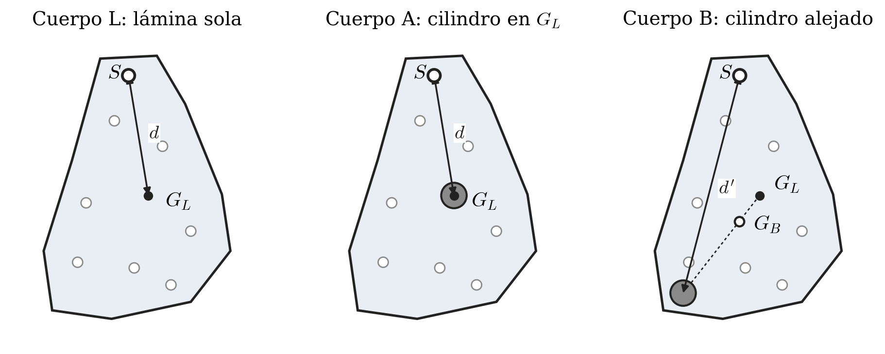
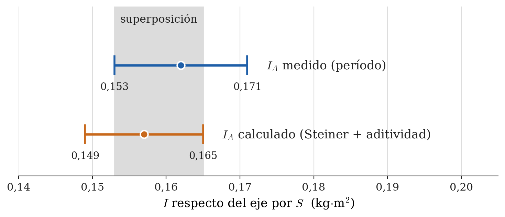
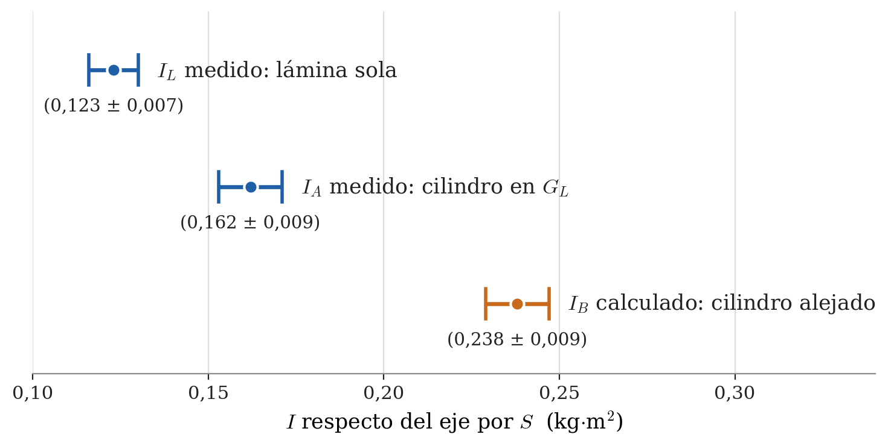

# Trabajo Práctico N°7 — Péndulo físico

<!-- Informe del TP7 (4.ª concurrencia, 04/11/2026). Carátula, integrantes y
docentes salen de pdf.yaml. Mediciones: hoja de datos firmada (fotos/). -->

## 1. Introducción

### 1.1 Objetivos

1. Determinar experimentalmente el centro de masa de un cuerpo con forma de lámina plana.
2. Determinar experimentalmente el momento de inercia de cuerpos con forma de lámina plana respecto de un eje de rotación.
3. Comprobar experimentalmente el teorema de Steiner y la propiedad aditiva del momento de inercia.
4. Analizar cómo influyen la masa y su distribución en el valor del momento de inercia.

### 1.2 Marco teórico

#### Centro de masa y centro de gravedad

El centro de masa de un cuerpo es el promedio de las posiciones de sus partículas, ponderado por sus masas. Si el campo gravitatorio es uniforme en todo el cuerpo, como en cualquier caso práctico de laboratorio, el peso actúa como una única fuerza $m\,g$ aplicada en ese mismo punto, que entonces es también el centro de gravedad.

Un cuerpo suspendido de un punto queda en equilibrio cuando su centro de gravedad está sobre la vertical que pasa por el punto de suspensión: solo así el peso no produce momento. Por eso, al colgar la lámina de distintos puntos y trazar con una plomada la vertical de cada uno, todas las rectas se cortan en el centro de gravedad.

Para un cuerpo compuesto por dos partes, el centro de masa está sobre el segmento que une los centros de masa de cada parte, más cerca de la más pesada:

$$\vec r_{G} = \frac{m_1\,\vec r_1 + m_2\,\vec r_2}{m_1 + m_2}$$

#### Péndulo físico

Un cuerpo rígido suspendido de un eje horizontal que no pasa por su centro de gravedad es un péndulo físico. Si $d$ es la distancia del punto de suspensión $S$ al centro de gravedad $G$ y la recta $SG$ se aparta un ángulo $\theta$ de la vertical, el peso produce respecto de $S$ un momento que tiende a devolver al cuerpo a la posición de equilibrio:

$$M_S = -\,m\,g\,d\,\mathrm{sen}\,\theta$$

Con la ecuación fundamental de la dinámica de rotaciones, $M_S = I\,\alpha = I\,\dfrac{d^2\theta}{dt^2}$, donde $I$ es el momento de inercia respecto del eje que pasa por $S$:

$$\frac{d^2\theta}{dt^2} + \frac{m\,g\,d}{I}\,\mathrm{sen}\,\theta = 0$$

Para ángulos pequeños (menores que unos $17^\circ \approx 0{,}3\ \mathrm{rad}$), $\mathrm{sen}\,\theta \approx \theta$ y la ecuación es la de un movimiento oscilatorio armónico (MOA), con solución $\theta(t) = \theta_0 \cos(\omega t + \varphi)$ y

$$\omega = \sqrt{\frac{m\,g\,d}{I}} \qquad T = \frac{2\pi}{\omega} = 2\pi\sqrt{\frac{I}{m\,g\,d}}$$

Despejando, el momento de inercia queda determinado por tres mediciones (masa, distancia y período):

$$I = \frac{m\,g\,d\,T^2}{4\pi^2}$$

Es una medición indirecta. Al $I$ obtenido de esta forma lo llamamos **medido**.

#### Teorema de Steiner y aditividad

El momento de inercia de un cilindro macizo de masa $m_C$ y radio $R$ respecto de su eje (baricéntrico) es $I_{C} = \tfrac{1}{2}\,m_C\,R^2$. Si el eje de rotación es paralelo a ese y está a una distancia $D$, el teorema de Steiner (de los ejes paralelos) da

$$I_C(S) = \frac{1}{2}\,m_C\,R^2 + m_C\,D^2$$

y, por la propiedad aditiva, el momento de inercia de un cuerpo formado por varias partes es la suma de los momentos de inercia de las partes respecto del mismo eje. Para la lámina con el cilindro:

$$I = I_L + \frac{1}{2}\,m_C\,R^2 + m_C\,D^2$$

Al $I$ obtenido de esta forma lo llamamos **calculado**. Si el $I$ calculado y el medido coinciden dentro de sus incertezas, el experimento comprueba Steiner y la aditividad.

#### Incertezas y comparación de intervalos

En productos, cocientes y potencias se suman los errores relativos, cada uno multiplicado por su exponente; en sumas se suman los errores absolutos. Con $g$ y $\pi$ tomados con error despreciable:

$$\frac{\Delta I}{I_0} = \frac{\Delta m}{m_0} + \frac{\Delta d}{d_0} + 2\,\frac{\Delta T}{T_0} \qquad\Rightarrow\qquad \Delta I = \left(\frac{\Delta m}{m_0} + \frac{\Delta d}{d_0} + 2\,\frac{\Delta T}{T_0}\right) I_0$$

Dos determinaciones de una misma magnitud, $I_0 \pm \Delta I$ y $I_0' \pm \Delta I'$, son compatibles si sus intervalos de indeterminación se superponen, como en el TP N°1 de Mediciones.

## 2. Procedimiento Experimental

### 2.1 Materiales, instrumentos e incertezas adoptadas

Lámina plana de chapadur perforado, de forma poligonal irregular, recubierta de papel; cilindro metálico; hilo con plomada; soporte con pivote.

| Instrumento | Magnitud medida | Error absoluto adoptado |
|---|---|---|
| Balanza | masas $m$, $m_C$ | $\Delta m = 0{,}002\ \mathrm{kg}$ |
| Regla milimetrada | distancias $d$, $d'$ | $\Delta d = 0{,}004\ \mathrm{m}$ |
| Calibre | diámetro del cilindro | $\Delta D = 0{,}1\ \mathrm{mm}$ |
| Cronómetro | tiempo de 10 oscilaciones | $\Delta t = 0{,}3\ \mathrm{s}$ |

*Tabla 1: Instrumentos y errores absolutos adoptados. El error del cronómetro incluye el tiempo de reacción del operador.*

### 2.2 Centro de masa de la lámina

Se colgó la lámina del soporte por distintas perforaciones y, una vez en reposo junto con la plomada, se trazó sobre el papel la vertical de cada punto de suspensión. Las tres rectas se cortaron en un punto: el centro de gravedad $G_L$ de la lámina.

### 2.3 Oscilaciones de los tres cuerpos

Se suspendió la lámina del pivote $S$, alejado de $G_L$, y se midió la distancia $d$ de $S$ a $G_L$. Con el mismo punto de suspensión se estudiaron tres cuerpos (Figura 1):

- **Cuerpo L:** la lámina sola.
- **Cuerpo A:** la lámina con el cilindro colocado en $G_L$. El centro de gravedad no cambia; cambia la masa.
- **Cuerpo B:** la lámina con el cilindro en una esquina alejada, a una distancia $d'$ de $S$. Cambia la distribución de la masa respecto del eje y el centro de gravedad se desplaza a $G_B$.

*Figura 1: Los tres cuerpos suspendidos del pivote $S$. En B el centro de gravedad $G_B$ queda sobre el segmento que une $G_L$ con el cilindro.*

En cada caso se apartó el cuerpo un ángulo pequeño de la vertical, cuidando que oscilara en su propio plano, y se cronometró el tiempo $t$ de 10 oscilaciones completas. El período es $T = t/10$, con $\Delta T = \Delta t/10 = 0{,}03\ \mathrm{s}$: medir varias oscilaciones reduce diez veces la incerteza del período.

Se pesaron la lámina y el cilindro por separado y se midió el diámetro del cilindro con el calibre: $D = (25{,}5 \pm 0{,}1)\ \mathrm{mm}$, es decir, $R = (12{,}75 \pm 0{,}05)\ \mathrm{mm}$.

## 3. Resultados y Análisis

### 3.1 Mediciones directas

**Tabla 2.** Mediciones de los tres cuerpos, suspendidos del mismo punto $S$.

| Cuerpo | $m$ (kg) | $\Delta m$ (kg) | $d$ (m) | $\Delta d$ (m) | $t$ (s) | $\Delta t$ (s) | $T$ (s) | $\Delta T$ (s) |
|:---:|:---:|:---:|:---:|:---:|:---:|:---:|:---:|:---:|
| L | 0,500 | 0,002 | 0,430 | 0,004 | 15,01 | 0,3 | 1,501 | 0,03 |
| A | 0,683 | 0,004 | 0,430 | 0,004 | 14,77 | 0,3 | 1,477 | 0,03 |
| B | 0,683 | 0,004 | 0,795 ($d'$) | 0,004 | 16,44 | 0,3 | 1,644 | 0,03 |

*Tabla 2: $m$ es la masa total del cuerpo: lámina $0{,}500\ \mathrm{kg}$ y cilindro $m_C = 0{,}183\ \mathrm{kg}$; en A y B el error es la suma de las dos pesadas. En B la distancia es la del pivote al cilindro. $t$: tiempo de 10 oscilaciones; $T = t/10$.*

### 3.2 Momento de inercia de la lámina

Con la fórmula del péndulo físico y $g = 10\ \mathrm{m/s^2}$ (Anexo A.1):

> $$I_L = (0{,}123 \pm 0{,}007)\ \mathrm{kg\cdot m^2} \quad \text{(medido)}$$

El término que más pesa en la incerteza es el del período ($2\,\Delta T/T \approx 4\ \%$, frente a $0{,}9\ \%$ de la distancia y $0{,}4\ \%$ de la masa): el cronómetro operado a mano es el instrumento que limita la precisión del método, y el período entra al cuadrado.

<!-- salto-pagina -->

### 3.3 Cuerpo A: comprobación de Steiner y de la aditividad

El momento de inercia de A se determinó de dos maneras independientes (Anexo A.2 y A.3):

- **Medido**, con el período $T_A$ y la masa $m_A = m + m_C$.
- **Calculado**, sumando a $I_L$ el momento de inercia del cilindro respecto de $S$ por Steiner, con $D = d$:

$$I_A = I_L + \frac{1}{2}\,m_C\,R^2 + m_C\,d^2$$

**Tabla 3.** Momento de inercia del cuerpo A por los dos métodos.

| $I_A$ | Valor (kg·m²) | Intervalo (kg·m²) |
|:---:|:---:|:---:|
| Medido (período) | $0{,}162 \pm 0{,}009$ | $[0{,}153 \,;\, 0{,}171]$ |
| Calculado (Steiner + aditividad) | $0{,}157 \pm 0{,}008$ | $[0{,}149 \,;\, 0{,}165]$ |

*Tabla 3: Los intervalos se superponen entre $0{,}153$ y $0{,}165\ \mathrm{kg\cdot m^2}$ (Figura 2).*

*Figura 2: Comparación de intervalos de indeterminación de $I_A$. La franja gris es la superposición.*

> Los intervalos se superponen: las dos determinaciones de $I_A$ son **compatibles**. El momento de inercia obtenido con Steiner y la aditividad coincide, dentro de la incerteza experimental, con el medido a partir del período.

En el valor calculado, el momento de inercia propio del cilindro, $\tfrac{1}{2}\,m_C\,R^2 = 1{,}5\cdot 10^{-5}\ \mathrm{kg\cdot m^2}$, es unas 2000 veces menor que el término de Steiner, $m_C\,d^2 = 0{,}034\ \mathrm{kg\cdot m^2}$: a $43\ \mathrm{cm}$ del eje, el cilindro se comporta prácticamente como una masa puntual.

### 3.4 Cuerpo B

Con el cilindro en la esquina, a $d' = 0{,}795\ \mathrm{m}$ del pivote, Steiner y la aditividad dan (Anexo A.3):

> $$I_B = I_L + \frac{1}{2}\,m_C\,R^2 + m_C\,d'^2 = (0{,}238 \pm 0{,}009)\ \mathrm{kg\cdot m^2} \quad \text{(calculado)}$$

El centro de gravedad $G_B$ no se trazó con la plomada, de modo que no se midió la distancia $d_B$ de $S$ a $G_B$ que requiere la fórmula del período; por eso para B se informa el valor calculado. Lo que sí se observa es que el período aumentó a $T_B = 1{,}644\ \mathrm{s}$, mayor que el de L y el de A, en concordancia con un momento de inercia mayor.

Por la definición de centro de masa, $G_B$ está sobre el segmento que une $G_L$ con el centro del cilindro, a una fracción

$$\frac{m_C}{m_A} = \frac{0{,}183}{0{,}683} = 0{,}27$$

de su longitud medida desde $G_L$: el centro de gravedad se corre hacia el cilindro, pero queda más cerca de $G_L$ porque la lámina es la parte más pesada.

### 3.5 Influencia de la masa y de su distribución

**Tabla 4.** Momentos de inercia de los tres cuerpos respecto del eje por $S$.

| Cuerpo | Masa (kg) | Distancia del cilindro a $S$ (m) | $I$ (kg·m²) |
|:---:|:---:|:---:|:---:|
| L | 0,500 | — | $0{,}123 \pm 0{,}007$ (medido) |
| A | 0,683 | 0,430 | $0{,}162 \pm 0{,}009$ (medido) |
| B | 0,683 | 0,795 | $0{,}238 \pm 0{,}009$ (calculado) |

*Tabla 4: A y B tienen la misma masa; difieren solo en la posición del cilindro.*

*Figura 3: Momento de inercia de los tres cuerpos. De L a A cambia la masa; de A a B, solo su distribución.*

- **De L a A** la masa aumenta un 37 % y el momento de inercia aumenta en $0{,}039\ \mathrm{kg\cdot m^2}$, compatible con el aporte del cilindro, $m_C\,d^2 = 0{,}034\ \mathrm{kg\cdot m^2}$.
- **De A a B** la masa no cambia, pero el cilindro se aleja de $0{,}430$ a $0{,}795\ \mathrm{m}$ del eje: su aporte pasa de $m_C\,d^2 = 0{,}034$ a $m_C\,d'^2 = 0{,}116\ \mathrm{kg\cdot m^2}$, y el momento de inercia total aumenta casi un 50 %.

Al agregar el cilindro en $G_L$, el período incluso **disminuyó** ($1{,}501 \to 1{,}477\ \mathrm{s}$) aunque $I$ aumentó: $T$ depende del cociente $I/(m\,d)$ (longitud del péndulo simple equivalente), que bajó de $0{,}57$ a $0{,}55\ \mathrm{m}$. En B, la masa lejos del eje hace crecer $I$ más que $m\,d$, y el período aumenta.

## 4. Conclusiones

**Objetivo 1 — centro de masa:** las verticales trazadas con la plomada desde distintos puntos de suspensión se cortaron en un punto, el centro de gravedad $G_L$ de la lámina, a $d = (0{,}430 \pm 0{,}004)\ \mathrm{m}$ del pivote. Al colocar el cilindro en $G_L$ (cuerpo A) el centro de gravedad no cambia. Al colocarlo en una esquina (cuerpo B), el centro de gravedad se desplaza a $G_B$, sobre el segmento que une $G_L$ con el cilindro y a un 27 % de su longitud desde $G_L$, más cerca de la lámina por ser la parte más pesada.

**Objetivo 2 — momento de inercia:** a partir del período de oscilación se determinó el momento de inercia de la lámina respecto del eje por $S$, $I_L = (0{,}123 \pm 0{,}007)\ \mathrm{kg\cdot m^2}$, y el del cuerpo A, $I_A = (0{,}162 \pm 0{,}009)\ \mathrm{kg\cdot m^2}$. La incerteza está dominada por la medición del tiempo.

**Objetivo 3 — Steiner y aditividad:** el momento de inercia de A calculado como suma del de la lámina y el del cilindro trasladado por Steiner, $(0{,}157 \pm 0{,}008)\ \mathrm{kg\cdot m^2}$, y el medido por el período, $(0{,}162 \pm 0{,}009)\ \mathrm{kg\cdot m^2}$, tienen intervalos que se superponen entre $0{,}153$ y $0{,}165\ \mathrm{kg\cdot m^2}$. Las determinaciones son compatibles: el experimento comprueba el teorema de Steiner y la propiedad aditiva del momento de inercia.

**Objetivo 4 — masa y distribución:** el momento de inercia aumenta al agregar masa (de L a A, $+0{,}039\ \mathrm{kg\cdot m^2}$) y aumenta mucho más al alejar esa misma masa del eje (de A a B, con igual masa, $+0{,}076\ \mathrm{kg\cdot m^2}$). Cada porción de masa aporta en proporción al cuadrado de su distancia al eje, por lo que la distribución de la masa influye más que la masa total.

<!-- salto-pagina -->

## Anexo de Cálculos

$g = 10\ \mathrm{m/s^2}$ y $\pi$ con error despreciable; $4\pi^2 = 39{,}478$. Períodos: $T = t/10$, $\Delta T = 0{,}3\ \mathrm{s}/10 = 0{,}03\ \mathrm{s}$. Redondeo según el TP N°1: incerteza a una cifra significativa y valor a la misma posición decimal.

### A.1 Lámina (medido)

$$I_{L0} = \frac{0{,}500\ \mathrm{kg}\cdot 10\ \mathrm{\tfrac{m}{s^2}}\cdot 0{,}430\ \mathrm{m}\cdot (1{,}501\ \mathrm{s})^2}{39{,}478} = 0{,}12270\ \mathrm{kg\cdot m^2}$$

$$\Delta I_L = \left(\frac{0{,}002}{0{,}500} + \frac{0{,}004}{0{,}430} + 2\cdot\frac{0{,}03}{1{,}501}\right) I_{L0} = 0{,}0533 \cdot 0{,}12270 = 0{,}0065\ \mathrm{kg\cdot m^2}$$

> $$I_L = (0{,}123 \pm 0{,}007)\ \mathrm{kg\cdot m^2}$$

### A.2 Cuerpo A (medido)

Con $m_A = 0{,}500 + 0{,}183 = 0{,}683\ \mathrm{kg}$ y $\Delta m_A = 0{,}002 + 0{,}002 = 0{,}004\ \mathrm{kg}$:

$$I_{A0} = \frac{0{,}683\ \mathrm{kg}\cdot 10\ \mathrm{\tfrac{m}{s^2}}\cdot 0{,}430\ \mathrm{m}\cdot (1{,}477\ \mathrm{s})^2}{39{,}478} = 0{,}16229\ \mathrm{kg\cdot m^2}$$

$$\Delta I_A = \left(\frac{0{,}004}{0{,}683} + \frac{0{,}004}{0{,}430} + 2\cdot\frac{0{,}03}{1{,}477}\right) I_{A0} = 0{,}0558 \cdot 0{,}16229 = 0{,}0091\ \mathrm{kg\cdot m^2}$$

> $$I_A = (0{,}162 \pm 0{,}009)\ \mathrm{kg\cdot m^2}$$

### A.3 Cuerpos A y B (calculados)

$$I = I_L + \underbrace{\tfrac{1}{2}\,m_C\,R^2}_{z} + \underbrace{m_C\,D^2}_{w} \qquad \Delta I = \Delta I_L + \Delta z + \Delta w$$

$$\Delta z = \left(\frac{\Delta m_C}{m_C} + 2\,\frac{\Delta R}{R}\right) z_0 \qquad \Delta w = \left(\frac{\Delta m_C}{m_C} + 2\,\frac{\Delta D}{D}\right) w_0$$

| Término | A ($D = d = 0{,}430\ \mathrm{m}$) | B ($D = d' = 0{,}795\ \mathrm{m}$) |
|:---:|:---:|:---:|
| $z_0 \pm \Delta z$ | $(1{,}49 \pm 0{,}03)\cdot 10^{-5}$ | $(1{,}49 \pm 0{,}03)\cdot 10^{-5}$ |
| $w_0 \pm \Delta w$ | $0{,}03384 \pm 0{,}0010$ | $0{,}11566 \pm 0{,}0024$ |
| $I_0 = I_{L0} + z_0 + w_0$ | $0{,}15655$ | $0{,}23838$ |
| $\Delta I = 0{,}0065 + \Delta z + \Delta w$ | $0{,}0075$ | $0{,}0090$ |
| **Resultado** | $\mathbf{0{,}157 \pm 0{,}008}$ | $\mathbf{0{,}238 \pm 0{,}009}$ |

*Tabla 5: Valores en kg·m². $m_C = (0{,}183 \pm 0{,}002)\ \mathrm{kg}$, $R = (12{,}75 \pm 0{,}05)\ \mathrm{mm}$; el factor $\tfrac{1}{2}$ es exacto.*

<!-- solo-md -->

---

**Fuentes utilizadas:**

- *Trabajo práctico Péndulo físico — Guía para la realización de las mediciones y los cálculos* (U.D.B. Física) — objetivos, procedimiento, fórmulas de propagación y preguntas guía de las conclusiones.
- *Trabajo práctico «Péndulo físico» — Teoría* (U.D.B. Física) — deducción del MOA del péndulo físico y aproximación de ángulos pequeños.
- Explicación de los docentes en el pizarrón, 4.ª concurrencia (04/11/2026), y hojas de datos y cálculos firmadas.
- Sears, Zemansky, Young y Freedman, *Física universitaria*, vol. 1, 12.ª ed. — cap. 9, sección 9.5 (teorema de los ejes paralelos); cap. 14, sección 14.6 (péndulo físico).
- TP N°1 — Mediciones y Errores (informe propio, 1.ª concurrencia) — propagación de incertezas, redondeo y comparación de intervalos.
- *Criterios para la realización de los informes de los Trabajos Prácticos* (U.D.B. Física) — estructura del informe.

<!-- /solo-md -->
