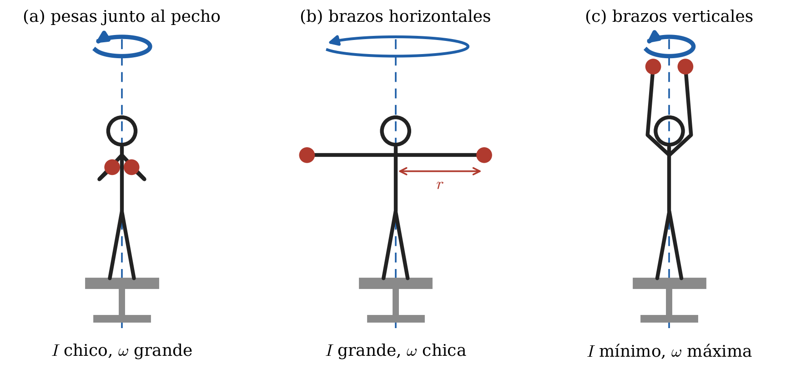
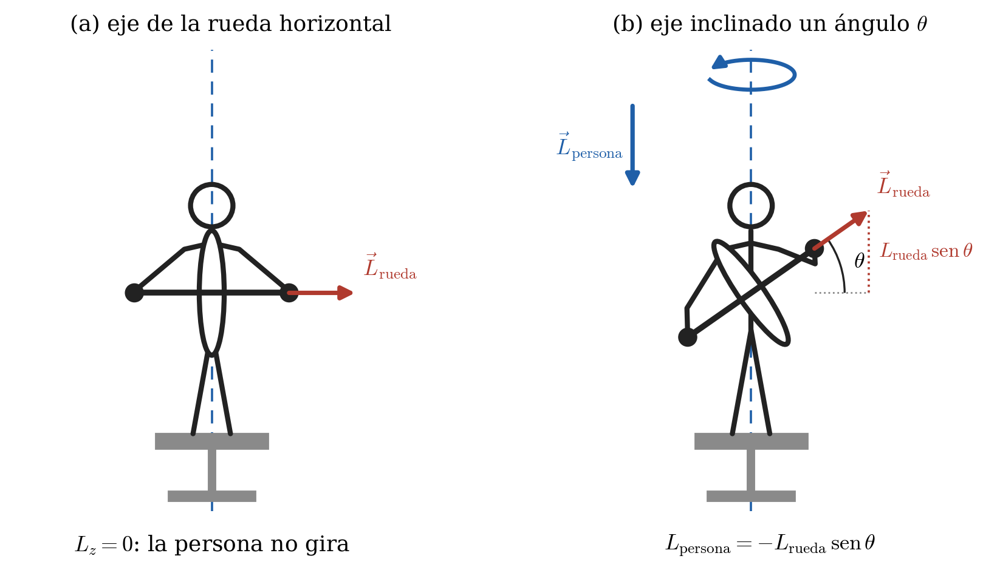

# Trabajo Práctico N°8 — Conservación del momento angular (monografía)

<!-- Monografía sobre las demostraciones de la 4.ª concurrencia (no hubo
mediciones). Carátula, integrantes y docentes salen de pdf.yaml. -->

## 1. Introducción

### 1.1 Objetivos

1. Explicar, con la conservación del momento angular, las demostraciones realizadas por los docentes en la plataforma giratoria.
2. Relacionar la velocidad angular de un cuerpo con la distribución de su masa respecto del eje de giro (momento de inercia).
3. Interpretar el carácter vectorial del momento angular a partir de la demostración con la rueda giratoria.

### 1.2 Alcance

En esta concurrencia no se tomaron mediciones: los docentes realizaron demostraciones cualitativas con un banquito giratorio, un par de pesas y una rueda con eje. Por eso el trabajo es una monografía: describe lo observado y lo explica con la teoría.

## 2. Marco teórico

### 2.1 Momento angular

El momento angular de una partícula de masa $m$ y velocidad $\vec v$, respecto de un punto $O$, es

$$\vec L = \vec r \times \vec p = \vec r \times m\,\vec v$$

donde $\vec r$ es la posición de la partícula respecto de $O$. Para un cuerpo rígido que gira con velocidad angular $\vec\omega$ alrededor de un eje de simetría, la suma sobre todas sus partículas da

$$\vec L = I\,\vec\omega \qquad I = \sum_i m_i\, r_i^2$$

donde $r_i$ es la distancia de cada partícula **al eje**. $\vec L$ tiene la dirección del eje de giro y su sentido sale de la regla de la mano derecha. El momento de inercia $I$ crece con el cuadrado de la distancia: la misma masa aporta mucho más lejos del eje que cerca de él.

### 2.2 Torque y variación del momento angular

El torque neto de las fuerzas externas cambia el momento angular:

$$\sum \vec\tau_{\mathrm{ext}} = \frac{d\vec L}{dt}$$

Es la versión rotacional de $\sum \vec F = d\vec p/dt$. Las fuerzas internas del sistema (las que una parte ejerce sobre otra) se anulan de a pares y no cambian el $\vec L$ total.

### 2.3 Conservación del momento angular

Si el torque externo neto es nulo, el momento angular total del sistema se conserva:

$$\sum \vec\tau_{\mathrm{ext}} = 0 \;\Rightarrow\; \vec L = \text{constante} \;\Rightarrow\; I_1\,\omega_1 = I_2\,\omega_2$$

La ley es vectorial y vale por componentes: si solo se anula la componente del torque sobre un eje, se conserva solo la componente de $\vec L$ sobre ese eje.

En el banquito giratorio el eje es vertical ($z$). El peso y la reacción del piso son verticales, y el rodamiento casi no tiene rozamiento, de modo que ninguna fuerza externa produce torque apreciable alrededor de $z$: **se conserva $L_z$**. Las componentes horizontales de $\vec L$, en cambio, no se conservan, porque el eje del banquito puede ejercer torques horizontales (le impide inclinarse).

### 2.4 Energía cinética de rotación

$$K = \frac{1}{2}\,I\,\omega^2 = \frac{L^2}{2\,I}$$

Con $L$ constante, si $I$ disminuye la energía cinética aumenta. Esa energía no aparece sola: la aporta el trabajo muscular de quien acerca las masas al eje.

## 3. Demostraciones y análisis

### 3.1 Girar sobre el banquito partiendo del reposo

Un compañero, quieto sobre el banquito, consiguió girar moviendo los brazos hacia un lado y las piernas y el torso hacia el otro, y repitiendo el movimiento.

Al partir del reposo, $L_z = 0$, y como no hay torque externo alrededor del eje, $L_z$ sigue siendo cero. Cuando los brazos giran en un sentido, el resto del cuerpo gira en sentido contrario, de modo que

$$I_{\mathrm{brazos}}\,\omega_{\mathrm{brazos}} + I_{\mathrm{resto}}\,\omega_{\mathrm{resto}} = 0$$

Si la ida y la vuelta se hicieran con la misma forma del cuerpo, cada movimiento deshacería al anterior y la persona volvería a la orientación inicial. Pero al cambiar la postura entre la ida y la vuelta (brazos extendidos en un movimiento, recogidos en el otro), los momentos de inercia son distintos y el ángulo girado no se compensa: el cuerpo termina orientado distinto **sin haber adquirido momento angular neto**. Es el mismo mecanismo con el que un gato que cae logra girar el cuerpo en el aire. Para quedar girando de forma sostenida, en cambio, hace falta un torque externo: el rozamiento del rodamiento o, como se hizo después, el empujón de los docentes.

### 3.2 Pesas y posición de los brazos

Con el compañero ya girando (impulsado por los docentes) y una pesa en cada mano, se observaron tres posiciones (Figura 1):

- **(a) Pesas junto al pecho:** gira rápido.
- **(b) Brazos extendidos horizontalmente:** gira notablemente más despacio.
- **(c) Brazos extendidos verticalmente sobre la cabeza:** vuelve a girar rápido, tanto o más que en (a).

*Figura 1: Las tres posiciones de las pesas. Al alejarlas del eje (b) el momento de inercia aumenta y la velocidad angular disminuye; en (c) quedan casi sobre el eje.*

Una vez soltado el banquito, $L_z = I\,\omega$ se mantiene constante, y lo que cambia de una posición a otra es la distancia de las pesas al eje. Si se modela a cada pesa como una masa puntual $m$ a distancia $r$ del eje, y al resto (persona y banquito) con un momento de inercia $I_0$:

$$I = I_0 + 2\,m\,r^2 \qquad I_a\,\omega_a = I_b\,\omega_b = I_c\,\omega_c$$

> $$\frac{\omega_b}{\omega_a} = \frac{I_0 + 2\,m\,r_a^2}{I_0 + 2\,m\,r_b^2} < 1$$
>
> La reducción es mayor cuanto más pesadas son las pesas frente al resto del cuerpo y cuanto más se alejan del eje, con el cuadrado de la distancia.

<!-- salto-pagina -->

**Tabla 1.** Momento de inercia y velocidad angular en las tres posiciones, tomando (a) como referencia.

| Posición | Distancia de las pesas al eje | Momento de inercia | Velocidad angular |
|:---:|:---:|:---:|:---:|
| (a) junto al pecho | $r_a$ | $I_a = I_0 + 2\,m\,r_a^2$ | $\omega_a$ |
| (b) brazos horizontales | $r_b > r_a$ | $I_b > I_a$ | $\omega_b = \omega_a\, I_a / I_b < \omega_a$ |
| (c) brazos verticales | $r_c \approx 0$ | $I_c \approx I_0$, el mínimo | $\omega_c = \omega_a\, I_a / I_c > \omega_a$ |

*Tabla 1: Persona y banquito con momento de inercia $I_0$, dos pesas de masa $m$ a distancia $r$ del eje vertical. Las velocidades salen de la conservación de $L_z = I\,\omega$.*

El modelo toma $I_0$ fijo, pero en (b) también los brazos se alejan del eje y aumentan su aporte, lo que refuerza el efecto. En (c) las pesas quedan sobre la cabeza, casi en el eje, y la persona gira algo más rápido que con las pesas en el pecho.

La energía cinética, en cambio, no se conserva: de $K = L^2/(2I)$ con $L$ constante, al pasar de (b) a (a) crece en el factor $I_b/I_a > 1$. Ese aumento es el trabajo que hace el compañero al tirar de las pesas hacia el eje, contra la tendencia de estas a seguir en línea recta (en el sistema que gira se percibe como una fuerza hacia afuera).

### 3.3 Rueda giratoria sostenida por el eje

Sin pesas y con el banquito quieto, se le dio al compañero una rueda con un eje central, que los docentes hicieron girar rápido. El compañero la sostuvo frente al pecho con una mano en cada extremo del eje, con la rueda girando entre ambas manos (Figura 2):

- Con el **plano de la rueda vertical** (eje horizontal), la persona permanecía quieta.
- Al **inclinar el eje** hacia un lado (subiendo una mano y bajando la otra), la persona empezaba a girar sobre el banquito, más rápido cuanto más horizontal quedaba el plano de la rueda.
- Al inclinarlo **hacia el lado contrario**, el giro de la persona se invertía.

*Figura 2: Momento angular de la rueda (rojo) y de la persona con el banquito (azul). Solo se conserva la componente vertical $L_z$: la persona gira para compensar la componente vertical que adquiere la rueda.*

<!-- salto-pagina -->

Antes de inclinar la rueda, toda su cantidad de giro está en un vector horizontal $\vec L_{\mathrm{rueda}}$ y la persona está quieta: $L_z = 0$. Al inclinar el eje un ángulo $\theta$ respecto de la horizontal, la rueda pasa a tener una componente vertical $L_{\mathrm{rueda}}\,\mathrm{sen}\,\theta$. Como $L_z$ se conserva y vale cero, la persona y el banquito tienen que adquirir la componente opuesta:

$$I_{\mathrm{p}}\,\omega_{\mathrm{p}} + L_{\mathrm{rueda}}\,\mathrm{sen}\,\theta = 0 \;\Rightarrow\; \omega_{\mathrm{p}} = -\frac{L_{\mathrm{rueda}}\,\mathrm{sen}\,\theta}{I_{\mathrm{p}}}$$

donde $I_{\mathrm{p}}$ es el momento de inercia de persona, rueda y banquito respecto del eje vertical. Esta expresión reproduce las tres observaciones:

- $\theta = 0$ (plano de la rueda vertical): $\omega_{\mathrm{p}} = 0$.
- $|\omega_{\mathrm{p}}|$ crece con $\mathrm{sen}\,\theta$: es máxima con el eje vertical ($\theta = 90^\circ$, plano de la rueda horizontal).
- Si se inclina hacia el otro lado, $\theta$ cambia de signo y la persona gira en sentido contrario.

El signo menos indica que la persona gira en sentido opuesto al de la rueda vista desde arriba. Al volver a poner el eje horizontal, la persona se detiene de nuevo (salvo lo que haya perdido por rozamiento).

La componente horizontal de $\vec L_{\mathrm{rueda}}$ también cambia al inclinarla, pero no se compensa con un giro de la persona: ese cambio lo absorbe el eje del banquito, que puede ejercer torques horizontales. Para cambiar la dirección de $\vec L_{\mathrm{rueda}}$, el compañero tenía que aplicarle al eje un torque con las dos manos (una empuja hacia arriba y la otra hacia abajo); por eso la rueda «se resiste» a ser inclinada.

### 3.4 Nota sobre la demostración no realizada: precesión

Los docentes describieron una demostración más, que no pudo hacerse porque el equipo no estaba en condiciones: la rueda girando rápido, con un solo extremo del eje apoyado y el eje horizontal, no cae, sino que el eje gira lentamente en un plano horizontal alrededor del apoyo (**precesión**).

La explicación usa la misma ecuación $\sum\vec\tau = d\vec L/dt$. El peso, aplicado en el centro de la rueda a una distancia $r$ del apoyo, produce un torque **horizontal y perpendicular** a $\vec L_{\mathrm{rueda}}$. Ese torque no cambia el módulo de $\vec L$ (no hace caer la rueda) sino su dirección, que gira en el plano horizontal con velocidad angular de precesión

$$\Omega = \frac{m\,g\,r}{I\,\omega}$$

donde $I\,\omega$ es el momento angular de la rueda. Cuanto más rápido gira la rueda, más lenta es la precesión; a medida que el rozamiento frena la rueda, $\Omega$ aumenta y, cuando $\omega$ es chica, la aproximación deja de valer y la rueda cae.

## 4. Conclusiones

**Objetivo 1 — conservación del momento angular:** las tres demostraciones se explican con una sola idea: sobre el sistema persona–banquito no actúa torque externo alrededor del eje vertical, por lo que $L_z$ se conserva. Partiendo del reposo, la persona puede cambiar su orientación cambiando de postura, pero no puede adquirir un giro sostenido sin un torque externo.

**Objetivo 2 — momento de inercia:** a momento angular constante, la velocidad angular es inversamente proporcional a $I = \sum m_i r_i^2$. Como $I$ depende del cuadrado de la distancia al eje, alejar las pesas del eje reduce la velocidad angular en forma marcada (Tabla 1); con las pesas sobre la cabeza, casi en el eje, se obtiene la mayor velocidad. La energía cinética no se conserva: aumenta al acercar las masas, a costa del trabajo muscular.

**Objetivo 3 — carácter vectorial:** la rueda muestra que se conserva cada componente de $\vec L$ que no recibe torque externo. Al inclinar la rueda, su componente vertical $L_{\mathrm{rueda}}\,\mathrm{sen}\,\theta$ es compensada por el giro de la persona en sentido contrario, con una velocidad que depende del ángulo y cambia de sentido con él; las componentes horizontales, en cambio, las absorbe el eje del banquito.

<!-- solo-md -->

---

**Fuentes utilizadas:**

- Sears, Zemansky, Young y Freedman, *Física universitaria*, vol. 1, 12.ª ed. — cap. 9 (momento de inercia) y cap. 10, secciones 10.2 (torque y aceleración angular), 10.5 (momento angular), 10.6 (conservación del momento angular) y 10.7 (giróscopos y precesión).
- *Criterios para la realización de los informes de los Trabajos Prácticos* (U.D.B. Física) — estructura del informe.
- Demostraciones de los docentes en la 4.ª concurrencia al laboratorio (A1193, turno noche).

<!-- /solo-md -->
