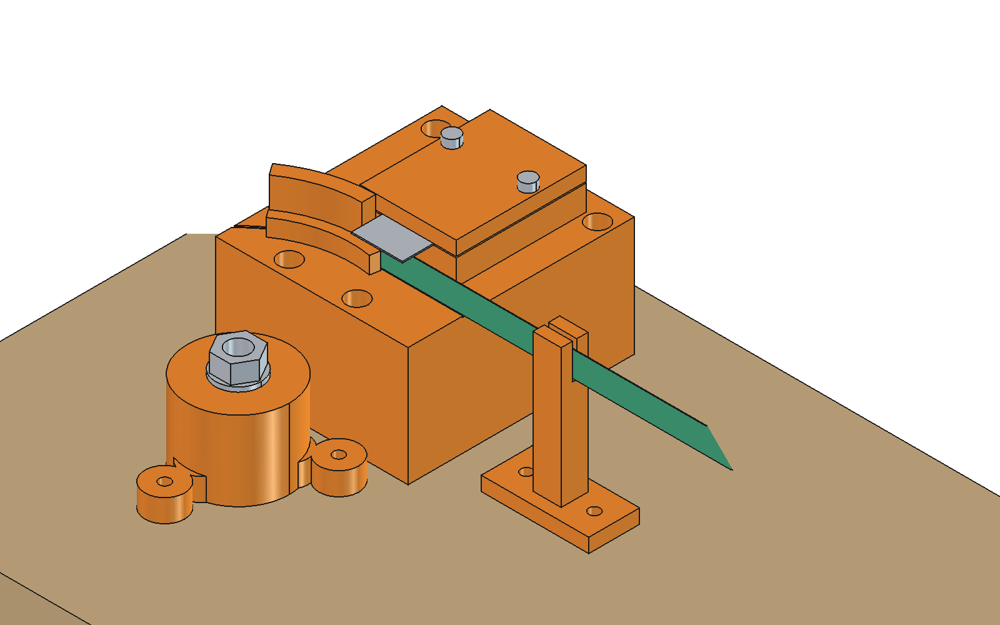
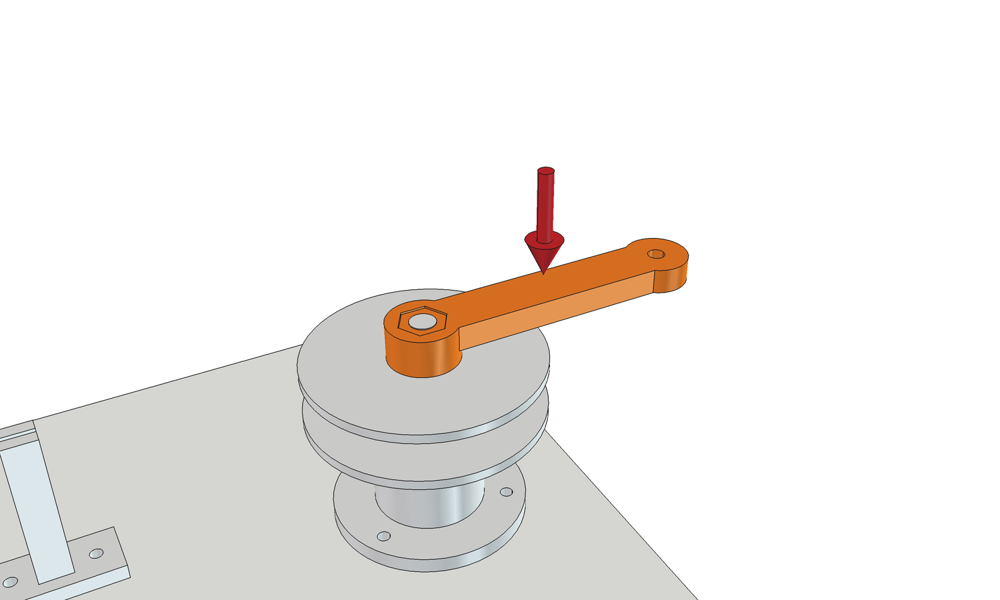
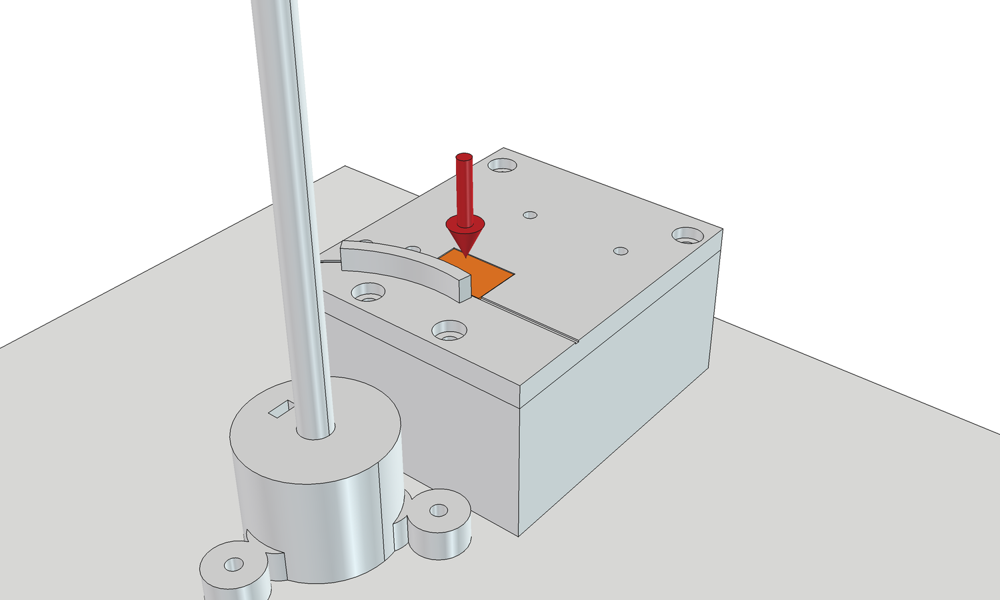
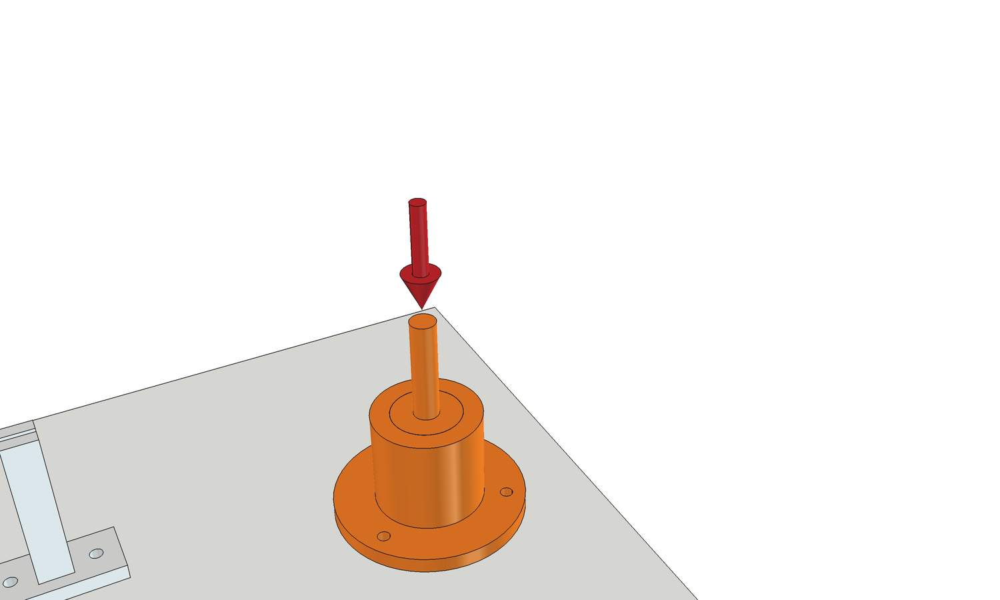
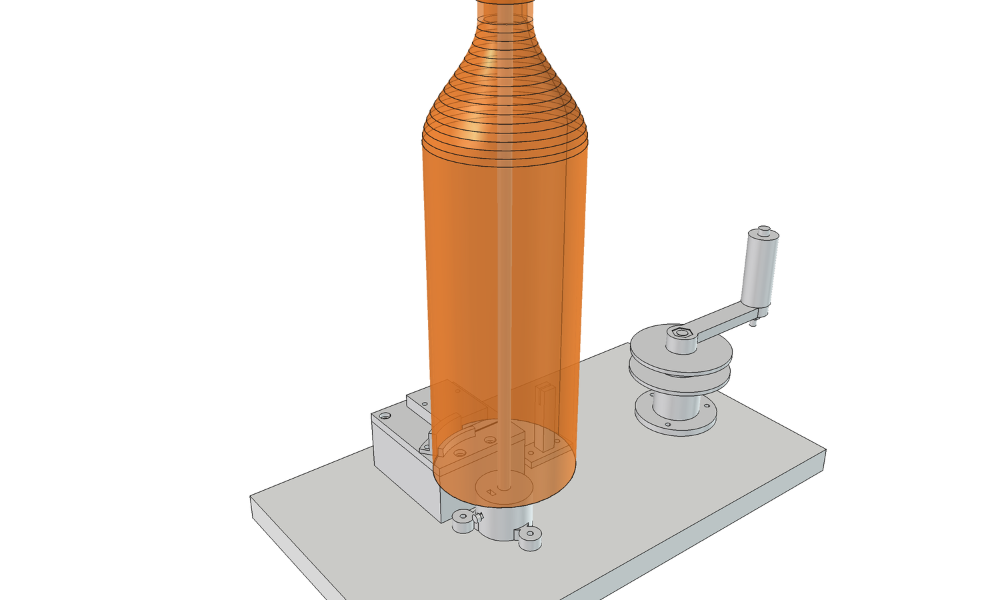
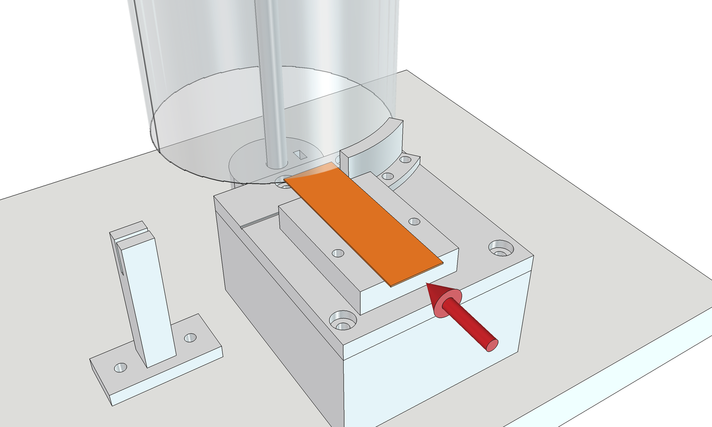

# Cortadora Manual de Botellas PET

<!-- Texto fuente de la Entrega 2 Rev. 1 y de la Entrega 3 (perfil pipeline_pdf/tp_mecanica).
     ::: solo-e3 → solo en la Entrega 3.  [x]{.v k=...} → valor comprobado contra la fuente.
     ::: alternativas → único lugar donde se nombra el concepto descartado. -->

::: solo-e3

## Abstract

Se diseñó y construyó una cortadora manual que transforma botellas de polietileno tereftalato (PET) en una tira continua de ancho controlado. La propia tira, enrollada en un carrete de eje vertical accionado por una manivela, hace girar la botella contra una cuchilla fija; la botella, vertical, se sostiene desde adentro con una varilla y su tapa perforada, y el ancho queda fijado por un calce que define la altura de la hoja sobre la guía donde apoya el borde. El diseño se desarrolló sobre un modelo digital paramétrico, con el que se verificaron interferencias, armado e impresión sin soportes, y se calcularon la fuerza en la mano y el lastre necesario para el descenso de la botella. El prototipo, impreso en PLA sobre una base de MDF, produjo un corte continuo y parejo en el tramo cilíndrico de botellas lisas. Con el calce de 9 mm, el ancho medido en cinco puntos promedió [9,83]{.v k=ancho.media_mm} mm, con un desvío estándar de [0,83]{.v k=ancho.desvio_mm} mm, y solo [2 de 5]{.v k=ancho.dentro_criterio_txt} puntos quedaron dentro de 9 ± 0,5 mm. El principio de tiro resultó viable; para cumplir el criterio de uniformidad falta colocar la chapita metálica de apoyo del diseño y repetir la medición.

:::

## 1. Introducción

La reutilización de botellas de polietileno tereftalato (PET) permite aprovechar estos residuos mediante su transformación en tiras plásticas continuas. Sin embargo, el corte manual produce tiras de ancho irregular y expone al operador al elemento cortante.

El presente trabajo desarrolla un dispositivo de accionamiento manual en el que la propia tira, enrollada en un carrete con manivela, hace girar la botella contra una cuchilla fija, mientras un cabezal de corte fija el ancho de la tira. El dispositivo se diseñó sobre un modelo digital paramétrico y se construyó un prototipo con piezas impresas en PLA para evaluar la continuidad del corte y la uniformidad del ancho en el tramo cilíndrico de la botella.

## 2. Objetivos

### Principal

Desarrollar un dispositivo mecánico de accionamiento manual capaz de transformar botellas de Polietileno Tereftalato (PET) en tiras plásticas continuas mediante un proceso de corte helicoidal controlado, integrando sistemas de sujeción, guiado y transmisión de movimiento.

### Secundarios

1. Diseñar un sistema de sostén interior de la botella, mediante una varilla y su tapa perforada, que permita su giro y su descenso axial, con apoyo del borde en el cabezal de corte para mantener su estabilidad durante el corte.
2. Desarrollar un cabezal de corte que guíe el borde y la pared de la botella frente a una cuchilla fija, con el propósito de obtener una tira de ancho uniforme.
3. Integrar una transmisión manual mediante manivela y carrete, en la que la propia tira haga girar la botella y el avance longitudinal resulte del apoyo del borde en la guía.
4. Incorporar elementos intercambiables que permitan adaptar el ancho de la tira al espesor de pared de botellas PET de distintos diámetros con tapa de 28 mm.
5. Construir un prototipo experimental para evaluar el sostén de la botella, la transmisión del movimiento y la continuidad y uniformidad del corte.

## 3. Estado del arte

Antecedentes recientes en el reciclaje mecánico de botellas PET confirman tanto la vigencia del problema abordado por este proyecto como las limitaciones de las soluciones existentes en cuanto al control geométrico del corte. Tylman y Dzierżek (2020)[^tylman] documentan una máquina de bajo costo, construida en un 80-90 % con piezas impresas en 3D, que transforma botellas PET en tiras continuas de ancho regulable mediante una cuchilla fija y un sistema de bobinado motorizado con una relación de transmisión de engranajes de 1:10. Si bien el dispositivo logra producir tiras utilizables como filamento de impresión 3D, los propios autores señalan que la irregularidad del ancho de corte generó defectos visibles en el material final, lo que evidencia que el control geométrico del corte, y no solo la capacidad de cortar, es un punto crítico no resuelto satisfactoriamente por las soluciones de bobinado simple.

En una línea de desarrollo más reciente, Meraj et al. (2024)[^meraj] presentan una máquina automatizada que combina un cortador de botella, basado en dos rodamientos afilados, con un sistema de avance por tornillo de potencia (*lead screw*) controlado mediante un microcontrolador Arduino, integrado a una etapa de extrusión para fabricar filamento de impresora 3D. En ese antecedente, la sincronización entre el giro de la botella y el avance del corte se resuelve con un actuador controlado electrónicamente.

También existen cortadoras manuales de diseño abierto, publicadas en línea. En la de Low-tech Lab, la hoja de una trincheta se monta entre arandelas a una altura fija sobre una tabla; esa altura define el ancho de la tira, y el operador tira de ella con una mano mientras ejerce una leve presión sobre el cuello de la botella con la otra[^lowtech]. Function 3D, desarrollador del sistema PETALOT, recomienda el ancho de la tira según el espesor de la pared: 10 mm para 0,20 mm de espesor y 7 mm para 0,35 mm[^f3d-1]. En Appropedia se informa que, con el uso, el borde de las botellas termina por cortar las piezas impresas de este tipo de cortadoras, y se sugiere reemplazarlas por metal[^appropedia-1].

A partir de estos antecedentes, en el presente proyecto se adoptaron la cuchilla fija y el arrastre de la botella por la propia tira, como en las cortadoras manuales, y se agregaron una guía de apoyo del borde junto al filo, que fija el ancho de la tira, y un carrete con manivela, que reemplaza el tiro hecho con la mano.

## 4. Marco teórico

El proyecto aplica principios de mecánica y diseño de máquinas para coordinar el sostén, la rotación y el avance de la botella durante el corte.

**Sostén y guiado.** Se busca permitir el giro del envase y su desplazamiento longitudinal, limitando los movimientos laterales y las inclinaciones. La varilla interior y la tapa perforada centran la botella; el apoyo del borde en la guía y los labios del cabezal fijan la posición de la pared junto a la cuchilla.

**Rozamiento.** La fuerza de rozamiento entre dos superficies es proporcional a la fuerza normal de contacto: no supera $\mu_s N$ mientras no hay deslizamiento y vale $f_k = \mu_k N$ cuando las superficies deslizan[^os-friccion-1]. Estos conceptos se aplicaron al deslizamiento de la pared sobre los labios del cabezal y de la tapa sobre la varilla, cuya componente a lo largo del eje se opone al descenso de la botella.

**Momento en la manivela.** El tiro $T$ de la tira actúa sobre el carrete con un brazo igual al radio de enrollado $r$, y produce un momento $T\,r$[^os-momento]. En la manivela, de brazo $R$, y con una relación de transmisión $i$ entre la manivela y el carrete (vueltas de manivela por vuelta de carrete), la fuerza en la mano resulta:

$$F = \frac{T\,r}{i\,R}$$

El radio $r$ crece a medida que se enrolla la tira, por lo que el caso más exigente es el rollo lleno.

**Equilibrio axial.** La botella desciende sobre la varilla mientras la suma de las fuerzas a lo largo del eje la empuja hacia la guía[^os-equilibrio]: el peso propio y, si hace falta, un lastre sobre la tapa deben superar la componente axial del rozamiento en los labios y en la tapa.

**Geometría de la hélice.** Al desarrollar el cilindro de la botella, de diámetro $D$, una vuelta de corte avanza el ancho $w$ a lo largo del eje mientras recorre el perímetro $\pi D$. La inclinación de la hélice resulta:

$$\tan\alpha = \frac{w}{\pi D}$$

Con $\alpha$ pequeño, la pared desliza casi en la dirección del giro y solo una pequeña fracción del rozamiento actúa a lo largo del eje.

**Fabricación por impresión FDM en PLA.** Las piezas se fabricaron por modelado por deposición fundida (FDM) en PLA. En este proceso la pieza se construye por capas, por lo que la orientación de cada pieza en la cama se eligió de modo que pudiera imprimirse sin estructuras de soporte, y los encastres se dimensionaron con holguras. El dispositivo se modeló de forma paramétrica en FreeCAD: el mismo modelo se usó para verificar interferencias, la secuencia de armado y la imprimibilidad de las piezas, y para generar los planos.

## 5. Desarrollo del diseño

### 5.1. Configuración general y criterios de diseño

La cortadora se construyó sobre una base de MDF de [345]{.v k=par.MDF.1} × [200]{.v k=par.MDF.2} × [18]{.v k=par.MDF.3} mm (@fig:conjunto). La botella, sin su base, se coloca vertical, con el pico hacia arriba, atravesada por una varilla lisa fijada en un zócalo; arriba la centra su propia tapa, perforada a [9]{.v k=par.TAPA_AGUJERO} mm, que gira y desliza sobre la varilla. El borde cortado apoya en la guía del cabezal de corte y la pared pasa por una ranura entre dos labios, donde una hoja fija corta la tira. La tira atraviesa un ojal fijo y se enrolla en un carrete de eje vertical, montado sobre una torre con dos rodamientos 608ZZ y accionado por una manivela.

El funcionamiento se basa en el tiro de la propia tira: al girar la manivela, la tira se enrolla en el carrete y tira de la pared, la botella gira sobre la varilla y la hoja corta. El borde cortado describe una hélice; en cada vuelta, el nuevo borde desciende y vuelve a apoyarse en la guía, de modo que el paso del corte, igual al ancho de la tira, queda fijado por la guía y no por un mecanismo que sincronice el giro con el avance.

{#fig:conjunto width=10cm}

Los criterios de diseño fueron los siguientes:

- **Ancho constante:** la referencia del ancho está junto al filo, en la guía donde apoya el borde, de modo que ni el diámetro ni la ovalización de la botella lo modifican.
- **Seguridad del operador:** la hoja queda contenida en el cabezal y solo asoma en la ranura; el carrete se ubicó a [180]{.v k=par.X_CARRETE} mm de la botella para que la mano que gira la manivela no se acerque a ella.
- **Una sola entrada de movimiento:** la manivela; no hay movimientos que sincronizar.
- **Fabricación accesible:** piezas impresas sin soportes, que entran en una cama de [256]{.v k=par.CAMA} × [256]{.v k=par.CAMA} mm, unidas con tornillos y tuercas comerciales, sin pegamento.
- **Alcance:** se corta el tramo cilíndrico de la botella; el hombro y el cuello quedan fuera del corte.

::: alternativas
**Alternativas evaluadas.** En una etapa previa se consideró una configuración con la botella horizontal, con sujeción exterior del cuello, accionada por un rodillo motriz por fricción sobre el cuerpo y con avance mediante engranajes reductores y un husillo que desplazaba un carro sobre guías paralelas. Se descartó por el riesgo de deslizamiento del rodillo, que habría alterado la relación entre el giro y el avance, y porque el cuello debía soportar la botella y el empuje del accionamiento. El principio de tiro elimina ambos problemas: el movimiento no depende de un contacto por fricción y el cuello solo centra la botella.
:::

### 5.2. Cabezal de corte y ancho constante

El cabezal está formado por una placa impresa de [6]{.v k=res.funcionamiento.placa_cabezal_mm} mm de espesor, atornillada sobre un taco de MDF de [36]{.v k=par.TACO_ALTO} mm (dos recortes de 18 mm) que la eleva hasta la altura a la que el carrete toma la tira (@fig:cabezal). La pared de la botella pasa por una ranura de [0,85]{.v k=res.funcionamiento.ranura_mm} mm entre un labio interior y uno exterior: [0,25]{.v k=par.PARED} mm de pared y [0,30]{.v k=par.HOLG_RANURA} mm de holgura por lado. Así confinada, la pared no puede inclinarse ni escaparse en la zona del corte. El labio interior mide [6]{.v k=par.ALTO_LABIO_INT} mm de alto, menos que el calce más bajo ([7]{.v k=par.W_MIN} mm), para que la hoja pase por encima.

La hoja, un segmento de hoja de trincheta de [18]{.v k=par.HOJA.1} mm, queda apretada entre el calce y el pisador por dos tornillos M3 × 25 con tuercas cautivas. El ancho de la tira es la altura del filo sobre la guía, y esa altura la fija el espesor del calce: el calce de 9 mm se imprime con [8,9]{.v k=par.CALCE_ESPESOR_9} mm porque apoya sobre el piso de PLA, que queda 0,1 mm por encima de la cara de la chapita. Como la referencia está junto al filo, el ancho por construcción es de [9,000]{.v k=res.funcionamiento.ancho_por_construccion_mm} mm y solo lo afecta la tolerancia de impresión del calce. Se imprimieron calces de 7, 8, 9 y 10 mm, para adaptar el ancho al espesor de pared según la recomendación de Function 3D[^f3d-2] (@tbl:pared).

| Espesor de pared (mm) | Ancho de tira (mm) |
|:---:|:---:|
| [0,20]{.v k=par.ANCHO_SEGUN_PARED.1.1} | [10]{.v k=par.ANCHO_SEGUN_PARED.1.2} |
| [0,25]{.v k=par.ANCHO_SEGUN_PARED.2.1} | [9]{.v k=par.ANCHO_SEGUN_PARED.2.2} |
| [0,30]{.v k=par.ANCHO_SEGUN_PARED.3.1} | [8]{.v k=par.ANCHO_SEGUN_PARED.3.2} |
| [0,35]{.v k=par.ANCHO_SEGUN_PARED.4.1} | [7]{.v k=par.ANCHO_SEGUN_PARED.4.2} |

: Ancho de tira recomendado según el espesor de pared. {#tbl:pared}

El borde de la botella apoya, bajo la ranura, en una chapita metálica: un recorte de [18]{.v k=par.CHAPITA_LARGO} × [12,7]{.v k=par.CHAPITA_ANCHO} mm de una galga de espesores de [0,5]{.v k=par.CHAPITA_ESP} mm, alojado en un rebaje abierto de [0,6]{.v k=par.POZO_ALTO} mm de profundidad. La chapita se extiende desde [4,4]{.v k=res.funcionamiento.chapita_aguas_arriba_mm} mm antes del filo hasta [9]{.v k=res.funcionamiento.chapita_aguas_abajo_mm} mm después, y una canaleta de [0,3]{.v k=par.RANURA_PROF} mm bajo el resto de la ranura evita que el borde toque el PLA. Su función es que el borde apoye en metal justo donde se define el ancho, porque el roce del borde de la botella desgasta el plástico[^appropedia-2].

{#fig:cabezal width=12cm}

### 5.3. Accionamiento y carrete

Con la botella vertical, la tira sale del cabezal de canto, con su ancho en posición vertical. Para enrollarla plana, sin torcerla, el eje del carrete también es vertical. El carrete tiene un núcleo de [32]{.v k=par.D_NUCLEO} mm de diámetro entre dos discos y gira sobre un tornillo M8 × 60 que actúa de eje, apoyado en dos rodamientos 608ZZ alojados a presión en la torre. La manivela, de [80]{.v k=par.R_MANIVELA} mm de brazo, se monta sobre el disco superior con una tuerca M8 cautiva; enroscada contra la del carrete, funciona como tuerca y contratuerca (@fig:manivela). Visto desde arriba, el conjunto gira en sentido horario, el mismo sentido en que el eje roscado aprieta la tuerca de la manivela. Entre el cabezal y el carrete, un ojal fijo mantiene constante la dirección del tiro mientras crece el rollo.

La relación de transmisión se eligió con la ecuación de la fuerza en la mano (sección 4), para el rollo lleno ($r$ = [26,4]{.v k=res.funcionamiento.radio_rollo_mm.2} mm) y con un tiro de diseño $T$ = [40]{.v k=par.T_DISENO} N. Ese tiro es una hipótesis de diseño: no se encontró un valor medido publicado y no se midió en el prototipo. El criterio adoptado fue no superar [20]{.v k=par.F_MANO_MAX} N en la mano, para girar de forma pareja y sin cansancio. La @tbl:transmision compara tres opciones.

| Opción | $i$ | Fuerza en la mano (N) | Vueltas de manivela por botella |
|:-----------------------------------|:------:|:----------:|:-------------:|
| Multiplicación, como en una bobinadora de filamento a manivela | 1/6,6 | [87,1]{.v k=tx.multiplica.fuerza_N} | [6]{.v k=tx.multiplica.vueltas_manivela} |
| **Carrete directo** | **1** | **[13,2]{.v k=tx.directo.fuerza_N}** | **[42]{.v k=tx.directo.vueltas_manivela}** |
| Reducción con un par de engranajes y un eje adicional | 3 | [4,4]{.v k=tx.reduce.fuerza_N} | [125]{.v k=tx.reduce.vueltas_manivela} |

: Opciones de transmisión entre la manivela y el carrete (valores calculados con $T$ = 40 N y el rollo lleno). {#tbl:transmision}

Se eligió el carrete directo, con relación 1:1: cumple el criterio con margen, no requiere engranajes y admite un tiro de hasta [61]{.v k=res.funcionamiento.tiro_admisible_N} N antes de superar los 20 N en la mano. La multiplicación, cuya relación corresponde al tren de engranajes de una bobinadora de filamento a manivela de diseño abierto[^winder], exige una fuerza que impide girar de forma pareja, y la reducción triplica las vueltas y agrega piezas. Si el tiro real resultara mayor, el primer recurso es alargar el brazo de la manivela, que no agrega piezas. Para la botella de referencia, de [88]{.v k=par.D_B} mm de diámetro y [180]{.v k=par.RECORRIDO} mm de tramo cilíndrico, el modelo calcula una tira de [5,53]{.v k=res.funcionamiento.largo_tira_m} m en [20]{.v k=res.funcionamiento.vueltas_botella} vueltas de botella, con un rollo que crece de [16]{.v k=res.funcionamiento.radio_rollo_mm.1} a [26,4]{.v k=res.funcionamiento.radio_rollo_mm.2} mm de radio.

{#fig:manivela width=10cm}

### 5.4. Autoavance y lastre

Para que el corte siga la hélice, la botella tiene que descender el ancho de la tira en cada vuelta y mantener el borde apoyado en la guía. Las fuerzas a lo largo del eje se calcularon con el modelo (@tbl:autoavance). El rozamiento en los labios se estimó con un coeficiente PLA-PET supuesto de [0,35]{.v k=par.MU_PLA_PET} y con los labios cargados con la mitad del tiro, del lado seguro. El de la tapa sobre la varilla se estimó con un coeficiente supuesto de [0,30]{.v k=par.MU_TAPA} y con la tapa cargada con el [10]{.v k=par.FRACCION_TAPA_PCT} % del tiro; en la tapa, el contacto está a pocos milímetros del eje, y el deslizamiento resulta inclinado [19,7]{.v k=res.funcionamiento.tapa_inclinacion_deslizamiento}°, mucho más que en la pared.

| Fuerza a lo largo del eje | Valor calculado (N) |
|:---------------------------------------------|:-----------------:|
| Peso de la botella, al inicio / al final del corte | [0,31]{.v k=res.funcionamiento.peso_botella_N.1} / [0,14]{.v k=res.funcionamiento.peso_botella_N.2} |
| Rozamiento en los labios | [0,23]{.v k=res.funcionamiento.rozamiento_axial_N.labios} |
| Rozamiento de la tapa sobre la varilla | [0,40]{.v k=res.funcionamiento.rozamiento_axial_N.tapa} |
| Rozamiento total | [0,63]{.v k=res.funcionamiento.rozamiento_axial_N.total} |

: Equilibrio axial de la botella (valores calculados). {#tbl:autoavance}

Al final del corte, el peso de la botella no alcanza para vencer el rozamiento: con un margen de 2, el modelo estima un lastre total de unos [115]{.v k=res.funcionamiento.lastre_total_g} g sobre la tapa. Como valor de referencia, el coeficiente de rozamiento del polietileno sobre acero es de [0,2]{.v k=par.MU_PE_ACERO.seca}, en seco y con grasa[^etb]; con ese valor, el lastre baja a unos [90]{.v k="res.funcionamiento.lastre_segun_mu_tapa_g.PE-acero, seca (0,20)"} g, de modo que lubricar la varilla no aporta. El cálculo no considera la componente axial que aporta el tiro cuando la tira sale alineada con la hélice, por lo que el lastre estimado queda del lado seguro. El diseño incluye un vaso impreso que se apoya sobre la tapa y admite unos [149]{.v k=res.funcionamiento.vaso_capacidad_tuercas_g} g de tuercas sueltas como lastre.

### 5.5. Verificaciones del modelo digital

El modelo paramétrico del prototipo se verificó con controles automáticos que recorren la geometría de todas las piezas. Si alguno no se cumple, el modelo no se da por válido. Los resultados fueron los siguientes:

- **Interferencias en el armado:** [0]{.v k=ver.choques_inicio} choques con la botella al inicio del corte y [0]{.v k=ver.choques_final} al final; los únicos cruces admitidos son los del propio corte (la hoja con la pared y la tira con la botella de la que sale).
- **Giro de la manivela:** en [36]{.v k=ver.posiciones_manivela} posiciones de una vuelta completa, al inicio y al final del corte, la manivela no toca ninguna pieza.
- **Lugar para la mano:** [46,4]{.v k=res.luz_mano_botella_mm} mm entre el mango y la botella, frente a un mínimo adoptado de [40]{.v k=par.LUZ_MANO} mm.
- **Secuencia de armado:** los [26]{.v k=ver.pasos_armado} pasos, agrupados en 7 etapas, se comprobaron en orden: cada pieza llega a su lugar sin atravesar lo ya armado.
- **Impresión:** las [15]{.v k=ver.piezas_impresas} piezas impresas entran en la cama, no tienen voladizos de más de 45° respecto de la vertical y sus puentes no superan [5,4]{.v k=ver.puente_max_mm} mm: ninguna necesita soportes.

Para comprobar que los controles detectan errores, se corrieron copias del modelo con errores introducidos a propósito (una ranura más angosta que la pared, un brazo de manivela demasiado largo, un núcleo de carrete más bajo que la tira); en todos los casos el control falló.

### 5.6. Materiales, fabricación y montaje

Las [15]{.v k=ver.piezas_impresas} piezas impresas se fabricaron en PLA, con boquilla de [0,4]{.v k=par.BOQUILLA} mm. Se estimaron unos [194]{.v k=res.impresion_total.masa_g} g de material y unas [6,1]{.v k=res.impresion_total.tiempo_h} h de impresión. Las holguras se definieron en el modelo: [0,4]{.v k=par.HOLG_AGUJERO} mm sobre el diámetro en los agujeros para tornillos, [0,3]{.v k=par.HOLG_TUERCA} mm entre caras en los alojamientos de tuercas cautivas y un alojamiento de [22,15]{.v k=par.D_608_ALOJ} mm para el ajuste a presión de los rodamientos de [22]{.v k=par.D_608} mm. La base y el taco del cabezal son de MDF de 18 mm, cortado a medida. Los componentes comerciales son la varilla, el tornillo M8 que sirve de eje del carrete, los rodamientos 608ZZ, la hoja de trincheta, la galga para la chapita, la tornillería métrica y los tornillos para madera (Anexo A).

El montaje se ordenó en 7 etapas: eje de la botella, cabezal, ojal, carrete y manivela, botella, cuchilla y, por último, lastre y sujeción de la base a la mesa con una prensa tipo sargento (Anexo B). Antes de montar la botella se le corta la base y se arranca con tijera una lengüeta inicial de unos 10 cm, cuya punta se fija al núcleo del carrete con un tornillo para madera chico.

En el prototipo se utilizó una varilla de acero de [7,3]{.v k=med.varilla_mm} mm de diámetro en lugar de la de [8]{.v k=par.VARILLA_D} mm del diseño; el tornillo prisionero del zócalo la traba firme, por lo que la diferencia no afecta el funcionamiento. La chapita de apoyo no se colocó en el prototipo, por lo que el borde de la botella apoyó directamente sobre el piso de PLA del rebaje.

## 6. Planos

Las cuatro láminas se dibujaron en formato A3 a partir del modelo digital del prototipo, en sistema europeo (método E), y se reproducen reducidas a A4: las escalas indicadas en cada rótulo corresponden al formato A3 original. La lámina 1 muestra el conjunto con la lista de piezas; las láminas 2 y 3 detallan las piezas impresas del cabezal de corte y del accionamiento, y la lámina 4 resume el principio de funcionamiento y la cadena de cálculo.

{.lamina}

{.lamina}

{.lamina}

{.lamina}

::: solo-e3

## 7. Resultados

### 7.1. Ancho de tira medido

Con el calce de 9 mm se midió con calibre el ancho de la tira en cinco puntos de las tiras obtenidas. La @tbl:ancho resume las mediciones; el criterio adoptado en el diseño es 9 ± 0,5 mm.

| Magnitud | Valor |
|:-----------------------------|:-------------------------------------|
| Mediciones (mm) | [9,79]{.v k=ancho.mediciones_mm.1}; [10,79]{.v k=ancho.mediciones_mm.2}; [8,73]{.v k=ancho.mediciones_mm.3}; [9,36]{.v k=ancho.mediciones_mm.4}; [10,47]{.v k=ancho.mediciones_mm.5} |
| Promedio (mm) | [9,83]{.v k=ancho.media_mm} |
| Desvío estándar muestral (mm) | [0,83]{.v k=ancho.desvio_mm} |
| Mínimo / máximo (mm) | [8,73]{.v k=ancho.minimo_mm} / [10,79]{.v k=ancho.maximo_mm} |
| Rango (mm) | [2,06]{.v k=ancho.rango_mm} |
| Promedio − nominal (mm) | [0,83]{.v k=ancho.desvio_medio_nominal_mm} |
| Puntos dentro de 9 ± 0,5 mm | [2 de 5]{.v k=ancho.dentro_criterio_txt} |

: Ancho de tira medido con el calce de 9 mm. {#tbl:ancho}

El ancho medio superó el nominal en [0,83]{.v k=ancho.desvio_medio_nominal_mm} mm, y la dispersión excedió el criterio de ±0,5 mm. Las causas probables, no demostradas con estas mediciones, son varias:

- **Chapita sin colocar:** el borde apoyó sobre el PLA del rebaje, [0,5]{.v k=par.CHAPITA_ESP} mm por debajo de la cara de la chapita que sirve de referencia del ancho. Según el modelo, eso ensancha la tira hasta 0,5 mm: explicaría parte del exceso medio, pero no la dispersión ni el punto que quedó por debajo del nominal.
- **Flexión de la hoja:** el segmento de hoja de trincheta no siempre se mantuvo rígido y se curvó durante el corte, lo que cambia la altura efectiva del filo.
- **Tramo medido:** algunas mediciones pudieron tomarse sobre el tramo inicial de la tira, cortado a mano con tijera, o sobre las primeras vueltas, de aspecto más irregular que las últimas.
- **Irregularidades de la botella:** variaciones de diámetro y de espesor de la pared.

Con cinco mediciones no es posible separar el efecto de cada causa.

### 7.2. Observaciones de funcionamiento

- Con botellas relativamente lisas se obtuvo un corte continuo, y se obtuvieron varias tiras.
- El corte avanzó de forma pareja con un giro constante de la manivela.
- El arranque requirió acompañar la botella con la mano hasta que el borde se asentó en la guía; desde ahí, el corte siguió la hélice.
- El corte terminó en el hombro de la botella, límite de uso contemplado en el diseño: se corta el tramo cilíndrico.
- Se usó un peso adicional sobre la tapa como lastre.
- A simple vista, las últimas vueltas cortadas resultaron más parejas que las primeras.

### 7.3. Valores calculados del modelo

La @tbl:calculados reúne los valores calculados con el modelo digital del prototipo. No son mediciones: dependen del tiro de diseño de 40 N, que es una hipótesis.

| Magnitud calculada | Valor |
|:---------------------------------------------|:------------------------------|
| Fuerza en la mano, rollo lleno, con $T$ = 40 N | [13,2]{.v k=res.funcionamiento.fuerza_mano_N} N (criterio: hasta 20 N) |
| Tiro admisible con ese criterio | [61]{.v k=res.funcionamiento.tiro_admisible_N} N |
| Inclinación de la hélice, $\alpha$ | [1,86]{.v k=res.funcionamiento.helice_grados}° |
| Ancho de tira por construcción (calce de 9 mm) | [9,000]{.v k=res.funcionamiento.ancho_por_construccion_mm} mm |

: Valores calculados con el modelo digital (no medidos). {#tbl:calculados}

## 8. Conclusión

El prototipo cumplió el objetivo de transformar botellas PET en una tira continua con accionamiento manual: el tiro de la propia tira hizo girar la botella contra la cuchilla fija sin ningún mecanismo de sincronización, y el corte avanzó de forma pareja en el tramo cilíndrico.

La uniformidad del ancho se cumplió en forma parcial. El ancho medio fue de [9,83]{.v k=ancho.media_mm} mm para un nominal de 9 mm, y la dispersión superó el criterio de ±0,5 mm. Las causas más probables son la falta de la chapita metálica de apoyo, que dejó el borde sobre el PLA, la flexión de la hoja y el tramo de tira en el que se midió, sumadas a las irregularidades de la botella. El uso quedó limitado al tramo cilíndrico de botellas relativamente lisas: el hombro y las botellas con nervaduras quedan fuera de alcance, y el arranque requiere acompañar la botella con la mano.

Como mejora inmediata corresponde colocar la chapita metálica bajo la ranura, como indica el diseño, y repetir la medición del ancho a lo largo de toda la tira, descartando el tramo inicial cortado a mano.

:::

<!-- salto-pagina -->

## Anexo A. Piezas impresas y comerciales

| N.° | Pieza impresa en PLA | Cant. | Función |
|:-----:|:-------------------------|:-----:|:------------------------------------------|
| 1 | Placa del cabezal | 1 | Guía del borde, labio interior, rebaje de la chapita y apoyo del calce |
| 2–5 | Calces de 9, 7, 8 y 10 mm | 4 | Fijan la altura del filo, es decir, el ancho de la tira |
| 6 | Pisador de la hoja | 1 | Aprieta la hoja contra el calce |
| 7 | Zócalo de la varilla | 1 | Mantiene vertical la varilla; la traba un tornillo M3 |
| 8 | Ojal | 1 | Fija la dirección del tiro |
| 9 | Torre del carrete | 1 | Aloja los dos rodamientos 608ZZ |
| 10–11 | Carrete, disco inferior y disco superior | 2 | Núcleo donde se enrolla la tira, entre dos discos |
| 12 | Manivela | 1 | Brazo de 80 mm con tuerca M8 cautiva |
| 13 | Mango | 1 | Gira sobre un tornillo M5 |
| 14 | Vaso de lastre | 1 | Lastre opcional sobre la tapa |
| 15 | Labio exterior | 1 | Labio exterior de la ranura; retiene la chapita |

: Piezas impresas ([194]{.v k=res.impresion_total.masa_g} g de PLA y unas [6,1]{.v k=res.impresion_total.tiempo_h} h de impresión, estimados). {#tbl:impresas}

| Pieza comercial | Cant. | Medida | Uso |
|:----------------------------|:---------:|:----------------------------|:------------------------|
| Varilla lisa de acero | 1 | Ø8 × 400 mm (en el prototipo, Ø7,3 mm) | Eje de la botella |
| Tornillo M8 × 60, rosca completa, y tuercas M8 | 1 + 2 | — | Eje del carrete; carrete y manivela |
| Arandelas M8 | 2 | 8,4 × 16 mm | A cada lado de los rodamientos |
| Rodamientos 608ZZ | 2 | 8 × 22 × 7 mm | Torre del carrete |
| Hoja de trincheta | 1 y repuestos | 18 mm | Cuchilla |
| Galga de espesores | 1 recorte | 0,5 mm, 18 × 12,7 mm | Chapita de apoyo del borde |
| Tornillos M3 × 25 y tuercas M3 | 2 + 2 | — | Aprietan la hoja |
| Tornillo M3 × 16 y tuerca M3 | 1 + 1 | — | Traba la varilla en el zócalo |
| Tornillo M5 × 75 Allen y tuerca autoblocante | 1 + 1 | — | Eje del mango |
| Tornillos para madera | 14 + 2 | 3,5 × 16 y 3,5 × 45 mm | Fijación a la base; taco del cabezal |
| MDF | 1 | 18 mm: 345 × 200 mm y dos recortes de 68 × 80 mm | Base y taco del cabezal |
| Prensa tipo sargento | 1 | Apertura de 80 mm o más | Sujeción de la base a la mesa |

: Piezas comerciales. {#tbl:comerciales}

<!-- salto-pagina -->

## Anexo B. Secuencia de armado

| Etapa | Pasos | Contenido |
|:----------------------|:-------:|:-----------------------------------------------|
| 1. Eje de la botella | 1 a 4 | Zócalo, tuerca del prisionero, varilla y prisionero |
| 2. Cabezal | 5 a 10 | Taco de MDF, tuercas cautivas, placa, chapita, labio exterior y calce |
| 3. Ojal | 11 | Ojal sobre la base |
| 4. Carrete y manivela | 12 a 20 | Rodamientos, eje, torre, arandela, discos del carrete, manivela y mango |
| 5. Botella | 21 | Botella preparada, con su tapa, bajando por la varilla |
| 6. Cuchilla | 22 a 24 | Hoja, pisador y tornillos de la hoja |
| 7. Lastre y sujeción | 25 y 26 | Vaso de lastre (opcional) y prensa a la mesa |

: Etapas del armado. {#tbl:armado}

En cada paso del armado, la pieza nueva se muestra en naranja y lo ya armado en gris ([@fig:paso08; @fig:paso14; @fig:paso21; @fig:paso22]).

{#fig:paso08 width=8cm}

{#fig:paso14 width=8cm}

{#fig:paso21 width=8cm}

{#fig:paso22 width=8cm}

## Bibliografía

::: bibliografia
- Meraj, M., Ku, P. X., Choo, H. L., & Aung, P. P. (2024). Design and development of an automated PET plastic bottle 3D printer filament making machine. *Journal of Physics: Conference Series, 2923*(1), Artículo 012005. <https://doi.org/10.1088/1742-6596/2923/1/012005>
- OpenStax. (2016a). 6.2 Friction. En *University physics volume 1*. <https://openstax.org/books/university-physics-volume-1/pages/6-2-friction>
- OpenStax. (2016b). 10.6 Torque. En *University physics volume 1*. <https://openstax.org/books/university-physics-volume-1/pages/10-6-torque>
- OpenStax. (2016c). 12.1 Conditions for static equilibrium. En *University physics volume 1*. <https://openstax.org/books/university-physics-volume-1/pages/12-1-conditions-for-static-equilibrium>
- Tylman, I., & Dzierżek, K. (2020). Filament for a 3D printer from PET bottles — Simple machine. *International Journal of Mechanical Engineering and Robotics Research, 9*(10), 1386–1392. <https://doi.org/10.18178/ijmerr.9.10.1386-1392>
:::

## Links de interés

::: links
- Appropedia. 3D printed improved PET bottle stripper. <https://www.appropedia.org/3D_printed_improved_PET_bottle_stripper>
- Engineering ToolBox. Friction — Coefficients for common materials and surfaces. <https://www.engineeringtoolbox.com/friction-coefficients-d_778.html>
- Function 3D. FAQs: At what width do you cut the plastic strip from the bottle? <https://function3d.xyz/en/faqs/>
- Function 3D. PETALOT: PET bottle to 3D filament. <https://github.com/function3d/petalot>
- Irimie, S. Cell Spool Winder (MakerWorld, modelo 561571). <https://makerworld.com/en/models/561571-cell-spool-winder>
- Low-tech Lab. Plastic bottle cutter. <https://wiki.lowtechlab.org/wiki/D%C3%A9coupeuse_de_bouteille_plastique/en>
- Precious Plastic. PET filament from bottles. <https://community.preciousplastic.com/library/pet-filament-from-bottles>
:::

[^tylman]: Tylman, I., & Dzierżek, K. (2020). Filament for a 3D printer from PET bottles — Simple machine. *International Journal of Mechanical Engineering and Robotics Research, 9*(10), 1386–1392. <https://doi.org/10.18178/ijmerr.9.10.1386-1392>

[^meraj]: Meraj, M., Ku, P. X., Choo, H. L., & Aung, P. P. (2024). Design and development of an automated PET plastic bottle 3D printer filament making machine. *Journal of Physics: Conference Series, 2923*(1), Artículo 012005. <https://doi.org/10.1088/1742-6596/2923/1/012005>

[^lowtech]: Low-tech Lab. Plastic bottle cutter. <https://wiki.lowtechlab.org/wiki/D%C3%A9coupeuse_de_bouteille_plastique/en>

[^f3d-1]: Function 3D. FAQs: At what width do you cut the plastic strip from the bottle? <https://function3d.xyz/en/faqs/>

[^f3d-2]: Function 3D. FAQs: At what width do you cut the plastic strip from the bottle? <https://function3d.xyz/en/faqs/>

[^appropedia-1]: Appropedia. 3D printed improved PET bottle stripper, sección «Common problems and solutions». <https://www.appropedia.org/3D_printed_improved_PET_bottle_stripper>

[^appropedia-2]: Appropedia. 3D printed improved PET bottle stripper, sección «Common problems and solutions». <https://www.appropedia.org/3D_printed_improved_PET_bottle_stripper>

[^os-friccion-1]: OpenStax. (2016a). 6.2 Friction. En *University physics volume 1*. <https://openstax.org/books/university-physics-volume-1/pages/6-2-friction>

[^os-momento]: OpenStax. (2016b). 10.6 Torque. En *University physics volume 1*. <https://openstax.org/books/university-physics-volume-1/pages/10-6-torque>

[^os-equilibrio]: OpenStax. (2016c). 12.1 Conditions for static equilibrium. En *University physics volume 1*. <https://openstax.org/books/university-physics-volume-1/pages/12-1-conditions-for-static-equilibrium>

[^winder]: Irimie, S. Cell Spool Winder (MakerWorld, modelo 561571); la relación surge de los engranajes de su tren. <https://makerworld.com/en/models/561571-cell-spool-winder>

[^etb]: Engineering ToolBox. Friction — Coefficients for common materials and surfaces (polietileno sobre acero). <https://www.engineeringtoolbox.com/friction-coefficients-d_778.html>

<!-- solo-md -->

---
*Fuentes: `08_modelo_2/` (README.md, 00_concepto.md, hallazgos_prototipo.md, parametros.py, resultados.json, planos, figuras, instructivo); `03_entrega_2/Entrega_2_Reentrega_0_S1091_Grupo_1.pdf` (estructura, objetivos, marco teórico y citas aprobadas); mediciones del grupo del 16/11/2026 (`anchos_medidos.py`); referencias citadas al pie.*

<!-- /solo-md -->
