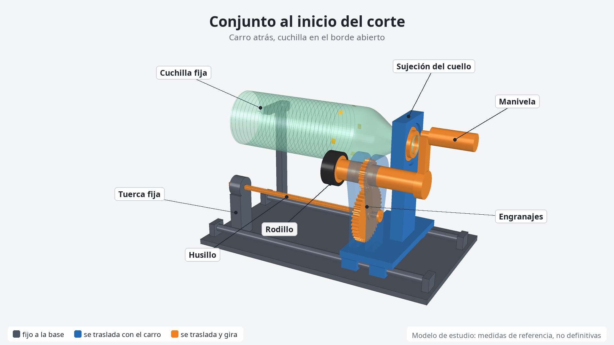
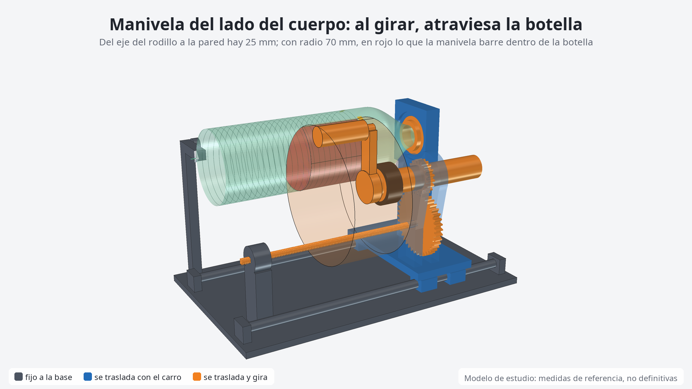
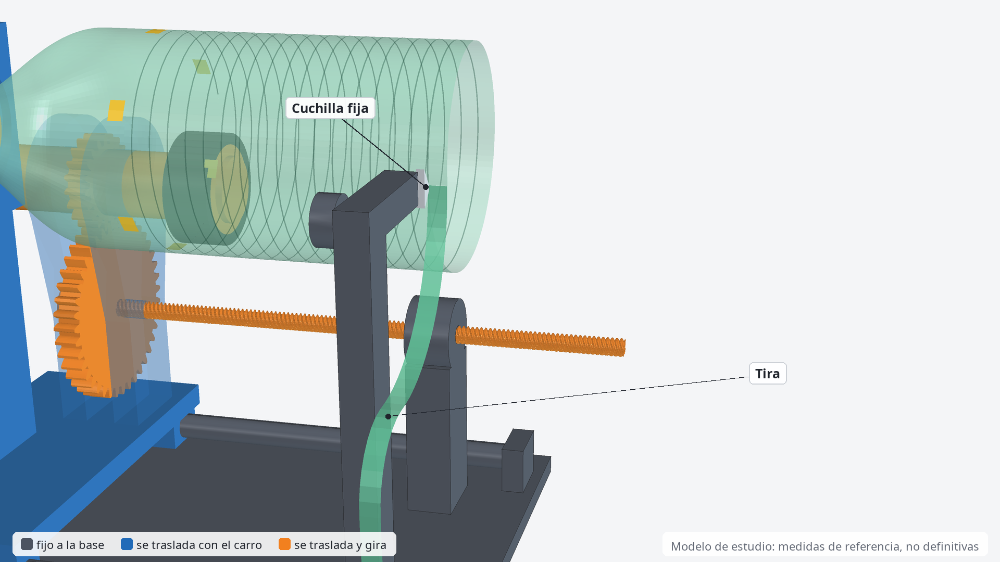

# Modelo 3D de la cortadora: qué encontró

Modelo de FreeCAD del mecanismo que describe la Entrega 2 (E2), simulado en todo el recorrido. **Es material de estudio para que el grupo decida.** No cambia la Entrega 2 ni la presentación.



## 1. Qué se puede confiar y qué no

- **Sale de E2:** la disposición (tuerca y cuchilla fijas a la base; soporte del cuello, rodillo, engranajes y husillo sobre el carro), el corte desde el borde abierto hacia el cuello y la ecuación `a = L·Db/(i·Dr)`.
- **Son supuestos:** casi todas las medidas. E2 no las define todavía. En [parametros.py](parametros.py) cada valor indica su origen: `[E2]`, `[DXF]`, `[REF]` (valor de referencia de la lámina 10) o `[SUP]` (supuesto de este modelo).
- **Qué se verificó:** geometría y cinemática. Se comprobó que las piezas no choquen en 13 posiciones del recorrido, y que los dientes reales engranen con 20/40. Como control, los mismos dientes con una relación equivocada sí se pisan.
- **Qué no se verificó:** fuerzas, fricción, deformación de la botella ni calidad del corte. Eso solo lo responde el prototipo. El paso medido en la simulación (7,04 mm) coincide con la ecuación porque la simulación usa las mismas relaciones: confirma que el modelo es coherente, no que la máquina real dé ese paso.
- **El recorrido de la tira es ilustrativo.** E2 solo pide una salida libre.

## 2. Hallazgos

### 2.1 La manivela no puede ir del lado del cuerpo de la botella

E2 une la manivela al eje del rodillo, pero no dice de qué lado. El eje del rodillo queda a `Dr/2` = **25 mm** de la pared. Con un mango de radio 12 mm, del lado del cuerpo la manivela no podría tener más de **13 mm** de radio. Con 70 mm de radio, la manivela barre **unos 283 000 mm³ dentro de la botella**.

La imagen IA parece mostrarla de ese lado. Se ve bien porque es una foto de una sola posición: al girar, chocaría.



En el modelo, el eje se prolonga más allá del soporte del cuello y la manivela queda detrás. Así no hay choque, pero el eje llega a 149 mm de largo. **A decidir:** esta solución, un reenvío, u otra posición de entrada.

### 2.2 Los rodamientos del eje no entran junto al rodillo

Un rodamiento para eje Ø30 mide cerca de Ø55 (se tomó el 6006, medida a confirmar con catálogo). Su radio de 27,5 mm no entra en los 25 mm disponibles sobre el cuerpo. Por eso el rodillo queda **en voladizo, a 24 mm** del último apoyo, y la placa de ese apoyo pasa a solo **1,5 mm** del hombro de la botella.

**A confirmar:** si el Ø30 del DXF es realmente este eje. Un eje más fino alivia este punto y el siguiente.

### 2.3 El eje Ø30 condiciona los engranajes

Un piñón de 20 dientes tiene el fondo del diente en `m·(z − 2,5)`. Con módulo 1,5 mide 26,25 mm, menos que el eje. Recién con **módulo 2** (fondo de 35 mm) queda material: 2,5 mm de pared. Eso fija 60 mm entre ejes y un engranaje conducido de Ø84.

### 2.4 Los sentidos de giro ya quedan determinados

E2 pide comprobarlos. Con el carro avanzando hacia el borde abierto y la tuerca fija:

| Elemento | Resultado |
|---|---|
| Rosca del husillo | Derecha, la más común |
| Manivela, vista desde el borde abierto | Sentido horario |
| Botella y husillo | Giran en el mismo sentido (dos inversiones) |
| Pared en la cuchilla, con la cuchilla del lado opuesto al rodillo | Baja: el filo mira hacia arriba y la tira sale hacia abajo |

Con una rosca izquierda, habría que girar la manivela al revés, y la cuchilla tendría que invertirse.



### 2.5 La máquina es bastante más larga que su base

| Medida | Valor |
|---|---|
| Base | 380 mm |
| Husillo | 264 mm |
| Largo total, del mango al extremo del husillo al final del corte | **570 mm** |
| Husillo que sobresale de la base al final | 158 mm |

Es el "espacio libre para el recorrido" que pide E2, ya con un número. La botella, en cambio, no avanza más allá de la cuchilla: se va consumiendo a medida que el carro avanza.

Al inicio, la botella queda sostenida solo del cuello, con **269 mm en voladizo**, y el rodillo la empuja de costado. Refuerza la pregunta de E2 sobre los apoyos complementarios.

### 2.6 Una idea para adaptar otras botellas: pivotar la caja sobre el husillo

E2 pide que la regulación del rodillo sea compatible con la distancia entre ejes. Si las dos placas que sostienen ambos ejes pivotan **alrededor del husillo**, el rodillo se acerca o se aleja de la botella y los engranajes no se separan.

| Db (mm) | Ángulo de la caja respecto de la línea husillo-botella | `a` (mm/vuelta) |
|---|---:|---:|
| 65 | 17,5° | 5,2 |
| 75 | 24,6° | 6,0 |
| 88 | 32,3° | 7,04 |
| 100 | 38,7° | 8,0 |
| 110 | 43,7° | 8,8 |

Alcanza con unos **26° de giro** para ese rango de diámetros, que también es supuesto. Dos límites:

- El paso `a` sigue cambiando con `Db`: para mantener el ancho hacen falta los engranajes intercambiables de E2.
- Es una propuesta mía: solo calculé el alcance. No simulé choques para otros diámetros, ni la fijación de la caja.

## 3. Cómo se usa

```
make          # verifica; genera STEP, planos auditados, figuras y modelo/cortadora_pet.FCStd
make video    # además, salida/cortadora_pet.mp4
```

Se cambia una medida en `parametros.py` y se vuelve a correr. Si el cambio genera un choque, `make` termina con error y `resultados.json` indica qué piezas se tocan y en qué posición del carro. Las piezas son formas fijas generadas por Python: para modificarlas se edita el código, no el `.FCStd`.

| Archivo | Qué es |
|---|---|
| `parametros.py` | Medidas con su origen y cinemática |
| `piezas.py` | Sólidos de cada pieza |
| `verificar.py` | Choques, engrane, paso y sentidos, sin ventana |
| `renderizar.py` | Figuras y video |
| `exportar_step.py` | `salida/cortadora_pet.step` para SolidWorks: 22 sólidos con nombre y color, en la posición inicial. Lo reabre y compara sólidos y volumen. La tira queda afuera |
| `planos.py`, `dibujo.py` | Proyectan el modelo y arman las cuatro láminas A3. Falla si dos textos se superponen |
| `dxf.py` | Escribe `planos/*.dxf` (R2000) con `ezdxf`, en el Python del sistema |
| `a_pdf.sh` | DXF a PDF con LibreCAD, en negro |
| `control_dxf.py` | Audita cada DXF con `ezdxf`, lo dibuja con un segundo lector y compara. `make` falla si hay errores |
| `resultados.json` | Números de la última verificación |

## 4. Normas aplicadas en los planos

**Criterio:** IRAM es la norma de aplicación, porque es un trabajo de una cátedra argentina y la industria local la usa. ISO es la referencia de alineación internacional. Cuando difieren, manda IRAM y queda indicado:

| Tema | ISO | IRAM | Quedó |
|---|---|---|---|
| Escala | 1:2, 1:5, 1:10… (sin 1:2,5) | Además 1:1,25, 1:2,5 y 1:7,5 | 1:2,5 en la lámina 1, declarada en una nota. Entra en A3, el formato más chico que da claridad; 1:5 queda chica para 18 globos y 1:2 exige A2. También la usa el plano NEFA 2-70-3-5010 |
| Margen izquierdo | 20 mm | 25 mm | 25 mm |
| Retícula de referencia | Obligatoria | Sin confirmar | No se dibuja: los planos NEFA y GVO revisados tampoco la llevan |
| Flecha de cota | Cerrada y rellena; ISO 129:1985 admite de 15° a 90°. El ángulo de la edición 2018 está sin confirmar | Apunte de cátedra: 4:1, unos 14° | 4:1 en el bloque del DXF. LibreCAD la redibuja a su modo |
| Rótulo | Campos de ISO 7200 | Disposición de IRAM 4508 | Campos ISO con la disposición de los planos NEFA. El texto de IRAM 4508 está sin confirmar |

Autor y aprobación dicen "A completar": los define el grupo.

| Norma ISO | Equivalente IRAM | Qué se aplicó | Fuente | Tipo de fuente |
|---|---|---|---|---|
| ISO 128-2:2022 (líneas; reemplazó a 128-20 y 128-24) | IRAM 4502-20, -22 y -24. Equivalencia sin confirmar; la 4502-24 figura como adaptación de ISO 128-24:1999 en una fuente secundaria | Gruesa 0,5 y fina 0,25; trazos de 12d y 3d; trazo largo de 24d y punto de 0,5d; trazo y dos puntos para la posición extrema | [IS 10714-20](https://law.resource.org/pub/in/bis/S01/is.10714.20.2001.pdf), [BSI](https://www.bsigroup.com/en-VN/blog/manufacturing-blog/when-six-became-one--in-the-presentation-of-lines), [apunte EIS](https://www.eis.unl.edu.ar/z/adjuntos/121/Norma_4502-24,_4504,_4505.pdf) | Primaria de la edición 128-20:1996. De la edición 2022, solo su vigencia |
| ISO 129-1:2018 (cotas) | IRAM 4513, equivalencia sin confirmar | Número sobre la línea de cota; cotas `DIMENSION` que miden solas | [ISO](https://www.iso.org/standard/64007.html), [IS 11669](https://law.resource.org/pub/in/bis/S01/is.11669.1986.pdf) (ISO 129:1985), `CLASE 3.pdf` | De la edición 2018, solo vigencia y alcance. Primaria de la edición 1985 |
| ISO 5457:1999 (formatos) | IRAM 4504, equivalencia sin confirmar | A3 apaisado; recuadro de 0,7; marcas de centrado; rótulo abajo a la derecha; margen IRAM | [IS 10711](https://law.resource.org/pub/in/bis/S01/is.10711.2001.pdf), idéntica a ISO; [apunte EIS](https://www.eis.unl.edu.ar/z/adjuntos/121/Norma_4502-24,_4504,_4505.pdf) | Primaria. La enmienda 1 de 2010 no se leyó |
| ISO 5455:1979 (escalas) | IRAM 4505, equivalencia sin confirmar | Designación en el rótulo; 1:1 y 1:2 valen en ambas | [IS 10713](https://law.resource.org/pub/in/bis/S01/is.10713.1983.pdf), [apunte EIS](https://www.eis.unl.edu.ar/z/adjuntos/121/Norma_4502-24,_4504,_4505.pdf) | Primaria para ISO; secundaria para IRAM |
| ISO 7200:2004 (rótulo) | IRAM 4508, equivalencia sin confirmar | Campos obligatorios y optativos, 180 mm de ancho, fecha de 10 caracteres, índice de revisión | [IS 11665](https://law.resource.org/pub/in/bis/S01/is.11665.2010.pdf), plantilla `A3_Landscape_ISO5457_advanced.svg` de FreeCAD, [NEFA 2-70-3-5010](https://www.argentina.gob.ar/sites/default/files/nefa_7/NEFA_2_70_3_5010.pdf) | Primaria. La plantilla y NEFA son ejemplos |
| ISO 7573:2008 (lista de piezas) | IRAM 4508, equivalencia sin confirmar | Lista sobre el rótulo, leída hacia arriba, con ítem, descripción, cantidad y especificación | [ISO](https://www.iso.org/standard/43883.html), [GVO 904](https://www.argentina.gob.ar/sites/default/files/planos_gvo/GVO_904.pdf) | Solo título y alcance de ISO: las columnas salen de los planos argentinos |
| ISO 3098-2:2000 (letra) | IRAM 4503-1, equivalencia sin confirmar | Alturas nominales de 2,5, 3,5, 5 y 7 mm; fuente `iso3098` de LibreCAD | [IS 9609-1](https://law.resource.org/pub/in/bis/S01/is.9609.1.2006.pdf), `CLASE 3.pdf` | Primaria. Sin confirmar a qué tipo de letra (A o B) corresponde esa fuente |
| ISO 2203:1973 (engranajes) | IRAM 4522-2, equivalencia sin confirmar | Rueda sin dientes hasta la cabeza; primitivo en trazo largo y punto, que sobresale de costado; fondo en fina; ninguna tapa a la otra en el engrane | [ISO 2203, muestra iTeh](https://cdn.standards.iteh.ai/samples/7006/509893f86f1947f790ca42b4bdab558d/ISO-2203-1973.pdf) | Primaria |
| ISO 6410-1:1993 (roscas) | IRAM 4520, equivalencia sin confirmar | Cresta gruesa, fondo en fina y arco de 3/4 en la vista de extremo | [ISO](https://www.iso.org/standard/12750.html), apunte de la Universidad de Cantabria visto solo en el buscador | Secundaria: el texto de la regla está sin confirmar |
| ISO 2768-1:1989 (tolerancias) | IRAM ISO 2768-1, adopción según el [Manual IRAM 2017](https://koha.ucp.edu.ar/bib/48049) | Clase m solo en el despiece, como propuesta; no aplica al conjunto, al esquema ni al estudio. Sin letra de geometría, porque la parte 2 fue reemplazada por ISO 22081 | [IS 2102-1](https://law.resource.org/pub/in/bis/S01/is.2102.1.1993.pdf), [iTeh](https://iteh.eu/catalog/standards/iso/5bb1f91d-50a4-44cf-bdbf-3652b92dd8ee/iso-22081-2021) | Primaria. Vigencia de la adopción IRAM sin confirmar |

**Sin confirmar, además:** la vigencia actual de cada norma IRAM (el listado de la UNLP es de 2007) y el texto de IRAM 4504, 4505 y 4508, conocidos por apuntes y planos. No se pudieron leer: las vistas previas de ANSI (no devuelven un PDF desde acá), la NC ISO 5455 de Cuba (el dominio no resuelve), el PDF de ISO 5457 del foro de Autodesk (pide inicio de sesión) y el apunte de Cantabria (certificado no verificable; no se forzó la descarga). El esquema cinemático usa símbolos de dibujo propios: sus símbolos no se cotejaron con una norma.

**Material de la cursada** (`sistemas_de_representacion/`, solo está `CLASE 3.pdf`; no se modificó):

| Dónde | Qué dice | Estado |
|---|---|---|
| `CLASE 3.pdf`, tabla de letras | Tipo A, de (14/14)h | Coincide con ISO 3098-2 |
| `CLASE 3.pdf`, flecha | Triángulo ennegrecido 4:1 | Dentro del rango de ISO 129:1985 |
| `CLASE 3.pdf`, modelo de caligrafía | "IRAM 4502" | Error: la letra es IRAM 4503; la 4502 es de líneas |
| `01_materiales_y_normas_iram.md` | Acotación en IRAM 4504 | Error: 4504 es formatos; acotación es 4513 |
| `01_materiales_y_normas_iram.md` | Mismo trazo de 6 y 1,5 mm en línea gruesa y fina | ISO lo hace proporcional al ancho: 6 y 1,5 corresponden solo a d = 0,5 |

**Escritor de DXF:** los archivos se escriben ahora con `ezdxf`. El escritor propio ya daba 0 errores, pero esa auditoría no prueba que AutoCAD lo acepte, y sus estructuras escritas a mano (`LAYOUT`, bloques de cotas) eran el mayor riesgo. El costo es depender de `python3-ezdxf` para regenerar. Sigue sin probarse en AutoCAD.

---
*Fuentes: `03_entrega_2/Entrega_2_Reentrega_0_S1091_Grupo_1.pdf` (secciones 5.1 a 5.5), `04_material_grafico/Proy Mecanica.dxf`, `04_material_grafico/imagen_ia_conjunto_rodillo_marcado.jpeg`, `05_presentacion/contradicciones_y_supuestos.md`, `sistemas_de_representacion/01_materiales_y_normas_iram.md` y `sistemas_de_representacion/CLASE 3.pdf`, `normas_investigacion_paralela.md` y las fuentes de la sección 4. Método de trabajo tomado de `~/FreeCAD/macros/`.*
