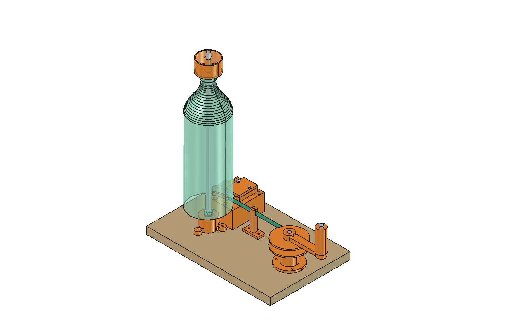
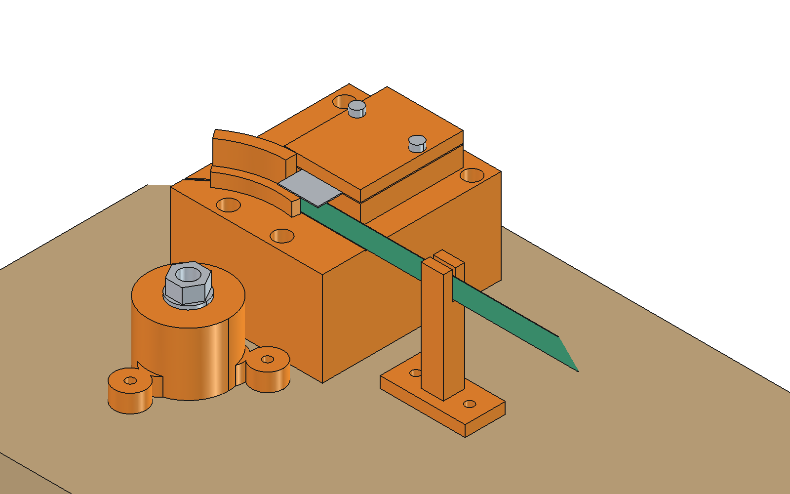

# Modelo 2.0 de la cortadora: modelo en FreeCAD

Modelo por código del principio de tiro descripto en [00_concepto.md](00_concepto.md): la botella va vertical sobre una varilla, la tira se enrolla en un carrete de eje vertical y ese tiro hace girar la botella contra una cuchilla fija. Sigue el método del modelo 1: `parametros.py` es la única fuente de verdad y `make` verifica todo.



## 1. Qué se puede confiar y qué no

- **Sale del concepto aprobado:** botella vertical con el pico arriba, carrete directo de eje vertical, sin lector, ancho fijado por un calce bajo la hoja, y ojal fijo.
- **Son supuestos `[SUP]`:** casi todas las medidas de las piezas, y también la botella (Ø88 mm, pared de 0,25 mm), el tiro de 40 N, la boquilla de 0,4 mm y la base de MDF. Se ajustan cuando lleguen la prueba 1 y las respuestas de Maty.
- **Qué se verificó:** geometría, armado, imprimibilidad y cuentas de funcionamiento (sección 3).
- **Qué no se verificó:** cómo corta la hoja, el rozamiento real, la deformación de la botella y la calidad de impresión. Eso lo responden las pruebas del concepto (sección 9 y anexo A).

## 2. Cómo está armado



| Grupo | Piezas | Cómo se une |
|---|---|---|
| **Eje de la botella** | Zócalo impreso, varilla lisa Ø8 de 400 mm | La varilla entra en un agujero ciego y la traba un tornillo M3 con tuerca cautiva; el zócalo va a la base con 3 tornillos para madera |
| **Cabezal de corte** | Taco de MDF, placa del cabezal, chapita, labio exterior, calce, hoja, pisador | El taco (dos recortes de MDF de 18 mm) va a la base con 2 tornillos de cabeza fresada. La placa, de 6 mm, va al taco con 4 tornillos para madera. La chapita queda en un rebaje abierto, retenida por el labio exterior, que se atornilla aparte, y por el calce. La hoja queda entre el calce y el pisador, apretada con 2 tornillos M3 × 25 a tuercas cautivas desde abajo |
| **Sargento** | Prensa comercial | Fija el extremo libre de la base a la mesa. `make` comprueba que su lugar no choque con nada |
| **Ojal** | Ojal | 2 tornillos para madera |
| **Carrete** | Torre, dos 608ZZ, tornillo M8 × 60, carrete en dos discos, manivela, mango | La torre va a la base con 3 tornillos. El tornillo M8 gira en los rodamientos. El carrete y la manivela tienen una tuerca M8 cautiva cada uno: enroscadas una contra otra, aprietan el carrete y quedan trabadas como tuerca y contratuerca |
| **Botella** | Botella con su tapa perforada a 9 mm, vaso de lastre opcional | Baja por la varilla; el borde se apoya en la chapita |

**Medidas que ordenan todo:**

| Medida | Valor | Por qué |
|---|---|---|
| Altura de la guía sobre el MDF | 41,9 mm en la cara de la chapita; el piso de PLA está a 42,0 | El carrete tiene que tomar la tira a esa altura, encima de una torre con dos rodamientos. **El taco de MDF da 36 mm de esa altura**; la placa impresa, solo 6 |
| Ranura entre labios | 0,85 mm | Pared de 0,25 mm más 0,30 mm por lado |
| Labio interior | 6 mm de alto | Menos que el calce más chico (7 mm): la hoja pasa por encima |
| Chapita bajo la ranura | Galga de 0,5 mm cortada a 18 × 12,7 mm, centrada bajo el filo: el borde apoya en metal desde 4,4 mm antes del filo, y la tira, hasta 9 mm después | El borde se apoya en metal justo donde se define el ancho. Una canaleta de 0,3 mm bajo el resto de la ranura evita que toque el PLA: `make` comprueba que queda a 0,3 mm |
| Distancia entre la botella y el carrete | 181 mm | Deja 46 mm entre el mango y la botella para la mano |
| Brazo de la manivela | 80 mm | Sección 4.1 del concepto |

**Sentido de giro:** vista desde arriba, la manivela gira en **sentido horario**, igual que la botella. Con rosca derecha, ese giro aprieta la tuerca de la manivela contra el carrete: al girar se traba más, no se afloja.

**Holguras de impresión**, todas en `parametros.py` para ajustarlas después de una pieza de prueba:

| Encastre | Holgura |
|---|---|
| Agujeros para tornillos y varillas | +0,4 mm en el diámetro |
| Hexágonos de tuercas cautivas | +0,3 mm entre caras |
| Alojamiento del 608ZZ, a presión | 22,15 mm para 22,00 mm |
| Ranura de la pared | 0,30 mm por lado |
| Rebaje de la chapita | Abierto hacia arriba, sin techo: 0,6 mm de profundidad (tres capas de 0,2 mm) para una galga de 0,5 mm, y 0,2 mm por lado |
| Varilla lisa en el zócalo | Ø8,2 mm para Ø8,0; la traba el tornillo M3 |
| Calce | 0,1 mm menos que el ancho: apoya en el piso de PLA, que queda 0,1 mm más alto que la chapita |

## 3. Qué verifica `make`

Si algún control falla, `make` termina con error, y `resultados.json` dice qué y dónde. Los números de abajo son los de la última corrida.

| Control | Resultado |
|---|---|
| **Choques en el armado**, con la botella al inicio y al final del corte | Ninguno. Solo se permiten dos cruces, que son el propio corte: la hoja con la pared, y la tira con la botella de la que sale. El borde cortado se modela como hélice, en escalones de 10°: apoya en la chapita junto al filo y sube hasta `w` en una vuelta |
| **La manivela da la vuelta**, en 36 posiciones, al inicio y al final | No toca nada |
| **Lugar para la mano** | 46 mm entre el mango y la botella; el mínimo es 40 |
| **Armado en orden**, 26 pasos | Cada pieza llega a su lugar sin atravesar lo ya armado: bajando, de costado o desde abajo, según corresponda |
| **Impresión**, 15 piezas | Todas entran en la cama, sin voladizos de más de 45° y con puentes de 5,4 mm como máximo. **Ninguna necesita soportes**, y cada una es un sólido único. El agujero del prisionero es un rombo, para que su techo no quede en voladizo |
| **STL** | Cada archivo se vuelve a leer: es un sólido cerrado, está apoyado en la cama y su volumen difiere menos de 0,1 % del de la pieza |
| **Borde sobre metal** | El borde toca la chapita y queda a 0,3 mm del PLA, tanto de la placa como del labio exterior |
| **Lastre** | El que hace falta entra en el vaso: caben unos 149 g de tuercas sueltas |

### Controles negativos

Para saber que los controles detectan errores, se corrieron copias del modelo con errores a propósito. En los dos casos `make` falló y detectó todos los errores.

| Corrida | Qué se rompió a propósito | Qué detectó `make` |
|---|---|---|
| 1 | Ranura más angosta que la pared | La botella choca con el cabezal, en el armado y al bajar |
| 1 | Brazo de la manivela de 120 mm | La manivela choca al girar y la mano queda a 6 mm de la botella |
| 1 | Núcleo del carrete más bajo que la tira | El carrete no toma la tira |
| 2 | Rebaje de la chapita de dos capas (0,4 mm) en vez de tres, más bajo que la galga de 0,5 mm | La chapita choca con el labio exterior y con el calce, y esos dos pasos del armado fallan |
| 2 | Sargento corrido hasta encima del zócalo | El sargento choca con el zócalo y con el prisionero, y al bajarlo, con la botella |

## 4. Funcionamiento

Con el tiro de diseño de 40 N y la botella de referencia:

| Magnitud | Valor |
|---|---|
| Tira | 9 mm de ancho, 5,53 m, 20 vueltas de botella |
| Rollo | De 16 a 26,4 mm de radio |
| Vueltas de manivela por botella | 42 |
| Fuerza en la mano, rollo lleno | **13,2 N**; criterio: hasta 20 N |
| Tiro admisible con ese criterio | 61 N, o 49 N con la pared más gruesa de la tabla (0,35 mm), porque el rollo llega a 32 mm |
| Rotura de la tira | 124 N: 3,1 veces el tiro |
| Hélice | 1,86° |
| Ancho por construcción | 9,000 mm: es el espesor del calce. Solo lo afecta la tolerancia de impresión del calce, que en FDM es de unas décimas, dentro de ±0,5 mm |
| Torre del carrete, flexión entre capas | 0,58 MPa: unas 26 veces por debajo de lo que resiste el PLA entre capas |
| Tornillos de la placa del cabezal al taco | 10 N de corte cada uno |

### Autoavance: va a hacer falta lastre

| Fuerza a lo largo del eje | Valor |
|---|---|
| Peso de la botella | 0,31 N al empezar; **0,14 N al final**, porque se va consumiendo |
| Rozamiento en los labios | 0,23 N: componente axial con μ = 0,35 y los labios cargados con la mitad del tiro, del lado seguro. Por vuelta la pared baja 9 mm y recorre 276 mm: el deslizamiento va inclinado 1,9° |
| Rozamiento de la tapa sobre la varilla | **0,40 N**, con μ = 0,30 y la tapa cargada con el 10 % del tiro. En la tapa el contacto está a 4 mm del eje: por vuelta baja 9 mm y recorre solo 25 mm, así que el deslizamiento va inclinado **19,7°** y la bajada pesa diez veces más que en la pared |
| Total | 0,63 N |

Al final del corte, el peso de la botella no alcanza. Con margen 2 hace falta un lastre total de **unos 115 g**. El vaso de lastre vacío pesa 17 g: hay que **agregarle unos 100 g de tuercas o tornillos sueltos**; caben unos 149 g. La arena no alcanza: en ese volumen pesaría unos 65 g. La prueba 2 dirá cuánto hace falta: la carga de la tapa y los rozamientos son supuestos.

**¿Sirve lubricar la varilla?** No, según la referencia. En la tabla de Engineering Toolbox, el polietileno sobre acero tiene μ = 0,2 tanto seco como con grasa: la grasa no lo baja. Para polipropileno no hay dato. Con ese valor de referencia, el lastre total baja a unos 90 g, pero porque 0,2 es menos que el 0,30 supuesto, no por lubricar:

| Rozamiento de la tapa sobre la varilla | Lastre total |
|---|---|
| Diseño, supuesto del lado seguro: μ = 0,30 | 115 g |
| Polietileno-acero, seco: μ = 0,20 | 90 g |
| Polietileno-acero, con grasa: μ = 0,20 | 90 g |

Por eso no se recomienda vaselina ni grasa: no ayudan, y además juntan polvo y virutas de PET. Alcanza con que la varilla esté limpia y lisa.

## 5. Revisión del 07/nov/2026

| Cambio | Antes | Ahora | Por qué |
|---|---|---|---|
| Varilla | Roscada M8, con tuerca y contratuerca | **Lisa Ø8**, la de los ejes lineales de impresora 3D, trabada con un tornillo M3 | La tapa, de plástico blando, bajaba girando sobre los filetes y podía engancharse: justo lo que frena el autoavance. Se descartó la roscada enfundada en un caño de 10 mm porque suma una pieza y un ajuste |
| Cabezal | Bloque macizo de 42 mm de alto | **Placa de 6 mm sobre un taco de MDF de 36 mm** | El bloque solo levantaba la guía hasta la altura del carrete. Hundir la torre en la base obligaba a fresar el MDF |
| Chapita | Fleje de 36 × 2,8 mm en una ranura de 0,6 mm con techo en puente | **Galga de 0,5 mm cortada a 18 × 12,7 mm** en un rebaje abierto, retenida por el labio exterior, ahora atornillado aparte | El fleje era muy difícil de cortar a mano, y la ranura podía cerrarse al imprimir. La galga se corta con un solo corte |
| Base | 310 mm de largo | **345 mm**, con lugar para un sargento en el extremo libre | La botella mide ~34 cm y la manivela se gira con una mano |
| Autoavance | Solo el rozamiento de los labios: 35 g de lastre | Más el de la tapa sobre la varilla: **115 g** | La tapa desliza muy inclinada (sección 4) |

**Peso y tiempo de impresión, antes y después.** Son estimaciones con el mismo método: el plástico depositado a un caudal medio de 9 mm³/s, más 3 s por capa. Bambu Studio da los valores exactos.

| | Antes | Después |
|---|---|---|
| Cabezal | 151 g, ~4 h (relleno del 30 %) | **24 g, ~39 min** (relleno del 40 %) + labio exterior: 2 g, ~7 min |
| Todas las piezas | 318 g, ~9,3 h | **194 g, ~6,1 h** |

## 6. Video corto

[salida/cortadora_v2.mp4](salida/cortadora_v2.mp4): 25 s, 1600 × 900, 30 cuadros por segundo, 2,96 MB. Está pensado para mostrarle el principio al grupo; **es una versión preliminar** y así lo dice en pantalla.

| Segundos | Qué muestra |
|---|---|
| 0 a 3 | Título, con la máquina quieta |
| 3 a 10 | Vista general: la manivela gira, la tira se enrolla, la botella gira y baja |
| 10 a 18 | Primer plano del cabezal, en cámara lenta: el borde sobre la guía, la hoja y la tira saliendo hacia el ojal |
| 18 a 25 | Vista general hasta terminar el corte |

**Cómo se mueve.** Manda el avance de la botella. Con `n` vueltas de botella, el corte va por `s = w·n`, así que **la botella baja exactamente `w` por vuelta**. La tira mide `π·D·n` y el rollo crece con ella. Las vueltas de la manivela salen de integrar `dL / 2πr`: `(r − r_núcleo) / espesor`, que al final del corte da 41,5, igual que la verificación.

**Efecto estroboscópico.** La botella y el carrete son de revolución: para que se vea que giran llevan marcas pintadas. Antes de renderizar, un control recorre los 750 cuadros y falla si las marcas de la botella, las del carrete o la manivela avanzan casi un número entero de pasos por cuadro: ahí parecerían quietas o girando al revés.

**Simplificación.** El tiempo del video no es el real: el corte de una botella dura 42 vueltas de manivela, y acá entra en unos 21 s.

## 7. Cómo se usa

```
make          # verifica; después, figuras, .FCStd, STL y los tres PDF
make video    # además, salida/cortadora_v2.mp4 (unos 6 minutos)
make ficha_pdf | compras_pdf | prueba1_pdf   # solo uno de los PDF (make ya los arma todos)
```

Se cambia una medida en `parametros.py` y se vuelve a correr. Las piezas son formas generadas por código: para modificarlas se edita el código, no el `.FCStd`. Para recorrerlo en FreeCAD sirve la guía del modelo 1, [guia_revisar_en_freecad.md](../06_modelo_3d/guia_revisar_en_freecad.md): los nombres de los objetos cambian, pero el método es el mismo.

| Archivo | Qué es |
|---|---|
| `00_concepto.md` | Documento conceptual aprobado |
| `parametros.py` | Medidas con su origen, holguras y datos de las cuentas |
| `piezas.py` | Sólidos de cada pieza, armados en su lugar |
| `verificar.py` | Choques, giro de la manivela, armado en orden, impresión y funcionamiento |
| `vista.py` | Figuras y `modelo/cortadora_v2.FCStd`, con colores: naranja impreso, gris comercial, marrón el MDF |
| `exportar_stl.py` | `stl/`, un archivo por pieza impresa, orientado para la cama; además escribe la ficha y la lista |
| `renderizar.py` | Cuadros del video, con el método del modelo 1: escena armada una vez, supermuestreo, rótulos con PIL y control estroboscópico |
| [ficha/ficha_impresion.md](ficha/ficha_impresion.md) y [su PDF](ficha/build/ficha_impresion.pdf) | **Para Maty**, en A4 apaisado: miniatura de cada pieza en la cama, cantidad, relleno, perímetros, soportes, peso, tiempo y notas |
| [compras/lista_compras.md](compras/lista_compras.md) y [su PDF](compras/build/lista_compras.pdf) | Para repartirse las compras: casilla, cantidad, medida, para qué y quién lo consigue; aparte, lo que se pide prestado y las herramientas |
| [prueba_1/prueba_1_tiro.md](prueba_1/prueba_1_tiro.md) y [su PDF](prueba_1/build/prueba_1_tiro.pdf) | Hoja para imprimir y medir el tiro en la mesa de trabajo (anexo A del concepto), con dibujo, casillas y tabla para completar a mano. La genera `prueba_1/generar_prueba1.py` |
| `resultados.json` | Números de la última verificación |

El `.FCStd` cambia en cada `make` aunque el modelo no cambie, porque FreeCAD guarda la fecha adentro. Las figuras, los STL y las fichas salen idénticos byte a byte.

---
*Fuentes: [00_concepto.md](00_concepto.md) y sus fuentes; Engineering Toolbox, [Friction coefficients](https://www.engineeringtoolbox.com/friction-coefficients-d_778.html) (polietileno-acero, seco y con grasa); método de `../06_modelo_3d/`; medidas de piezas comerciales: rodamiento 608ZZ (8 × 22 × 7), tuercas y tornillos métricos ISO, rosca de cuello PCO 1881 y hoja de trincheta de 18 mm. La resistencia entre capas del PLA (~15 MPa) es un valor de referencia bajo, a confirmar.*
