# Ficha de impresión

<!-- solo-md -->

**Cortadora PET 2.0 - Grupo 1, S1091.** 7 de noviembre de 2026. Generada desde el modelo con `make`: no editar a mano. El PDF (`build/ficha_impresion.pdf`) sale de este mismo archivo.

<!-- /solo-md -->

## Configuración común

- **Impresora:** Bambu Lab P1S, boquilla de 0,4 mm, capa de 0,2 mm.
- **Material:** PLA común, en todas las piezas.
- **Sin soportes** en ninguna pieza: no hay voladizos de más de 45° y los puentes no pasan de 5,4 mm.
- **Cada STL ya está orientado como va en la cama:** abrirlo y laminar, sin rotarlo.
- **Tuercas:** se colocan después de imprimir, en alojamientos abiertos. No hace falta pausar la impresión.

> [!TIP]
> **Imprimir primero: el cabezal (01), el labio exterior (15) y el calce de 9 mm (02).** Antes de seguir, probarlos con una botella de 1,5 L lisa, con la base cortada:
>
> 1. Apoyar el labio exterior en su lugar sobre el cabezal, con los agujeros alineados.
> 2. Pasar la pared de la botella entre los dos labios: tiene que entrar sin trabarse y sin quedar floja, y el borde tiene que llegar hasta el piso.
> 3. Medir el calce con calibre: tiene que dar unos 8,9 mm.
>
> Si algo no va, avisar al grupo antes de imprimir el resto: se ajusta la medida y se reimprimen solo esas piezas.

## Piezas

| N.° | Vista en la cama | Pieza | Archivo | Cant. | Tamaño (mm) | Relleno | Perímetros | Soportes | Peso aprox. | Tiempo aprox. | Nota |
|--|-----|--------|----------|--|------|---|----|----|---|---|--|
| 01 | 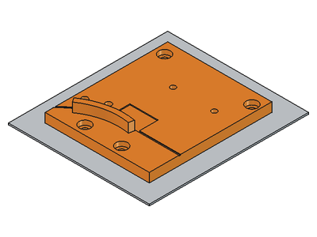{width=1.9cm} | Cabezal (placa) | `01_Cabezal.stl` | 1 | 68 × 80 × 12 | 40 % | 4 | No | 24 g | 39 min | 1 |
| 02 | 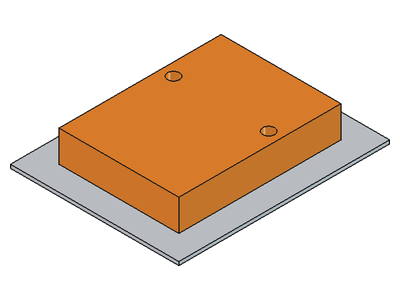{width=1.9cm} | Calce de 9 mm | `02_Calce_9mm.stl` | 1 | 34 × 46 × 8,9 | 100 % | 3 | No | 17 g | 28 min | 2 |
| 03 | 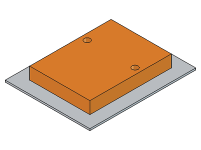{width=1.9cm} | Calce de 7 mm | `03_Calce_7mm.stl` | 1 | 34 × 46 × 6,9 | 100 % | 3 | No | 13 g | 21 min | 3 |
| 04 | 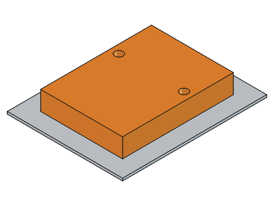{width=1.9cm} | Calce de 8 mm | `04_Calce_8mm.stl` | 1 | 34 × 46 × 7,9 | 100 % | 3 | No | 15 g | 25 min | 3 |
| 05 | 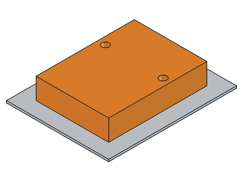{width=1.9cm} | Calce de 10 mm | `05_Calce_10mm.stl` | 1 | 34 × 46 × 9,9 | 100 % | 3 | No | 19 g | 31 min | 3 |
| 06 | 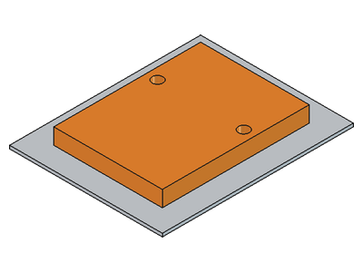{width=1.9cm} | Pisador de la hoja | `06_Pisador.stl` | 1 | 34 × 46 × 5 | 40 % | 3 | No | 6 g | 10 min | — |
| 07 | 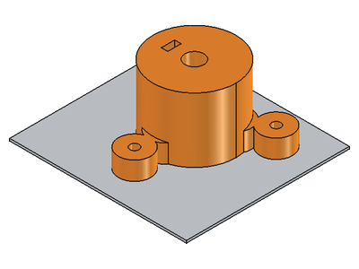{width=1.9cm} | Zócalo de la varilla | `07_Zocalo.stl` | 1 | 59 × 53 × 28 | 30 % | 4 | No | 21 g | 38 min | 4 |
| 08 | 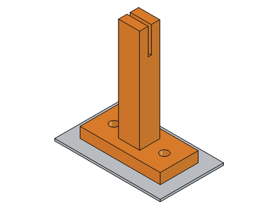{width=1.9cm} | Ojal | `08_Ojal.stl` | 1 | 38 × 18 × 53,9 | 20 % | 3 | No | 5 g | 20 min | 5 |
| 09 | 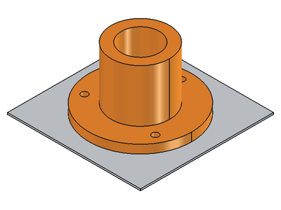{width=1.9cm} | Torre del carrete | `09_Torre.stl` | 1 | 60 × 60 × 36 | 40 % | 4 | No | 22 g | 42 min | 6 |
| 10 | 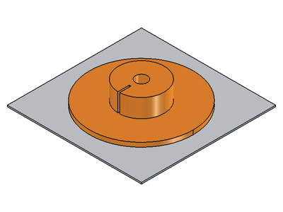{width=1.9cm} | Carrete, disco inferior | `10_CarreteInferior.stl` | 1 | 72,7 × 72,7 × 16 | 30 % | 3 | No | 14 g | 25 min | 7 |
| 11 | 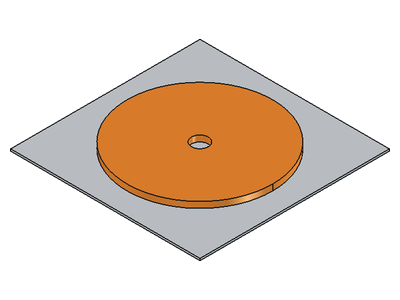{width=1.9cm} | Carrete, disco superior | `11_CarreteSuperior.stl` | 1 | 72,7 × 72,7 × 3 | 20 % | 3 | No | 7 g | 12 min | — |
| 12 | 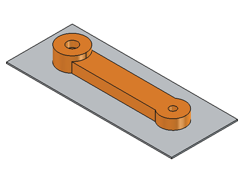{width=1.9cm} | Manivela | `12_Manivela.stl` | 1 | 101 × 22 × 12 | 40 % | 4 | No | 10 g | 18 min | 8 |
| 13 | 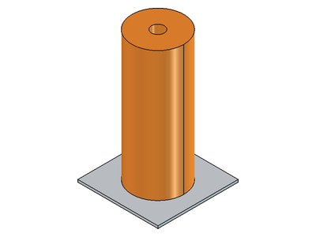{width=1.9cm} | Mango | `13_Mango.stl` | 1 | 22 × 22 × 55 | 15 % | 3 | No | 11 g | 30 min | — |
| 14 | 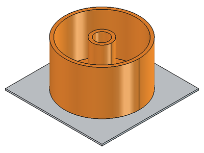{width=1.9cm} | Vaso de lastre | `14_Lastre.stl` | 1 | 50 × 50 × 30 | 15 % | 2 | No | 8 g | 19 min | 9 |
| 15 | 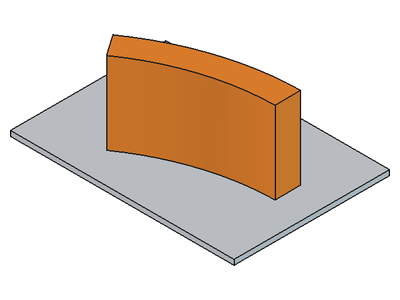{width=1.9cm} | Labio exterior | `15_LabioExterior.stl` | 1 | 31,5 × 18,3 × 16 | 40 % | 4 | No | 2 g | 7 min | 1 |

El tamaño es ancho × profundidad × alto, tal como queda en la cama.

**Total: unos 194 g de PLA y 6,1 h de impresión**, sin contar purgas ni pruebas. Es una estimación hecha desde el modelo: Bambu Studio da el peso y el tiempo exactos al laminar.

## Notas

1. Imprimir antes que el resto y probar con una botella real (ver el recuadro de arriba). En el cabezal, las dos tuercas M3 se colocan desde abajo, después de imprimir.
2. Define el ancho de la tira: 100 % de relleno, para que no se aplaste al apretarlo. Mide 8,9 mm a propósito. Medirlo con calibre y anotar el valor real: el laminador puede dejarlo una décima arriba o abajo.
3. Para botellas de pared más gruesa (7 y 8 mm) o más fina (10 mm). Mismo cuidado que el de 9 mm; cada uno mide 0,1 mm menos que su nombre.
4. La tuerca M3 entra de canto por la ranura de arriba. El agujero lateral tiene forma de rombo a propósito: así se imprime sin soporte.
5. Revisar que la ranura de 1,5 mm quede limpia, sin hilos de plástico.
6. Los dos rodamientos entran a presión desde arriba. Si entran muy duros o muy flojos, avisar al grupo: se ajusta la medida y se reimprime solo esta pieza.
7. La tuerca M8 entra desde abajo, después de imprimir.
8. La tuerca M8 entra desde abajo. Es la pieza que más trabaja: respetar los 4 perímetros.
9. Opcional: imprimir solo si el grupo lo pide, después de probar la máquina.
