# Instructivo de armado

<!-- solo-md -->

**Cortadora PET 2.0 - Grupo 1, S1091.** 8 de noviembre de 2026. *Versión preliminar: las medidas se confirman con las piezas de prueba.* Se genera desde el modelo con `make armado_pdf`: no editar a mano. El PDF (`build/instructivo_armado.pdf`) y la plantilla A3 (`build/plantilla_base_A3.pdf`) salen de `generar_instructivo.py`.

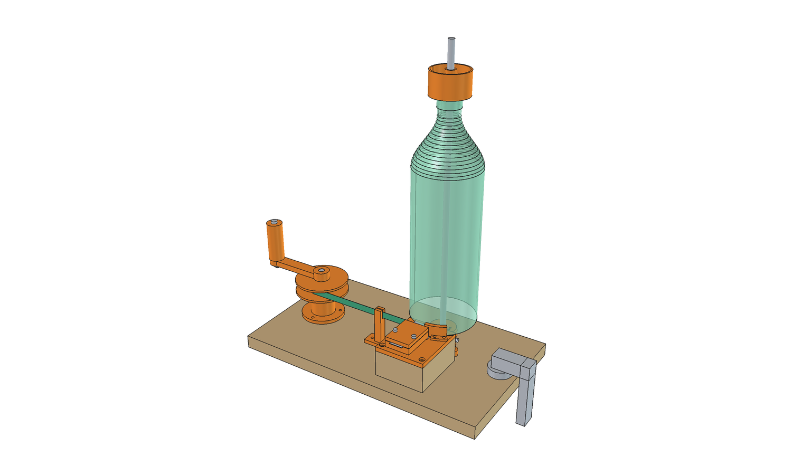

<!-- /solo-md -->

## 1. Antes de empezar

### Piezas impresas

El número es el de la ficha de impresión y el de cada archivo. Los calces van uno por vez: el de 9 mm es el de la botella común.

| N.° | Pieza | Vista | N.° | Pieza | Vista |
|---|-----|-----|---|-----|-----|
| 01 | Cabezal (placa) | 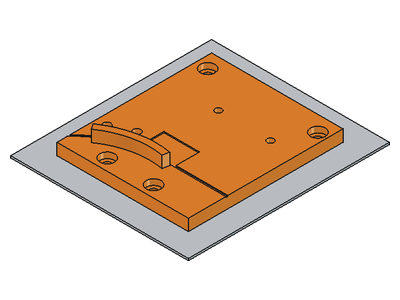{width=1.3cm} | 09 | Torre del carrete | 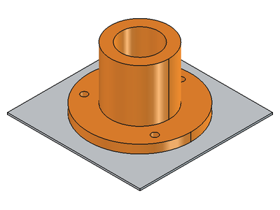{width=1.3cm} |
| 02 | Calce de 9 mm | 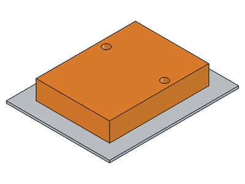{width=1.3cm} | 10 | Carrete, disco inferior | 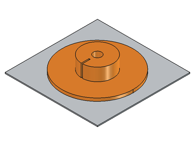{width=1.3cm} |
| 03 | Calce de 7 mm | 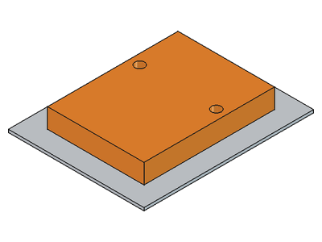{width=1.3cm} | 11 | Carrete, disco superior | 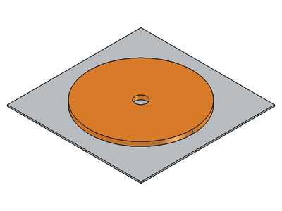{width=1.3cm} |
| 04 | Calce de 8 mm | 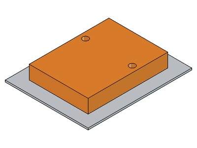{width=1.3cm} | 12 | Manivela | 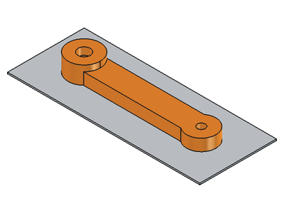{width=1.3cm} |
| 05 | Calce de 10 mm | 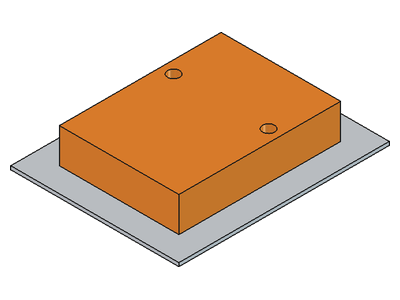{width=1.3cm} | 13 | Mango | 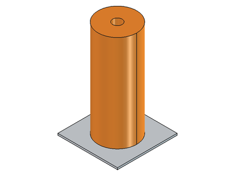{width=1.3cm} |
| 06 | Pisador de la hoja | 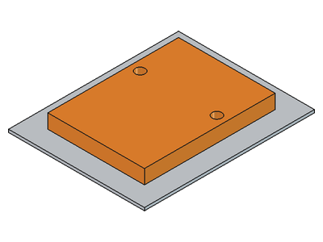{width=1.3cm} | 14 | Vaso de lastre | 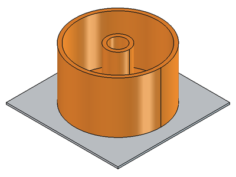{width=1.3cm} |
| 07 | Zócalo de la varilla | 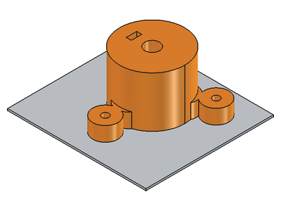{width=1.3cm} | 15 | Labio exterior | 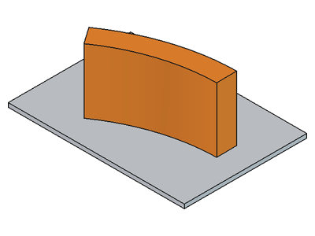{width=1.3cm} |
| 08 | Ojal | 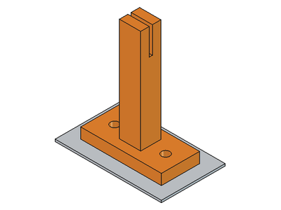{width=1.3cm} |  |  |  |

### Piezas compradas

| Pieza | Cant. | Medida |
|-----|-----|------|
| Varilla lisa Ø8 mm | 1 | 400 mm |
| Tornillo M8 × 60, cabeza hexagonal, rosca completa | 1 | — |
| Tuerca M8 | 2 | — |
| Arandela M8 | 2 | 8,4 × 16 mm |
| Rodamiento 608ZZ | 2 | 8 × 22 × 7 mm |
| Hoja de trincheta de 18 mm | 1 + repuestos | Segmentable |
| Galga de espesores de 0,5 mm (una hoja) | 1 | Se corta a 18 × 12,7 mm |
| Tornillo M3 × 25 y tuerca M3 | 2 + 2 | — |
| Tornillo M3 × 16 y tuerca M3 | 1 + 1 | — |
| Tornillo M5 × 70 y tuerca autoblocante M5 | 1 + 1 | — |
| Tornillo para madera 3,5 × 16 | 14 | — |
| Tornillo para madera 3,5 × 45, cabeza fresada | 2 | — |
| Tabla de MDF de 18 mm | 1 | 345 × 200 mm y dos recortes de 68 × 80 mm |
| Prensa tipo sargento | 1 | Apertura de 80 mm o más |

### Herramientas

- Destornillador: Phillips o el que pidan los tornillos.
- Llaves o pinza para M8 y M3.
- Taladro: Mechas de 9, 4 y 2,5 mm, y de avellanar.
- Punzón o clavo, escuadra, regla y cinta de papel.
- Caño de PVC de electricidad de 20 mm.
- Tijera de hojalatero.
- Guantes.
- Calibre.

### Seguridad

> [!CAUTION]
> **La hoja de trincheta corta mucho.** Guantes cada vez que se toca la hoja o se corta una botella. La hoja va siempre apretada por sus dos tornillos; si se afloja, parar. Nadie pone la mano delante del filo. Para partir un segmento gastado, usar una pinza, nunca los dedos. Al guardar la máquina, sacar la hoja.

### Cuidados con el plástico

- **No sobreapretar.** Las piezas son de plástico: los tornillos para madera se aprietan hasta que la cabeza apoya y nada más; los M3, firmes con los dedos y un cuarto de vuelta con el destornillador. Si una rosca gira en falso, avisar al grupo: no seguir apretando.
- **Tuercas cautivas** (M3 de la placa, M8 del carrete y de la manivela). Van en hexágonos abiertos de la cara de abajo. Alinear las caras de la tuerca con las del hexágono y empujarla con el pulgar. Si no entra, pasar un tornillo de la misma medida desde el otro lado, enroscarlo en la tuerca y apretarlo: la tuerca entra sola. Después, sacar el tornillo. No martillar.
- **Rodamientos 608ZZ.** Entran a presión en la torre, siempre empujando el aro de afuera, nunca el de adentro ni la tapita. Ponerlos derechos, empujar con el pulgar y terminar con el sargento entre dos tacos de madera, o con golpes suaves sobre un taco. Para el de abajo, empujar con el caño de PVC de 20 mm. Si entran muy duros o quedan flojos, avisar al grupo: no limar la torre.

### Cómo se nombran los lados

Con la base vista desde arriba y la **esquina A** (marcada en la plantilla) adelante a la izquierda: el sargento va a la **izquierda**, el carrete a la **derecha**, y la placa de la cuchilla queda **atrás** de la botella.

## 2. Preparación de la base

### Cortar la madera

- **Base:** MDF de 18 mm, 345 × 200 mm.
- **Taco:** dos recortes del mismo MDF, de 68 × 80 mm. Apilados miden 36 mm.

En la maderera los cortan a medida. Los cantos tienen que quedar a escuadra.

### Plantilla de perforación

La plantilla es una hoja A3 aparte: **imprimirla al 100 %, sin ajustar a la página** (en el diálogo de impresión: «tamaño real»). Si no hay impresora A3, la imprime cualquier fotocopiadora.

1. **Controlar la escala:** medir con regla las dos líneas de control de 100 mm. Si no dan 100 mm justos, la impresora escaló la hoja: volver a imprimir.
2. **Pegarla** sobre la cara de arriba de la base con cinta de papel, con el rectángulo de la base sobre los bordes de la madera y la esquina A sobre la esquina de adelante a la izquierda.
3. **Marcar con punzón** el centro de cada agujero, las cuatro esquinas del taco y el centro del círculo del sargento. Sacar la plantilla y unir las esquinas del taco con lápiz.
4. **Agujerear:** los guía, con mecha de 2,5 mm y 12 mm de profundidad (marcar la mecha con cinta). Los 2 del taco, pasantes con mecha de 4 mm; después, dar vuelta la base y avellanarlos por abajo hasta que la cabeza del tornillo quede al ras.

<!-- solo-pdf
\needspace{6cm}
-->

Las mismas cotas, para marcar con regla y escuadra si no se pudo imprimir la plantilla:

| N.° | Pieza | X desde A | Y desde A | Agujero |
|---|-----|---------|---------|-------|
| 1 | Zócalo | 92,5 mm | 88,0 mm | guía Ø2,5 |
| 2 | Taco | 93,0 mm | 145,0 mm | pasante Ø4, avellanar abajo |
| 3 | Zócalo | 115,0 mm | 49,0 mm | guía Ø2,5 |
| 4 | Zócalo | 137,5 mm | 88,0 mm | guía Ø2,5 |
| 5 | Taco | 145,0 mm | 141,0 mm | pasante Ø4, avellanar abajo |
| 6 | Ojal | 173,0 mm | 118,9 mm | guía Ø2,5 |
| 7 | Ojal | 197,0 mm | 118,9 mm | guía Ø2,5 |
| 8 | Torre | 274,2 mm | 85,8 mm | guía Ø2,5 |
| 9 | Torre | 295,0 mm | 121,8 mm | guía Ø2,5 |
| 10 | Torre | 315,8 mm | 85,8 mm | guía Ø2,5 |

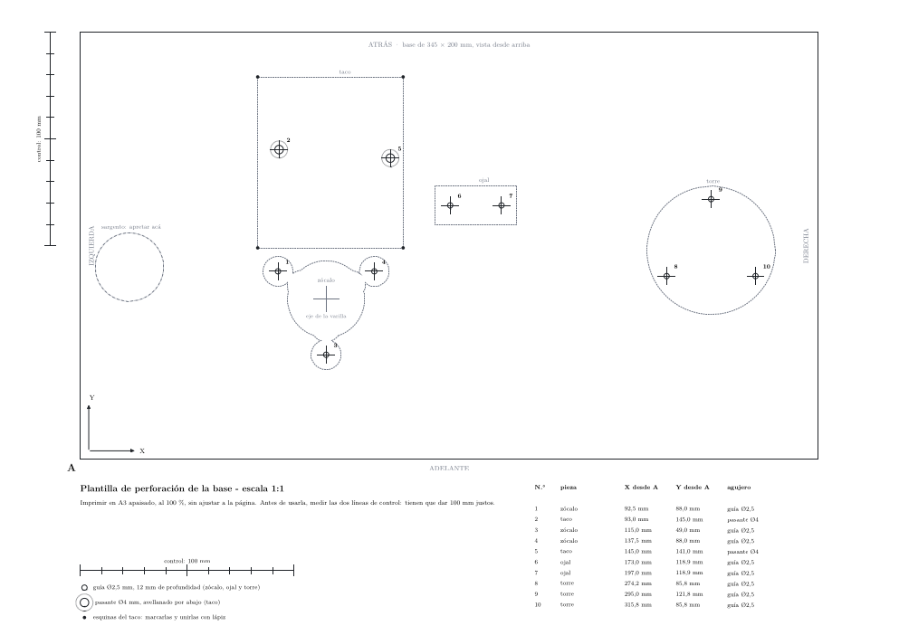{width=13cm}

*Plantilla reducida: no sirve para marcar.*

<!-- salto-pagina -->

## 3. Armado paso a paso

Cada paso tiene una vista: en gris, lo que ya está armado; en naranja, la pieza nueva; la flecha roja indica por dónde entra. Las vistas de una misma etapa están tomadas desde el mismo lugar.

<!-- solo-pdf
\needspace{9cm}
-->

### Etapa 1: Eje de la botella

#### Paso 1. Zócalo

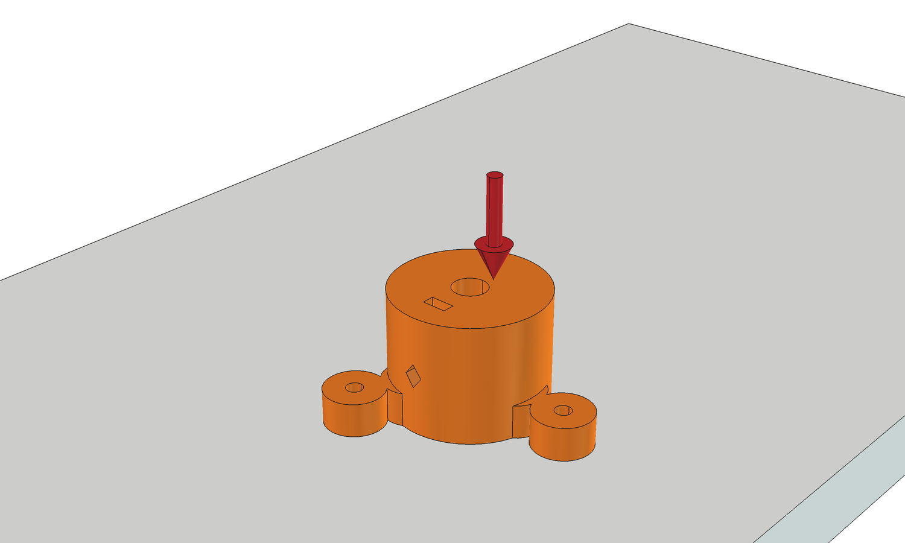{width=8.5cm}

**Usa:** zócalo de la varilla (n.° 07); 3 × tornillo para madera de 3,5 × 16.

1. Apoyar el zócalo sobre la base, con sus 3 orejas sobre los agujeros guía que se hicieron con la plantilla. El agujero en forma de rombo del costado mira a la izquierda, hacia el lado del sargento.
2. Atornillar las 3 orejas, de a poco y en cruz. Parar cuando la cabeza apoya.

> [!TIP]
> **Comprobar:** empujar el zócalo de costado con la mano: no se mueve. El agujero en rombo mira a la izquierda.

<!-- solo-pdf
\needspace{9cm}
-->

#### Paso 2. Tuerca del prisionero

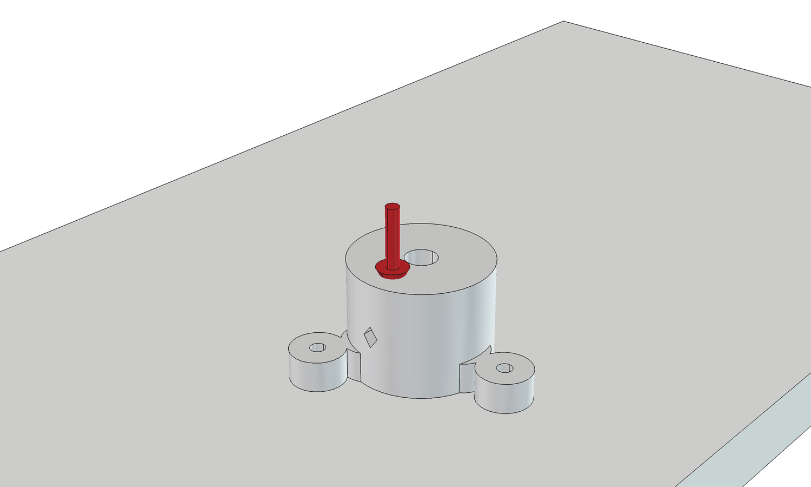{width=8.5cm}

**Usa:** 1 × tuerca M3.

1. Meter la tuerca de canto por la ranura de arriba del zócalo, con un vértice hacia abajo, y empujarla con la punta de un destornillador hasta el fondo.

> [!TIP]
> **Comprobar:** mirando por el agujero en rombo se ve el agujero de la tuerca, centrado. Un tornillo M3 entra a mano dos vueltas; después sacarlo.

<!-- solo-pdf
\needspace{9cm}
-->

#### Paso 3. Varilla

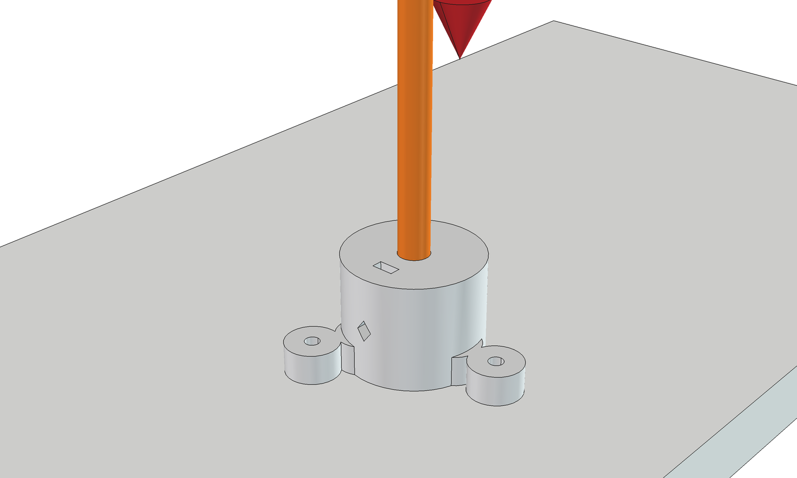{width=8.5cm}

**Usa:** 1 × varilla lisa Ø8 × 400 mm.

1. Limpiar la varilla y meterla desde arriba en el agujero del zócalo, hasta el fondo: entra 25 mm.

> [!TIP]
> **Comprobar:** con una escuadra apoyada en la base, la varilla queda pegada a la escuadra mirando de frente y de costado: está vertical. La punta queda a 403 mm de la base.

<!-- solo-pdf
\needspace{9cm}
-->

#### Paso 4. Prisionero

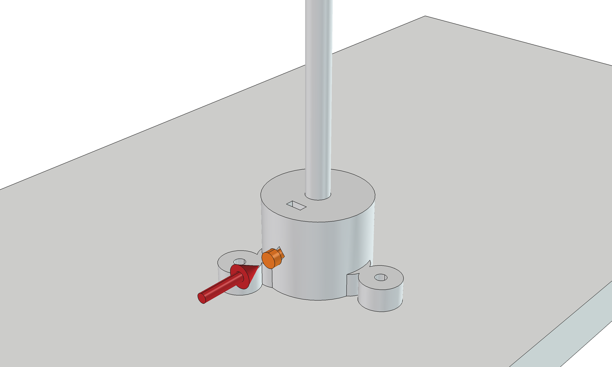{width=8.5cm}

**Usa:** 1 × tornillo M3 × 16.

1. Pasar el tornillo por el agujero en rombo, desde la izquierda, y enroscarlo en la tuerca hasta que apriete la varilla. Firme con los dedos y un cuarto de vuelta más con el destornillador: no más, el zócalo es de plástico.

> [!TIP]
> **Comprobar:** tirar de la varilla hacia arriba y tratar de girarla: no se mueve.

<!-- solo-pdf
\needspace{9cm}
-->

### Etapa 2: Cabezal

#### Paso 5. Taco de madera

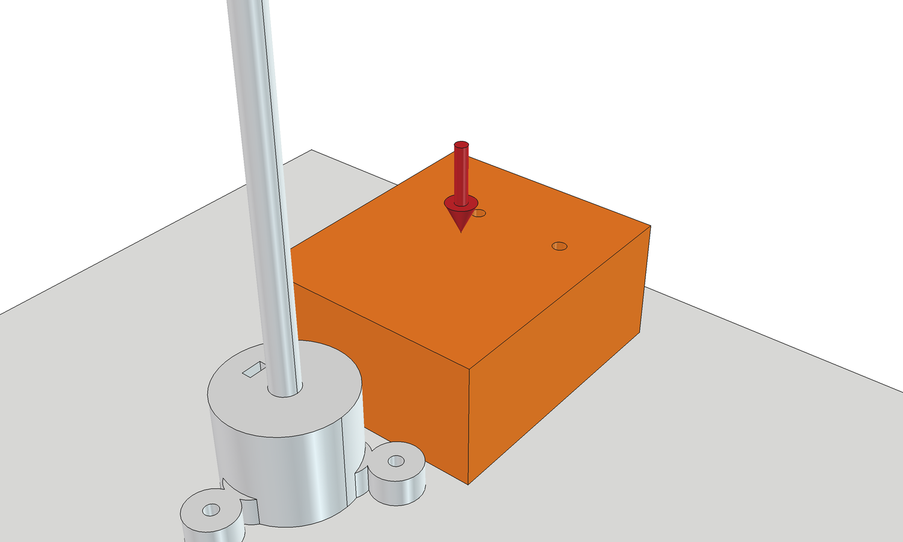{width=8.5cm}

**Usa:** los 2 recortes de MDF de 68 × 80 mm; 2 × tornillo para madera de 3,5 × 45, cabeza fresada; el sargento, para sostener mientras se atornilla.

1. Apilar los dos recortes con los cantos parejos y apoyarlos sobre el rectángulo del taco marcado en la base.
2. Apretar el taco contra la base con el sargento. Correr la base hasta que el taco quede afuera del borde de la mesa, para llegar a los agujeros por debajo.
3. Por debajo, con mecha de 2,5 mm, seguir los 2 agujeros pasantes de la base dentro del taco: 45 mm de profundidad en total, contando la base (marcar la mecha con cinta).
4. Atornillar los 2 tornillos de cabeza fresada desde abajo.

> [!TIP]
> **Comprobar:** los cantos del taco siguen sobre las líneas marcadas. La cabeza de los tornillos queda al ras o hundida: apoyada en la mesa, la base no baila.

<!-- solo-pdf
\needspace{9cm}
-->

#### Paso 6. Tuercas de la placa

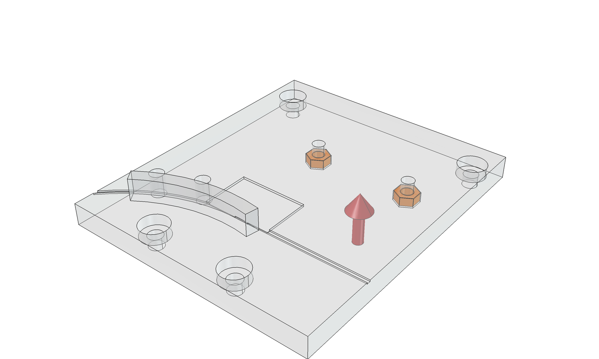{width=8.5cm}

**Usa:** cabezal, placa (n.° 01); 2 × tuerca M3.

1. Dar vuelta la placa: los dos hexágonos están en la cara de abajo, la que apoyó en la cama de la impresora.
2. Meter una tuerca en cada hexágono, como se explica en «Cuidados con el plástico».

> [!TIP]
> **Comprobar:** las tuercas quedan 0,3 mm hundidas: apoyada en la mesa, la placa no baila, y al darla vuelta las tuercas no se caen.

<!-- solo-pdf
\needspace{9cm}
-->

#### Paso 7. Placa sobre el taco

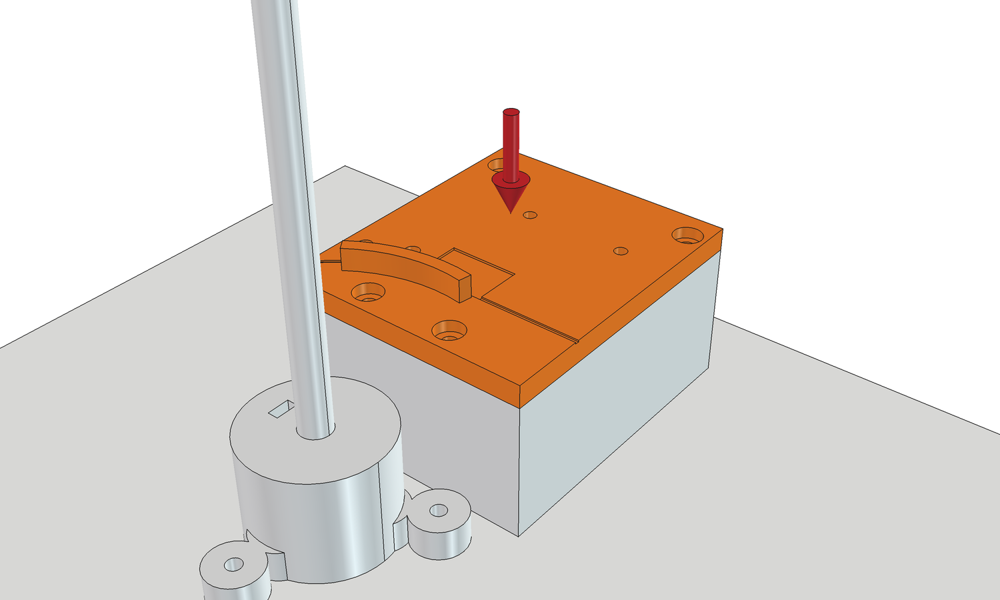{width=8.5cm}

**Usa:** cabezal, placa (n.° 01); 4 × tornillo para madera de 3,5 × 16.

1. Apoyar la placa sobre el taco, con las tuercas abajo y los cantos al ras de los del taco. El labio curvo queda del lado de la varilla.
2. Marcar con el punzón el centro de los 8 agujeros de la placa y sacarla.
3. Agujerear el taco: los 4 de las esquinas con mecha de 2,5 mm y 15 mm de profundidad; los 2 del lado de la varilla, para el labio, con mecha de 2,5 mm y 9 mm; y los 2 de las tuercas, donde entran las puntas de los tornillos de la hoja, con mecha de 4 mm y 10 mm.
4. Volver a poner la placa y atornillar los 4 tornillos de las esquinas, en cruz.

> [!TIP]
> **Comprobar:** de la base a la cara de arriba de la placa hay 42 mm. Los cantos de la placa quedan al ras de los del taco.

<!-- solo-pdf
\needspace{9cm}
-->

#### Paso 8. Chapita

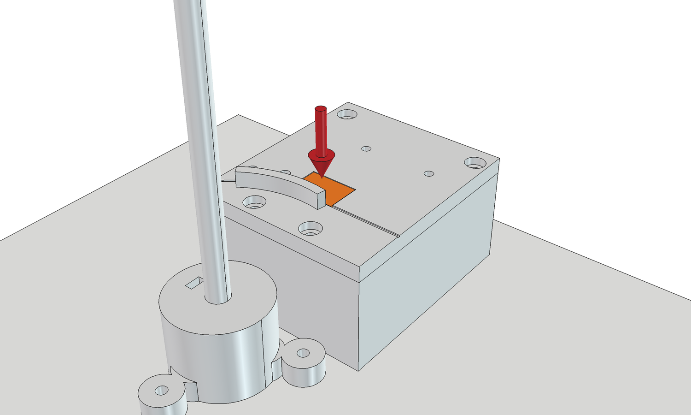{width=8.5cm}

**Usa:** 1 × chapita de galga de 0,5 mm, cortada a 18 × 12,7 mm.

1. Cortar la galga a 18 mm de largo y repasar los cantos con una lima, sin dejar rebabas.
2. Apoyarla en el rebaje de la placa, junto al labio curvo, con el lado de 18 mm de izquierda a derecha. El rebaje tiene 0,6 mm de profundidad.

> [!TIP]
> **Comprobar:** una regla apoyada de canto sobre la placa, cruzando la chapita, toca el plástico de los dos lados: la chapita queda 0,1 mm abajo del piso y no sobresale.

<!-- solo-pdf
\needspace{9cm}
-->

#### Paso 9. Labio exterior

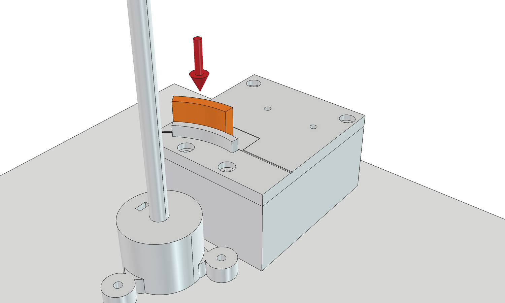{width=8.5cm}

**Usa:** labio exterior (n.° 15); 2 × tornillo para madera de 3,5 × 16.

1. Apoyar el labio sobre la placa, con su pie encima de la chapita y los agujeros alineados con los que se hicieron en el taco.
2. Atornillar los 2 tornillos, sin pasarse: el pie tiene 3 mm.

> [!TIP]
> **Comprobar:** un recorte de pared de botella (sirve un pedazo de la base que se corta) entra entre los dos labios sin trabarse y sin quedar flojo: la ranura mide 0,85 mm. La chapita no se puede sacar.

<!-- solo-pdf
\needspace{9cm}
-->

#### Paso 10. Calce

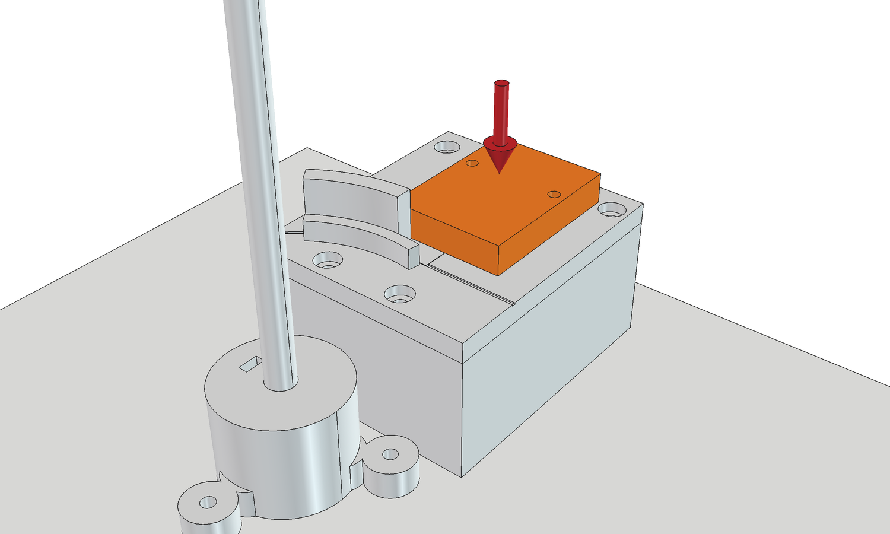{width=8.5cm}

**Usa:** calce de 9 mm (n.° 02).

1. Medir el calce con calibre: tiene que dar 8,9 mm. Anotar el valor real.
2. Apoyarlo sobre la placa, con sus dos agujeros sobre los de las tuercas.

> [!TIP]
> **Comprobar:** el calce mide 8,9 mm con calibre. Por sus agujeros se ven las tuercas de la placa.

<!-- solo-pdf
\needspace{9cm}
-->

### Etapa 3: Ojal

#### Paso 11. Ojal

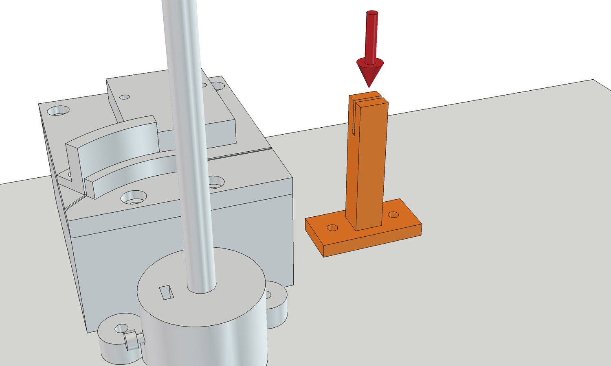{width=8.5cm}

**Usa:** ojal (n.° 08); 2 × tornillo para madera de 3,5 × 16.

1. Apoyar el ojal sobre sus agujeros guía, con la ranura de izquierda a derecha, en línea con la pared de la botella.
2. Atornillar los 2 tornillos.

> [!TIP]
> **Comprobar:** mirando desde el ojal hacia la placa, la ranura apunta al hueco entre los dos labios. Una tira de botella pasa por la ranura de 1,5 mm sin engancharse.

<!-- solo-pdf
\needspace{9cm}
-->

### Etapa 4: Carrete y manivela

#### Paso 12. Rodamientos en la torre

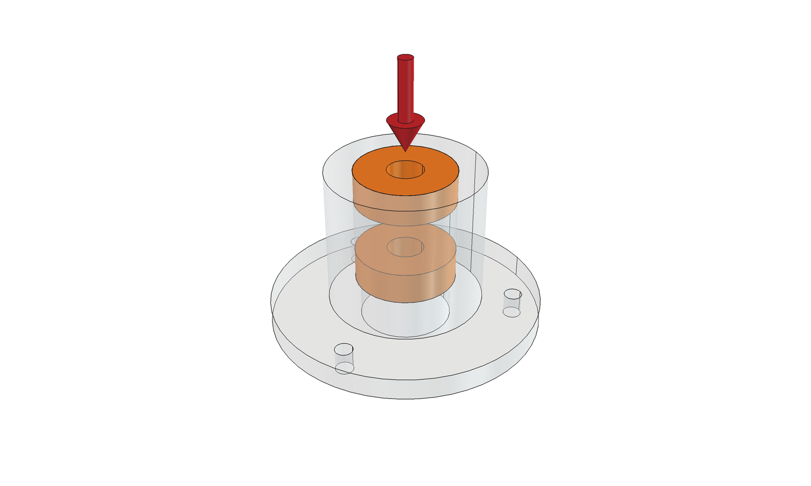{width=8.5cm}

**Usa:** torre del carrete (n.° 09); 2 × rodamiento 608ZZ; el caño de PVC de 20 mm.

1. Se arma en la mano, fuera de la base.
2. Meter el primer rodamiento por arriba de la torre y llevarlo hasta el escalón del fondo, empujando con el caño de PVC apoyado en el aro de afuera, como se explica en «Cuidados con el plástico».
3. Meter el segundo hasta que quede al ras de la cara de arriba, empujando con un taco de madera plano.

> [!TIP]
> **Comprobar:** el de arriba queda al ras. Entre los dos quedan 12 mm. Cada uno gira libre al empujarlo con un dedo.

<!-- solo-pdf
\needspace{9cm}
-->

#### Paso 13. Eje del carrete

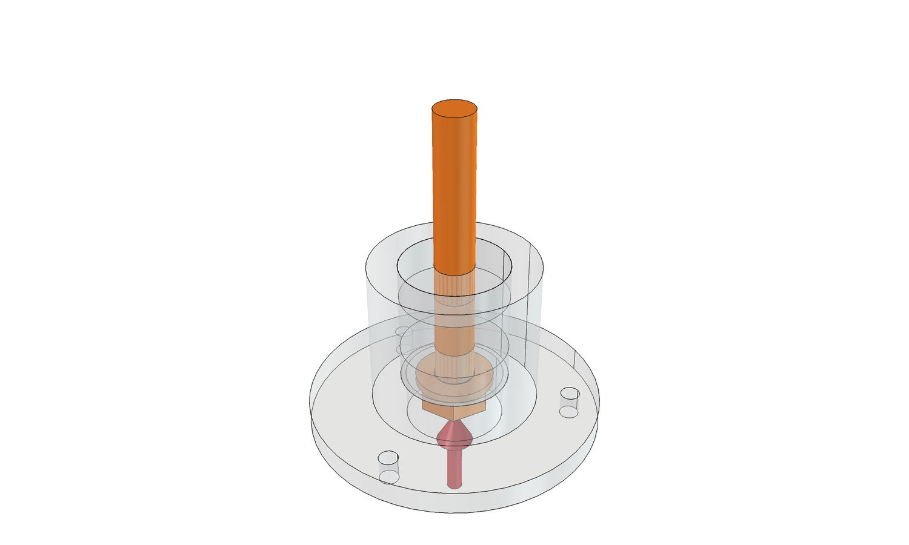{width=8.5cm}

**Usa:** 1 × tornillo M8 × 60; 1 × arandela M8.

1. Poner la arandela en el tornillo y meterlo desde abajo de la torre, por los dos rodamientos. La cabeza queda dentro del hueco de abajo.

> [!TIP]
> **Comprobar:** el tornillo asoma 32,4 mm arriba de la torre y gira libre con los dedos.

<!-- solo-pdf
\needspace{9cm}
-->

#### Paso 14. Torre sobre la base

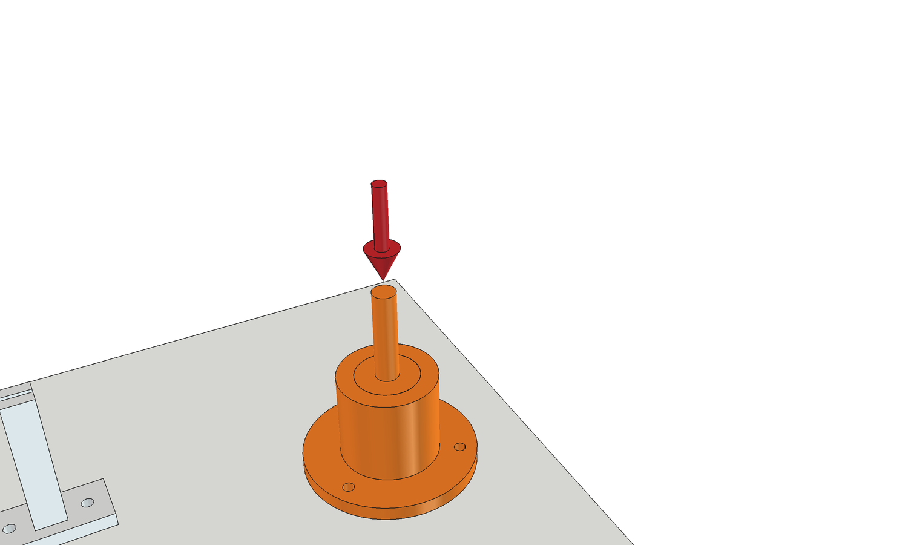{width=8.5cm}

**Usa:** la torre con los rodamientos y el tornillo; 3 × tornillo para madera de 3,5 × 16.

1. Apoyar la torre sobre sus agujeros guía, sin que se caiga el tornillo, y atornillar la brida con los 3 tornillos.

> [!TIP]
> **Comprobar:** el tornillo sigue girando libre: la cabeza queda 3,1 mm arriba de la base, sin rozarla.

<!-- solo-pdf
\needspace{9cm}
-->

#### Paso 15. Arandela de arriba

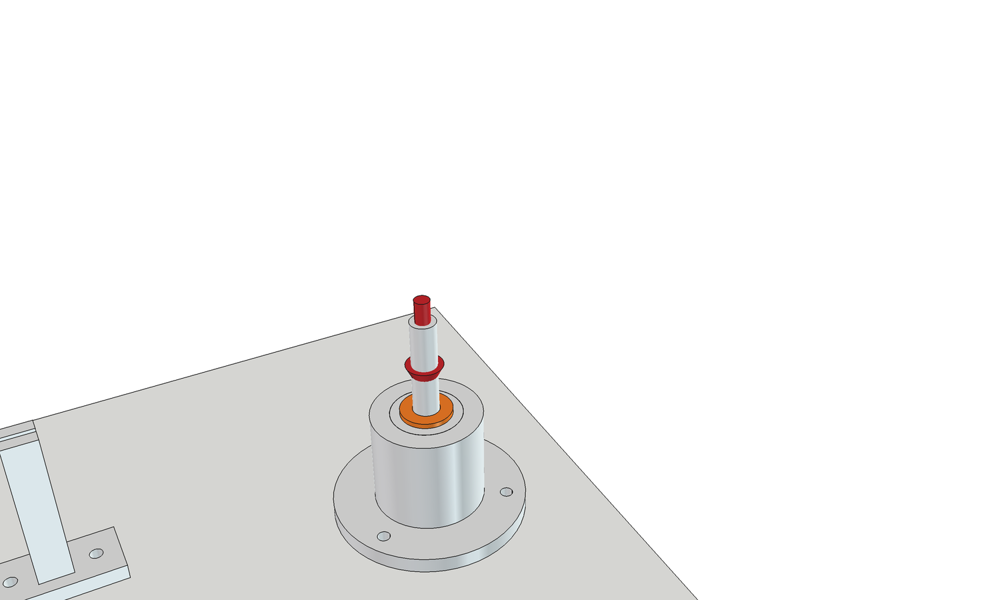{width=8.5cm}

**Usa:** 1 × arandela M8.

1. Pasar la arandela por el tornillo hasta que apoye en el rodamiento de arriba.

> [!TIP]
> **Comprobar:** la arandela apoya en el aro de adentro del rodamiento, no en la torre.

<!-- solo-pdf
\needspace{9cm}
-->

#### Paso 16. Carrete, disco inferior

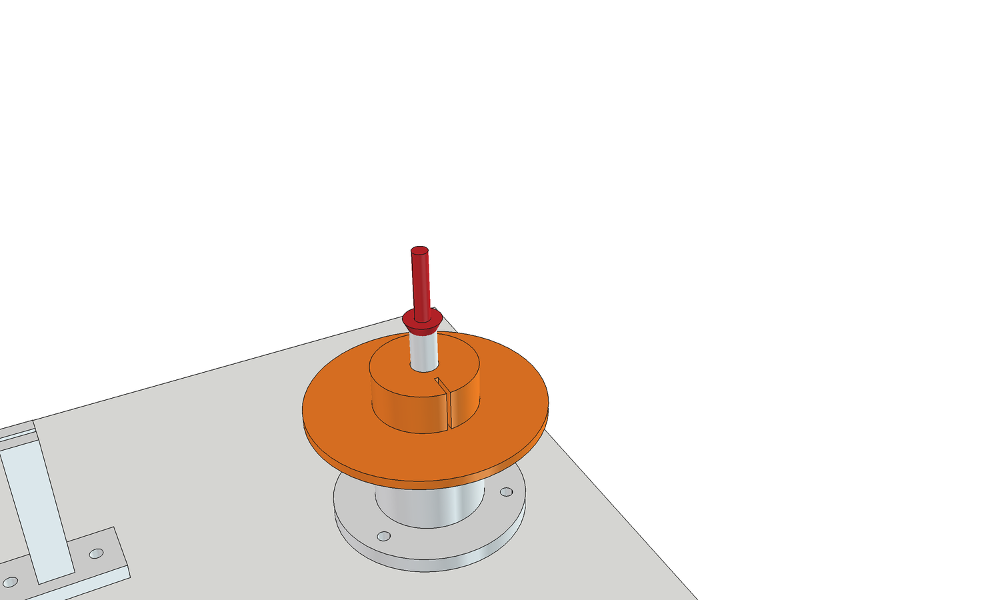{width=8.5cm}

**Usa:** carrete, disco inferior (n.° 10); 1 × tuerca M8.

1. Meter la tuerca M8 en el hexágono de la cara de abajo del disco (la que apoyó en la cama).
2. Sostener la punta del tornillo con los dedos y enroscar el disco hasta que apoye en la arandela.

> [!TIP]
> **Comprobar:** el disco no toca la torre: entre los dos pasa una hoja de papel. La ranura del núcleo queda limpia, sin hilos de plástico.

<!-- solo-pdf
\needspace{9cm}
-->

#### Paso 17. Carrete, disco superior

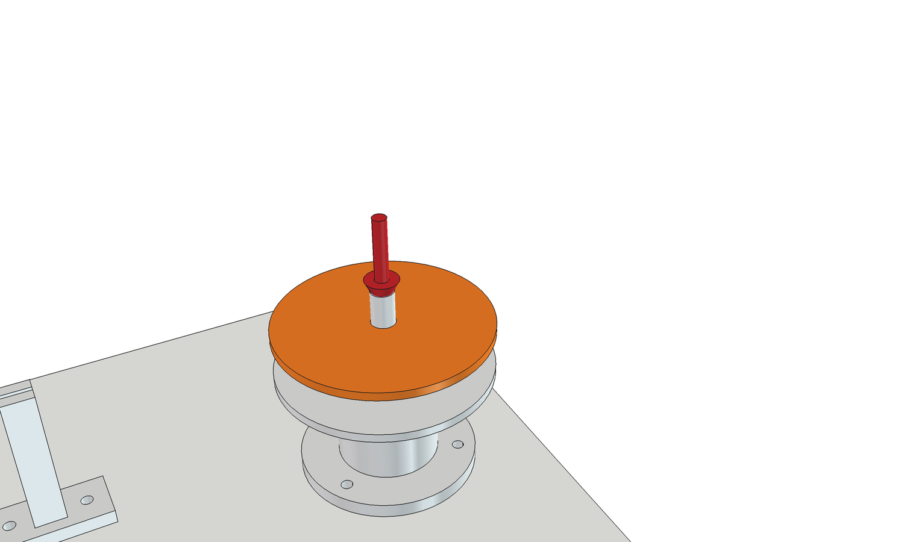{width=8.5cm}

**Usa:** carrete, disco superior (n.° 11).

1. Pasarlo por el tornillo hasta que apoye en el núcleo.

> [!TIP]
> **Comprobar:** apoya plano. Entre los dos discos quedan 13 mm, lugar para la tira más ancha.

<!-- solo-pdf
\needspace{9cm}
-->

#### Paso 18. Manivela

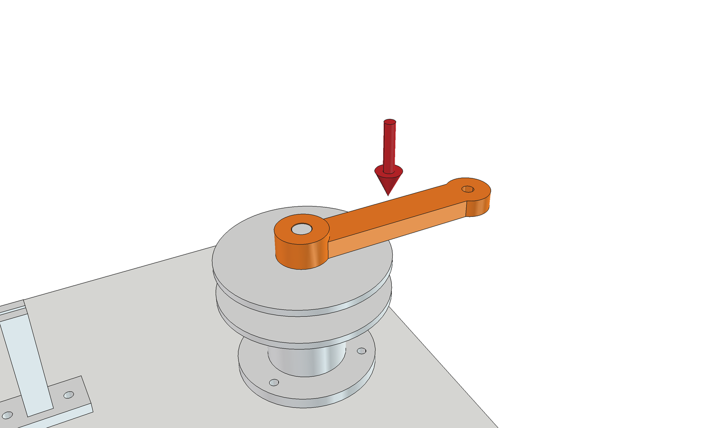{width=8.5cm}

**Usa:** manivela (n.° 12); 1 × tuerca M8.

1. Meter la tuerca M8 en el hexágono de la cara de abajo de la manivela.
2. Enroscarla en el tornillo hasta que apoye en el disco superior.
3. Sostener el carrete con una mano y apretar la manivela girándola en sentido horario, visto desde arriba: firme con la mano, sin herramientas.

> [!TIP]
> **Comprobar:** la manivela y el carrete giran juntos, suaves, sin juego hacia arriba ni hacia abajo.

<!-- solo-pdf
\needspace{9cm}
-->

#### Paso 19. Mango

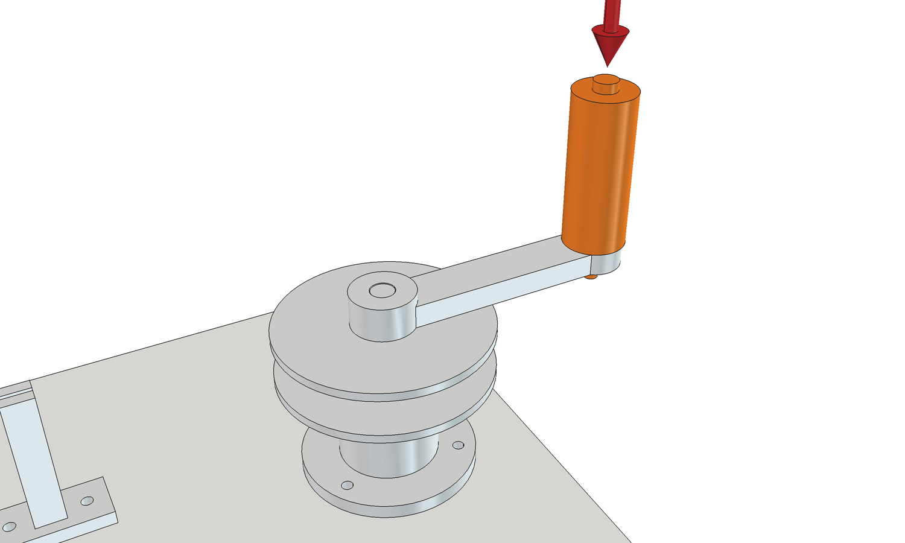{width=8.5cm}

**Usa:** mango (n.° 13); 1 × tornillo M5 × 70.

1. Pasar el tornillo por el mango y por el agujero de la punta de la manivela, desde arriba.

> [!TIP]
> **Comprobar:** la cabeza del tornillo apoya en el mango y la rosca asoma por debajo de la manivela.

<!-- solo-pdf
\needspace{9cm}
-->

#### Paso 20. Tuerca del mango

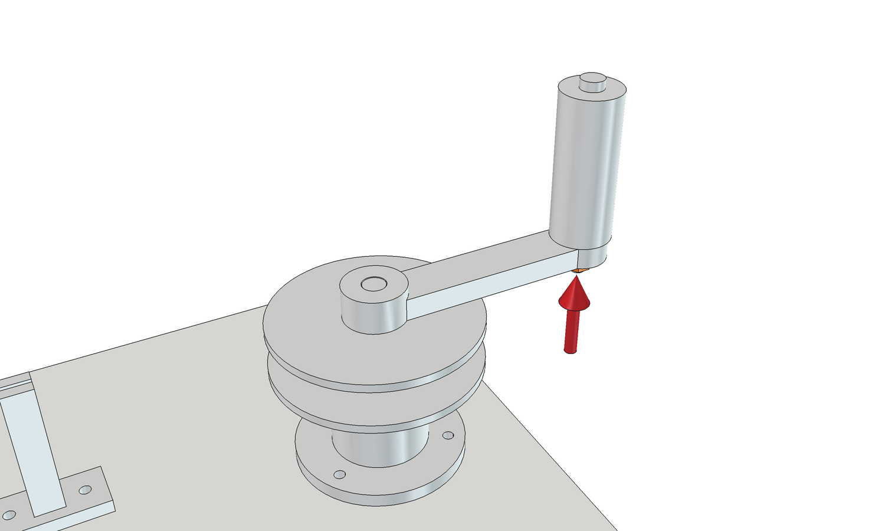{width=8.5cm}

**Usa:** 1 × tuerca autoblocante M5.

1. Enroscar la tuerca por debajo de la manivela hasta que el mango no tenga juego hacia arriba ni hacia abajo, pero siga girando libre: entre el mango y la manivela quedan 0,5 mm. La tuerca autoblocante no se afloja sola.

> [!TIP]
> **Comprobar:** girar la manivela una vuelta completa en sentido horario visto desde arriba: no toca nada. El mango gira libre en la mano y pasa a 46,4 mm del lugar de la botella.

<!-- solo-pdf
\needspace{9cm}
-->

### Etapa 5: Botella

#### Paso 21. Botella

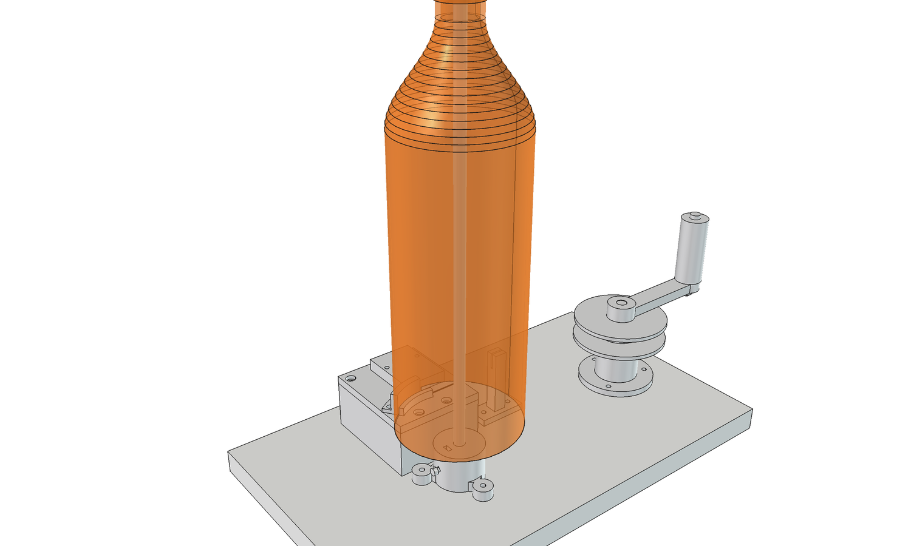{width=8.5cm}

**Usa:** una botella preparada, con su tapa perforada (ver «Primer uso», 1).

1. Pasar la varilla por el agujero de la tapa y bajar la botella hasta que el borde cortado apoye en la chapita, con la pared entre los dos labios.
2. Girar la botella con la mano hasta que el comienzo de la lengüeta quede donde termina el labio de afuera, junto al calce, con la lengüeta saliendo hacia la derecha, hacia el ojal.

> [!TIP]
> **Comprobar:** la botella gira con la mano sin trabarse y su borde apoya en la chapita, no en el plástico.

<!-- solo-pdf
\needspace{9cm}
-->

### Etapa 6: Cuchilla

#### Paso 22. Hoja

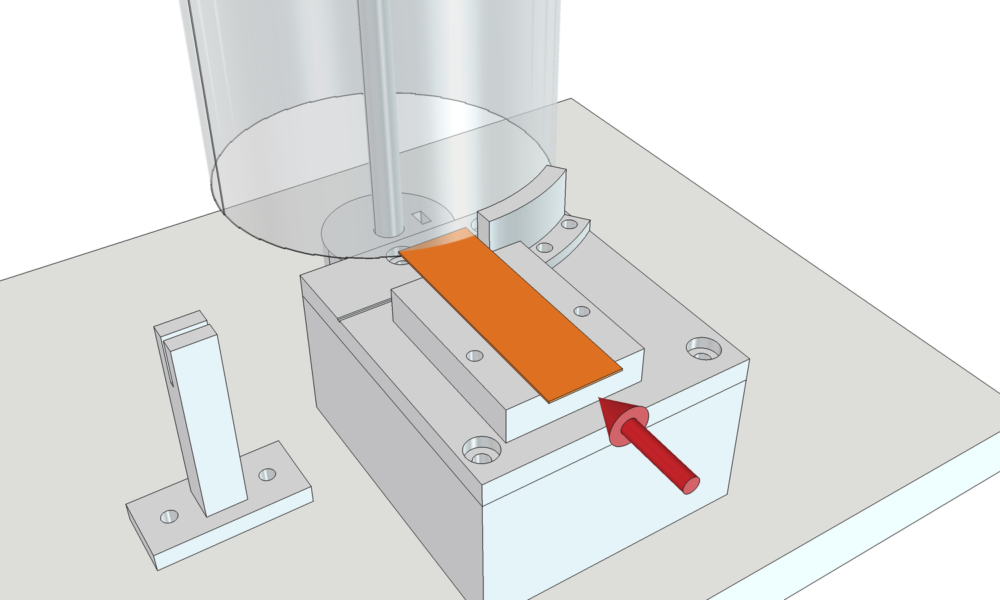{width=8.5cm}

**Usa:** 1 × hoja de trincheta de 18 mm, de unos 60 mm de largo; guantes.

1. Con guantes. Deslizar la hoja desde atrás, apoyada plana sobre el calce, con el filo mirando a la izquierda: la pared de la botella llega desde ese lado.
2. La punta entra en el comienzo del corte de la lengüeta, 4 mm hacia adentro de la pared.

> [!TIP]
> **Comprobar:** la lengüeta queda debajo de la hoja y la botella, arriba. Atrás, la hoja sobresale unos 3 mm del calce.

<!-- solo-pdf
\needspace{9cm}
-->

#### Paso 23. Pisador

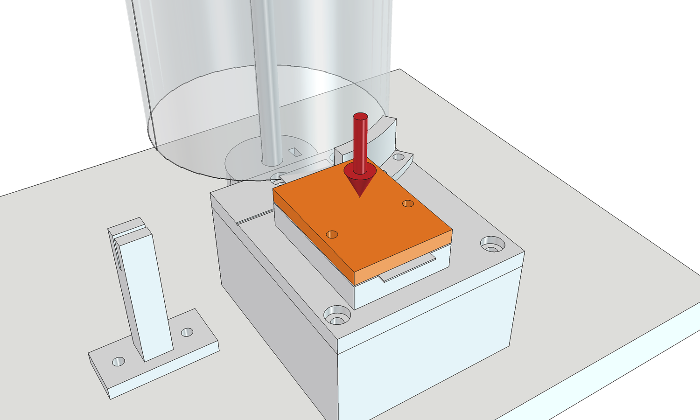{width=8.5cm}

**Usa:** pisador de la hoja (n.° 06).

1. Apoyarlo sobre la hoja, con los agujeros sobre los del calce.

> [!TIP]
> **Comprobar:** el pisador y el calce coinciden en sus cuatro cantos.

<!-- solo-pdf
\needspace{9cm}
-->

#### Paso 24. Tornillos de la hoja

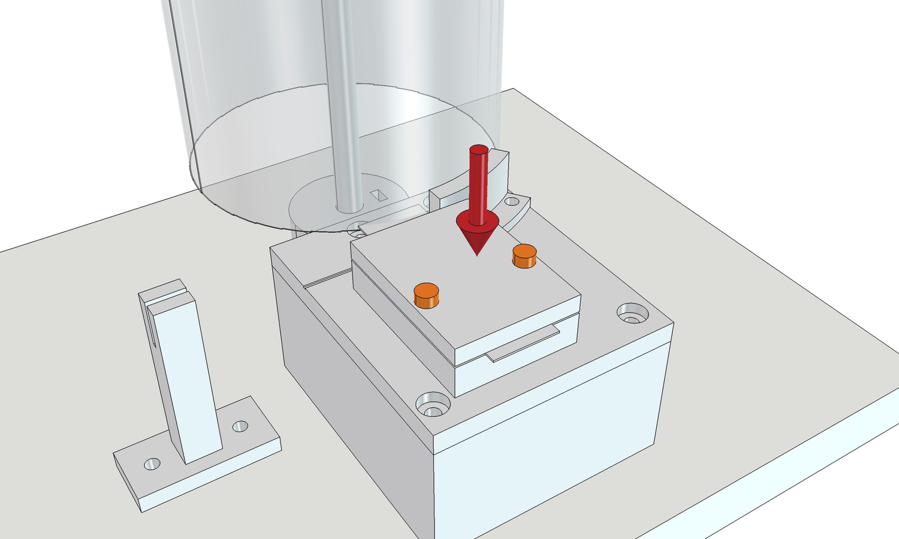{width=8.5cm}

**Usa:** 2 × tornillo M3 × 25.

1. Pasar los tornillos por el pisador y el calce, a los costados de la hoja, y enroscarlos en las tuercas de la placa.
2. Apretar de a poco, alternando entre los dos, hasta que la hoja no se mueva. Firme, pero sin forzar: la punta entra 4,6 mm en el taco.

> [!TIP]
> **Comprobar:** empujar la hoja con la punta de un destornillador, con guantes: no se mueve. El pisador apoya parejo, sin luz de un lado.

<!-- solo-pdf
\needspace{9cm}
-->

### Etapa 7: Lastre y sujeción a la mesa

#### Paso 25. Vaso de lastre (solo si hace falta)

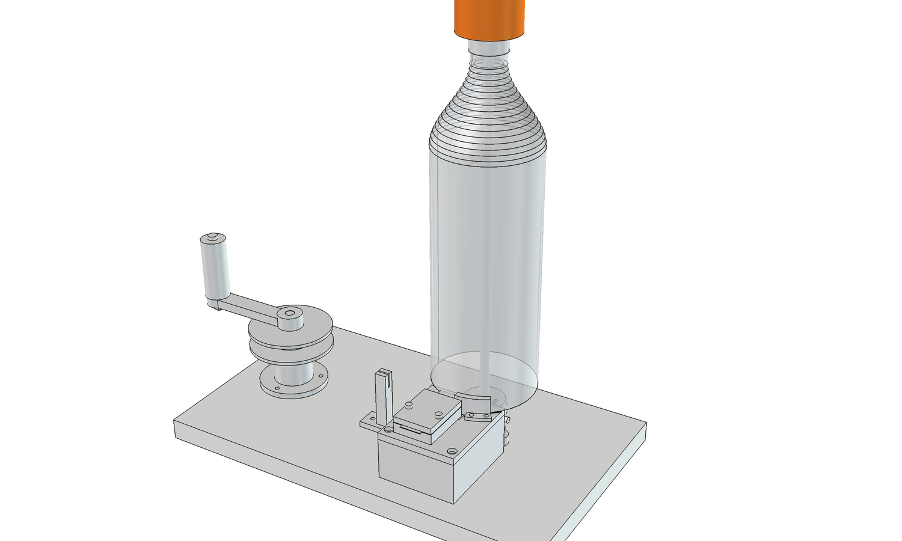{width=8.5cm}

**Usa:** vaso de lastre (n.° 14); unos 100 g de tuercas o tornillos sueltos.

1. Se pone solo si la botella no baja sola al cortar (ver «Primer uso», 4).
2. Pasar el vaso por la varilla hasta que apoye en la tapa y cargarlo con unos 100 g: con el vaso, son unos 115 g sobre la botella.

> [!TIP]
> **Comprobar:** el vaso baja por la varilla sin trabarse y queda apoyado en la tapa.

<!-- solo-pdf
\needspace{9cm}
-->

#### Paso 26. Sargento a la mesa

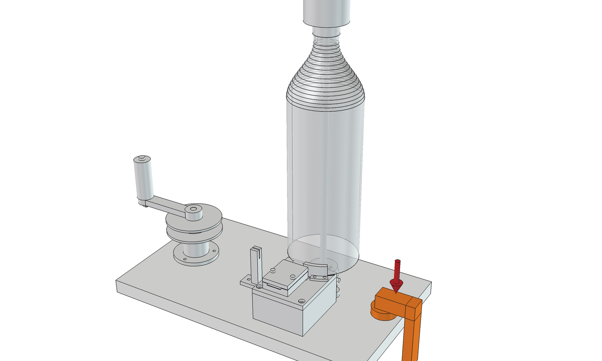{width=8.5cm}

**Usa:** 1 × sargento.

1. Poner la base con el extremo izquierdo al borde de la mesa y apretar el sargento sobre el círculo marcado, con el arco por fuera de la base.

> [!TIP]
> **Comprobar:** empujar la base hacia cualquier lado: no se mueve. La manivela gira sin tocar la mesa.

## 4. Primer uso

### 1. Preparar la botella

Botella de 1,5 L lisa, limpia y seca, con su tapa. Con guantes:

1. **Cortar la base** con la trincheta, donde empieza la parte lisa. El borde tiene que quedar parejo: es lo que apoya en la chapita.
2. **Arrancar la tira:** con tijera, cortar desde el borde una lengüeta de 9 mm de ancho y unos 25 cm de largo, en espiral, siguiendo el borde con una línea apenas inclinada. Es lo que llega hasta el carrete.
3. **Perforar la tapa** en el centro, con mecha de 9 mm, apoyada sobre un taco. La varilla pasa con 1 mm de juego.

### 2. Montarla

1. Si la hoja está puesta, aflojar sus dos tornillos y sacar el pisador y la hoja.
2. Montar la botella y la hoja como en los pasos 21 a 24.
3. Pasar la lengüeta por la ranura del ojal, desde arriba.
4. Meter la punta de la lengüeta en la ranura del núcleo del carrete, entre los dos discos: entra 8 mm. Girar la manivela una vuelta, despacio, para que la tira se enrolle sobre su punta y quede tomada.

### 3. Cortar

Girar la manivela **en sentido horario, visto desde arriba**, a ritmo parejo. Una botella son unas 42 vueltas de manivela y unos 5,5 m de tira. La botella gira y baja sola, 9 mm por vuelta.

### 4. Si algo no anda

- **Se traba o cuesta mucho:** parar, no forzar. Girar un poco hacia atrás para aflojar la tira y revisar: que la tira siga en el ojal, que el borde de la botella siga apoyado en la chapita y que la botella no tenga restos de etiqueta o de pegamento. Si la hoja no corta parejo, cambiar el segmento (ver «Mantenimiento»).
- **La botella no baja:** el corte sube por la pared y la tira sale más angosta. Poner el vaso de lastre (paso 25) con unos 100 g de tuercas. Si sigue sin bajar, avisar al grupo.
- **La tira sale de otro ancho:** medirla con calibre en varios puntos; tiene que dar 9 ± 0,5 mm. Si no, revisar el calce y la chapita.

### 5. Al terminar

1. Aflojar los tornillos de la hoja, sacar el pisador y la hoja, y levantar lo que quedó de la botella.
2. Para sacar el rollo: aflojar la manivela girándola en sentido antihorario mientras se sostiene el carrete, sacarla junto con el disco superior y deslizar el rollo hacia arriba.

## 5. Mantenimiento

### Cambiar la hoja

Con guantes. Aflojar los dos tornillos, sacar el pisador y deslizar la hoja hacia atrás. Partir el segmento gastado con una pinza, en la marca, o poner una hoja nueva. Volver a montarla como en los pasos 22 a 24.

### Cambiar el calce para otro ancho

El ancho de la tira depende del espesor de la pared de la botella. Para medirla, doblar un pedazo en cuatro, medir las cuatro capas juntas con calibre y dividir por cuatro.

| Espesor de pared | Ancho de tira | Calce | El calce mide |
|----------------|-------------|-----|-------------|
| 0,20 mm | 10 mm | calce de 10 mm (n.° 05) | 9,9 mm |
| 0,25 mm | 9 mm | calce de 9 mm (n.° 02) | 8,9 mm |
| 0,30 mm | 8 mm | calce de 8 mm (n.° 04) | 7,9 mm |
| 0,35 mm | 7 mm | calce de 7 mm (n.° 03) | 6,9 mm |

Sacar los tornillos de la hoja, el pisador y la hoja, cambiar el calce y volver a montar todo como en los pasos 22 a 24. Medir los primeros centímetros de tira.

### Revisar la chapita

El borde de la botella apoya y roza sobre la chapita. De vez en cuando, y siempre que la tira salga despareja, sacar el calce y el labio exterior y mirarla: si tiene un surco que se siente con la uña, darla vuelta o cortar una nueva de 18 × 12,7 mm.
