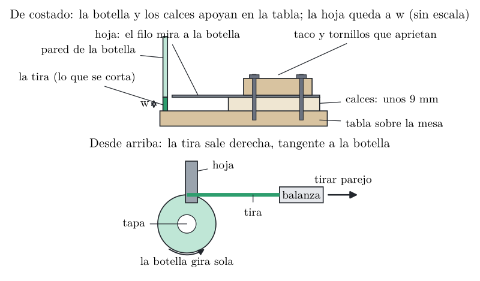

# Prueba 1: medir el tiro

<!-- solo-md -->

**Cortadora PET 2.0 - Grupo 1, S1091.** Hoja para imprimir y usar en la mesa de trabajo. Se genera con
`make` desde `generar_prueba1.py`: no editar a mano.

<!-- /solo-md -->

**Para qué sirve:** saber cuánta fuerza hace falta para tirar de la tira de plástico mientras una cuchilla
fija corta la botella. Con ese número se confirma el carrete y la manivela de la máquina. No hace falta
imprimir nada: alcanza con una tabla, una trincheta y una balanza de equipaje. Lleva media hora y dos personas.

> [!CAUTION]
> **Seguridad:** guantes todo el tiempo. La hoja siempre bien apretada. Nadie pone la mano delante del filo.
> Al terminar, sacar la hoja y guardarla.

## Materiales

- ☐ Una botella de 1,5 L lisa, limpia y seca, **con su tapa**.
- ☐ Una trincheta con hoja nueva de 18 mm.
- ☐ Una tabla de madera de unos 30 × 15 cm y un taco chico de unos 3 cm de alto.
- ☐ Calces para levantar la hoja unos 9 mm: arandelas, palitos de helado o cartón apilados.
- ☐ Dos tornillos con arandela, o una prensa chica (sargento), para apretar la hoja.
- ☐ Una balanza de equipaje con gancho; mejor si marca el máximo.
- ☐ Regla o calibre, tijera, marcador, un lápiz y guantes.

## Armado

1. **Cortar la base de la botella** con la trincheta, donde empieza la parte lisa. Despacio y con guantes:
   el borde tiene que quedar lo más parejo posible.
2. **Armar la cuchilla.** Sobre la tabla, cerca de un borde, apilar los calces hasta unos 9 mm. Apoyar la
   hoja encima, con el filo hacia la parte libre de la tabla, sobresaliendo unos 2 cm de los calces. Apretarla
   con el taco y los tornillos, o con la prensa. **La hoja no se tiene que mover.**
3. **Medir la altura real** desde la tabla hasta el filo: ese es el ancho de la tira, `w`. Anotarlo.
4. **Arrancar la tira.** Con la tijera, cortar en la botella una lengüeta de ese mismo ancho y unos 10 cm
   de largo, desde el borde hacia arriba, con una línea apenas inclinada.
5. **Atar la punta** de la tira a un lápiz y colgar del lápiz el gancho de la balanza.

<!-- salto-pagina -->

## Medición

1. Parar la botella con el pico arriba y el borde cortado apoyado **sobre la tabla**, al lado del filo.
   Meterla de modo que **la hoja entre en el corte**: la pared pasa entre la tabla y la hoja.
2. Quien ayuda apoya **una mano suave sobre la tapa**, solo para que la botella no se caiga y pueda girar.
3. **Tirar de la balanza despacio y parejo**, en línea recta, a la altura de la tabla y tangente a la botella:
   la tira sale derecha, sin subir ni bajar. La botella gira sola.
4. Mirar la balanza mientras se tira. **Tiro medio:** el valor que más se repite con el corte andando parejo.
   **Tiro máximo:** el pico más alto, por ejemplo al arrancar o si se traba.
5. Cortar unos 50 cm, frenar y anotar. **Repetir tres veces** en la misma botella.
6. Al final, medir el **ancho de la tira** en cinco puntos y el **espesor de pared** en un pedazo. Si el
   calibre no llega a medir tan fino: doblar un pedazo de tira en cuatro, medir las cuatro capas juntas y
   dividir por cuatro.

## Qué anotar

| Dato | Medición 1 | Medición 2 | Medición 3 |
|------------|-------|-------|-------|
| Marca y tipo de botella |  |  |  |
| Diámetro de la botella (mm) |  |  |  |
| Espesor de pared (mm) |  |  |  |
| Altura del filo, `w` (mm) |  |  |  |
| Ancho de la tira en 5 puntos (mm) |  |  |  |
| Tiro medio (kg) |  |  |  |
| Tiro máximo (kg) |  |  |  |
| ¿La botella bajó sola, o hubo que empujarla? |  |  |  |
| Observaciones: se trabó, se rompió la tira, se movió la hoja… |  |  |  |

**Para pasar a newtons:** la balanza marca kilos; multiplicar por 9,8. Por ejemplo, 3 kg son unos 29 N.

## Cómo se usa el resultado

Se mira el **tiro medio**:

- **Hasta 6 kg:** la máquina va con el carrete movido directo por la manivela, con brazo de 80 mm.
- **Entre 6 y 9 kg:** hace falta un brazo de manivela más largo, de 120 mm.
- **Más de 9 kg:** antes de cambiar la máquina, revisar el filo y el ángulo de la hoja, y repetir la prueba.

La fila "¿bajó sola?" adelanta la prueba siguiente: si la botella bajó sola con la mano apoyada encima, la
idea de que avance sola va bien encaminada.
